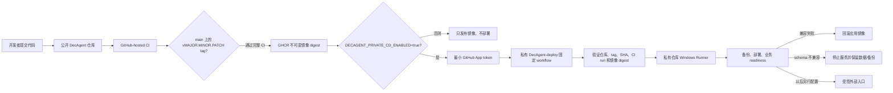

# DecAgent 仓库、CI/CD 与本机交付

本目录把代码仓库、CI、CD 和本机部署分开说明，便于从零理解各部分的职责。文档状态按 **2026-10-23** 仓库记录核对；出现差异时以当前 workflow、OpenSpec tasks 和对应证据文件为准。

## 文档导航

- [代码仓库与版本流转](repository/README.md)：公共应用仓库和私有部署仓库各自保存什么，如何判断一次代码变更是否已进入受控发布。
- [GitHub Actions CI](ci/README.md)：PR/Push 检查、并行测试分片、构建验证、测试覆盖边界及耗时证据。
- [GHCR 与私有 CD](cd/README.md)：版本 tag 如何经过 CI、发布镜像、校验来源并触发私有部署 workflow；当前缺少哪些配置。
- [Windows 本机 SOP Compose](deployment/README.md)：服务拓扑、配置与密钥位置、预检、备份/回滚边界和本机试运行限制。
- [项目开发技能索引](../.agents/skills/README.md)：已固定到项目内的官方工程参考、社区工作流参考及各自边界。

## 当前核实状态

| 环节 | 状态 | 证据边界 |
| --- | --- | --- |
| 公共代码仓库 | `shuaibilx/DecAgent`，公开 | 是应用源码、公共 CI 和版本镜像的来源。 |
| 公共 CI | 已建立分层并行流水线；固定 SHA `9743e1a…` 的 run `39951724425` 为 12/12 通过 | 不代表本地未提交工作区已通过同 SHA CI，也不代表公开基准、私有 CD 或 Docker 升级回滚已验收。 |
| GHCR 发布 | `release.yml` 配置为语义版本 tag 触发完整 CI 后发布镜像 | 当前记录没有创建本轮 release tag。配置存在不等于已发布新版本。 |
| 私有部署仓库 | `shuaibilx/DecAgent-deploy`，私有；部署验证器和 workflow 已同步 | Runner 数量为 0；GitHub App 凭证已配置，单仓库安装等待确认。 |
| 本机 SOP 服务 | `ops/deploy/sop.env` 与三份 ACL 受限本机 secret 已准备；Docker Linux engine / Compose 可用，静态预检和一次性隔离容器 smoke 均通过 | 隔离 smoke 已清理；持久 SOP 部署、真实首装/升级/回滚和私有 CD 仍未完成。当前旧 `decagent-api` v0.1.4 容器占用 `127.0.0.1:8000`。 |
| 外部访问 | 未开通 | 目前 API 绑定 `127.0.0.1`；没有已核实的域名或 Cloudflare Tunnel 配置，不应把服务视为公网可用。 |

## 发布和信任边界

公共 `main` 已移除本机 Runner 调度；开发分支中的私有 dispatch 仍被变量和最小权限 App 门控。私有 workflow 只 checkout 私有部署代码；公开 release 只能传入固定字段，并将验证器输出的不可变 control 镜像 digest 交给 rollout。公网入口和独立 Linux 部署都仍是后续工作。

## OpenSpec 状态

当前交付任务以 [游客与本机交付 change](../openspec/changes/guest-sop-local-trial/tasks.md) 和 [条件工作流 change](../openspec/changes/jev-conditional-workflows/tasks.md) 中的勾选和证据链接为准。公开评测 v10 首波结果在 [实测报告](../evals/benchmarks/evidence/public-first-wave-live-20261023-v10-9d61688.md)：3 条 failed、5 条 unknown、0 条成功；unknown 不重放，且该批不能证明 Jev 收益。
