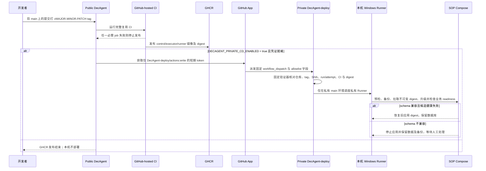

# GHCR 与私有 CD

目标 CD 路径是通过 CI 固定版本向本机 SOP 服务发布。公共 `main` 当前只做 tag-only GHCR 发布，没有调度本机的步骤；仅开发分支保留受 GitHub App 与变量门控的私有 dispatch 实现。**真实端到端 CD 仍未验收**：GitHub App `5443230` 和两项凭证已准备，但 App 尚未安装到私有仓库，Runner 未注册。本机配置预检通过，一次性容器 smoke 通过后已清理；生产 SOP 服务尚未部署，CD 开关仍关闭。

## 版本发布路径

## 公开与私有仓库的设置边界

| 位置 | 需要的设置 | 当前状态 |
| --- | --- | --- |
| Public `DecAgent` | 开发分支的私有 dispatch 需要 `DECAGENT_PRIVATE_CD_ENABLED=true`、`DECAGENT_DEPLOY_APP_CLIENT_ID` variable、`DECAGENT_DEPLOY_APP_PRIVATE_KEY` secret | Client ID variable 与私钥 secret 已配置；`DECAGENT_PRIVATE_CD_ENABLED` 仍未设置，`main` 没有 dispatch job。不得把 App 私钥放进日志或源码。 |
| GitHub App | 仅安装到 `DecAgent-deploy`，提供 Actions workflow dispatch 所需的最小权限 | App 仅有 Actions 写权限（另含必需 Metadata 只读），webhook 关闭。安装页只选中私有 `DecAgent-deploy`，最终提交等待用户确认。 |
| Private `DecAgent-deploy` | 固定 `main` workflow、`decagent-local-production` 环境、Windows runner label `decagent-deploy` | workflow/package 已同步；Runner 数量 0。 |
| Local Windows host | `DECAGENT_LOCAL_PROJECT_DIR`、Python 3.11+ venv、`ops/deploy/sop.env`、三份文件密钥和运行中的 Linux Docker Desktop | env/secret 已准备、预检及一次性空密钥容器 smoke 通过；临时资源已清理，Runner 和生产 SOP 服务尚未安装。旧版 `decagent-api` 仍运行在 `127.0.0.1:8000`。 |

GHCR control 镜像当前为公开包，可匿名 pull。`DecAgent` 在 Manage Actions access 中显示 Admin，说明该仓库有该 package 的管理权限；它不等于向私有部署仓库派发 workflow 的 App 权限。当前公开的旧版 control image 不是本 change 的 SOP 构建，不能据此启动生产 rollout，也不需要额外授予 package Read。来源与权限检查的实测细节见[私有部署边界证据](../../evals/integration/evidence/private-deployment-boundary-20261023.md)。

私有 workflow 固定 checkout 私有仓库 `main`，先运行 `release_verifier.py`，再把验证器产生的镜像 digest 传给固定 rollout coordinator。它不 checkout 或执行公开 release 指定的源码，不接收脚本、shell 命令、工作目录或任意镜像输入。并发部署使用不取消的单一锁。

## 尚未完成的门槛

1. 完成 GitHub App 的单仓库安装确认；Client ID variable 和 private-key secret 已配置，仍保持 dispatch 开关关闭。
2. App 安装到 private repo 后，按 private repo 限制注册 Runner；本机 env/secrets 已准备，安装脚本只允许 `DecAgent-deploy`。
3. 先完成任务 4.4 的 Docker 首装、失败恢复、兼容升级、健康失败回滚与 schema 不兼容停服演练。
4. 再执行可信 GHCR 发布到本机的 5.4 全链路演练，记录 release SHA/run、镜像 digest、readiness、备份和恢复结果。

截至 2026-10-23，两个仓库各有 0 个 self-hosted runner；没有创建新的 release tag、触发 CD 或部署持久 SOP image。GitHub App 安装仍待确认。隔离 smoke 不代表发布或部署验收。此计划不启用公网 URL、Cloudflare Tunnel 或独立 Linux 主机。
