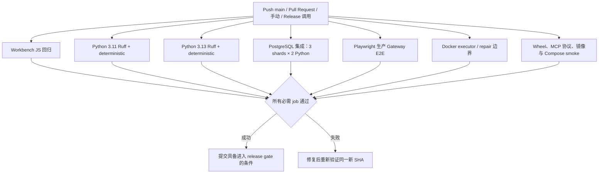

# GitHub Actions CI

CI 的职责是检查提交、运行测试并验证构建产物。它不运行公开基准真实模型试次，也不部署到 Windows 本机。

## 触发与结构

`.github/workflows/ci.yml` 在推送到 `main`、所有 Pull Request、手动 `workflow_dispatch` 及被 release workflow 调用时运行。同一 workflow/ref 的新运行会取消仍在执行的旧运行。所有 job 使用 GitHub-hosted Ubuntu runner，并以只读 `contents` 权限为默认值。



当前 pipeline 有 12 个 job：Workbench JavaScript 1 个、Python 3.11/3.13 检查 2 个、PostgreSQL 分片 6 个、Chromium 浏览器 E2E 1 个、Docker 边界 1 个、包和镜像构建 1 个。六个 PostgreSQL 分片并行运行，Playwright 浏览器使用 digest 固定的官方 Python 镜像；主 Python 兼容矩阵仍为 3.11 和 3.13。

Ruff 的 CI 命令明确检查 `decagent`、`evals`、`ops`。本地 `ruff check .` 也通过 `pyproject.toml` 排除 `.agents`，因为这里保存的是外部工程 skill 与其示例代码，不属于 DecAgent 产品源码；这不会降低上述 CI 路径的检查范围。

## 最后一次完整耗时证据

固定 SHA [`9743e1a6d303e41cd88175a97d3b386e7edfefd6`](https://github.com/shuaibilx/DecAgent/commit/9743e1a6d303e41cd88175a97d3b386e7edfefd6) 的 [run 39951724425](https://github.com/shuaibilx/DecAgent/actions/runs/39951724425) 为 12/12 job 通过，墙钟 8 分 19 秒、累计 Runner 时间 52 分 05 秒。相对旧 9-job run `39940453829`，墙钟减少 4 分 08 秒，累计 Runner 时间增加 26 秒；优化缩短了等待时间，没有证明 Runner 总资源费用下降。

详细 job 时间、性能基线、全部 skip 类别和三次浏览器镜像失败/修正过程见[CI 分层与浏览器 E2E 验收](../../evals/integration/evidence/ci-browser-sharding-20261023.md)。该报告注明 Windows 专属语义、固定 τ runtime、特定 Docker fixtures 等跳过条件；skip 不应被解释为通过。

候选 `9d61688c52ee66435a22e18c4fa1c8348a70095a` 的首波前同 SHA CI run `39784378797` 为 9/9 通过，属于当时的工作流版本。它与后来的 12-job 验收 run 是不同 SHA 和 workflow 状态，不能合并成“当前工作区全部已通过”。目前本地 CI workflow 有未提交修改，故最新工作区尚无同 SHA GitHub CI 结果。

## Windows 本机运行 PostgreSQL 集成测试

集成测试只有在 `DECAGENT_TEST_DATABASE_URL` 指向专用、可创建和删除测试数据库的 PostgreSQL 实例时才会运行。变量未设置时，pytest 会将对应测试标记为 skip；看到全绿但伴随大量 skip，不能当作数据库集成验收。

仓库脚本会启动或复用任务专用容器 `decagent-conditional-postgres`，绑定 `127.0.0.1:55433`，并将连接信息保存在被 Git 忽略的 `.decagent/conditional-tests/` 中。脚本不会删除已有容器或卷；测试为每个用例创建并清理独立数据库，共享测试卷会保留。不要把变量指向开发或生产数据库。

```powershell
& .\.venv\Scripts\python.exe ops\local\test_postgres.py
if ($LASTEXITCODE -ne 0) { throw "PostgreSQL test service failed" }

$env:DECAGENT_TEST_DATABASE_URL = (Get-Content -Raw '.decagent\conditional-tests\database-url').Trim()
try {
    & .\.venv\Scripts\python.exe -m pytest -q -rs evals\integration\test_business_guest_trial_budget.py
    if ($LASTEXITCODE -ne 0) { throw "Guest budget integration tests failed" }
}
finally {
    Remove-Item Env:DECAGENT_TEST_DATABASE_URL -ErrorAction SilentlyContinue
}
```

连接串只在当前 PowerShell 进程中使用；不要打印、提交或粘贴它。停止测试容器不会删除共享卷，但也不要删除该卷来“清理”本机测试。

## CI 不能证明什么

- CI 的合成浏览器流程为 0 付费模型调用；不能证明主模型或 Jev 决策质量。
- deterministic / integration / E2E 通过不等于 206 个 EnterpriseOps 案例或 80 个 τ-Bench test 案例完成。
- wheel、MCP 协议及 Compose smoke 不等于本机升级/回滚、私有 workflow dispatch 或 Runner 恢复实测。
- 全量执行里仍有有原因的 skip；分区证据应与报告一起看。

CI 优化遵循先缩短关键路径、保留必需覆盖的原则。当前最慢 job 是 Python 3.13 集成 shard 3/3（8 分 19 秒）；未经多次稳定测量，不建议继续增加并行 Runner 数量。
