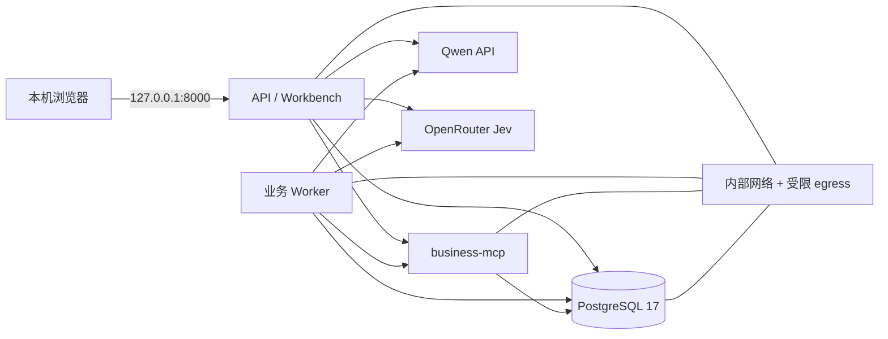

# Windows 本机 SOP Compose

本指南描述本机试运行的准备和运行边界，不表示持久化服务已完成真实部署。2026-10-24 的一次性 Docker smoke 在加入 Compose 健康等待后通过并清理；真实首装恢复、GHCR 升级/回滚和私有 CD 仍未验收。当前 Compose 将 API 只绑定到 loopback，适合本机访问；它没有为公网访问配置域名、TLS 入口或 Tunnel。详见[启动竞态修复与隔离 smoke 证据](../../evals/integration/evidence/local-sop-smoke-startup-race-20261024.md)。

## 服务拓扑



`compose.sop.yaml` 有 `postgres`、`migrate`、`bootstrap`、`business-mcp`、`api` 和 `worker` 服务。PostgreSQL、MCP 和数据网络不发布到宿主机；API 仅发布 `127.0.0.1:${DECAGENT_SOP_API_PORT:-8000}`。控制容器使用只读根文件系统、移除 Linux capabilities、限制 PID/内存，并将业务数据写入专用 Docker volumes。配置默认关闭游客试用：`DECAGENT_GUEST_TRIAL_ENABLED=false`。

## 首次准备

本机配置文件已在 2026-10-23 准备完成并通过 Compose 静态预检。2026-10-24 又用当前工作树重复运行一次性隔离 smoke：完整 SOP 容器栈启动、Worker 故障检测/恢复通过，资源自动清理；未保留生产 SOP 容器。证据见[本机 SOP 预检记录](../../evals/integration/evidence/local-sop-preflight-20261023.md)、[此前隔离 Docker smoke](../../evals/integration/evidence/local-sop-disposable-smoke-20261023.md)和[本次启动竞态修复证据](../../evals/integration/evidence/local-sop-smoke-startup-race-20261024.md)。以下说明区分已完成准备与后续部署：

1. 已核实 Docker Desktop Linux engine 可用（Compose v5.6.0）；实际部署前仍需确认 Docker 服务处于 healthy。
2. `ops/deploy/sop.env` 已从模板创建；非敏感配置中游客试用和 Qwen→DeepSeek 降级均保持关闭。
3. `.decagent/sop-secrets/` 中已创建 `postgres_password`、`main_api_key`、`jev_api_key`。两把模型密钥仅从本机忽略的 `.env` 复制到 secret 文件，数据库密码由随机数生成；ACL 限定为当前 Windows 用户。密钥值没有写入日志、文档或 Git。
4. 下方 `sop_preflight` 已实际运行并通过；它只渲染和检查 Compose 配置，不会创建容器，也不代表业务 readiness 已经通过。
5. 首次安装和升级应使用受信的不可变 `ghcr.io/shuaibilx/decagent-control@sha256:…` digest 经 rollout coordinator 管理。GitHub App 已创建并保存凭证，但仍未安装到私有部署仓库，Runner 尚未配置；本机 Docker 首装/升级回滚演练也未完成。不要把裸 `docker compose up` 当成生产发布流程。
6. 当前旧版 `decagent-api` 容器使用 `127.0.0.1:8000`。Compose 支持通过 `DECAGENT_SOP_API_PORT` 指定独立端口；切换现有端口或替换旧服务前，应先完成受信版本验收和数据恢复演练。一次性 smoke 使用随机端口，没有停止或修改旧服务。

## 配置预检

以下命令在 2026-10-23 **已执行并通过**。它使用本机配置运行 `docker compose config` 和静态边界校验；该命令不启动容器。`--env-file` 指向本机 `sop.env`，不要在真实部署时使用带示例默认值的模板。

```powershell
$Python = 'D:\Anaconda3\envs\Agent311\python.exe'
& $Python -m ops.deploy.sop_preflight `
  --project-directory (Get-Location).Path `
  --compose-file compose.sop.yaml `
  --env-file ops/deploy/sop.env
```

`sop_preflight` 调用 Docker Compose 渲染配置并检查 SOP 网络隔离、digest 固定的 PostgreSQL、API loopback 绑定、API readiness、Worker readiness 等约束。它不创建服务，不检查模型质量，也不替代真实容器验收。

## 部署、健康检查与恢复

**部署命令模板，未执行且当前缺少前置条件：** 下列参数必须来自私有发布验证器产生的实际 digest；尖括号是占位符，不是可用镜像。当前请先完成 OpenSpec tasks 4.4、5.3、5.4 的配置和演练，不要直接复制执行。

```powershell
$Python = 'D:\Anaconda3\envs\Agent311\python.exe'
& $Python -m ops.deploy.sop_rollout `
  --candidate-image 'ghcr.io/shuaibilx/decagent-control@sha256:<64位小写十六进制>' `
  --project-directory (Get-Location).Path `
  --compose-file compose.sop.yaml `
  --env-file ops/deploy/sop.env `
  --backup-root .decagent/sop-backups `
  --state-root .decagent/sop-releases
```

首次部署会拒绝不符合固定项目/资源状态的目标。后续 rollout 在更改前留存数据库、`/data` 和脱敏 Compose 指纹；候选应用需要通过 API 与业务 Worker/MCP readiness。候选失败时，只有旧应用版本仍兼容当前数据库 schema/graph 才回退应用镜像。schema 不兼容时会停服并保留数据库和备份，不会自动 `pg_restore` 覆盖在线数据。

部署后操作者可检查 API `http://127.0.0.1:8000/readyz`、Workbench `http://127.0.0.1:8000/` 和 compose 服务状态。示例只读检查命令（未在本轮执行）：

```powershell
docker compose --project-directory . --env-file ops/deploy/sop.env --file compose.sop.yaml ps
docker compose --project-directory . --env-file ops/deploy/sop.env --file compose.sop.yaml logs --tail 200 api worker business-mcp
Invoke-WebRequest -Uri 'http://127.0.0.1:8000/readyz' -TimeoutSec 5
```

日志可能含业务诊断信息，查看、复制或提交前先做脱敏。不要使用 `docker compose down -v`、手动删卷或删除 `.decagent/sop-backups`；这些会破坏持久状态或恢复材料。数据库备份包含敏感业务数据，目前主要靠 Windows ACL/Linux 文件权限保护；真实员工数据接入前还要确认磁盘加密、备份保留周期和恢复权限。

## 可用性和外部访问

- 接受短时中断：电脑关机/休眠、Windows 更新、Docker Desktop 或 Runner 重启时服务会不可用；不提供 7×24 保证。
- 游客 Jev 预算现在只允许固定 OpenRouter Jev 1.14 费率 profile，并按 $0.02/attempt 预留；游客入口仍由 `DECAGENT_GUEST_TRIAL_ENABLED` 默认关闭。真实建议工作台、费用边界变更后的复验及部署演练完成前，不要开启游客入口。
- 当前没有已确认可用的域名，也没有配置 Cloudflare Tunnel。不要把 `DECAGENT_SOP_PUBLIC_URL` 改成任意公网地址来代替入口、安全控制和外部身份方案。
- 真实 Windows 登录启动、Docker Desktop 恢复、Runner 恢复、Docker 首装/升级/回滚均属于 OpenSpec 4.4/5.3/5.4 待验收项；独立 Linux 部署另列后续。

## 相关文件

- [Compose](../../compose.sop.yaml)
- [环境模板](../../ops/deploy/sop.env.example)
- [配置预检器](../../ops/deploy/sop_preflight.py)
- [rollout 协调器](../../ops/deploy/sop_rollout.py)
- [私有 Runner 安装器](../../ops/deploy/install-local-runner.ps1)（仅对 private `DecAgent-deploy` 注册；当前不要运行）
- [私有 CD 文档](../cd/README.md)
- [部署边界实测](../../evals/integration/evidence/private-deployment-boundary-20261023.md)
