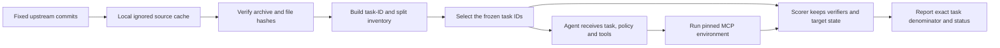

# Benchmark data and provenance

The benchmark sources have been downloaded into the local ignored cache at
`evals/benchmarks/vendor_cache/`. You do not need to download the task data by
hand. The cache is excluded by this directory's `.gitignore`; the project keeps
only the source manifest and task-ID inventory.

`manifests/source_manifest.json` pins repository revisions, licenses, source
archive checksums, database snapshots, MCP image digests, and the data paths used
for evaluation. `manifests/task_inventory.json` records task IDs and official
split membership without copying prompts, verifier SQL, reference actions, or
database state into the inventory. Rebuild the inventory after installing its
small optional reader dependency:

```powershell
python -m pip install -r evals/benchmarks/requirements.txt
python evals/benchmarks/build_task_inventory.py
```

## Task facets and model input boundary

Every pinned EnterpriseOps and τ-Bench task now has a compact task-facet record:
workflow-family estimate, explicit multi-step cues, configured tool names,
state-dependency cues, structured and semantic branch candidates, clarification
cues, and recovery cues. These are reproducible surface heuristics for coverage
analysis, marked `heuristic_unreviewed`; they do not claim hidden reference
trajectories or ground-truth branch labels. Tool names describe the configured
catalog, not a required call sequence.

The inventory records each source split and currently marks all selected sets
`not_run`. `agent_input.py` projects only EnterpriseOps prompts and configured
tool names. For τ-Bench, it accepts a live user-simulator turn plus policy and
transcript; it never accepts the hidden task object, because `user_scenario` is
provided to the simulator rather than the agent. Verifiers, target state,
reference actions and simulator instructions stay in the scorer/simulator path.

## Frozen evaluation scope

EnterpriseOps-Gym is the primary multi-step business workflow benchmark. The
current frozen comparison uses every CSM and ITSM row in the `oracle` mode:
103 CSM tasks and 103 ITSM tasks. The other official tool-set modes and their
task IDs remain in the inventory. The project README and dataset card publish
different total task counts, so scoring uses the exact row IDs and checksums in
the pinned Hugging Face revision rather than either headline number.

τ-Bench supplements the enterprise benchmark with conversational interaction.
The inventory preserves each domain's official `base`, `train`, and `test`
membership. The resource-limited supplementary run uses the official `test`
splits for `retail` and `telecom`, 40 tasks from each domain. Its full `base`
split remains available for later full evaluation. A separate deterministic
EnterpriseOps smoke subset uses the ten task IDs with the lowest SHA-256 rank
per selected domain; smoke results must not be presented as full benchmark
scores.

DecAgent also keeps a small internal workflow set at
`evals/benchmarks/business/frozen-v2.json` for contract and harness development.
It has 40 development cases and 80 holdout cases split by scenario family; the
same scenario template never appears on both sides. The earlier `frozen-v1.json`
is retained as history, but its scenario families overlap and it must not be used
to claim holdout generalization. This internal synthetic set supplements the
public workflow benchmarks and cannot replace them. Its labels are generated
references, not human-verified labels. The review checklist remains pending, and
the base set covers all three decision primitives through operation selection,
explicit-assignee detection, and work-blockage scoring.

A separate memory-decision supplement is frozen at
`evals/benchmarks/business/memory-decisions-v1.json`: 40 development and 80
holdout cases cover Jev Choice/Noul decisions for write, read-needed, and
relevance judgments. Scenario families are split-isolated, model input is an
allowlist that excludes labels and split metadata, and all labels remain
`synthetic-reference` with `human_reviewed=false`. The set is currently marked
`not_run`; it must not be used to claim measured memory accuracy or select a
runtime policy. The memory contract currently publishes Choice and Noul
templates; Score is covered by the base workflow set rather than these memory
decisions. Its review record remains pending, and memory-case label review is
still required before making any measured-accuracy claim.

Human review checklist for the internal labels:

- [ ] Verify all development and holdout scenario-family assignments.
- [ ] Check reference actions, terminal states, and forbidden writes per family.
- [ ] Check dynamic-candidate and ambiguity labels against the seeded directory.
- [ ] Independently review the new memory-decision supplement's references and scope boundaries.
- [ ] Record reviewer, date, dataset checksum, and any corrections in a new frozen dataset version.



## Offline confidence-threshold analysis

Business decision exports can be converted into a content-addressed prediction
cache and scanned repeatedly without additional Jev requests. The scanner
requires the current program-owned question registry, rejects stale question
versions and holdout data, and only marks a threshold policy-eligible when the
labels come from a reviewed validation split with at least 100 automatic cases
and observed accuracy of at least 95%. Ties in automatic coverage select the
higher confidence threshold. Zero automatic cases retain null accuracy and
interval values.

The current `frozen-v2.json` labels are synthetic references. By the owner's
2026-10-18 decision, all internal sets are auxiliary regression evidence only:
they cannot select a threshold or runtime policy, and are never headline scores.
Saved predictions can produce diagnostic threshold curves. The
saved report contains one measured point per threshold and decision family,
including coverage, accuracy, Wilson interval, false interventions, missed
interventions, and unresolved answers; unavailable values stay null.

```powershell
.\.venv\Scripts\python.exe -m decagent.evaluation.business calibrate-cache --input development-export.json --output predictions.json
.\.venv\Scripts\python.exe -m decagent.evaluation.business threshold-scan --input predictions.json --output threshold-report.json --minimum-auto 100 --target-accuracy 0.95
```

These commands are offline. `calibrate-cache` accepts only a complete frozen
development export; a production policy requires a separately reviewed
validation cache. Every output is new-file-only and tied to the frozen dataset
checksum and current registered decision families.

To check sample sufficiency without collecting predictions or making model
calls, run the following command with a new output filename:

```powershell
.\.venv\Scripts\python.exe -m decagent.evaluation.business eligibility-diagnostic --output .decagent/evaluation-closeout/new-eligibility.json
```

This is cardinality-only evidence, not a measured threshold scan. The six
workflow families each have at most 40 development examples; memory write has
20, and memory read-needed/relevance each have 10. All are below the 100
automatic-sample minimum even under perfect predictions. Accuracy and chosen
threshold remain null; the holdout is not used for tuning.

## Evaluation cost accounting

Every live Jev request reserves against the shared cumulative $1 ledger before
HTTP dispatch. Pending or unknown usage blocks further Jev calls; the recorded
historical spend is retained when the ledger is first initialized. The report
keeps actual primary-model requests and token counts even when the owner uses a
free quota. Scripted fixtures make no provider calls, and replaying a saved
prediction cache has zero new model cost; neither is reported as live evidence.

## Local readiness

EnterpriseOps CSM and ITSM database snapshots are already extracted under the
ignored cache and mapped from the pinned Parquet rows. The MCP images are
resolved to immutable Linux/AMD64 manifest digests in the source manifest. Both
images were pulled by their exact digest on 2026-10-18, and the local provenance
gate passed. On a new machine, pull those exact `image@sha256` references, verify
the local image digests, and run the MCP wire smoke test before formal scoring.

```powershell
docker pull docker.io/shivakrishnareddyma225/enterpriseops-gym-mcp-csm@sha256:eaa456ac9aa85728426e7d3813a0bbca0949d6a8695be30e26f03894e6e6b189
docker pull docker.io/shivakrishnareddyma225/enterpriseops-gym-mcp-itsm@sha256:a234ae3fb7cee196ba25e6b9957969dea829919b6e8271dddae128f065aaf39f
.\.venv\Scripts\python.exe evals/benchmarks/validate_source_manifest.py --for-scoring
```

The pinned τ-Bench source reports version 1.0.1 and requires Python 3.12 through
3.13. Its `data/tau2/results/` directory is excluded from evaluation inputs.
Only `data/tau2/domains/` supplies task, policy, database, and split data. Some
task records contain verifier or reference information; the agent adapter must
not pass those fields to the model. Keep scoring and target-state checks in the
evaluation harness.

The source manifest is the gate for formal scoring: an unknown license, missing
snapshot, changed checksum, unresolved image digest, or unverified environment
must stop the run and leave the score unreported.

## Frozen model profiles and public comparison manifest

`manifests/evaluation_model_profiles.json`, v2, and comparison manifests
through v9 are preserved as historical inputs. The current pre-registered cohort uses
profile-set file `manifests/evaluation_model_profiles_v5.json` (profile schema v4)
with `manifests/comparison_trial_manifest_v10.json`.
It freezes secret-free identities for planning, τ-Bench simulation, judging and
Jev, including endpoint, price provenance, retry/output limits, timeout,
provider routing, sampling-parameter support/omission, response mode and tool
choice. The profile matches the readiness model without embedding credentials.
The earlier Qwen zero-rate profile reflected a mistaken interpretation of the
account voucher. Qwen API usage is billed; the voucher offsets the bill. The v3
Qwen profile remains explicitly `unknown` as historical evidence. The new v4
profile freezes the user-confirmed applicable Qwen standard realtime rates for
`qwen3.8-flash`: CNY ¥0.8/M uncached input, ¥2.7/M output, and ¥0.1/M cached
input. A response with a validated cache-hit count is costed at that split;
without it, the ordinary input rate provides a conservative upper bound. The v5
profile set changes only the primary request timeout from 60 to 120 seconds
after v9 Plan requests ended at the 60-second local deadline; the user simulator
and judge remain at 60 seconds, and Jev remains at 10 seconds. This is a distinct
unrun cohort, not a retry of historical unknown attempts. These are `frozen_rate`
or `frozen_rate_upper_bound` estimates, not provider
invoices. Exact per-request gross API charges, voucher credits and cash paid
remain separate provider evidence; missing amounts are null, account-window
totals are never spread across requests, and CNY is not converted without a
verified rate. The endpoint's account invoices are not fetched automatically,
so provider-billed totals may remain unavailable. `billing_snapshot()` reports
provider evidence under `by_currency`, rate-computed and provider-billed costs
under `cost_by_currency`, plus per-attempt cache/token/basis records. Jev's USD
input rate is owner-reported and must be checked against each OpenRouter
generation record. Cross-provider fallback stays disabled within a paired
cohort.

The public-trial ledger also retains a minimal official score summary for
recovery/reporting: scorer source, score in `[0, 1]`, success flag and measured
forbidden-side-effect count. Its digest is checked against the frozen benchmark
for new scored routes. The summary contains no verifier SQL, gold state or task
labels and is not added to agent context. Older ledgers migrate with a nullable
column; absent historical score detail stays absent. The historical v8 live run recorded
two official scores, both 0.0. The later v9 first-wave attempt also failed its
quality gate (4 failed, 4 unknown, 0 success; two scores of 0.0). The complete
paired benchmark result remains 0/286; see the [v8 first-wave report](../../generated/261021/2110_公开评测首波报告_v8.md)
and [v9 first-wave report](../../generated/261022/1426_公开评测首波执行报告_f1a4a70.md).

`manifests/comparison_trial_manifest_v8.json` pre-registered the 206 EnterpriseOps
oracle tasks and 80 τ-Bench official test tasks, plus separate 20-task
EnterpriseOps and 4-task τ-Bench smoke sets. It pins the source-manifest and
task-inventory hashes, all role-specific model-profile fingerprints,
resource-profile digest, per-role request/token budgets for the Agent, user
simulator and judge, first-wave aggregate ceilings, trial isolation rules,
route pairs, and scoring boundaries.
The manifest also freezes the first wave: one fixed case each for EnterpriseOps
CSM/ITSM and τ retail/telecom, paired as ReAct and Plan for 8 route slots. Its
immutable registration status is `pre_registered_not_run`; runtime route states
live in the candidate-scoped SQLite ledger and report. Do not edit the manifest
to record route outcomes. The v8 execution produced 2 failed, 6 unknown and 0
successful routes; it did not change the full benchmark denominator or count
engineering protocol smokes as task attempts.

After offline diagnostic fixes, a first-wave dry-run at candidate `36c664944d378b5deee26e9feac8b87280ce4739` reselected the same four tasks and eight route slots, confirmed the pinned local images, and created no ledger or model/MCP calls. Its evidence is `evidence/public-evaluation-first-wave-preflight-20261021-36c6649.json`. The same-SHA [GitHub Actions run 39611406922](https://github.com/shuaibilx/DecAgent/actions/runs/39611406922) subsequently passed all jobs, including Python 3.11/3.13, PostgreSQL integration, Workbench, isolated Docker/SQL, wheel/MCP, and Compose. This remains a preflight only: it does not replay v8 unknown routes, change their terminal states, or authorize a new live batch. A live run still requires a clean frozen candidate and separate batch authorization.

Frozen input SHA-256 values are newline-stable: the source manifest is hashed
as UTF-8 text with LF line endings, while the task inventory retains its
original UTF-8 CRLF canonical digest. The verifier normalizes checkout line
endings before hashing, so Git's Windows/Linux checkout settings do not look
like benchmark-data drift; all non-newline content remains covered by SHA-256.

The v8 cohort remains historically `unassigned`; do not edit or dispatch it.
The reviewed exposure policy is frozen separately in v9 and preserved in v10.
The manifest does not
copy prompts, simulator scenarios, verifiers, expected actions, or database
contents. It assigns only the two EnterpriseOps cases confirmed as tested to
`development_exposed`; the other 204 EnterpriseOps cases and all 80 τ official
test cases are `not_exposed`. The τ train smoke cases are development data.
This is project-level exposure tracking, not an independent holdout and not a
claim about model pretraining. Do not expand exposure labels using the
unreviewed task-family heuristic.

Rebuild historical v9 deterministically from the frozen local inventory and v4
profiles. Use a new output path because the builder refuses to overwrite evidence:

```powershell
.venv\Scripts\python.exe evals/benchmarks/build_trial_manifest.py --manifest-version 9 --model-profiles evals/benchmarks/manifests/evaluation_model_profiles_v4.json --output .decagent/evaluation-closeout/rebuilt-v9.json
```

The historical v9 digest is
`f984ec74c9776efef0b6ba808ff035198500f1997537e01776dc2a895173a604` and
contains 286 full tasks, 24 smoke tasks, and 4 first-wave tasks. The default
manifest builder version remains v5 for compatibility. Live dispatch rejects v7/v8;
v9 was later executed; its terminal routes are recorded in the linked report.
The current v10 digest is
`1096d0515168eab71b06cb6b9bde558a0fa2a5269ec723aef996886a342b2fed`, and its
profile-set digest is
`4fa091d2840928bfb6a00dccfbd452a2dee8c42c465512955fd63923eb0a6721`. The v10
cohort is pre-registered but has not created a ledger or started a live route.
Rebuild v10 explicitly with a new output path:

```powershell
.venv\Scripts\python.exe evals/benchmarks/build_trial_manifest.py --manifest-version 10 --model-profiles evals/benchmarks/manifests/evaluation_model_profiles_v5.json --output .decagent/evaluation-closeout/rebuilt-v10.json
```

The v10
batch ceilings are 500 Qwen requests / 5,000,000 Qwen tokens / 1,600 tool calls
and 4 hours, with separate Agent (300 / 3,000,000), user-simulator (160 /
1,600,000), and judge (40 / 400,000) request/token caps. A persisted batch
ledger carries these limits and its deadline across resume; a stop line keeps
unfinished trials untouched. This is an admission guard, not a hard cancel for
an already-running network request, so the live runner remains gated. The
previously selected token envelope implies an estimated pre-voucher CNY upper
bound of about ¥13.50 at the highest frozen Qwen rate (5,000,000 × ¥2.7/M).
This is a profile-derived guardrail, not an expected charge or provider invoice;
voucher credits only change cash paid, not gross API cost, and this ceiling is
not a new live-batch authorization.

The command uses exclusive file creation, so choose a new output path. Earlier
profile and manifest versions remain as historical evidence; they are not overwritten.
The default public-run dry-run selects v10. To inspect the fixed first-wave slice
and verify local images without creating a ledger or calling a model/MCP server:

```powershell
.venv\Scripts\python.exe evals/benchmarks/run_public_trials.py --phase first-wave --check-images
```

A live run still requires the exact candidate to pass CI, all runtime gates, a
new persisted budget, and separate user authorization; the expired v9 batch
authorization does not carry forward.
Route pairs must carry the same exposure assignment, model-profile and
resource-profile digests. Structured branches use code rules; a Jev semantic
comparison is marked not-applicable until the benchmark contains a naturally
occurring semantic decision with a trusted, reviewed question template. Do not
manufacture Jev cases or change the official 206+80 denominator.

New live reports use `public-evaluation-live-first-wave-v4` and include
`successful_route_count`, `terminal_route_count`, and `route_status_counts` so
failed or unknown terminal routes are distinguishable from successful routes.
`completed_route_count` remains as a compatibility alias for
`successful_route_count`. Reports also include `cost_by_currency` and
`cost_records` from the ledger billing snapshot. They distinguish provider-billed
amounts from rate-based estimates and do not convert CNY amounts into USD.
Historical v1-v3 reports remain unchanged. In v3, `completed_route_count` counts only routes whose lifecycle reached successful `completed`; it does not count failed or unknown terminal routes. Use `ledger_status` and each route lifecycle for historical terminal counts.

## Isolated comparison runtime

Public benchmark tools enter the plan executor through the evaluator-only
`EvaluationCatalog`. A fresh `EvaluationScope` captures the benchmark revision
and the task's original MCP tool schemas; it never registers those tools in the
production `PluginRegistry` or HTTP API. EnterpriseOps and τ-Bench sessions use
the same plan compiler, input binding resolver, and `PlanRuntime` as the
service-tickets workflow. Each controlled route receives a new environment and
an exclusive per-trial SQLite journal. This keeps comparison state separate
from the company's PostgreSQL task and receipt tables.

EnterpriseOps initial-state identity now uses a private live-database
fingerprint collected after each fresh restore. The fingerprint includes the
SQLite schema and deterministic `rowid`-ordered rows, and returns only a digest
and row/table counts to the evaluator. The collector refuses schemas above 256
objects, more than 128 tables, more than 10,000 rows in a table, or more than
64 MiB of row data. The original snapshot hash remains a separate provenance
check. The fingerprint stays outside model input and binds paired routes to the
same restored state.

`enterprise_scoring.EnterpriseOfficialScorer` now provides the default private
scorer for Enterprise sessions. It verifies the pinned source archive and every
executable benchmark source before importing the original VerifierEngine. Exact
private configs, live database identity and task context go only to that engine.
All valid verdicts must pass; a valid false verdict is a task failure, while a
throwing, malformed or error-bearing verifier is a scoring failure. Initial and
post-state digest/count audit projections are stored in the isolated journal.
Unmeasured intermediate side effects remain null / `not_measured`.

Plan routes now render actual returned journal observations as the default final
response. A frozen response policy may require a narrative or a summary when the
complete deterministic output is too large; then at most one explicitly injected
`qwen3.8-flash` callback is used. It receives only public task/policy and actual
observations, must cite observed call IDs, and is charged to Agent primary usage
and latency. Oversized inputs are refused, not truncated. Unknown usage skips
all private scoring so no new official judge request can follow. ReAct uses the
same frozen UTF-8 output byte limit. Citation/format validation is not proof of
semantic correctness; the official verifier still determines task success.

The output policy is bound into `ComparisonTrial` and the v4 comparison manifest.
The prior, unrun v1 manifest is retained under
`evidence/comparison-trial-manifest-v1-before-final-response.json`. These changes
do not authorize live requests; provider budget and readiness gates remain the
caller's responsibility. All 286 formal cases remain unrun.

The journal retains exact upstream tool responses alongside a deterministic
JSON view for planned and ReAct calls, including errors. A received MCP tool
error remains an observation for ReAct or follows a plan's explicit error edge;
a transport-uncertain write pauses and cannot be replayed. A
PlanRuntime completion means only that declared evidence was observed; the
official EnterpriseOps or τ-Bench verifier remains the sole source of task
success. The synchronous τ-Bench adapter crosses an in-memory MCP client/server
session while delegating tool results and errors to the original environment.

The adapter and executor can be checked without model calls through
`evals/deterministic/test_business_public_evaluation_session.py` and
`evals/deterministic/test_business_tau_tools.py`. The Docker smoke test in
`evals/integration/test_business_enterprise_environment.py` checks pinned image,
snapshot, tool catalog, independent live-state fingerprints across fresh
resets, and original SQL verifier readiness; it is not a task score. τ-Bench's
opt-in route smoke uses scripted zero-cost model adapters to exercise ReAct and
Plan clarification, original tools, the private `SimulationRun` transcript
journal, and the original evaluator. Its numeric evaluator output is protocol
evidence only and is not a model success result. Formal comparisons still
require ready measured model callbacks, the original benchmark scorer, and frozen paired task
identities. No EnterpriseOps or τ-Bench task result is claimed by the offline
contract tests.

Route timing separates environment setup, the agent interval, private scoring,
cleanup, and total wall time. Agent machine latency includes planning and tool
execution, excludes harness setup/scoring/cleanup, and subtracts measured human
and user-simulator waiting. Initialization failures retain `agent_started=false`
and must not be presented as fast successful runs.

## Separately locked τ2 tool process

The pinned upstream core lock conflicts with the application's MCP 2.3.0
dependency chain. Keep both locks: `tau_process.PinnedTauRuntime` starts one
dedicated Python 3.12 worker per trial. The worker uses only stdlib and original
τ2; application MCP stays in the main environment. This pinned revision also
needs the locked optional `websockets==15.0.1` because of an eager voice import.
Python 3.13 fails on that upstream audioop import, so the tested runtime is
Python 3.12.7. Upstream source and dependency pins were not edited.

Only trusted evaluator code selects the executable/domain/task. Original
schemas, JSON argument types, text results, errors and mutation metadata cross
the bridge unchanged. The worker validates the pinned source archive/files,
does not inherit model credentials, disables dotenv/network connections, and
exposes simulator/scorer operations only through evaluator-private ports. Model
requests use measured parent callbacks; the worker receives no provider keys.
Request IDs, 4 MiB frames and bounded waits
prevent stale/unbounded responses. Transport failure closes the process without
tool replay. Closing the MCP session reclaims the owned process tree on Windows;
the POSIX process-group cleanup remains outside independent Linux acceptance.

`evals/benchmarks/verify_tau_runtime.py` checks all 80 official supplementary
test tasks with two fresh original initializations. The committed runtime
readiness evidence records 80/80 ready and **zero formal attempts**, not task
success. `evals/deterministic/test_business_tau_process.py` separately exercises
real upstream tools through MCP and the production plan binding path. Its public
fixture lookup is a synthetic protocol regression, not an official task result.
On Windows, run these commands with Python UTF-8 mode enabled: without it, the
telecom task files can raise `UnicodeDecodeError` under the active locale. Set
`PYTHONUTF8` in PowerShell so the setting reaches Python subprocesses too.

Opt in to real offline subprocess tests from the project root:

```powershell
$env:PYTHONUTF8 = '1'
$env:DECAGENT_TEST_TAU_PYTHON = (Resolve-Path ".decagent/evaluation-runtimes/tau2-96a3ef9-py312/Scripts/python.exe").Path
.\.venv\Scripts\python.exe -m pytest evals/deterministic/test_business_tau_process.py -q -rs
```

The 2026-10-20 offline recheck without UTF-8 mode initialized 40/80 tasks and
reported `UnicodeDecodeError` for all telecom tasks. Repeating it with
`PYTHONUTF8=1` initialized 80/80; both runs made zero model requests and scored
zero official tasks. The failed and successful records are preserved separately
as `evidence/tau2-runtime-readiness-20261020.json` and
`evidence/tau2-runtime-readiness-20261020-pythonutf8.json`.

Without that separate runtime, real τ process checks explicitly skip; standard
CI does not download the public corpus or call providers. The old optional test
that imports τ2 inside the application environment intentionally remains skipped.
See the [runtime guide and current evidence](../../generated/261018/评测/1928_τBench独立运行时桥与验证.md).

## Public comparison preflight

The public runner is offline by default. It verifies the frozen v10 trial manifest,
source and inventory checksums, model profiles, routed-model readiness evidence,
and optionally local digest-pinned EnterpriseOps images. It does not create a
trial ledger, call a model, or call an MCP tool:

```powershell
python evals/benchmarks/run_public_trials.py --mode smoke --check-images
python evals/benchmarks/run_public_trials.py --mode full --check-images
python evals/benchmarks/run_public_trials.py --phase first-wave --check-images
python evals/benchmarks/run_public_trials.py --phase remaining-smoke --check-images
python evals/benchmarks/run_public_trials.py --phase full --check-images
```

`--phase` selects only a pre-registered subset while preserving the full cohort
denominator in the report: `first-wave` selects 4 tasks / 8 ReAct/Plan slots,
`remaining-smoke` selects the other 20 / 40, and `full` selects 286 / 572.
These selectors are dry-run previews; they do not claim routes or resume a
ledger.

To preserve a new preflight report, use `--report` with a new JSON filename under
`evals/benchmarks/evidence`; existing evidence cannot be overwritten. The
2026-10-22 v10 preflight after CI is recorded in
[`public-first-wave-preflight-20261022-d3e0006.md`](evidence/public-first-wave-preflight-20261022-d3e0006.md)
and its machine-readable JSON. It passed all pinned-image checks and selected
4 tasks / 8 route slots with no ledger, model calls, or MCP calls. `--state`
is unsupported in both dry-run and live mode; execution always uses the canonical
ledger path.
`--execute` is implemented for the fixed first-wave phase, but remains fail-closed
until the persisted supervisor, candidate/CI, model, runtime, image, and cleanup
gates below pass. Every new live cohort also requires a separately frozen budget
and explicit user authorization; a previous cohort's authorization does not carry
forward. The smoke/full reports dated 2026-10-19 are preflight evidence only:
they contain 24/286 planned cases, not executed tasks or benchmark scores. They
also enumerate the fixed four-case first wave and its eight ReAct/Plan route
slots without dispatching them. Jev remains N/A unless a naturally occurring
semantic decision has been reviewed and matched to a trusted template.

The gated live first-wave path now reuses the production PlanRuntime route
adapters, pinned EnterpriseOps/τ environments, measured model callbacks,
ledgered MCP gateway, original benchmark scorers, and verified cleanup. Before
opening the canonical trial ledger it preflights all four frozen tasks and
requires their isolated environments to clean up successfully. The scheduler
checks every live `PublicComparisonTrial` against its frozen manifest ID,
benchmark, version, case, exposure group, resource limits, response policy,
and role-profile digests before reserving a route.

Live execution remains opt-in and accepts only the fixed `first-wave` phase.
It fails closed unless the checkout is clean, the exact `HEAD` has a completed
successful GitHub Actions workflow named `CI`, the frozen readiness/runtime
profiles match, the main-model credential is configured, cross-model fallback
is disabled, both digest-pinned EnterpriseOps images are already local, and
the pinned τ Python 3.12 runtime is available. Reports are exclusive new JSON
files under `evals/benchmarks/evidence`; the persistent cohort and Jev ledgers
always use their canonical paths.

Example, from a clean checkout whose exact commit has passed GitHub CI:

```powershell
python evals/benchmarks/run_public_trials.py `
  --execute --mode smoke --phase first-wave `
  --tau-python .decagent/evaluation-runtimes/tau2-96a3ef9-py312/Scripts/python.exe `
  --report evals/benchmarks/evidence/public-evaluation-live-first-wave-unique.json
```

The v8 run used candidate
`5a21ded64061ce5576b33c58dcec3266615e2a1a` after its exact SHA passed CI
run `39600167554`. This checkout now contains report and OpenSpec changes and
is not eligible for another live run until a new clean candidate passes CI. A
dry-run, readiness record, callback unit test, or image check does not imply
real provider dispatch. The v8 report is an eight-route first-wave experiment,
not a successful benchmark or evidence of Jev performance. Any unknown route
remains terminal and is never replayed. Jev remains outside this first-wave
comparison unless a separate approved pairing is scheduled.

Environment-only preflight evidence for the four fixed first-wave tasks is in
[`evidence/public-first-wave-environment-preflight-20261020.json`](evidence/public-first-wave-environment-preflight-20261020.json).
It confirms source-pinned initialization and verified cleanup only; it contains
no route execution, official score, business tool dispatch, or provider request.

### First live cohort status and candidate binding (2026-10-21)

The first live attempt did run on candidate
`9bc3ee6654e46630c9ae8238a28eb6e34a088698` after GitHub CI run `39442012550`
passed. It covered the fixed four tasks and eight ReAct/Plan routes: four routes
ended `failed`, four ended `unknown`, all eight cleanups were verified, and no
official scorer ran. The canonical v7 ledger has four Qwen attempts and does
not contain candidate-SHA metadata. These are terminal historical attempts;
they must not be replayed or retroactively attributed to a candidate using the
current checkout, a later report, or a CI run.

The live ledger now binds a new, empty cohort to one exact CI-verified SHA
before any route claim. Resume, dispatch, and report generation verify the same
binding; an active historical ledger without this metadata is rejected, and
malformed metadata fails closed. As a result, the existing v7 cohort cannot be
used for another candidate. A new real batch requires a new cohort, a separately
frozen budget, and same-SHA CI evidence. Current official benchmark result
remains 0/286 scored tasks; this engineering attempt does not establish model
quality or a Jev advantage.

### v8 first-wave result (2026-10-21)

The next candidate-scoped cohort is v8 and is bound to SHA
`5a21ded64061ce5576b33c58dcec3266615e2a1a`; GitHub Actions CI run
`39600167554` passed all jobs. Its four fixed tasks and eight ReAct/Plan route
slots all reached terminal states: two failed, six unknown, zero succeeded.
Both routes that reached the original scorers received 0.0; all eight
environment cleanups were verified. Five of 26 Qwen primary/simulator requests
had unknown usage and retain their reservations. These attempts are not
replayed, and the result does not pass the per-domain score gate. Read the
[human report](../../generated/261021/2110_公开评测首波报告_v8.md) and the
[immutable machine report](evidence/public-first-wave-live-20261021-v8-5a21ded.json).

### v9 manifest first-wave execution on candidate f1a4a70 (2026-10-22)

The frozen v9 manifest was executed on candidate
`f1a4a704fe2c36b22127006fe0bc9860733923d5` after same-SHA [CI run
39731158534](https://github.com/shuaibilx/DecAgent/actions/runs/39731158534)
passed. Four fixed tasks and eight ReAct/Plan routes reached terminal states:
four failed, four unknown, zero succeeded. Cleanup was verified for all eight.
Only ITSM/ReAct and τ telecom/ReAct reached an official scorer; both received
0.0. Three Plan primary requests timed out with unknown usage and retain 198,176
reserved tokens / ¥0.2052352 frozen-rate cost reservation. Two τ retail user
simulator requests were verified not sent during local preflight. No Jev or
judge requests were made. The estimated frozen-rate API cost for known usage is
¥0.0853511; no provider invoice evidence is recorded. See the [human report](../../generated/261022/1426_公开评测首波执行报告_f1a4a70.md) and [immutable machine report](evidence/public-first-wave-live-20261022-f1a4a70.json).

This first wave did not pass the route completion or score gate. Do not replay
unknown routes. A later offline loopback reproduced and fixed the τ retail
empty-tool-list preflight defect; the targeted callback test file passes 25
tests and the full deterministic suite passes (2,025 passed, 18 skipped). Ruff
and strict OpenSpec validation pass. The fix was committed as
`cb050a92b181cc75c7939a99d8c466a1f912c266`, and same-SHA [CI run
39736719671](https://github.com/shuaibilx/DecAgent/actions/runs/39736719671)
passed all jobs in about 12.1 minutes. Plan timeouts and the CSM MCP unknown
remain unresolved; remaining smoke and the 206+80 benchmark stay paused pending
a newly frozen batch.
This result does not measure Jev or establish a Jev gain.

### Candidate 8b8d4c2 preflight (2026-10-22)

After offline diagnostics, candidate `8b8d4c2be7d0d1cee8819f22742a9f8201328960` passed the full nine-job GitHub Actions CI in 12m42s ([run 39773178389](https://github.com/shuaibilx/DecAgent/actions/runs/39773178389)). Its no-execution `--check-images` preflight selected the same four first-wave tasks and eight ReAct/Plan slots, verified the pinned EnterpriseOps images, and reported `ledger_created=false`, `live_model_calls=0`, and `mcp_calls=0` ([machine report](evidence/public-first-wave-preflight-8b8d4c2.json), [operator note](evidence/public-first-wave-preflight-8b8d4c2.md)). The preflight does not retry historical unknowns or create a new live cohort. The previous four-hour batch window has expired; any new first-wave execution requires a separately frozen budget and same-SHA CI.

The evidence-only follow-up commit `06b390328c5eb3a089f08b68899dd8f6d285c5b4` also passed all nine CI jobs in 10m18s ([run 39775263485](https://github.com/shuaibilx/DecAgent/actions/runs/39775263485)); it changed no runtime code.
