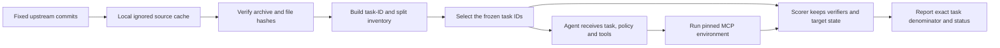

# Benchmark data and provenance

The benchmark sources have been downloaded into the local ignored cache at
`evals/benchmarks/vendor_cache/`. You do not need to download the task data by
hand. The cache is excluded by this directory's `.gitignore`; the project keeps
only the source manifest and task-ID inventory.

`manifests/source_manifest.json` pins repository revisions, licenses, source
archive checksums, database snapshots, MCP image digests, and the data paths used
for evaluation. `manifests/task_inventory.json` records task IDs and official
split membership without copying prompts, verifier SQL, reference actions, or
database state into the inventory. Rebuild the inventory after installing its
small optional reader dependency:

```powershell
python -m pip install -r evals/benchmarks/requirements.txt
python evals/benchmarks/build_task_inventory.py
```

## Task facets and model input boundary

Every pinned EnterpriseOps and τ-Bench task now has a compact task-facet record:
workflow-family estimate, explicit multi-step cues, configured tool names,
state-dependency cues, structured and semantic branch candidates, clarification
cues, and recovery cues. These are reproducible surface heuristics for coverage
analysis, marked `heuristic_unreviewed`; they do not claim hidden reference
trajectories or ground-truth branch labels. Tool names describe the configured
catalog, not a required call sequence.

The inventory records each source split and currently marks all selected sets
`not_run`. `agent_input.py` projects only EnterpriseOps prompts and configured
tool names. For τ-Bench, it accepts a live user-simulator turn plus policy and
transcript; it never accepts the hidden task object, because `user_scenario` is
provided to the simulator rather than the agent. Verifiers, target state,
reference actions and simulator instructions stay in the scorer/simulator path.

## Frozen evaluation scope

EnterpriseOps-Gym is the primary multi-step business workflow benchmark. The
current frozen comparison uses every CSM and ITSM row in the `oracle` mode:
103 CSM tasks and 103 ITSM tasks. The other official tool-set modes and their
task IDs remain in the inventory. The project README and dataset card publish
different total task counts, so scoring uses the exact row IDs and checksums in
the pinned Hugging Face revision rather than either headline number.

τ-Bench supplements the enterprise benchmark with conversational interaction.
The inventory preserves each domain's official `base`, `train`, and `test`
membership. The resource-limited supplementary run uses the official `test`
splits for `retail` and `telecom`, 40 tasks from each domain. Its full `base`
split remains available for later full evaluation. A separate deterministic
EnterpriseOps smoke subset uses the ten task IDs with the lowest SHA-256 rank
per selected domain; smoke results must not be presented as full benchmark
scores.

DecAgent also keeps a small internal workflow set at
`evals/benchmarks/business/frozen-v2.json` for contract and harness development.
It has 40 development cases and 80 holdout cases split by scenario family; the
same scenario template never appears on both sides. The earlier `frozen-v1.json`
is retained as history, but its scenario families overlap and it must not be used
to claim holdout generalization. This internal synthetic set supplements the
public workflow benchmarks and cannot replace them. Its labels are generated
references, not human-verified labels. The review checklist remains pending, and
the base set covers all three decision primitives through operation selection,
explicit-assignee detection, and work-blockage scoring.

A separate memory-decision supplement is frozen at
`evals/benchmarks/business/memory-decisions-v1.json`: 40 development and 80
holdout cases cover Jev Choice/Noul decisions for write, read-needed, and
relevance judgments. Scenario families are split-isolated, model input is an
allowlist that excludes labels and split metadata, and all labels remain
`synthetic-reference` with `human_reviewed=false`. The set is currently marked
`not_run`; it must not be used to claim measured memory accuracy or select a
runtime policy. The memory contract currently publishes Choice and Noul
templates; Score is covered by the base workflow set rather than these memory
decisions. Its review record remains pending, and memory-case label review is
still required before making any measured-accuracy claim.

Human review checklist for the internal labels:

- [ ] Verify all development and holdout scenario-family assignments.
- [ ] Check reference actions, terminal states, and forbidden writes per family.
- [ ] Check dynamic-candidate and ambiguity labels against the seeded directory.
- [ ] Independently review the new memory-decision supplement's references and scope boundaries.
- [ ] Record reviewer, date, dataset checksum, and any corrections in a new frozen dataset version.



## Offline confidence-threshold analysis

Business decision exports can be converted into a content-addressed prediction
cache and scanned repeatedly without additional Jev requests. The scanner
requires the current program-owned question registry, rejects stale question
versions and holdout data, and only marks a threshold policy-eligible when the
labels come from a reviewed validation split with at least 100 automatic cases
and observed accuracy of at least 95%. Ties in automatic coverage select the
higher confidence threshold. Zero automatic cases retain null accuracy and
interval values.

The current `frozen-v2.json` labels are synthetic references. They can produce
diagnostic threshold curves, but cannot select a policy for runtime use. The
saved report contains one measured point per threshold and decision family,
including coverage, accuracy, Wilson interval, false interventions, missed
interventions, and unresolved answers; unavailable values stay null.

```powershell
.\.venv\Scripts\python.exe -m decagent.evaluation.business calibrate-cache --input development-export.json --output predictions.json
.\.venv\Scripts\python.exe -m decagent.evaluation.business threshold-scan --input predictions.json --output threshold-report.json --minimum-auto 100 --target-accuracy 0.95
```

These commands are offline. `calibrate-cache` accepts only a complete frozen
development export; a production policy requires a separately reviewed
validation cache. Every output is new-file-only and tied to the frozen dataset
checksum and current registered decision families.

## Evaluation cost accounting

Every live Jev request reserves against the shared cumulative $1 ledger before
HTTP dispatch. Pending or unknown usage blocks further Jev calls; the recorded
historical spend is retained when the ledger is first initialized. The report
keeps actual primary-model requests and token counts even when the owner uses a
free quota. Scripted fixtures make no provider calls, and replaying a saved
prediction cache has zero new model cost; neither is reported as live evidence.

## Local readiness

EnterpriseOps CSM and ITSM database snapshots are already extracted under the
ignored cache and mapped from the pinned Parquet rows. The MCP images are
resolved to immutable Linux/AMD64 manifest digests in the source manifest, but
are not pulled yet. Before any formal score, pull those exact `image@sha256`
references, verify the local image digests, and run the MCP wire smoke test.

```powershell
docker pull docker.io/shivakrishnareddyma225/enterpriseops-gym-mcp-csm@sha256:eaa456ac9aa85728426e7d3813a0bbca0949d6a8695be30e26f03894e6e6b189
docker pull docker.io/shivakrishnareddyma225/enterpriseops-gym-mcp-itsm@sha256:a234ae3fb7cee196ba25e6b9957969dea829919b6e8271dddae128f065aaf39f
.\.venv\Scripts\python.exe evals/benchmarks/validate_source_manifest.py --for-scoring
```

The pinned τ-Bench source reports version 1.0.1 and requires Python 3.12 through
3.13. Its `data/tau2/results/` directory is excluded from evaluation inputs.
Only `data/tau2/domains/` supplies task, policy, database, and split data. Some
task records contain verifier or reference information; the agent adapter must
not pass those fields to the model. Keep scoring and target-state checks in the
evaluation harness.

The source manifest is the gate for formal scoring: an unknown license, missing
snapshot, changed checksum, unresolved image digest, or unverified environment
must stop the run and leave the score unreported.
