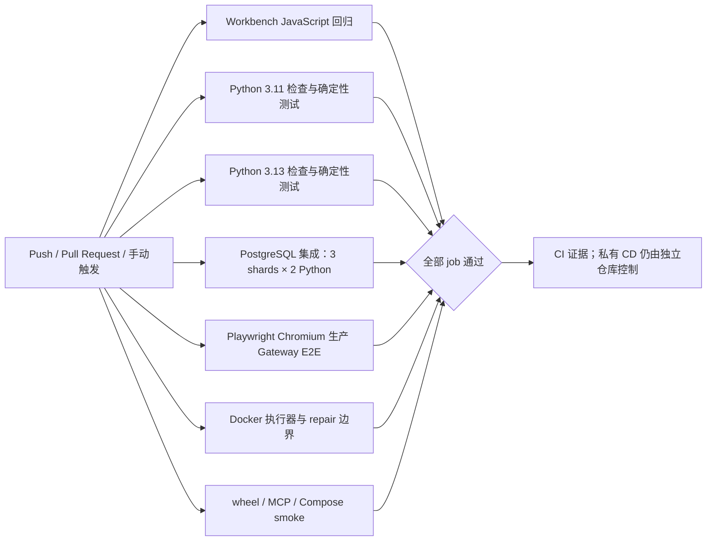

# CI 分层、分片与浏览器 E2E 验收

日期：2026-10-23。本文记录 `guest-sop-local-trial` task 5.1 的最终验收证据；只统计固定 SHA 的 GitHub Actions run，不把本地结果或失败尝试计作远端通过。

## 结论

最终候选 [`9743e1a6d303e41cd88175a97d3b386e7edfefd6`](https://github.com/shuaibilx/DecAgent/commit/9743e1a6d303e41cd88175a97d3b386e7edfefd6) 的 [CI run 39951724425](https://github.com/shuaibilx/DecAgent/actions/runs/39951724425) **12/12 个 job 全绿**。流水线包含 Python 3.11/3.13、Ruff、确定性套件、6 个 PostgreSQL 集成分片、生产 Gateway 的 Chromium 浏览器 E2E、Docker 执行器边界、wheel/MCP 与离线 Compose smoke。

最终 run 从首个 job 启动到最后一个 job 完成用时 **8 分 19 秒**；所有 job 的累计 Runner 时间为 **52 分 05 秒**。旧基线 [run 39940453829](https://github.com/shuaibilx/DecAgent/actions/runs/39940453829) 为 9/9 job 全绿，墙钟 **12 分 27 秒**、累计 Runner 时间 **51 分 39 秒**。墙钟减少 **4 分 08 秒（33.2%）**；累计 Runner 时间增加 **26 秒（0.8%）**。这次将 E2E 覆盖加回流水线后，累计资源基本持平，不能据此声称 Runner 费用下降。

首次 12-job 完整 run [`39947355157`](https://github.com/shuaibilx/DecAgent/actions/runs/39947355157) 使用每次安装 Chromium/Linux 依赖的方式，浏览器 job 用时 11 分 21 秒，整条流水线墙钟 11 分 19 秒、累计 Runner 时间 62 分 31 秒。最终 run 使用锁定 digest 的 Playwright 官方 Python 镜像，浏览器 job 降到 **1 分 26 秒**，完整流水线比该 run 少 **3 分钟墙钟**和 **10 分 26 秒累计 Runner 时间**。最终浏览器 job 中，容器初始化 37 秒、依赖安装 14 秒、Chromium 核心流程 28 秒。

## 流水线结构

`integration` 使用固定 node-id 分片、`pytest-xdist -n 4` 与 `--dist=worksteal`，同一 Python 版本的三个 shard 并行；两版本合计最多六个 shard 并行。Ruff 与 deterministic 分别在 3.11、3.13 运行。pip 缓存依赖 `requirements.lock`、`requirements.txt`、`pyproject.toml`；浏览器 job 使用镜像预装的系统 Python，因此不调用 `setup-python` pip-cache hook。其余 job 的 pip 缓存保持开启。

浏览器 job 固定为 `mcr.microsoft.com/playwright/python:v1.64.0-noble@sha256:684df257a1fa0ef3fa288239819984008f560e8f8db5b635ee9e2a50cbcd2e23`，并用 `/ms-playwright` 查找浏览器。它使用镜像内 Python 3.12；项目声明 Python `>=3.11`，主兼容矩阵仍明确覆盖 3.11 和 3.13。PostgreSQL service 以 `postgres` 主机名连接。Playwright 版本通过 [锁文件](../../e2e/requirements.lock) 固定并在 job 中核验。Playwright 官方说明该 Python 镜像包含浏览器及其系统依赖，项目仍需单独安装对应版本的 Playwright Python 包；镜像版本与项目 Playwright 版本必须匹配。[官方 Docker 文档](https://github.com/microsoft/playwright.dev/blob/main/python/docs/docker.mdx)

## 最终 run 的 job 时间

累计 Runner 时间为各 job 时长之和；墙钟时间是并行 job 的最长关键路径，二者含义不同。

| Job | 结果 | 时长 |
| --- | --- | ---: |
| Workbench JavaScript regressions | 通过 | 6 秒 |
| Python 3.11 checks | 通过 | 4 分 50 秒 |
| Python 3.13 checks | 通过 | 5 分 37 秒 |
| Python 3.11 integration shard 1/3 | 通过 | 4 分 47 秒 |
| Python 3.11 integration shard 2/3 | 通过 | 5 分 33 秒 |
| Python 3.11 integration shard 3/3 | 通过 | 5 分 13 秒 |
| Python 3.13 integration shard 1/3 | 通过 | 4 分 26 秒 |
| Python 3.13 integration shard 2/3 | 通过 | 5 分 39 秒 |
| Python 3.13 integration shard 3/3 | 通过 | 8 分 19 秒 |
| Python 3.12 production gateway browser E2E | 通过 | 1 分 26 秒 |
| Disposable Docker executor and repair boundaries | 通过 | 2 分 51 秒 |
| Build package and container images | 通过 | 3 分 18 秒 |

最慢的单个 job 是 Python 3.13 integration shard 3/3（8 分 19 秒），因此它构成当前墙钟关键路径。`max-parallel: 6` 下 6 个数据库分片同时执行；若再增加分片，需先观察多次 run 的稳定分布，避免仅增加 Runner 资源而没有关键路径收益。

## 测试结果与 skip

- Python 3.11 和 3.13 各自的 deterministic job 均为 **2,164 passed、18 skipped、0 failed**。
- 每个 Python 版本的三个 PostgreSQL integration shard 合计 **678 passed、33 skipped、0 failed**。六个 shard 均连接固定 digest 的 PostgreSQL 17 service。
- Playwright job 的受控浏览器流程通过：员工登录 → 创建合成业务任务 → 明确审批 → Gateway/Worker/MCP 写入 → 核验回执及数据库目标状态。该路径 **0 付费模型请求**。
- wheel/MCP/Compose 构建 job、Docker 执行器边界 job 和 JavaScript 回归 job 均通过。

Deterministic 每个 Python 版本的 18 个 skip：14 个 τ 子进程测试要求尚未配置的 pinned tau runtime；1 个测试要求未安装的 tau2 runtime；1 个是 Windows interpreter process-tree regression；另有 Windows ACL 和 junction 语义各 1 个。Linux CI 不会把这些平台/运行时缺口伪报为通过。

Integration 每个 Python 版本的 33 个 skip：17 个测试需要独立 disposable Docker/SQL fixture；1 个需要固定 benchmark container image；4 个需要显式开启 repair Docker integration；5 个为 opt-in pinned Docker environment readiness；4 个使用可选的 upstream source cache；1 个需要 `mcp-cli 0.3.0`；1 个仅适用于 Windows ACL。独立 Docker boundary job 已通过，但它不替代这些被跳过测试；其 skip 仍表示对应集成场景未由该 job 验证。

## 失败尝试与修复

- Run [`39949424100`](https://github.com/shuaibilx/DecAgent/actions/runs/39949424100) 在 Playwright 镜像里调用 `setup-python` 的 pip cache hook 时失败：镜像工具缓存中没有该 hook 需要的 `pip` shim。其他 11 个 job 通过。
- Run [`39950636276`](https://github.com/shuaibilx/DecAgent/actions/runs/39950636276) 移除 pip cache hook 后，`setup-python` 安装的 Python 3.13 在镜像环境中缺 SSL 模块，pip 无法访问 PyPI。其他 11 个 job 通过。
- 最终改为使用 digest 固定的官方镜像自带 Python 3.12；项目支持该版本，锁定依赖和浏览器运行都成功，最终 12/12 job 通过。主矩阵 Python 3.11/3.13 未变。

## 复核边界

这是 CI 结构与覆盖面的验收，不是完整无 skip 验收。确定性和集成测试的 skip 已逐项归类；Windows 专属语义、pinned τ runtime、特定 Docker fixtures、外部 MCP CLI 和上游语料缓存仍需各自环境才能完整验证。生产模型/Jev 质量、公开基准、私有 CD 和本机 Docker 升级/回滚演练不由此 run 证明。

## 后续候选 SHA 复验（2026-10-23 北京时间）

后续评测候选 [`50e38b71ce030d7a17593611e4efd564f0a183bf`](https://github.com/shuaibilx/DecAgent/commit/50e38b71ce030d7a17593611e4efd564f0a183bf) 的 [GitHub Actions run 39981292425](https://github.com/shuaibilx/DecAgent/actions/runs/39981292425) 绑定相同 SHA，最终状态为 **12/12 job success**。运行时间为北京时间 23:47:29–23:55:52，墙钟 8 分 23 秒，累计 Runner 时间 53 分 36 秒。Workbench JavaScript、Python 3.11/3.13 检查、六个 PostgreSQL 集成分片、Python 3.12 Gateway Chromium E2E、Docker 执行器边界、wheel/MCP/Compose 构建与启动冒烟均通过。

Python 3.11 与 3.13 deterministic 均为 **2,169 passed、18 skipped、0 failed**。18 个 skip 包括 14 个依赖未配置 pinned τ 子进程运行时的案例、1 个未安装 tau2 runtime、1 个 Windows process-tree 回归，以及 Windows ACL 和 junction 语义各 1 项。六个 PostgreSQL 集成 shard job 全部成功；本次不从 GitHub job 摘要中推断逐 shard pass/skip 计数，上一版 `9743e1a` 的计数仍仅属于其自身 run。游客预算集成本机专用 PostgreSQL 复验另有 38 passed、0 skipped 的证据，模型请求数为 0。

该候选的总墙钟比前一 12-job 验收 run 多 4 秒、累计 Runner 时间多 1 分 31 秒；单次运行差异不足以证明 CI 进一步提速或变慢。最慢 job 仍为 Python 3.13 integration shard 3/3（8 分 19 秒）。这些 CI 结果不代表真实 Jev/Qwen 评测、公开基准完成、游客入口启用、私有 Runner/CD 或真实本机 Docker 升级回滚验收。
