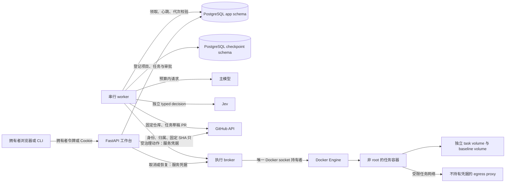
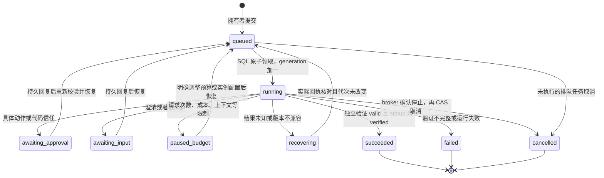
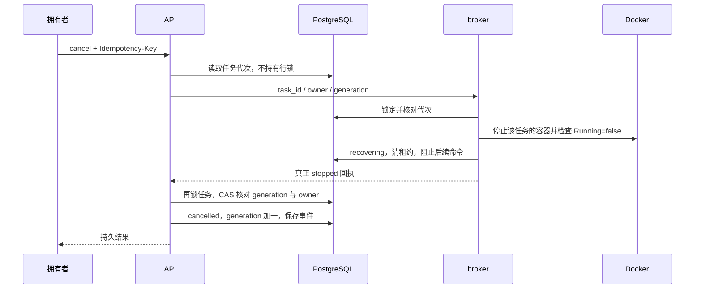

# DecAgent：worker、部署与恢复图解

> 历史资料说明（2026-10-12 更新入口）：本页保留旧仓库修复 worker 的部署与恢复说明，生成于 2026-10-11。原命令、测试数量、费用和通过状态仅适用于当时范围；不作为当前业务 Agent、真实模型提效或独立 Linux 部署的验收结论。
>
> 当前入口：[业务使用指南](../261012/0852_业务Agent使用指南.md)、[业务架构](../261012/0852_业务Agent架构详解.md)、[离线图册](../261012/0902_业务Agent架构图册.html)、[本机业务验收](../261012/0900_本机业务验收记录.md)。业务题目与 synthetic-reference 校准/40+80 评测见[当前评测说明](../261012/0844_业务基准评测说明.md)。

生成时间：2026-10-11 01:21（北京时间）。本文件补充 [工作台与 CLI 指南](../261010/1716_工作台与CLI指南.md)，使用独立的 DecAgent 目录和数据，不改动同级 Waku 项目。

## 本次验证到哪里

本阶段实现真实 SQL 队列消费、持久化 LangGraph 恢复、应用回调装配与完整 Compose 控制服务。拥有者网页的浏览器检查见前一份指南。本阶段的 Compose 检查使用真正的 Docker、PostgreSQL、broker、代理、API 和空队列 worker，另使用容器内 CLI 验证拥有者初始化及认证查询。它没有调用付费模型，也没有发布 GitHub 内容。

worker 的抢占、心跳、等待、恢复、取消代次保护与版本检查使用真实 PostgreSQL 和真实 PostgresSaver，模型/任务能力由明确标识的离线脚本替代。GitHub 归属与发布恢复回调使用受控 HTTP 响应；它们验证协议与数据库行为，不代表真实仓库操作已验收。主实施线程负责真实 RuntimeServices 修复闭环与额外外部验证；最终结论以该线程的验收报告为准。

## 服务与凭据的位置



| 服务 | 持有的秘密 | 宿主端口/挂载 |
| --- | --- | --- |
| API | 数据库、broker 服务凭据、GitHub PAT | 默认仅 127.0.0.1:8000；无 Docker socket |
| worker | 数据库、broker、GitHub、主模型、Jev | 无宿主端口；无 Docker socket |
| broker | 数据库和自身服务凭据 | 无宿主端口；唯一 Docker socket 挂载 |
| PostgreSQL | 数据库密码 | 控制网络内部，不公开数据库端口 |
| egress proxy | 无 | 不挂载凭据 |
| 任务容器 | 无上述控制服务秘密 | broker 创建的限定工作区与任务网络 |

API 与 worker 的根文件系统只读，临时文件在受限 tmpfs，持久证据在 control_data 卷。任务工作区和基线卷由 Docker Engine 经 broker 创建，不把控制数据目录挂入任务容器。控制容器不是任务执行器；容器中的仓库代码始终走 broker 边界。

## 第一次启动 Compose

在 DecAgent 根目录执行。先把实例配置写进受保护的 `.env`；真实值不写进 `.env.example`。主模型地址/模型名称、Jev provider/model、作者身份与预算价格由实例配置决定。以下命令不会把密钥放进命令参数。

```powershell
.venv\Scripts\python.exe ops\control\prepare_secrets.py
docker build -f ops/runner/Dockerfile -t decagent-executor-runner:local .
$env:DECAGENT_RUNNER_IMAGE = (docker image inspect decagent-executor-runner:local --format '{{.Id}}').Trim()
docker compose build
docker compose up -d --wait
docker compose --profile setup run --rm owner-init
.venv\Scripts\python.exe ops\control\export_owner.py
```

prepare_secrets 会生成随机数据库密码和 broker 凭据，把配置好的供应商凭据保存到 `.decagent/secrets/` 中；已有文件全部保留。Linux 使用 0600，Windows 在写入前收紧 ACL。更换供应商凭据时，应由拥有者更新对应受保护的 secret 文件后重新创建相应控制服务；再次运行准备脚本不会替换已有密钥。

runner 必须固定到不可变的 `sha256:` 镜像 ID。只有标签名不够；broker 还会检查 runner 版本标签及非 root 用户，并执行实际隔离诊断。Docker Engine 需要 Linux 模式与 28+ 的隔离网关能力。

owner-init 将拥有者令牌写入 control_data 的 `/data/owner.token`，数据库只保存其摘要。再次初始化会拒绝覆盖。export_owner 把该令牌导出到**新的**受保护主机文件 `.decagent/compose-cli/owner.token`，只输出路径，不输出令牌，也不覆盖旧文件。浏览器登录时，拥有者自行使用此文件的内容。

Compose 的环境插值默认读取项目 `.env`，供应商密钥则以文件 secrets 挂载给相应控制服务，不出现在 Compose environment 字段中。`.dockerignore` 排除 `.env`、运行数据和虚拟环境。Linux 自行改变 secret 文件的宿主 UID/挂载权限时，应确保目标控制进程可读取文件；本次完整 Compose 启动实测平台为 Windows Docker Desktop 的 Linux Engine。

### 认证 CLI 的两种入口

容器内使用同一个拥有者文件：

```powershell
docker compose exec -T api python /opt/decagent/start.py doctor
docker compose exec -T api python /opt/decagent/start.py tasks
```

如果宿主映射端口改成 18020，容器内 CLI 仍连接自身的 8000：

```powershell
docker compose exec -T --env DECAGENT_PUBLIC_URL=http://127.0.0.1:8000 api python /opt/decagent/start.py tasks
```

宿主 CLI 使用刚导出的文件：

```powershell
$env:DECAGENT_DATA_DIR = (Resolve-Path .decagent/compose-cli).Path
python -m decagent tasks
python -m decagent task show TASK_UUID
```

任务提交语法：

```powershell
python -m decagent task submit --project-id PROJECT_UUID --base-ref main --issue '修复已描述的 Python 行为' --max-cost '1.00' --trust exact_commit
python -m decagent task cancel TASK_UUID
python -m decagent task resume TASK_UUID --max-cost '1.00' --max-calls 40
```

示例中的金额是拥有者输入的上限示例，不是供应商价格或已授权的自动消费。发布草稿需要提交时明确加 `--publish-draft`；提交作者需要配置 `DECAGENT_GIT_AUTHOR_NAME` 和 `DECAGENT_GIT_AUTHOR_EMAIL`。主模型价格未知时，需明确的预留价格及拥有者允许未知价格的预算，否则运行时会在外部请求前暂停。doctor 只检查本地配置，付费请求数为 0。

## 任务如何运行与暂停



每个 worker 串行处理一个任务，多 worker 可并行处理不同任务。领取使用 `FOR UPDATE SKIP LOCKED`；只有 queued 和租约已过期的 running 可被领取。人工等待中的任务不会被后台自动抢走。

每次领取递增 lease_generation。后台线程默认每 5 秒刷新 30 秒租约，同时记录本次活动秒数。任务进入等待时停止心跳并清空租约；拥有者思考、浏览差异或隔夜等待不会持续累计活动时长。旧 worker 的结果必须满足任务 ID、owner、generation、running 状态和有效租约，否则不能更新新 worker 或取消后的任务。

| 等待类型 | 拥有者看到什么 | 恢复条件 |
| --- | --- | --- |
| action | 标准化工具参数、动作摘要、原因 | 对当前摘要批准、拒绝或编辑；编辑重新治理 |
| code_trust | 具体仓库、提交 SHA、信任范围 | 使用独立的代码信任授权，不能拿动作批准代替 |
| clarification / acceptance | 具体问题及确认内容 | 持久保存拥有者回复 |
| budget | 暂停原因、limit、required_action（若有） | 调整对应限制；上下文配置不足时仅提高金额不会解决 |
| reconciliation | 未知动作或交付原因 | 核对已发生的效果，不直接重放未知结果 |
| version | 不兼容的 checkpoint 版本 | 保留原 checkpoint，明确升级和迁移 |

task.waiting 事件保存完整的安全提示字段。网页和 SSE 显示持久事件；断线重连从最后的事件序号继续，不创建新任务。

## 为什么重启不会从头再执行

LangGraph 的 thread_id 始终是任务 UUID，与 worker 进程无关。新 worker 读取同一个 PostgreSQL checkpoint：

1. 未开始的任务注入初始 issue；已有 checkpoint 使用 `invoke(None)` 继续。
2. checkpoint 中存在人工中断时，只从该任务对应的持久审批回复构造 `Command(resume=...)`。
3. resume 载荷只帮助图继续；执行授权仍由服务重新读取数据库中的拥有者回复和当前策略。
4. 预算及恢复请求从 task.resume_requested 事件读取；未知效果仍由 broker/交付控制器确认。
5. 每个控制器动作、工具调用、执行 ID、审批和回执持久化，重复节点执行必须读取既有结果。

不兼容的数据库/任务图版本会阻止领取；checkpoint 版本不兼容时进入 recovering，保留原状态。没有自动删除 checkpoint 或重置数据库的恢复路径。

## 取消与未知发布的锁顺序



API 不在持有任务行锁时等待 broker，避免 broker 使用另一条数据库连接校验租约时死锁。回执缺失、stopped 不为 true、代次改变或状态已终结都会返回冲突。

草稿 PR 的 POST 响应丢失时，默认恢复回调使用 GitHub GET 查找绑定的任务分支、commit 和草稿。它检查 tree、parent、任务标记、固定仓库、base/head 和 PR 状态。只有实际找到匹配的草稿或已关闭 PR，才保存真实交付回执并允许恢复；没找到 PR 时保留 unknown，不重新 POST。

## 项目归属与记忆同步

登记项目时使用 GitHub `GET /user` 的登录身份与仓库 owner.login 比较。PAT 对某个仓库有 push 权限不代表该仓库属于拥有者。可信归属结果和固定 repository_id 保存在 projects.trust。

own_branch 信任要求：可信归属为 owner、信任分支等于登记 base_branch、提交 base_ref 就是该分支，并由只读解析得到固定 SHA。外部仓库或直接提供别的 SHA 不会获得自己的分支信任。

worker 每 60 秒在任务间轮询已知 draft 交付；merged 交付仅在相关记忆仍待处理时继续检查。GitHub GET 的真实合并 SHA 与源内容证据传给 MemoryManager，默认 RuleStrategy 不调用付费 Jev。未确认、未合并、冲突或证据不足的候选继续等待，不虚构激活结果。网络不可用时保存 unavailable 事件并保留记忆状态；没有 GitHub 凭据或作者配置时不发起维护请求。

## 本地诊断与可重复离线验证

页面本地诊断与 CLI doctor 不调用外部模型。默认装配支持拥有者明确点击后的 GitHub 身份、executor 健康、主模型和 Jev 连接诊断。API 与 worker 的模型凭据只从控制服务 secrets 加载，不返回页面，不进入任务容器。模型诊断先在独立事务提交 dispatch intent，费用预留上限为每次 `$0.05`；同一请求复用回执，响应丢失不重复调用。数据库版本 4 增加 `app.model_diagnostics`，须先迁移再启动新版服务。

重复独立 Compose 检查：

```powershell
.venv\Scripts\python.exe ops\control\offline_smoke.py
```

该脚本要求已有 `decagent-executor-runner:supervised` 镜像，创建唯一的临时项目、随机数据库/broker 凭据及空供应商密钥文件，使用显式空 Compose env-file，避免使用真实模型配置。完成后只清理这次创建的容器、网络和卷。它实际验证启动、拥有者初始化、认证 CLI、本地 doctor、只读根文件系统和 Docker socket 分配，不把空队列启动称为真实修复。

本阶段测试文件：test_worker.py（11 项）、test_worker_application.py（7 项）、test_worker_control.py（3 项），加网关/客户端原 27 项。Linux 测试容器没有 Docker CLI，Compose 结构检查在该容器中明确跳过；宿主 Windows 的该项及完整 Compose 检查均实际运行。实际 HTTPS 域名、证书代理部署与本指南命令的真实供应商修复结果，须由对应部署/外部验收证据确认。
