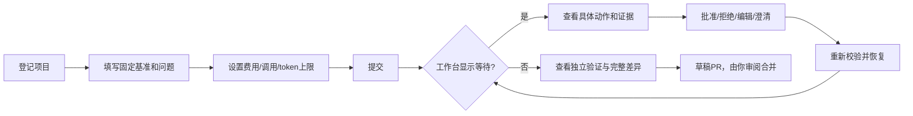
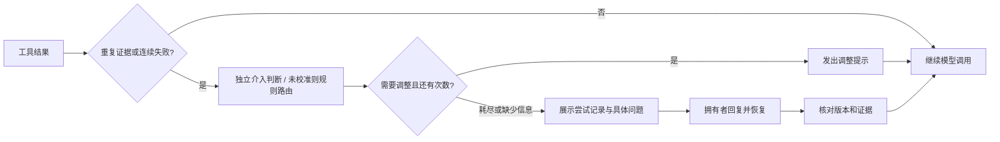

# DecAgent 本机使用指南

> 历史资料说明（2026-10-12 更新入口）：本页保留仓库修复与旧 Docker 控制部署的使用指南，生成于 2026-10-11。原命令、测试数量、费用和通过状态仅适用于当时范围；不作为当前业务 Agent、真实模型提效或独立 Linux 部署的验收结论。
>
> 当前入口：[业务使用指南](../261012/0852_业务Agent使用指南.md)、[业务架构](../261012/0852_业务Agent架构详解.md)、[离线图册](../261012/0902_业务Agent架构图册.html)、[本机业务验收](../261012/0900_本机业务验收记录.md)。业务题目与 synthetic-reference 校准/40+80 评测见[当前评测说明](../261012/0844_业务基准评测说明.md)。

DecAgent 的核心是人工介入决策：任务什么时候继续，什么时候换一种尝试，什么时候需要你提供线索。Python 仓库修复是第一个应用场景，你通过网页查看尝试轨迹、回复具体问题，再查看独立验证结果和草稿 PR。项目位于原 Waku 的同级目录 `DecAgent/`。生成的说明在 `generated/`，凭据和本地证据在忽略目录 `.decagent/`。

本次已验证 Windows、Docker Desktop 的 Linux Engine、Python 3.11 容器和当前 Agent311 的 Python 3.13。独立 Linux 主机验收按你的决定保留待办。

## 1. 进入项目环境

在 PowerShell 中进入 `DecAgent` 项目根目录。你已有的 Agent311 可以继续使用；环境名称不保证 Python 版本。

以下是安装配方，本轮未重复修改你的 Conda 环境；已在项目隔离环境与 Python 3.11 容器验证依赖导入。

```powershell title="not executed in this run"
conda activate Agent311
python --version
$env:PIP_CONFIG_FILE = "nul"
python -m pip install --index-url https://pypi.org/simple -r requirements.txt
```

`PIP_CONFIG_FILE=nul` 仅在当前终端屏蔽旧 pip 配置，避免继续使用报 SSL 错误的 NVIDIA 索引。保留 HTTPS 证书校验。

`requirements.txt` 先安装锁定依赖，再通过 `-e .` 安装本地 `decagent` 包。之后源码修改直接生效。项目根目录的 `pyproject.toml` 定义包名、依赖与命令入口。

已执行的无费用检查：

```powershell
.venv\Scripts\python.exe -m decagent --help
.venv\Scripts\python.exe -m decagent doctor
```

doctor 只显示“是否配置”，不输出密钥，也不调用模型。

`$env:PYTHONUTF8 = "1"` 是 PowerShell 设置当前终端的 Python UTF-8 模式的命令，可在运行 Python 前执行；退出这个终端后失效。它不能把原本 GBK 编码的文件转换成 UTF-8。DecAgent 的持久文件读写已明确指定 UTF-8，通常无需额外设置。

## 2. 核对控制服务配置

本次保留你的 `.env` 密钥，并补上了运行所需的非秘密配置。不要用 `.env.example` 覆盖已有 `.env`。这些值只属于控制服务，不进入仓库任务容器。

| 配置 | 当前选择 / 用途 |
| --- | --- |
| 主模型 | `qwen3.8-flash` |
| 主模型地址 | `https://maas.qianwenaiapi.com/compatible-mode/v1` |
| Jev provider | `openrouter` |
| Jev 请求模型 | `~typesafe/jev-latest` |
| Jev 实际已验证版本 | `typesafe/jev-1.13-20260917` |
| `DECAGENT_MAIN_PRICE_VERSION` | `owner-confirmed-free-quota-20261011` |
| 主模型输入 / 输出计价 | 当前均为 0，依据是你确认的免费额度 |
| `DECAGENT_JEV_RESERVATION` | 每次请求先预留 `$0.02`，按真实 usage.cost 结算 |
| `DECAGENT_CONTEXT_TOKENS` | `65536`，保护授权、验证证据和完整工具消息 |
| runner | 固定 `sha256:` 镜像 ID，不能只写可变标签 |
| Git 作者 | `DecAgent`，使用测试仓库拥有者的 noreply 邮箱 |

免费额度用尽或更换账号、服务后，更新价格依据与单价，再运行真实任务。零计价表示本次约定的增量费用；供应商没有返回的账单金额仍不伪造。

Jev 暂未完成真实人工样本校准。工具风险判断仍保守转审核；新增 `task_intervention` 建议以 shadow 方式记录，实际继续、调整和求助由有界规则执行。高 confidence 不直接授予写入、执行命令或发布权限。

## 3. 启动本机工作台

已执行以下流程；本机工作台默认绑定 `127.0.0.1:8000`。`prepare_secrets` 只创建缺失的文件，保留已有凭据。

```powershell
.venv\Scripts\python.exe -m ops.control.prepare_secrets
docker compose build
docker compose up -d --wait
docker compose --profile setup run --rm owner-init
```

`owner-init` 只在新实例运行一次。已初始化时拒绝覆盖；正常重启无需重复初始化。

导出拥有者令牌到新的受保护主机文件：

```powershell
.venv\Scripts\python.exe -m ops.control.export_owner
```

文件是 `.decagent/compose-cli/owner.token`。你自行打开该文件，复制内容到网页登录表单。不要把令牌发送到聊天、提交 Git 或放入网页截图。

以后启动使用 `docker compose up -d --wait`。需要停止时使用 `docker compose stop`；此停止命令本轮未执行。它保留数据卷。不要为了排查问题删除 PostgreSQL、checkpoint 或证据卷。

## 4. 登录并登记仓库

打开 [本机工作台](http://127.0.0.1:8000)，输入拥有者令牌。

1. 展开“登记仓库”，填写 `owner/repository` 和基准分支。
2. 使用仅覆盖目标仓库的细粒度 GitHub PAT。需要 Metadata 读取、Contents 读取/写入、Pull requests 读取/写入。
3. 服务核对 GitHub 登录身份、仓库 ID、归属和 push 权限。某个 PAT 权限较大，不会扩大任务授权。
4. 真实验收仓库是 `shuaibilx/decagent-integration-test-20261010`。实验基准分支为 `decagent-fixture/semantic-20261010`，其 main 未被修改。

PAT 保存在控制服务 `.env` / secrets 中，网页不接收 PAT 明文。远程使用必须配置 HTTPS；本次仅完成本机 loopback 部署。

## 5. 提交任务与处理等待



填写问题时包含输入、观察到的错误和预期行为。任务将分支解析成固定 SHA，后续执行不跟随分支任意移动。填写费用上限，即使千问免费，也仍限制 Jev 调用。

“允许创建草稿 PR”是发布授权。任务只有完成相关基线失败、同一固定材料的独立通过和非零回归通过，才允许发布。

| 等待原因 | 你应当处理的内容 |
| --- | --- |
| action | 核对具体工具、路径、命令、当前摘要；可批准、拒绝或编辑 |
| code_trust | 确认具体仓库及 SHA；动作批准不能代替代码信任 |
| clarification | 确认失败用例是否对应需求，或回答停滞求助中的具体定位问题 |
| budget | 调整真正不足的限制；上下文不足时，提高金额无效 |
| reconciliation | 核对已有动作或 PR 的实际结果；不盲目重发未知操作 |
| version | 保留旧 checkpoint，解决版本兼容性后再继续 |

审批只适用于当前规范化动作与材料摘要。改变代码、证据、授权或策略后，旧批准可能失效。点击网页刷新不会重启任务；SSE 断线恢复补齐持久事件。

### 5.1 查看进展与介入轨迹

任务详情中的“进展与介入轨迹”显示观察、判断、策略调整提示、求助与回复。展开证据可核对最近尝试、退出状态、目标和结果摘要。模型建议与实际程序路由分别显示；`shadow` 表示该建议还没有相应版本的校准依据。

| 路由 | 实际行为 |
| --- | --- |
| continue | 将工具结果交给主模型继续；新的观察不等于修复已成功 |
| replan | 要求主模型检查已有证据并提出不同假设；提示本身不证明策略已经改变 |
| clarify | 请求你补充需求或预期行为 |
| escalate | 提交尝试记录及具体线索请求；调整次数耗尽时必定求助 |

规则在工具队列处理完后检查进展。重复相同动作与结果，或连续两次失败会触发检查；一次失败或读取不同内容不会立即中断。每轮反馈最多发出两次调整提示。未知执行结果先核实，不能靠再次执行试探。全局调用、token、费用和执行限制始终有效。

出现求助卡片时，在回复框填写目标文件、可复现输入或预期输出等有用信息，点击“提交补充信息”，再点击“重新校验并恢复”。回答绑定当前问题与证据；代码或授权变化会要求重新确认。恢复复用原判断和问题，不重复执行已经确认的动作。运行时求助或主模型 `request_user` 的有效新回复开始下一轮有界调整，但不会扩大权限或重置总预算。



### 5.2 导出介入场景与任务轨迹

以下命令不调用模型，默认运行八个合成场景，生成 Markdown 与 JSON：

```powershell
$env:PYTHONUTF8 = "1"
python -m decagent intervention-report
```

导出已登录实例的某个真实任务时，先使用已导出的拥有者令牌目录，再替换 UUID：

```powershell title="replace task UUID before running"
$env:DECAGENT_DATA_DIR = (Resolve-Path .decagent/compose-cli).Path
python -m decagent intervention-report --task-id YOUR_TASK_UUID
```

输出保存在 `generated/YYMMDD/HHmm_介入场景与轨迹报告.*`。任务导出包含最多 50 条进展/介入事件，并明确是有界历史。标签留空，拥有者回复不会自动变成判断正确性的标签。合成场景通过只验证程序行为；误中断、漏中断与任务收益仍需独立人工标注和真实对照实验。

## 6. 查看交付与项目记忆

先查看“差异”和“验证与判断依据”，再打开草稿 PR。模型回复“修好了”不等于任务成功。未经独立验证的结果会显示 `unverified`。

真实已验证的交付：

- [PR #1](https://github.com/shuaibilx/decagent-integration-test-20261010/pull/1)：脚本化模型和 RuleStrategy，零付费请求，验证工程管道。
- [PR #2](https://github.com/shuaibilx/decagent-integration-test-20261010/pull/2)：真实千问和 OpenRouter Jev，保留原始测试，独立与回归均 2 项通过。
- [PR #3](https://github.com/shuaibilx/decagent-integration-test-20261010/pull/3)：注入命令响应丢失、审批后重建 worker 和 PR 创建响应丢失，核实已有结果后恢复，无重复草稿 PR。

“项目记忆”页面提供候选审核和撤销。未合并的分支知识不能仅靠审核成为其他任务可读的活跃记忆。worker 定期核对真实合并 SHA、来源 blob 和验证依据；冲突继续待审核。

本次已通过默认认证 API 查看 PR #2 交付并撤销其测试记忆候选；重复同一请求返回原回执。撤销增加修订版本，后续读取立即排除该记录。测试 PR 保留草稿状态，未为验证记忆而合并。

## 6.1 配置与连接诊断

在配置区查看“是否已配置”，页面不显示密钥。本地诊断只访问数据库；没有调用模型、GitHub 或运行任务。真实诊断需要选择一个目标并勾选明确确认。主模型和 Jev 每次诊断的费用预留上限为 `$0.05`，主模型输出上限为 256 token，Jev 不重试。

API 与 worker 均在控制服务中持有模型 secrets；仓库任务容器不接收这些 secrets。真实诊断先把 dispatch intent 提交到 `app.model_diagnostics`，再发 HTTP。响应未知时保留预留，同一请求不再次收费；另点一次新诊断按钮会创建新请求，应先检查原回执。

本机默认 API 的千问流式诊断与 Jev typed Decisions API 均已真实通过；同一个 Idempotency-Key 重发复用了原结果。诊断连通只证明接口可用，不能替代修复任务验收或 Jev 质量校准。

## 7. CLI 管理与故障处理

已在 API 容器内运行认证查询：

```powershell
docker compose exec -T api python /opt/decagent/start.py tasks
```

以下是供你替换任务 UUID 的操作配方，本轮未对你的新工作台任务执行取消或修改预算；接口行为有真实 PostgreSQL 回归测试。

```powershell title="not executed in this run"
$env:DECAGENT_DATA_DIR = (Resolve-Path .decagent/compose-cli).Path
python -m decagent tasks
python -m decagent task show YOUR_TASK_UUID
python -m decagent task resume YOUR_TASK_UUID --max-cost 1 --max-calls 30 --max-tokens 100000
python -m decagent task cancel YOUR_TASK_UUID
```

| 现象 | 检查 |
| --- | --- |
| 网页能提交，但任务不启动 | `docker compose ps`；worker 是否运行 |
| broker 不健康 | 固定 runner ID、Docker Linux Engine、隔离自检结果 |
| 未校准或 Jev 故障 | 查看判断记录；完成当前审批，不提高 confidence 来替代授权 |
| 修改 `.env` 后没有生效 | Compose 密钥来自 secrets；更新受保护文件并重建对应服务 |
| context budget 等待 | 提高 `DECAGENT_CONTEXT_TOKENS` 后重建 worker，或缩小任务范围 |
| 重启后 recovering | 核对未知命令/PR；保留原动作与事件，不删库 |

运行数据备份和恢复到新实例的步骤见 [数据与备份说明](../261010/1555_数据预算迁移与备份.md)。恢复必须使用新的空数据库和证据目录。

当前限制和进一步验收见最新发布报告。人工标注与真实三策略质量对照尚未完成；不能据此声称 Jev 已提高修复成功率。
