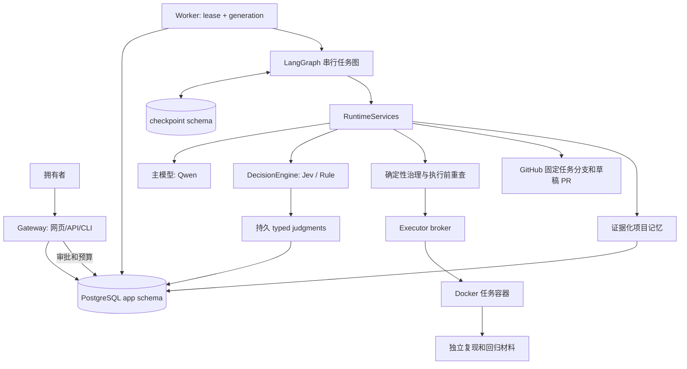
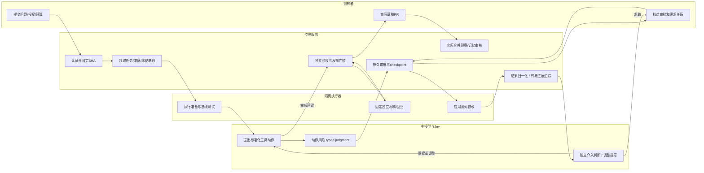
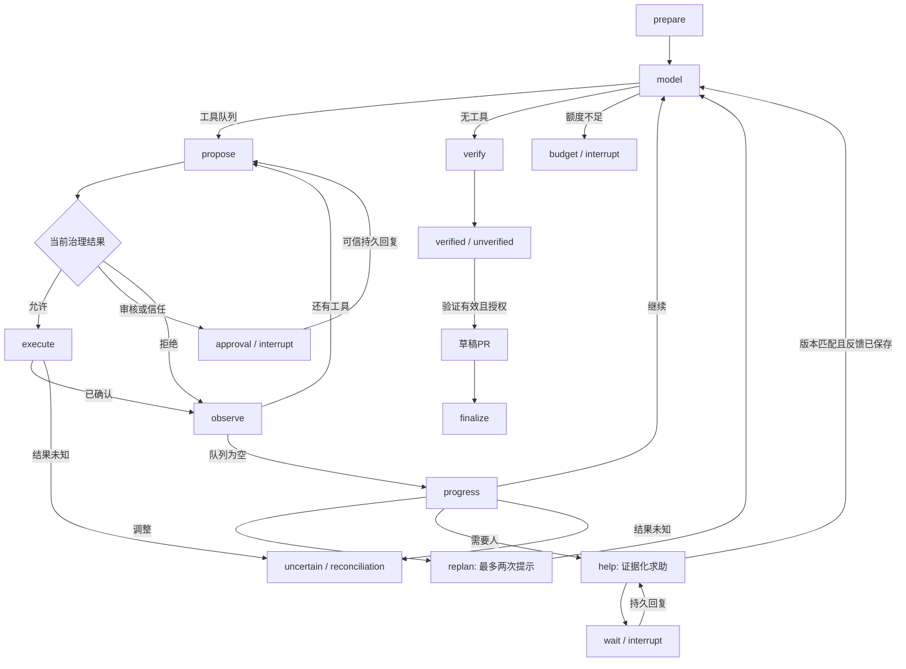
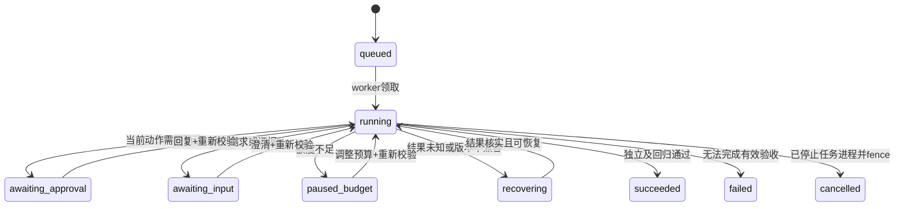
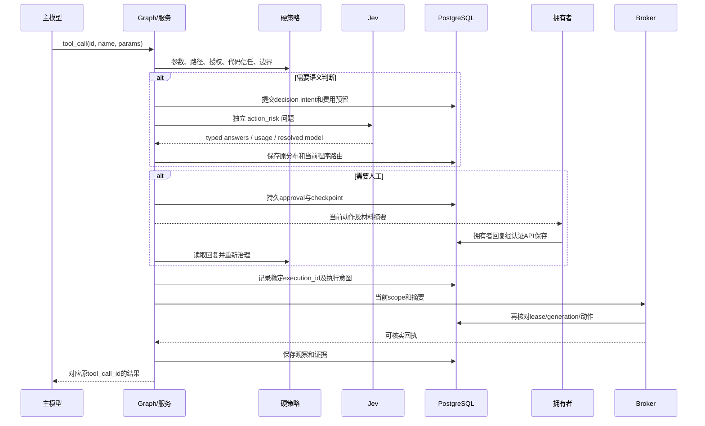
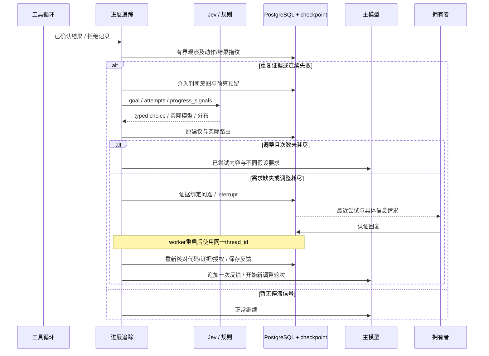
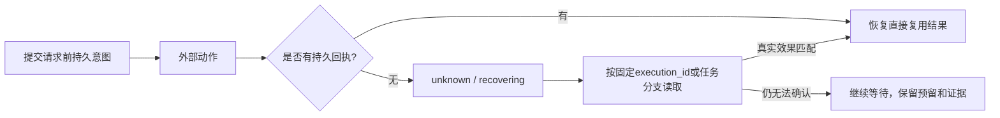
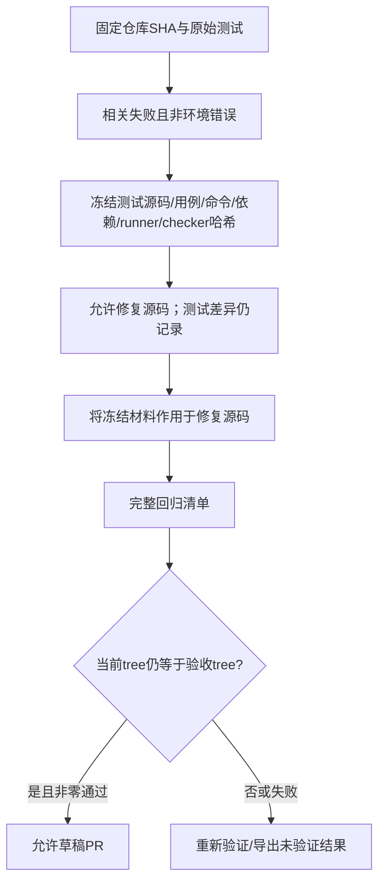
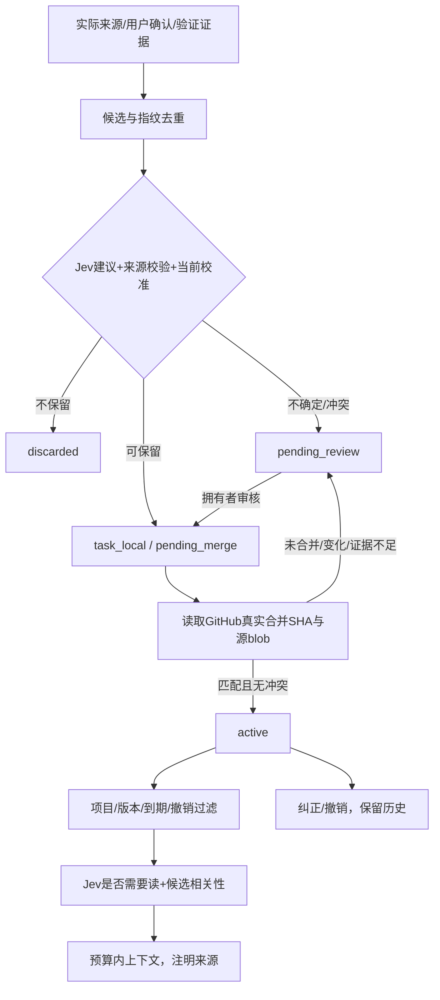
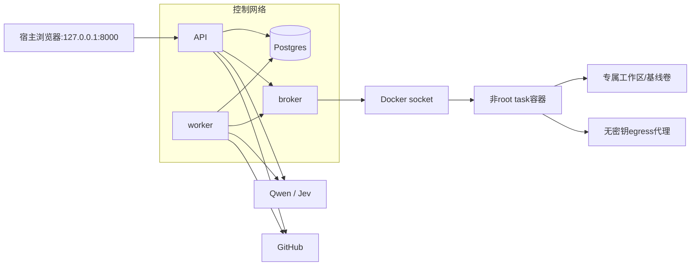

# DecAgent 智能体架构详解

> 历史资料说明（2026-10-12 更新入口）：本页保留repository_repair 与 adaptive-intervention 的架构说明，生成于 2026-10-11。原命令、测试数量、费用和通过状态仅适用于当时范围；不作为当前业务 Agent、真实模型提效或独立 Linux 部署的验收结论。
>
> 当前入口：[业务使用指南](../261012/0852_业务Agent使用指南.md)、[业务架构](../261012/0852_业务Agent架构详解.md)、[离线图册](../261012/0902_业务Agent架构图册.html)、[本机业务验收](../261012/0900_本机业务验收记录.md)。业务题目与 synthetic-reference 校准/40+80 评测见[当前评测说明](../261012/0844_业务基准评测说明.md)。

DecAgent 的主线是自主任务中的人工介入决策：观察实际尝试，识别重复证据，在预算内调整策略，并在需要人帮助时提交具体问题、持久化回答后恢复。Python 仓库修复作为首个可验证场景，提供固定基线、独立验收和草稿交付。

核心工程问题是：失败可能带来有用线索，重复操作也可能只是在消耗预算，Agent 应如何区别处理。进展模块保留动作与结果指纹，独立介入节点选择 continue/replan/clarify/escalate。指纹变化只表示观察新颖性，不代表任务已经取得有效进展；修复成功仍由独立验收证明。

## 动机与上游思想

本项目希望回答“自主执行与人的注意力如何分配”。可展示的特点是有证据的停滞识别、有界策略调整、具体求助、持久反馈恢复及可复查的决策轨迹。当前实现已经提供这些机制；是否减少误中断和漏中断，需要下一阶段数据证明。Python 修复提供可重复的任务成功标准，供比较不同介入策略，而非作为项目唯一卖点。

Waku 提供了职责清晰、便于阅读的 Python 包结构和 gateway/runtime/memory 的工程参照。DecAgent 保留原项目，在独立目录实施，原有 `.waku/` 不迁移为新项目状态。

pi 的启发落在小而清楚的工具循环、模型适配边界和上下文管理上。当前运行时使用 Python LangGraph，不嵌入 pi 的 Node CLI，也不声称兼容其所有扩展机制。来源、许可和具体借鉴范围见根目录 NOTICE。

Jev 负责窄而有明确类型的语义判断；千问负责理解任务、选择工具和生成修复。LangGraph 负责节点、等待和恢复，PostgreSQL 保存授权、动作、预算、证据与 checkpoint。

| 决策 | 主模型 | Jev | 确定性程序 / 拥有者 |
| --- | --- | --- | --- |
| 生成修复源码 | 生成候选 | 不生成 | 验收实际差异 |
| 工具安全性 | 提出工具 | 判断语义风险 | 路径、参数、授权、边界硬校验 |
| 是否人工介入 | 在调整提示后提出不同假设 | 独立 task_intervention：continue / replan / clarify / escalate | 有界规则与版本匹配校准路由；需求回答不授予动作权限 |
| 是否沉淀记忆 | 可提取候选 | retain / discard / review | 来源、验证、冲突、实际合并决定生效 |
| 是否读取记忆 | 提供任务语义 | Noul 读取门控与相关性 | 项目、版本、撤销、敏感性过滤 |
| 是否成功与发布 | 可建议完成 | 不负责最终证明 | 独立验证 + 回归 + 固定内容 + 草稿授权 |

## 总体架构图

Gateway 是交互入口，负责认证、提交与拥有者操作；它不直接执行仓库代码。worker 从数据库领取任务，通过 lease 表示暂时执行权，用 generation 阻止旧 worker 回写。

模块入口：[application.py](../../decagent/runtime/application.py)、[worker.py](../../decagent/runtime/worker.py)、[graph.py](../../decagent/runtime/graph.py)、[services.py](../../decagent/runtime/services.py)。

## 修复任务泳道图

泳道表示职责分配，不表示主模型与 Jev 串联授予权限。确定性硬拒绝、低风险读取可以直接路由；只有适合语义判断的操作才调用 Jev。

## LangGraph 流程与任务状态

图中 state 保存普通 JSON。`thread_id` 固定为任务 UUID。恢复载荷帮助图找到持久回复；它本身不成为授权。执行前仍核对真实数据库状态、摘要、lease、generation 和当前材料。

## 一次治理工具调用的时序图

新版动作请求只判断 `action_risk`；旧版同时记录 `action_risk` 和 `intervention` 的持久请求保留兼容。任务介入在结果边界单独判断，不附带在每一次工具审批中。Choice confidence 表示分布集中度；Noul 是 yes 概率，没有另一个 confidence。阈值须匹配实际模型、问题、策略与数据版本。未校准的动作风险保守审核；未校准的任务介入只保留模型建议，按有界规则路由。[TypeSafe Choice](https://docs.typesafe.ai/primitives/choice)、[校准与路由](https://docs.typesafe.ai/patterns/confidence-routing)。

## 介入决策与反馈恢复

进展只保留最近 20 个归一化观察。哈希排除执行 ID、时间戳与耗时等噪声；pytest 汇总耗时变化不产生虚假新证据，源码内容变化仍保留。重复检查以最近六次观察为窗口，连续失败与同一动作/结果重复分别计算。求助保留最近八次尝试，网页事件保留最新 50 条展示范围。

每轮最多两次策略调整提示，实际是否改变策略由后续动作证明。有版本匹配校准时可采用 Jev 路由；重复四次的无效继续仍会被程序纠正，次数耗尽必定求助。未知执行回执直接进入核实流程。运行时求助与主模型 `request_user` 的有效新回复都开始下一反馈轮次，不清空总预算、历史事件或工具授权。长判断和回复读取结束后再次检查租约，过期 worker 不能推进这些节点的 checkpoint。

`graph_version=1` 与应用 schema 版本 4 保持兼容，新增状态有缺省值，原节点名称保留。判断 ID 增加任务及版本上下文，避免相同输入在不同任务中碰撞；完全匹配的旧意图仍复用。问题与反馈绑定当前代码、证据、策略和授权，过期回复不能推动新版本任务。

入口：[progress.py](../../decagent/runtime/progress.py)、[intervention.py](../../decagent/runtime/intervention.py)。[LangGraph 中断机制](https://docs.langchain.com/oss/python/langgraph/interrupts)要求节点恢复时重新执行，副作用必须通过持久记录保持幂等；本项目的问题、反馈及调整事件采用稳定键去重。

## 幂等与崩溃窗口

命令、写入、模型调用与 GitHub 发布都有独立意图。网络超时不等于外部操作没有发生。命令核实使用稳定执行 ID；写入核实保留预期内容哈希和路径；PR 核实使用固定分支、commit、tree 与任务标记。

执行凭据：[operations.py](../../decagent/runtime/operations.py)。持久 Jev 调用：[durable.py](../../decagent/decisions/durable.py)。草稿恢复：[delivery.py](../../decagent/integrations/delivery.py)。

## 独立验收如何避免“改测试来通过”

基线只接受与需求相关的失败。测试删除、skip/xfail、断言削弱和检查范围减少会被标注。可信 checker 使用父进程与私有通道接收结构化结果，仓库代码打印相同 marker 不构成有效通过。零用例、环境错误或验证后再次修改都不能发布。

复现与验收模块：[session.py](../../decagent/tools/repair/session.py)、[check_runner.py](../../decagent/tools/repair/check_runner.py)、[changes.py](../../decagent/tools/repair/changes.py)。

## 项目记忆生命周期

修复后自动生成的事实候选描述可观察的路径、内容和通过用例。它不凭模型推断“根本原因”或架构决策。未合并知识仅用于当前任务；跨任务生效要核实实际合并内容，包括 squash 合并。

上下文组织保留授权、验证信息和完整 tool_call/result 配对。记忆与仓库文本按不可信数据处理，不能改写系统授权。压缩不删除原事件，也不替代 checkpoint。

## 部署与安全边界

只有 broker 挂载 Docker socket。API、worker、数据库凭据和模型密钥不进入任务容器。任务容器具备 CPU、内存、进程数限制、只读根文件系统与受限出口网络。控制服务不能因为模型提出命令而在宿主进程直接执行仓库代码。

## 当前证据与限制

真实修复 PR #2 使用千问和 Jev，基线失败、独立与回归各两用例通过，生成草稿后保留人工审阅。它证明该限定仓库任务可以闭环，不证明所有 Python 项目都可自动修复。

真实历史缺陷数据集覆盖 Flask、Requests 和 pytest 的 12 个任务，已逐个核对基础失败与参考修复通过。120 个判断样本的真实人工标签仍待完成；不能用模拟答案宣称 Jev 改善。

本机部署与 Docker Linux 容器已验证。命令响应丢失、审批后恢复、PR 响应未知的真实演练已生成草稿 PR #3；版本 4 备份已恢复到新数据库，未来 schema/graph 升级被阻止，旧镜像回滚通过。独立 Linux 主机与真实人工标注三策略质量对照仍待验收。`release-report` 在缺失、跳过、过期或证据被修改时返回 incomplete。

网页模型诊断也是受限的控制服务动作：拥有者显式选择一个目标，API 独立提交 `app.model_diagnostics` 的意图后调用供应商，结果未知时保留预留。诊断不会运行仓库工具或改变任务授权；其上限为每次 `$0.05`，相同逻辑请求复用既有结果。

使用流程见 [使用指南](0616_使用指南.md)，各脚本职责见 [源码结构说明](0639_源码结构与脚本职责.md)，概率与配置细节见 [Jev 指南](../261010/1601_Jev决策与校准指南.md)。真实恢复、回滚和费用证据见 [GitHub 与验收记录](0643_GitHub与真实验收记录.md)。

## 后续创新路线

| 阶段 | 要解决的问题 | 可核对的产物 |
| --- | --- | --- |
| 决策质量 | 什么时候该继续、换策略或问人；新证据是否真正有用 | 真实停滞轨迹、独立双人标签、争议处理、按仓库/缺陷分组的校准与留出集 |
| 人的注意力成本 | 相同成功率下能否减少打断、缩短等待；什么时候问最有价值 | 规则 / 主模型 / Jev 统一预算的实际任务对照，误中断、漏中断、成功率、等待和调用成本 |
| 跨任务经验 | 如何复用“怎样问人、怎样换策略”的有效经验 | 带真实结果和版本来源的介入策略记忆；独立读取/写入判断，沿用现有记忆治理 |

先导出未标注轨迹并观察 shadow 建议，再用留出实验选择自动路由。轨迹重放不能替代真实收益实验：采用不同策略会改变后续操作与求助时机。每次创新需要给出触发条件、状态契约、可复现实验和失败退路，并同步使用指南。
