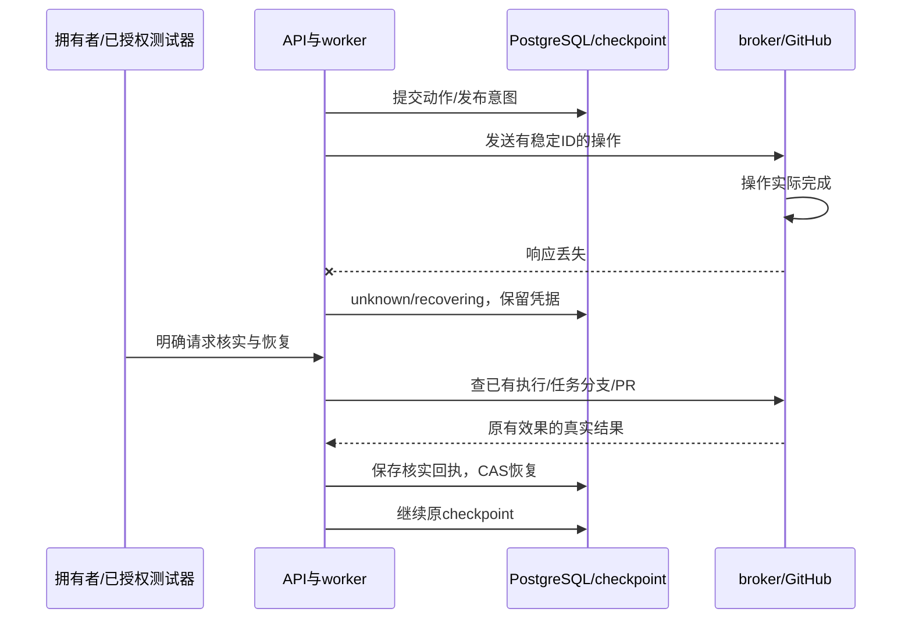

# GitHub 权限、真实修复与恢复验收

> 历史资料说明（2026-10-12 更新入口）：本页保留基础仓库修复、GitHub 草稿与响应丢失演练的历史记录。原命令、测试数量、费用和通过状态仅适用于当时范围；不作为当前业务 Agent、真实模型提效或独立 Linux 部署的验收结论。
>
> 当前入口：[业务使用指南](../261012/0852_业务Agent使用指南.md)、[业务架构](../261012/0852_业务Agent架构详解.md)、[离线图册](../261012/0902_业务Agent架构图册.html)、[本机业务验收](../261012/0900_本机业务验收记录.md)。业务题目与 synthetic-reference 校准/40+80 评测见[当前评测说明](../261012/0844_业务基准评测说明.md)。

> 历史范围：本记录对应基础工作台与既有草稿 PR，不作为新增人工介入机制的真实收益证据。新版进展、调整和反馈闭环另行验收。

DecAgent 已在当前 Windows + Docker Desktop 本机完成 Python 仓库修复、草稿 PR 交付和响应未知恢复。所有真实测试使用独立私有仓库，草稿未合并，主分支保持原 SHA。实验结果证明受限任务闭环可运行；人工标注三策略质量对照仍待执行。

## 权限与仓库范围

已按你的授权创建私有仓库 [shuaibilx/decagent-integration-test-20261010](https://github.com/shuaibilx/decagent-integration-test-20261010)，仓库 ID `1412976452`。凭据属于控制服务，进入 `.env` / Compose secrets，网页和任务容器均不接收 PAT 明文。

日常使用建议采用只覆盖目标仓库的细粒度 PAT：Metadata 读取、Contents 读取/写入、Pull requests 读取/写入。仓库创建是单独的管理动作，不属于每个修复任务的必要权限。登记时从 GitHub 的实际身份、仓库 ID、owner 和权限响应核实归属；“有 push 权限”不等于“仓库属于你”。

发布到 `decagent/<任务UUID>`，要求提交任务时明确允许草稿 PR，固定 base 未变，源码差异绑定已完成的独立/回归验证。没有 force push、自动修改主分支或自动合并路径。关闭而未合并的 PR 不会被恢复流程自动重新打开。

## 三个已保留的真实草稿

| 交付 | 主模型 / 判断器 | 实际结果 |
| --- | --- | --- |
| [PR #1](https://github.com/shuaibilx/decagent-integration-test-20261010/pull/1) | scripted / rule | 零模型费用，核对治理、Docker 执行、固定验收与 GitHub 管道。 |
| [PR #2](https://github.com/shuaibilx/decagent-integration-test-20261010/pull/2) | qwen3.8-flash / OpenRouter Jev | 原始测试保持，基础 1 失败/1 通过，独立 2 通过、回归 2 通过；66 checkpoint。 |
| [PR #3](https://github.com/shuaibilx/decagent-integration-test-20261010/pull/3) | scripted / rule | 命令实际完成后注入响应丢失、审批后重建运行时、PR POST 实际成功后注入响应丢失；核实后恢复，未重复创建 PR。 |

固定实验基准为分支 `decagent-fixture/semantic-20261010`，SHA `5872b9e4cdc33f618bda11e95f99d1499d37822d`。主分支原值和观察后值均为 `bcb0e941d724c03c2d2a30b330310f7cee8f5b4c`。

真实千问任务 UUID：`bb8a7629-ecbb-4b35-b062-7d852c6a0cb8`。恢复任务 UUID：`37b0fd7e-cd51-4107-805e-241483e821d0`。每次模型请求、审批、工具动作、执行 ID、验证材料与交付意图都有数据库审计依据。

真实模型第一次尝试中，测试器曾拒绝超出最初固定 fixture 范围的命令/发布请求。范围只对该已授权测试任务中的有界 pytest 参数和精确任务分支作了核对修正；随后恢复同一 checkpoint。历史错误记录保留，最终控制回执为 verified；不能只凭旧 intent 中残留的 error 字段推断最终失败。

## 响应未知的恢复过程

PR #3 演练重建运行时 12 次，保留 30 checkpoint、7 次 Docker 执行。命令响应丢失的执行 ID 为 `7f9fb248-dcd8-561e-b6fe-3f30c3ea276f`；broker 在代次 3 和 21 后被重建。审批回复在新运行时重读并绑定当前动作。发布恢复只用 GET 核对任务分支、commit/tree/parent、任务标记与草稿，找到后保存已有 PR #3。

找不到可核实结果时继续等待人工，不把“没有返回错误”当作“已经成功”。维护管理员不应删除 unknown 记录、checkpoint 或故障卷来强行推进。

## 版本 4 备份与回滚

从真实 PR #2 的任务数据库和证据导出一致快照，恢复到新的测试数据库。原任务记录保持不变；恢复核对包括 20 个动作、12 个审批、5 个判断、6 份证据、13 笔 usage、3 个验证和 66 checkpoint。新表 `app.model_diagnostics` 也包含在版本 4 的备份中。

快照 SHA-256：`25016a3de4fa427abee93ac58c6085f6e429edc0bb90d17aaef04456a1bbc9cb`。

在恢复副本中注入未来 schema 标记，旧应用明确阻止迁移；移除该测试标记后版本检查恢复。随后运行不兼容 graph 镜像，退出码 1；回到原固定镜像，退出码 0。同一恢复数据库被保留，没有删除原 Waku、原任务数据或故障卷。

| 镜像 | 不可变 ID |
| --- | --- |
| 演练原控制镜像 | `sha256:08fa1f12792fde0a26e60bebd75f245a9310ff474a6034a86e54de7a154f3f40` |
| 不兼容 graph 镜像 | `sha256:1a7b5517825273e9a1a1307f490e80c6689d2ff92ed7d51b3b5f423253e4b982` |
| 固定仓库 runner | `sha256:caa1b714fa8f01202405776e8e93ae464fac4f92075db47458833e54b3b405cd` |

历史版本 3 的备份演练回执继续保留；新版演练使用新的 intent 和数据库，不覆盖历史快照。

## 模型费用与证据

| 范围 | 主模型 | Jev 实际已知费用 |
| --- | --- | --- |
| 初次连接诊断 | 1 次，1,254 token，供应商未返回账单金额 | 1 次，371 token，$0.000014658 |
| PR #2 真实修复 | 8 次，24,660 token | 5 次，4,739 token，$0.000184296 |
| 默认网页 API 诊断 | 1 次，1,298 token | 1 次，366 token，$0.000014448 |
| 合计 | 10 次，27,212 token | 7 次，5,476 token，**$0.000213402** |

千问新增验证按你确认的大额免费额度采用 `owner-confirmed-free-quota-20261011`，输入/输出增量计价 0。这个零值是你确认的预算依据；不表示供应商返回了零金额账单。初期未知费用账本和原始诊断回执保持原状。

已知 Jev 费用远低于本次 $1 授权上限；它不包含未来任务。`jev-latest` 请求在本次实际解析为 `typesafe/jev-1.13-20260917`，将来别名更新需重新记录返回版本和校准依据。

完整控制回执在 `.decagent/live-repository/<run UUID>/control-receipt.json`，运行日志和证据也留在该忽略目录。新网页诊断回执是 `.decagent/web-diagnostics.json`，版本 4 备份意图是 `.decagent/backup-drill-v4-intent.json`。这些包含内部任务审计信息，应留在本地；对外展示使用本说明和脱敏摘要。

## 仍待验收

- 独立 Linux 主机：按你确认的条件保留待办，Docker Desktop Linux 容器结果不等同于原生 Linux 部署。
- 人工标注与三策略真实质量对照：120 个待标注样本不能作为 ground truth。完成人工审核及模型/样本/费用 manifest 确认后才能运行实验并判断 Jev 是否改善。
- 本次支持边界是受控 Python 仓库修复。大型多语言项目、任意网络服务、GPU 环境和非 Python runner 不属于已经验证的支持范围。

日常操作见 [使用指南](0616_使用指南.md)，实现与可视化见 [架构详解](0616_智能体架构详解.md) 和 [离线图册](0618_架构图册.html)。
