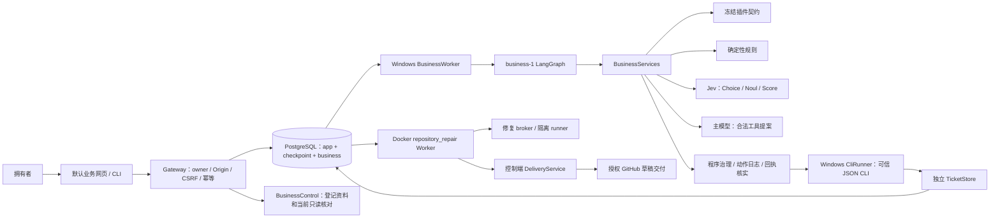
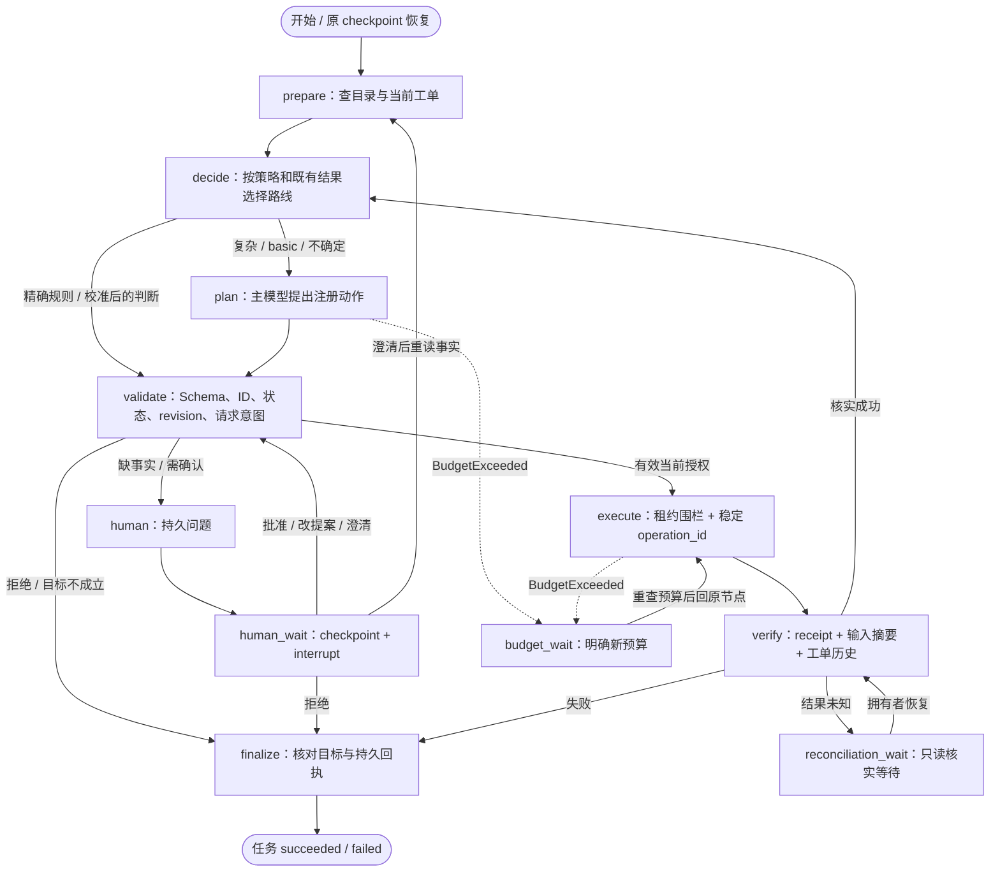
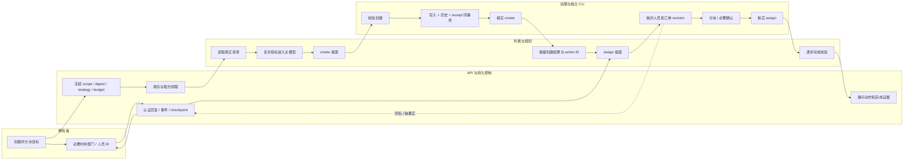
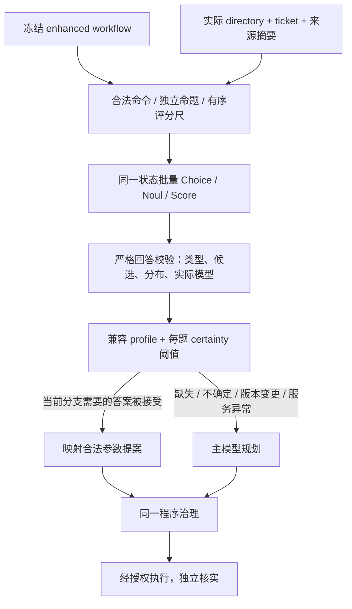
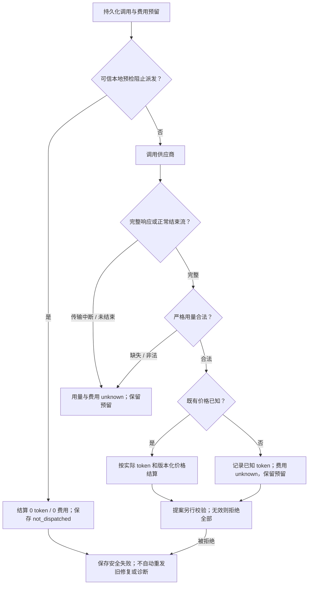
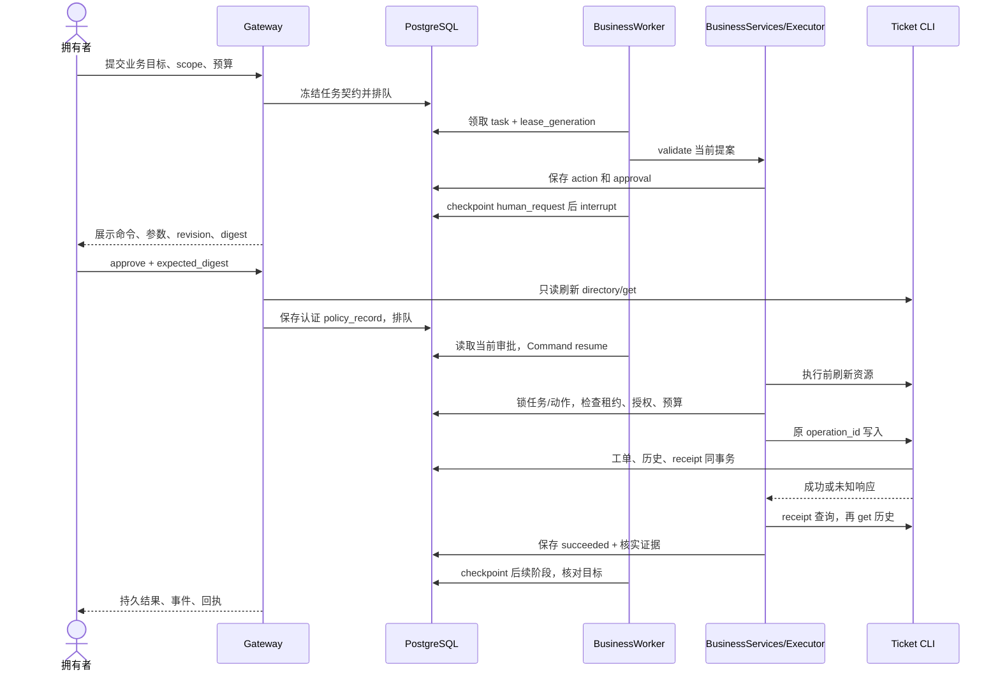
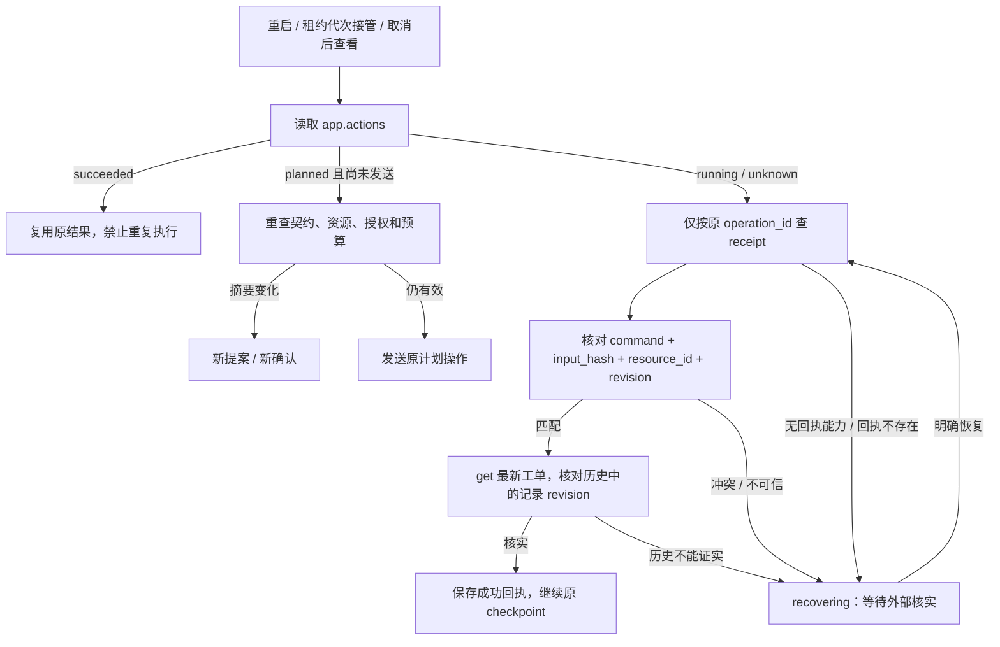
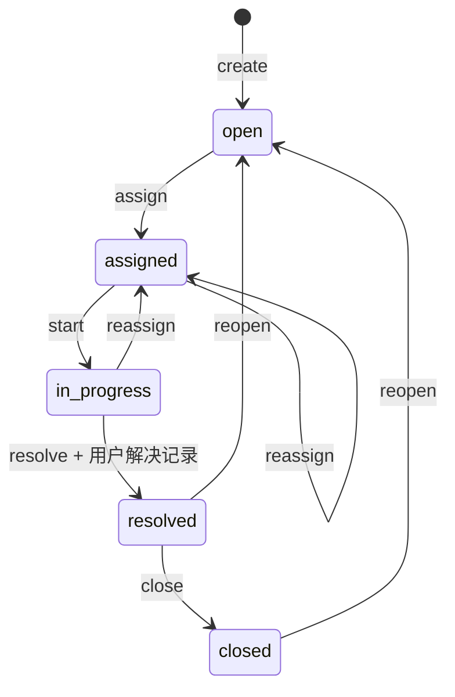
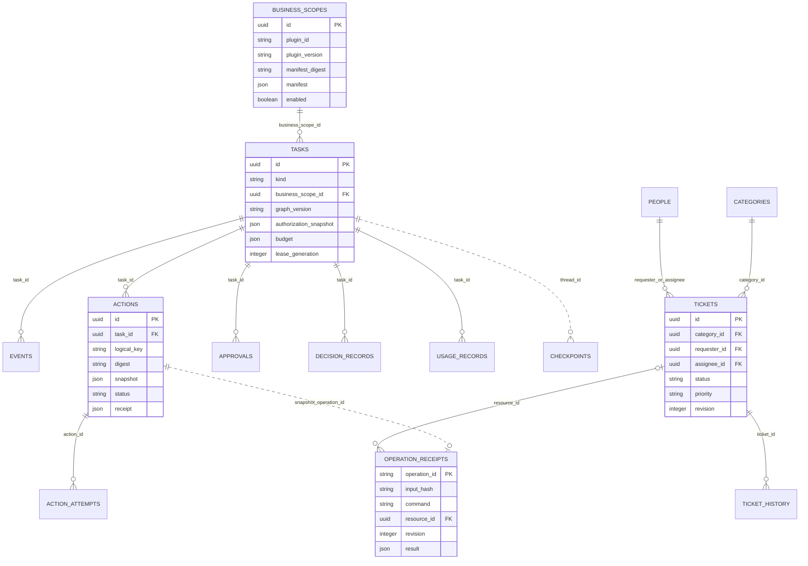
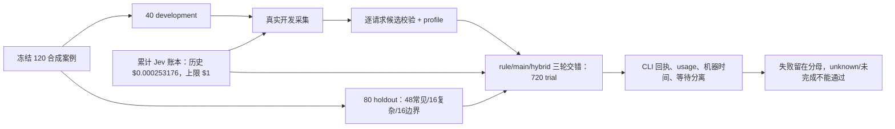

> 历史版本说明：本页保留 CLI / owner 业务路线的当时内容。当前业务已迁移为员工身份下的 MCP + Skill；请使用[当前指南](../261014/1646_MCP业务Agent使用指南.md)和[当前架构](../261014/1646_MCP业务Agent架构详解.md)。

# 业务 Agent 架构详解

DecAgent 让主模型和 Jev 使用同一份业务契约，但把“判断什么”“能否执行”和“是否完成”交给不同环节。
当前默认业务是本地合成服务工单：查目录、创建、分派、评论和状态变更。
主模型规划复杂目标，Jev 判断程序提供的有限选项，程序校验每次提案并核实实际回执。

当前源码包含非空 `W⊆C⊆O` 完成证据及 `goal_unproven`，以及严格拒绝响应用量、安全模型归属、可信未派发零结算与持久化不重发。修复后综合回归和 9 次真实功能探测见[现版本验证](../261013/0158_现版本修复与功能验证.md)。[完整 720 次对照](2341_业务固定集完整实测.md)属于修复前版本，严格 not_passed；当前六类 Jev 快路线禁用，不能由该对照或小样本宣称 Jev 提效。

图册提供相同主题的[离线交互视图](0902_业务Agent架构图册.html)。
部署和操作见[使用指南](0852_业务Agent使用指南.md)；字段查阅见[API 与规划协议](../261011/2349_业务API与规划协议.md)。
本页描述源码，不把模拟模型、历史修复验收或本机容器视为真实业务提效证据。

## 能力如何成为契约

管理员登记的是已经安装且可信的 JSON CLI。清单冻结插件 ID、version、entrypoint、
环境白名单、每条命令的输入/结果 Schema、read/write 效果和确认要求。
registry 校验并保存 manifest_digest，业务任务创建时把同一摘要放入 authorization_snapshot。
启用状态或摘要变化后，旧任务不能继续使用原能力。

basic 清单提供可调用能力；enhanced 额外提供版本化工作流、合法状态、问题、评分尺、
参数来源和完成约束。主模型工具与运行校验由同一清单生成，避免“模型看到的参数”与
“程序实际允许的参数”分裂。未知字段、开放输入对象、无效本地引用、外部 Schema 引用均受注册校验。

插件 Skill 只提供资料，不授权任意命令、shell 或 SQL。
runner 的 entrypoint 来自可信登记；用户自然语言不能指定新脚本或新增环境变量。
源码：[contracts.py](../../decagent/business/contracts.py:399)、[registry.py](../../decagent/business/registry.py:10)、
[planner.py](../../decagent/business/planner.py:42)。

## 总体组件与运行边界

业务 worker 不建立 GitHub、修复 broker 或仓库工具。
主模型直到进入 plan 才初始化；查询和精确规则任务可以不调用模型。
同一 API 保留修复回调，修复 HTTP 与 broker 客户端延迟到使用时建立。
GitHub 发布由控制端 DeliveryService 执行；broker 和隔离 runner 不持有 GitHub 凭据。

Windows 当前通过 Job Object 控制 CLI 子进程树和数量；非 Windows runner 返回 unsupported_platform。
Linux 显式 `worker --kind business` 在领取任务前拒绝启动。
Docker 中的 PostgreSQL 和修复 worker 可运行，但不能据此宣称业务 CLI 在 Linux 可用。
独立 Linux 适配与主机部署验收仍是待办。

## 两个任务类型共享什么

005 迁移增加 task.kind 和 business_scope_id；旧任务默认 repository_repair。
修复任务仍要求 project_id、base_sha 且没有业务作用域；业务任务必须有作用域，
project_id/base_sha 为 NULL。业务事件以 task 外键关联，没有伪造仓库。

共享设施包括任务状态、预算、租约、事件、action、approval、usage 和 PostgreSQL checkpoint。
业务图版本是 business-1，修复图使用其原有版本；兼容性按 kind 检查。
checkpoint.thread_id 为 task ID，恢复同时检查任务身份和图版本。

Windows 未指定 worker kind 时串行交替两类队列；Linux 默认只运行修复 worker。
本机部署把 Docker worker 明确限定为 repository_repair，Windows worker 明确限定为 business。
这避免两个进程争抢同类队列，也保留旧任务和修复执行边界。
源码：[005 迁移](../../decagent/storage/005_business_tasks.sql)、[worker 分派](../../decagent/runtime/worker.py)。

## LangGraph 的业务闭环

下面是逻辑流，不表示源码添加了这些静态边。
源码只有 START→prepare 静态边，后续由每个节点的 Command 指定唯一目的地，避免两条路线同时运行。

图中的 budget_wait→execute 只展示一种恢复目标；实际 wait_target 保存原阶段，
也可以是 plan、validate、human_wait 或 verify。
拒绝、非法规划、未知回执和阶段上限均不能用完成文本变成 succeeded。

图累计最多 128 个自主阶段，恢复不会重置计数。
上限处若有未知写入，保留 reconciliation 等待；明确恢复后只能 verify 原回执。
核实后按上限结束，不重新规划或新增写入。
源码：[graph.py](../../decagent/business/graph.py:48)、[services.py](../../decagent/business/services.py:90)。

## 泳道：创建并分派

已创建工单会保留在后续规划上下文中。澄清人员后不重复创建。
完成要求创建和分派回执引用同一工单；工单仍可处于 assigned。
业务 Agent 没有实际设备维修证据，因此不能擅自写解决记录或关闭工单。

## Jev 的三个类型怎样使用

| 类型 | 当前问题 | 选项/尺子从哪里来 | 结果用途 |
| --- | --- | --- | --- |
| Choice | operation、person、category | 清单命令经状态过滤；directory 实际 ID、姓名、团队；含 no_match | 选择单一合法操作或实体 |
| Noul | explicit_assignee、multi_person | enhanced 契约内独立命题 | 判断用户是否指定处理人、是否多人受影响 |
| Score | work_blockage | 契约有序情境：未影响、可绕过、工作受阻 | 新工单优先级建议 |

Noul 是命题成立概率，max(p,1-p) 用于确定性判断；p 接近 0.5 不自动采用。
Score 保留有序分布及其加权位置，工单尺度为 0 到 2：
[0,0.5)→normal、[0.5,1.5)→high、[1.5,2]→urgent。
分数不授权修改已有工单，不表示业务已解决。

实际 API 会独立舍入概率、score 和 confidence。校验保留原值，并要求存在同一概率分布同时满足
各字段的精度区间、总和及最高等级约束，不能分别放宽到互相矛盾的数字。
细节见[三类决策格式与评分尺子](../261011/1900_三类决策格式与评分尺子.md)。

程序把同一状态下独立问题批量发送，问题不会把其他答案当输入。
人名重复不会合并：两位张伟保留不同 ID 和部门；缺少唯一支持时选择 no_match。
非法状态、复合请求或没有明确操作也不能强选某个命令。
自由文本标题、评论和解决记录来自用户或主模型保留原意的提案，Jev 不生成任意字符串参数。

profile 绑定 actual model、plugin_digest、workflow/question/policy/dataset version。
请求别名变化不替代实际模型核对；目录证据摘要绑定每次请求。
其他增强插件仍可构造类型化问题，但服务工单的专用参数映射不会套在不同题型或评分尺度上。
它们进入主模型规划。
源码：[questions.py](../../decagent/business/questions.py:65)、[calibration.py](../../decagent/business/calibration.py:36)、
[services._typed_route](../../decagent/business/services.py:192)。

## 校准说明的有效边界

业务 profile 与历史仓库修复的人类标注 profile 分开。
当前参考数据是 synthetic-reference，开发集 40、固定验收集 80；
“开发集接受答案零已观察错误”只说明拟合条件，没有独立人工标注或泛化保证。

开发拟合逐题选择在零已观察错误下尽可能保留覆盖的阈值，不能可靠采用的题禁用。
每条记录以自己的合法候选和状态校验，不能拿第一条请求的候选验证全部样本。
验收集禁止用于调阈值；部分、漂移或未知必要 usage 的开发采集不能产出有效 profile。
缺失/不可读/不兼容校准时记录原因并降级到有预算的主模型。

## 主模型能提议什么

PlannerProtocol 用契约输入 Schema 生成 plugin 工具，外加
decagent_ask_user 和 decagent_finish 两个控制。
主模型可以组织复杂步骤、保留用户自由文本、询问缺失事实和提出完成摘要。
模型没有任意 shell、SQL、插件登记或新增权限工具。

未知工具、非法参数、无效 finish 被拒绝。
无效规划最多两次，再询问拥有者；不是无限重试。
finish 的声明集合 C 必须非空，满足 W ⊆ C ⊆ O：O 是本任务全部已核实操作，W 是按注册命令 effect 判定的全部写入。辅助 directory/get/receipt 读取可以不列入 C；写入不能遗漏，陌生 ID 不能混入。最终核实仍使用完整 O 及 app.actions 的成功回执、目标、精确参数和单一结果资源，不把证据缩减为 C。
程序不能从现有目标识别或注册 literal 命令建立目标时，完成声明返回 goal_unproven 和程序给定摘要，保留所有动作且不追加副作用。当前目标识别是有限规则，不等于任意自然语言目标都可自动证明；未知目标应写成明确注册操作，或使用精确 JSON。已有拒绝、取消及执行失败仍保留对应程序原因。
精确 JSON 请求还核对原命令与参数；模型不能偷偷换标题、对象或内容后保留自动授权。

## 响应被拒绝时怎样记账

提案合法性与用量可靠性分别判断。完整响应或正常结束流的所有提案被拒绝时，`PrimaryResponseRejected` 只携带固定 reason、严格用量和安全原始模型名；不保存工具参数、原始响应或原异常正文。三个 token 字段必须是非负整数且总数相符，布尔、字符串、浮点与修补总数均不接受。流式用量和模型名在 LangChain 合并前独立检查，避免强制转换及字符串拼接改变证据。

可信本地预检的零结算不适用于供应商抛出的异常；客户端伪造相同异常类型也不能证明请求未发送或已完整结束。业务规划继续执行原有两次失败后询问策略；旧修复保存 rejected 并等待核实，重启同一上下文不重发；主模型诊断保存 failed，同一 operation_id 复用结果。未知价格保留已知 tokens 的记录，费用预留仍在。用户确认的千问零费率需要真实用量，不能推导历史缺失 token。

## 确认如何约束一次写入

动作摘要绑定 task、scope、plugin digest/version、policy、命令、完整参数、资源
ID/revision/status/assignee 和 instruction digest。
确认从认证拥有者回复得到，checkpoint、模型“允许”文字或 Skill 都不产生执行权。

| 操作情形 | 程序处理 |
| --- | --- |
| 已校验只读 | allow |
| 明确新建、首次分派、开始、评论 | 状态、实体、Schema 和请求意图通过后可 allow |
| 改派、解决、关闭、重开、已有 priority 变更 | confirm |
| 用户未明确请求的模型写入 | confirm |
| 同名/缺少真实对象 | clarify |
| 状态非法/伪造 ID/越权字段 | deny |
| revision 或审查事实变化 | stale，刷新重评 |

编辑回复提供完整参数，原动作不执行；生成新提案并强制再次确认。
重复相同回复返回已有结果；不同内容返回冲突。
执行前重读目录和资源，不能只依赖提交时的人员候选。
源码：[actions.py](../../decagent/business/actions.py:67)、[BusinessControl.reply](../../decagent/gateway/business.py)。

## 时序：需确认的写入

批准时和执行时都会核对事实，发生变化后必须重评。
写入返回 ok 不是任务完成；receipt 的输入绑定和资源历史都要符合。
机器 active_seconds 不包括等待拥有者的时间。

## 未知结果怎样恢复

operation_id 从 task、logical key 和 action digest 稳定派生。
TicketStore 把工单、历史和回执放进同一事务；同键同输入复用结果，
同键不同输入返回 operation_conflict。
进程超时、响应丢失或 checkpoint 保存前崩溃时，都不能因此换新键重复写。

旧 worker 失去租约后无权保存结果或开始新动作。
取消撤销租约并终止受控进程；后台已经提交的写入可能仍存在，应查原回执。
调用/token/费用额度用尽仍允许核实已发送操作；机器时间用尽先明确扩充时间预算。
任务达到 128 阶段后只保留明确恢复的回执核实，不继续自主业务。

## 工单生命周期

comment 和 set_priority 是附加操作，不单独产生生命周期新状态。
每次已有工单写入使用最新 expected_revision。
目录人员是业务实体，不能用作多用户登录身份。
工单关闭是业务状态，不等于 Agent 任务成功的统一终点。

## 数据实体与关联

实线表示数据库外键/归属；虚线表示快照或回执 ID 的程序核对，不表示 SQL 外键。

CHECKPOINTS 表示 LangGraph checkpoint 家族的概念节点，不是假定它只占一个 SQL 表。
USAGE_RECORDS 表示 app.usage_records 的持久调用预留及结算；工单 receipt 和 app.actions.receipt 是不同层：
前者证明业务事务提交，后者保存 Agent 已核实的结果。
business schema 由 006 迁移建立，备份包含业务数据与共享任务记录。

## 公平评测与实际边界

三策略共用实际 BusinessServices、BusinessWorker、CliRunner、同一契约/Skill/目录和治理。
每个 trial 初始资源重建；参考标签仅用于评分和开发拟合，不进入规划上下文。
服务端缓存是否存在没有被证明；客户端 Jev cache_ttl=0、retries=0，任务之间不复用记录。

真实验收需要完整 80 案例×3 策略×3 轮且必要 usage 已知：
hybrid 正确率不低于 main、所有策略禁止写入为零、常见机器耗时 p50 严格更低、
混合案例总机器耗时不高于 main。
机器耗时包括规划、CLI、治理和生产核实；人工等待单独报告。
即时脚本确认 actor 的 human_wait=0 不是真人等待测量。

千问使用已授权免费额度；全局 Jev 账本跨探测/校准/验收保留历史。
pending/unknown 费用不当作零；预算停止保存部分报告。
当前实测收益没有通过结论；合成参考的结果也不能外推至真实企业业务。
完整命令与统计约束见[业务基准评测说明](0844_业务基准评测说明.md)。

## 当前部署拓扑

Windows API 和 business worker 共用 .decagent/local-control，
PostgreSQL 用既有卷经 55432 映射，Docker 修复 broker 经 8001 映射。
原 /data 复制与追加迁移应保留 owner、历史任务和证据，不重新初始化拥有者。
PostgreSQL 和 broker 额外接 windows-control 非 internal 网络以启用 loopback 端口；
修复 worker、出口 proxy 与执行容器未加入这个网络。
本机已完成 schema 6 迁移、服务健康、插件登记、目录初始化及一条无模型 rule 创建。
原 owner、数据库卷与原 /data named volume 保留；升级前历史任务计数为 0，
旧任务恢复由独立集成场景验证。
备份、旧镜像标签和具体回执见[本机验收记录](0900_本机业务验收记录.md)。
这些证据没有证明 Jev 提效或独立 Linux 业务可用。

历史修复架构仍可在[旧架构详解](../261011/0616_智能体架构详解.md)查阅。
它的修复质量/PR/介入结论不证明本次业务 Agent 质量。
源码全索引见[源码结构与脚本职责](../261011/0639_源码结构与脚本职责.md)。

真实服务的舍入兼容与无效响应处理见[兼容性和评测协议](1512_真实模型兼容性与评测协议.md)。开发收集完成与有效覆盖分别报告；无效响应不拟合，涉及的 family 禁用。
