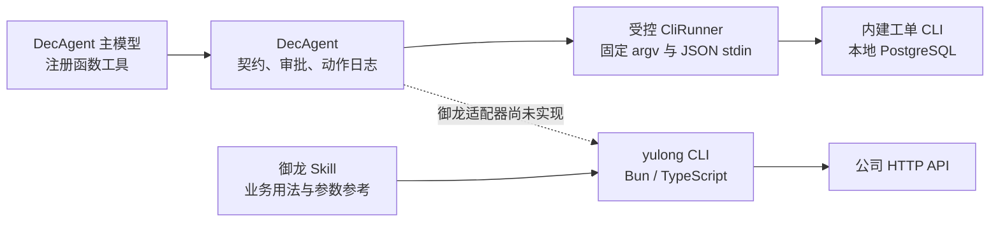
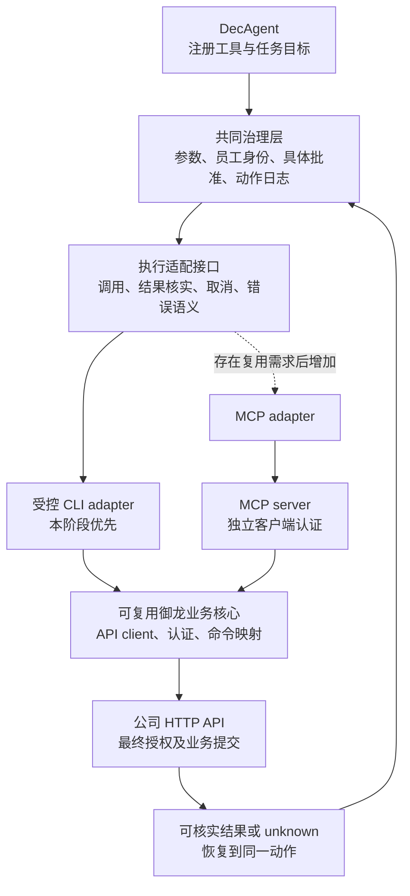

> 历史路线评审：此文记录 2026-10-13 的源码与建议。后续需求明确采用 MCP + Skill，目前已实施；请参阅[当前架构](../261014/1646_MCP业务Agent架构详解.md)。旧 runner 源码保留于迁移前备份，原文结论与外部引文保留当时范围。

# MCP 与 CLI 公司业务接入路线评审

你已明确优先让自研 DecAgent 稳定执行公司业务，并以当前操作员工的权限调用公司 API。基于这两个选择，建议保留已有受控 CLI，同时把业务契约、员工身份、批准记录和执行状态做成可复用核心，给执行适配器留出替换接口。MCP 可以成为后续接入方式；当前单独更换协议的收益有限。

这是一份架构评审。此次核对两个仓库、MCP 官方规范和本机插件注册元数据，没有修改运行代码或调用公司业务 API。这里不讨论决策模型。本机目前仅登记 service-tickets 1.0.0；现有源码、测试与 README 没有御龙接入适配器。不能把内建合成工单的成功当作公司插件已接入。

## 两种路线怎样调用 API

CLI 路线通常是 Agent 调用固定程序，程序将业务参数转换为 HTTP 请求。MCP 路线是 Agent 的 MCP client 调用 server 暴露的工具，server 再调用公司 HTTP API。两种方式都需要处理相同的参数、身份和业务返回值。

CLI 可以装在服务器上运行。MCP 的 stdio 方式也使用客户端启动的本地子进程；Streamable HTTP 才提供另一种远程消息传输方式。比较时应区分接口协议、进程是否常驻和业务授权，避免把它们混成一项。[MCP 2026-07-28 传输规范](https://modelcontextprotocol.io/specification/2026-07-28/basic/transports)。

当前两条实际链路如下，虚线表示尚未实现的接入：

MCP 标准化工具发现、参数 Schema 与结果结构；CLI 可以自己提供同等的机器契约，但不同 CLI 的接口约定需要适配。MCP 的协议统一会降低多个客户端之间重复接入的成本。[MCP 工具规范](https://modelcontextprotocol.io/specification/2026-07-28/server/tools)。

## 优劣与适用条件

| 维度 | CLI 路线 | MCP 路线 | 对当前目标的意义 |
| --- | --- | --- | --- |
| 利用已有业务代码 | 可直接复用御龙客户端、认证和命令映射；需要补 DecAgent adapter | 可以复用同一核心，另加 server 与 client；简单套壳仍会运行旧 CLI | 已有 CLI 具有实际复用价值 |
| 机器发现与参数约束 | 依赖自己定义；当前 DecAgent manifest 完整，御龙 schema 不完整 | tools/list、inputSchema、可选 outputSchema 有统一接口 | 补齐同一份业务契约，避免两套定义漂移 |
| 多 Agent 客户端复用 | 每个客户端需支持进程执行、安装及输出约定 | 支持相应 MCP 版本的客户端可复用 server | 未来多客户端需求会提高 MCP 的价值 |
| 部署与调试 | 人工终端容易复现；要分发二进制、配置及平台版本 | 本地 stdio 也需安装；远程 HTTP 可集中维护，但增加服务运维 | 现在保留 CLI 调试入口成本较低 |
| 调用生命周期 | 当前逐次启动进程，进程内连接与缓存难跨调用复用；可另做常驻进程 | 常驻 server 可复用连接，但调用仍有协议和服务开销 | 需要同条件实测，不能预设 MCP 更快 |
| 身份与权限 | 御龙有 token / 本地登录及权限预检；仍需可信员工身份绑定 | HTTP 认证有标准规范；下游公司权限仍需独立实现 | 协议不会替你决定调用者和公司权限 |
| 写入失败与恢复 | 需要业务幂等、结果核实与 durable journal | 同样需要业务幂等和核实；RPC 请求 ID 不代表业务已提交 | 当前最关键的写入能力缺口是共同问题 |
| 上下文与大结果 | 可按模块读 Skill、返回有限字段或文件引用 | 同样可按需加载工具、过滤结果、返回资源引用 | Token 效率取决于工具加载和结果设计 |

表中关于成本与适用性的判断是基于当前源码的工程推论，没有做两种协议的端到端对照压测。MCP 支持结构化工具，也不要求把所有工具一次塞进模型上下文。官方工程实践已有按需发现和执行端过滤结果的方案，CLI 也能采用这种组织方式。[Anthropic：MCP 的按需发现与执行端处理](https://www.anthropic.com/engineering/code-execution-with-mcp)。

远程 MCP 的认证与公司 API 的访问凭据分别处理。官方授权规范要求 MCP server 验证发给自身的 token；不能简单把其他资源的 token 原样接收后转交下游。stdio 的凭据方式与 HTTP 授权规范不同。[MCP 授权规范](https://modelcontextprotocol.io/specification/2026-07-28/basic/authorization)、[MCP 安全指南](https://modelcontextprotocol.io/docs/2026-07-28/tutorials/security/security_best_practices)。

## 当前路线已有的优点

DecAgent 已经把模型输出限制在已登记的函数与参数中。固定模块或绝对可执行路径来自程序契约，参数走 JSON stdin，进程使用 shell=False。模型不负责拼接任意 shell。证据：[固定入口与命令白名单](../../decagent/business/contracts.py:420)、`business/runner.py:161`（迁移前源码）、[模型工具](../../decagent/business/planner.py:48)。

参数 Schema 同时用于程序验证和模型函数定义。插件登记冻结 manifest 摘要；执行前检查租约、插件状态和具体批准。读写效果、参数变更与确认均能由控制层解释。这些资产可以跨执行协议复用。证据：[同源 Schema](../../decagent/business/contracts.py:539)、[注册与冻结](../../decagent/business/registry.py:14)、[执行守卫](../../decagent/business/execution.py:40)。

内建工单的写入、幂等输入绑定和提交回执位于同一 PostgreSQL 事务。未知写入先核实 operation_id 的提交回执，再核实资源历史。这个设计具有生产价值，换入口时应保留其状态语义。[内建事务回执](../../decagent/business/tickets/store.py:53)、[核实与恢复](../../decagent/business/execution.py:205)。

## 当前最需要改进的地方

下方御龙路径相对以下只读参考仓库：

[local path omitted]

| 已证实现状 | 对公司接入的影响 | 建议 |
| --- | --- | --- |
| DecAgent 向固定 argv 的 stdin 写 command/params/operation_id；御龙用位置子命令、--json 或 --json-file | 插件不能直接登记后就跑通 | 增加显式 adapter，程序完成命令别名与输入转换 |
| DecAgent 成功只接受 ok/data；御龙还有 asOf，错误用 type/detail | 现有 envelope 会被拒绝 | 正规化错误与结果，同时保留安全诊断和是否可能已派发 |
| 御龙 schema 只有 name/module/description/method/path/example | 缺少机器验证参数、结果及副作用的依据 | 从真实接口定义补全版本化契约，生成工具定义、帮助和 Skill 参考 |
| 御龙点号及大小写命令与 DecAgent 小写下划线要求不同 | 直接导入会失败 | 使用稳定且无碰撞的命令映射，保留源命令 ID |
| 默认 BusinessExecutor 只给 service-tickets 注入数据库环境，其他插件是空环境 | 公司凭据和员工身份接入尚未实现 | 由可信执行层解析员工/组织/权限及 credential reference |
| 御龙 Skill 允许 token 进入模型上下文并放到 --token argv | 凭据混入规划与命令文本，不利于后台服务边界 | 模型只提供业务参数，凭据由执行层取得 |
| 御龙危险写入只检查 --yes；Skill 负责三步确认 | 布尔开关不能证明某个员工批准了这一组参数 | 由 DecAgent 保存并核对批准主体、参数摘要、资源版本和时效 |
| 客户端未实现 operation_id/幂等/持久回执；恢复文档先建议重试 | 写请求超时后可能无法证明是否已提交 | 与后端确认幂等或操作查询能力；无法核实则保留 unknown 并交人工处理 |
| PluginSpec 未验证通用 receipts 声明，资源历史强核验只用于内建工单 | 通用写插件可登记，却可能缺少可靠恢复条件 | 登记时核实 recovery capability、查询命令及 Schema；声明支持范围 |
| 当前 runner 明确 Windows-only、每次调用启动进程 | Linux 后台运行和高频调用需要另行设计 | 按目标平台提供受控执行实现，再按实测优化生命周期 |
| digest 只覆盖 manifest，未绑定实际程序/Skill/外部命令映射制品 | 同路径制品变化不必改变契约摘要 | 同时绑定安装制品、Skill 与业务命令目录版本 |
| 御龙 Skill 说配置文件 mode=token 可启用；CLI 明确忽略该字段 | 单靠说明文档会把配置漂移带入 Agent | 从单一事实源导出说明，修正模式文档 |

核心证据：DecAgent 的 [入口契约](../../decagent/business/contracts.py:406)、`business/runner.py:267`（迁移前源码）、[环境构造](../../decagent/business/execution.py:35)、[通用回执与内建专门核实](../../decagent/business/execution.py:214)。

御龙源码定位：

- yulong-cli/src/commands/schema.ts:61：发现输出的字段。
- yulong-cli/src/commands/business.ts:106：Token 模式权限预检；:139：--yes 检查。
- yulong-cli/src/core/envelope.ts:7：成功输出；:22：错误输出。
- yulong-skill/yulong-shared/SKILL.md:81：凭据上下文与 argv；:137：确认约定。
- yulong-skill/references/recovery-guide.md:5：现有恢复能力；:11：重试说明。
- yulong-cli/src/core/config.ts:275 与 :314：实际模式配置来源。
- yulong-cli/src/core/api-client.ts:345：文件导出读入并转 base64；大结果还需受控文件引用。

这里仅证实客户端缺少相应实现，未证实公司后端完全没有幂等或审计能力。需要后端接口契约才能判断可采用哪些恢复方案。本地保存 operation_id 或包装一个 receipt 对象，无法证明远端只写了一次。

对通用 receipts 的核实还运行了两个纯内存探测：删除内建 manifest 的 receipts，以及把 receipt.command 改成未注册命令，当前 PluginSpec.from_mapping 都接受。探测没有写数据库或派发进程。无回执插件当前保持 unknown 是保守处理，不能因此宣称公司写入已经可以完整恢复。

Windows Job Object 限制进程树及进程数量；它不是文件系统和网络访问的完整隔离。这条路线目前要求可信安装插件，适配器与发布制品要遵守这一信任范围。

## 已确定的员工身份方案

你已选择按当前操作员工身份调用。它决定的是业务授权主体，不要求改成 MCP：CLI 与 MCP 都应携带同一份可信业务身份。当前 DecAgent 的 OwnerIdentity 只有 Agent 登录身份，没有公司员工和组织绑定；BusinessExecutor 也没有通用公司凭据解析器。这部分属于待建设能力。[现有登录身份](../../decagent/gateway/auth.py:73)、[现有执行环境](../../decagent/business/execution.py:32)。

建议以以下规则作为后续接入设计的约束：

1. 从已经验证的登录会话绑定公司 employee_id、组织/租户及 credential_ref。身份来源必须由认证和执行层确认，不能从用户文本或模型生成的 employee_id 推导；查询别的员工可以是业务参数，但不能因此切换调用权限。
2. 任务创建时固定发起员工及组织，后续动作、批准、恢复和审计都引用这份绑定。后台 worker 的租约身份只负责运行归属；排队、重启或切换 UI 登录用户，不能改变既有任务的公司授权主体。
3. 执行时按 credential_ref 解析该员工的有效凭据，重新核实所需权限。凭据过期、员工离职或权限被收回时，暂停并要求重新认证或明确终止，不回退到统一服务账号。持久记录保留身份绑定和凭据引用，不能将一次权限快照当作永久授权。
4. 模型只选择已注册业务工具和业务参数。御龙当前 --token 方式需要新增受控运行时凭据接口，或复用其内部 API client；由可信适配器按调用注入，避免 token 进入模型上下文、argv、动作参数及日志。凭据通道仍受本机操作系统和可信插件边界约束。
5. 写入批准绑定员工、组织、命令、参数摘要、资源版本及有效期。参数、身份或目标资源变化后重新确认。提交前再次检查权限，公司 API 保留最终授权；日志记载实际调用员工与业务动作结果。

例如员工 A 批准“将工单 T 分配给 B”，业务参数中的 B 是目标员工，调用 API 的身份仍是 A。若 A 对 T 没有权限，Agent 应返回权限不足；不能让模型选择另一员工的 token。超时后核实结果也使用原任务绑定的授权主体。

后续若增加远程 MCP，调用者到 MCP server 的认证与 server 到公司 API 的员工委托是两个独立绑定。MCP 登录成功不能自动推出某个公司员工身份。公司现有认证是否支持第三方员工委托仍需依据后端契约核实，不能仅凭本地 token 缓存宣称已经实现。

## 推荐的改进顺序

优先把“业务能力的含义”与“怎样发送调用”分开：

这是建议结构，执行适配接口、御龙 adapter 与 MCP adapter 都没有在本次实施。复用业务核心并不要求先做新微服务；第一版可以保持现有进程部署。仅在调用频率、连接成本或集中运维需求成立时，再评估常驻进程/服务。

第一阶段先把少量真实只读业务能力接入 DecAgent：完整 Schema、字段字典、员工身份、权限失败和统一错误。一个端到端案例应能从自然语言任务查到可信结果，凭据不进入模型。

第二阶段选取可以明确确认与核实结果的写入。批准记录留在控制层，调用时重新检查权限、参数及资源状态。公司 API 若缺少足够的幂等和查询能力，应明确哪些操作需要人工核实；写入结果不明时不能沿用通用重试流程。

第三阶段按真实负载优化。读目录可按版本或合理期限复用；权限缓存必须按员工和组织隔离，写入授权及确认前资源新鲜度继续核实。文件导出返回受控 artifact 引用，模型只接收必要字段与摘要。

当出现多个 Agent 客户端、集中维护远程能力、标准工具发现等明确需求时，在同一业务核心外增加 MCP。MCP server 对外提供写入时也要实施有效的服务端授权与批准要求，不能默认所有客户端都经过 DecAgent 的控制层。

## 已有性能线索的范围

从 .decagent/business-eval/post-completion-probe.json 的 9 次内建工单任务中，重算实际 CliRunner 耗时得到：

| 内建命令 | 调用数 | p50 秒 |
| --- | --- | --- |
| directory | 35 | 0.6843 |
| create | 5 | 0.8073 |
| receipt | 7 | 0.6864 |
| get | 16 | 0.6704 |
| list | 3 | 0.6599 |
| assign | 2 | 0.6941 |

计时起点在 CountingRunner.run 调用 CliRunner 之前，范围包含进程启动、命令处理和本地后端访问，不能将全部耗时解释成进程启动成本。[计时范围](../../decagent/evaluation/business/harness.py:103)。

这不是御龙 Bun CLI 的测量，也没有 MCP 对照组。它说明频繁调用有可测量成本，并支持后续在相同 API、参数、权限策略、连接条件下比较冷启动 CLI、常驻 CLI/MCP 和 SDK 的 p50/p95。不能据此发布性能倍数或判断 MCP 一定更快。御龙 Token 模式每个正常业务命令通常先查权限再发业务请求；减少远端往返也需要单独评估。

## grilling 的当前决策树

已确定的主分支是“优先自研 DecAgent”。由此得出的建议是保留 CLI 并补接入契约，后续按明确需求添加 MCP。

第二个主分支已确定为“按当前操作员工身份调用”。由此得到的约束是：可信身份绑定、执行时解析员工凭据、任务恢复保持原授权主体、写入批准与员工和参数绑定，不采用统一服务账号回退。

本次路线评审范围内的用户选择已明确：优先自研客户端，采用员工权限。CLI 与 MCP 的技术取舍以及改进顺序已经据此给出。未来选择具体业务接口、部署多员工服务或实施认证接入时，需要新的实施设计；这些不扩展为本次协议比较的未决问题。建议尚未实施，后续修改执行层仍需你确认接入设计。

其余后端能力属于尚未证实的事实：是否接受幂等键、是否支持结果查询、是否提供资源版本。该不确定性保留在建议中，没有静默假设其存在。本报告提出改进方向，没有将建议转换为已批准实施的 change。

## 核实范围

核实了两份独立只读代码调查，关键结论由主审再次读取源码。只读检查本机 business_scopes，当前仅 service-tickets；全量检索当前 decagent、evals 和 README 未发现御龙 adapter。运行两个纯内存契约探测，并重算既有 CLI 时序。

没有访问公司业务接口、修改认证配置、启动 MCP 服务或改变生产运行代码。协议部分按查阅到的官方 2026-07-28 规范解释；实际客户端/SDK 的协议版本兼容性需要实施时另行验证。旧模型实测及项目测试通过数未被用作 MCP 与 CLI 优劣的证明。
