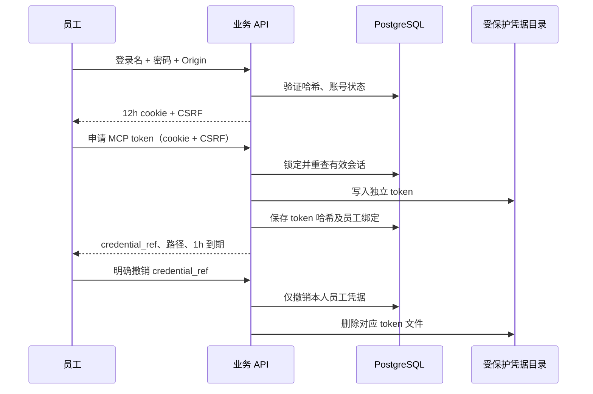

# 模拟员工账号与权限指南

更新时间：2026-10-13 16:23（北京时间）。

本项目使用本机 PostgreSQL 中的合成员工和工单，未接入公司登录或真实业务 API。员工身份控制业务权限，owner 身份控制运维与历史仓库修复。

统一操作、MCP 服务、业务 Worker 和默认员工工作台现已接通。当前本机启动流程见 [MCP 使用指南](../261014/1646_MCP业务Agent使用指南.md)；下文身份模块的原测试数量保留当时范围。本机启动器的凭据目录为 .decagent/local-control/demo-auth。

## 初始化账号

在 DecAgent 项目根目录、已激活的 Python 环境中运行。先配置本地环境变量；密钥只放本地运行配置。

```powershell
python -m ops.local.start migrate
python -m ops.local.start seed-tickets
python -m ops.local.start business accounts seed
```

`seed-tickets` 明确初始化六个人员和五个服务类别；`accounts seed` 只创建缺少的账号。相同姓名、不同团队保留为不同人员，重复运行不重置密码、账号 ID、角色或停用状态。目录不完整或有歧义时不会创建密码。

初始密码分别保存于 `.decagent/local-control/demo-auth/<登录名>.password`。数据库只保存独立盐的 PBKDF2-SHA256 哈希。Windows 目录 DACL 仅允许当前账户和 LocalSystem；Linux 文件/目录模式为 0600/0700，但独立 Linux 部署仍待验收。凭据目录及其父级不能是 symlink 或 junction。管理命令只返回账号名，不输出密码。

| 登录名 | 目录姓名 / 团队 | 角色 |
| --- | --- | --- |
| employee-it | 张伟 / IT Support | employee |
| employee-facilities | 张伟 / Facilities | employee |
| handler-it | Zhang Wei / IT Support | handler |
| handler-facilities | Zhang Wei / Facilities | handler |
| handler-access | 王芳 / Access Management | handler |
| supervisor | Chen Li / Network | supervisor |

## 登录及独立 MCP 凭据

API 默认地址为 `http://127.0.0.1:8000`，所有浏览器写请求须提供精确 Origin 与登录时返回的 CSRF token；登录本身检查 Origin。

| 操作 | HTTP 接口 | 条件 |
| --- | --- | --- |
| 登录 | POST /api/v2/business/auth/session | JSON login/password；不接受额外身份字段 |
| 当前身份 | GET /api/v2/business/auth/session | 员工 cookie |
| 注销 | DELETE /api/v2/business/auth/session | cookie + Origin + X-CSRF-Token |
| 申请 MCP 凭据 | POST /api/v2/business/auth/mcp-credentials | 当前有效员工会话 + Origin + CSRF |
| 撤销 MCP 凭据 | DELETE /api/v2/business/auth/mcp-credentials/{credential_ref} | 原员工会话 + Origin + CSRF |

浏览器会话默认为 12 小时，cookie 为 HttpOnly、SameSite=Strict。独立 MCP token 默认为 1 小时，其明文仅写受保护的 `mcp-<credential_ref>.token` 文件；发行 API 只返回引用、文件路径和到期时间。数据库保存哈希。注销浏览器会话不会自动撤销独立 token，需要明确撤销。账号停用、凭据撤销、到期或账号凭据 revision 变化均阻断后续请求。

下面的 Python 片段在 API 服务启动后可用于检查身份并申请/撤销一份凭据。密码通过隐藏输入读取，不写进脚本或打印。

```python
from getpass import getpass
import httpx

origin = "http://127.0.0.1:8000"
with httpx.Client(base_url=origin) as client:
    login = client.post("/api/v2/business/auth/session",
        json={"login": "employee-it", "password": getpass("员工密码：")},
        headers={"Origin": origin})
    login.raise_for_status()
    headers = {"Origin": origin, "X-CSRF-Token": login.json()["csrf_token"]}
    identity = client.get("/api/v2/business/auth/session")
    identity.raise_for_status()
    print(identity.json())
    issued = client.post("/api/v2/business/auth/mcp-credentials", headers=headers)
    issued.raise_for_status()
    credential = issued.json()
    print("凭据文件：", credential["credential_path"])
    ref = credential["credential_ref"]
    revoked = client.delete(f"/api/v2/business/auth/mcp-credentials/{ref}", headers=headers)
    revoked.raise_for_status()
    client.delete("/api/v2/business/auth/session", headers=headers).raise_for_status()
```

员工 cookie、MCP Bearer、owner 运维凭据用途独立。MCP token 不能替代网页确认会话；owner token 不能成为员工；在员工网页接口同时传 Authorization 也会拒绝。任务中只保存凭据引用，可信程序按任务绑定的 employee_id 解析，不能由模型传入另一员工身份。



## 角色与范围

| 能力 | employee | handler | supervisor |
| --- | --- | --- | --- |
| 创建 | 本人 | 本人 | 本人 |
| 查询/列表/历史 | 本人请求 | 本人请求或当前获分配 | 全局 |
| 评论 | 本人请求 | 本人请求或当前获分配 | 全局 |
| 分配/改派、调整已有优先级 | 拒绝 | 拒绝 | 合法工单 |
| 开始/解决 | 拒绝 | 当前获分配 | 合法工单 |
| 关闭/重开 | 本人请求 | 本人请求 | 合法工单 |
| 操作回执 | 本人操作 | 本人操作 | 全局审计 |
| 代替另一员工批准/提交 | 拒绝 | 拒绝 | 拒绝 |

创建 requester 由认证员工绑定，不能提供 requester_id、employee_id、role 或 approved 进行覆盖。分配目标必须同时是有效目录人员和有效 handler/supervisor 账号。person_id 列表过滤只会缩小授权范围；猜测他人工单、历史或回执 ID 不会泄露其内容。改派后立即重新应用处理人范围。

角色许可还要满足业务状态、revision 和具体确认要求。主管可读全局，并不获得代签他人操作的权限。解决表示记录员工提供的处置内容，不能据此声称已修好 VPN 或设备。

## 历史边界与验证

旧匿名工单、历史、回执保留 employee_id=NULL。它们只供主管或 owner 的历史入口读取，新业务操作不能认领、修改或重放这些记录。旧 owner 任务也不能通过切换员工账号继续执行。

已验证：迁移、账号初始化、独立登录与 token 生命周期、旧 owner 登录回归共 24 项 PostgreSQL 测试；角色/资源授权 4 项 PostgreSQL 测试；凭据目录与哈希 5 项测试通过。Windows junction 实测拒绝；普通 symlink 测试因本机未授予创建权限跳过 2 项。后续 MCP 网络和员工工作台验收不在这些身份测试的证据范围内。

实现与测试：
- [员工账号](../../decagent/business/employee_accounts.py)
- [员工认证](../../decagent/business/employee_auth.py)
- [角色与资源授权](../../decagent/business/access.py)
- [账号测试](../../evals/integration/test_business_employee_accounts.py)
- [认证测试](../../evals/integration/test_business_employee_auth.py)
- [权限测试](../../evals/integration/test_business_access.py)

