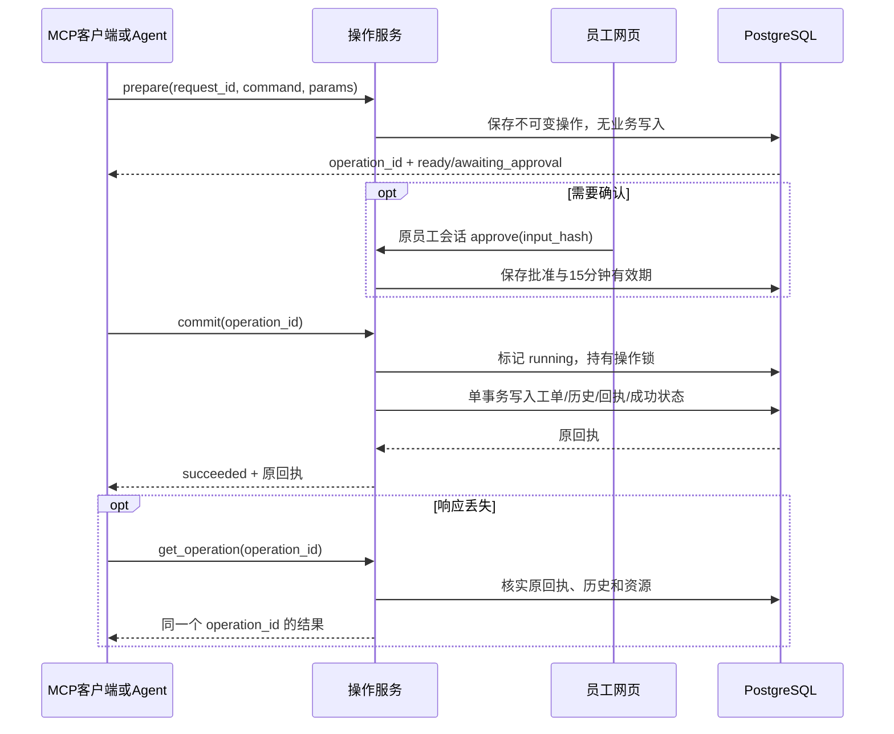

# 业务操作：准备、确认、提交与恢复

本指南描述 `service-tickets` 2.0.0 的统一操作核心，已由 MCP 服务、DecAgent 和员工工作台共同使用。启动方式见 [MCP 使用指南](../261014/1646_MCP业务Agent使用指南.md)。模拟工单与公司真实业务系统没有连接。

## 一次写入如何完成

1. 员工凭据确定操作人。`prepare(request_id, command, params)` 校验当前角色、工单范围和资源版本，保存不可变参数及摘要，返回 `operation_id`。此时工单、历史和回执均未写入。相同员工、相同 `request_id` 与相同内容返回原操作；内容变化报冲突。
2. 需要确认时，状态为 `awaiting_approval`。原员工在浏览器会话内核对参数和摘要后批准、拒绝或编辑。批准有效期为 15 分钟。外部 MCP 编辑由服务创建关联新操作；Agent 编辑先拒绝旧操作，再由图生成新动作和新操作，两者都需再次确认。MCP Bearer 不能批准。
3. `commit(operation_id)` 使用原操作保存的输入，重新校验身份、角色、范围、资源版本、合同及批准。Agent 来源额外要求当前任务、动作、预算和租约绑定的短期执行 grant。写入工单、历史、回执、批准消费及 `succeeded` 状态在**同一个 PostgreSQL 事务**完成。
4. 客户端断线、超时或 Worker 退出后，先查询 `get_operation(operation_id)`。不要换一个 `request_id` 重新准备同一业务写入。

## `running` 与 `unknown` 的核实顺序

服务先用同一操作锁排除仍在途的提交，再查原 ID 回执。回执必须同时匹配员工、命令、输入摘要、合同摘要，并与唯一历史记录、业务资源及结果 Schema 一致。资源后来可以继续变更，因此只要求当前 revision 不小于该回执 revision。已核实的回执使操作成为 `succeeded`，再次提交只返回原结果。

| 证据 | 查询结果 | 是否允许再提交 |
| --- | --- | --- |
| 原写入仍持有操作锁 | 暂报 `unknown / commit_in_flight` | 暂不判断，稍后重查 |
| 回执、历史、资源与输入绑定一致 | `succeeded`，返回原回执 | 不再写入 |
| 无回执、无历史、无在途事务，当前授权/资源/批准仍有效 | 原 ID 恢复为 `ready` | 可以用原 ID 重新提交 |
| Agent 无当前租约 grant | `unknown / recovery_grant_required` | Worker 获得新租约 grant 后用原 ID 重试 |
| 回执或历史不一致，或成功标记缺少回执 | `unknown` 与明确错误码 | 禁止自动重试，人工核实 |
| 旧批准、资源版本、角色或合同已失效 | `expired` 或 `failed` | 重新准备新操作 |

`unknown` 不是成功，也不是失败。用户界面和 Agent 都不能把它写成“工单已经完成”。在真实数据库故障注入中，写入前与事务提交前退出都保留零业务副作用，并可沿原 ID 恢复；事务成功但响应丢失时，回执核实避免重复写入。

提交后的核实响应缺少结构化内容，或回执与不可变操作不一致时，Agent 同样保留 unknown 和原服务操作 ID。恢复须重新查询真实回执；异常响应不能把已提交动作改写成普通失败或促使新建相同写入。
