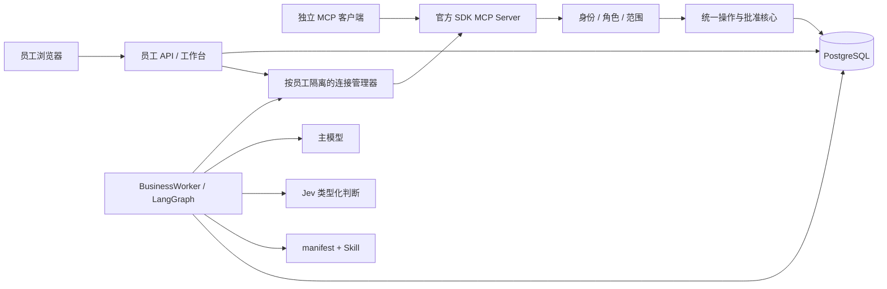
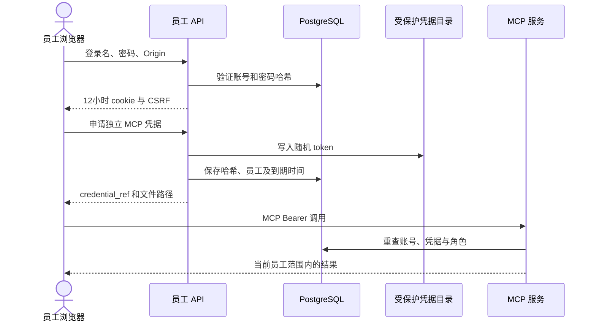
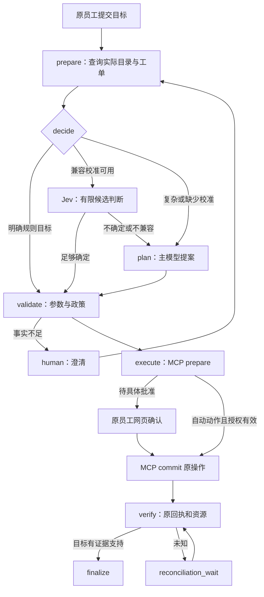
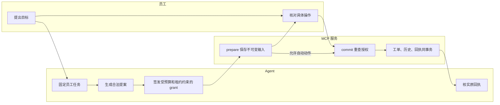
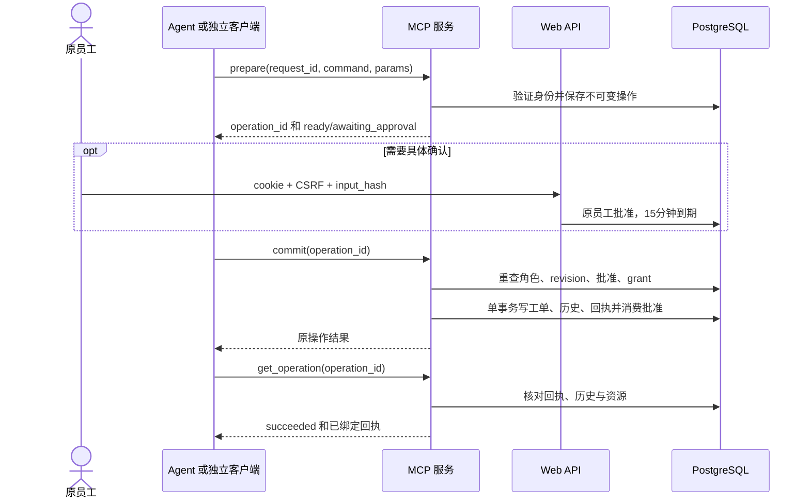
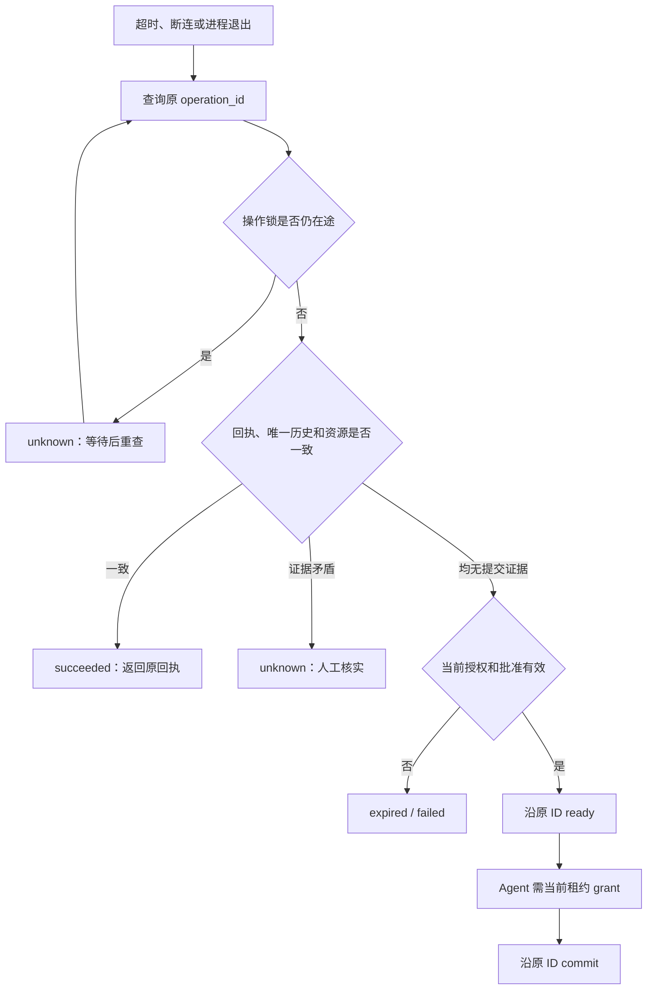
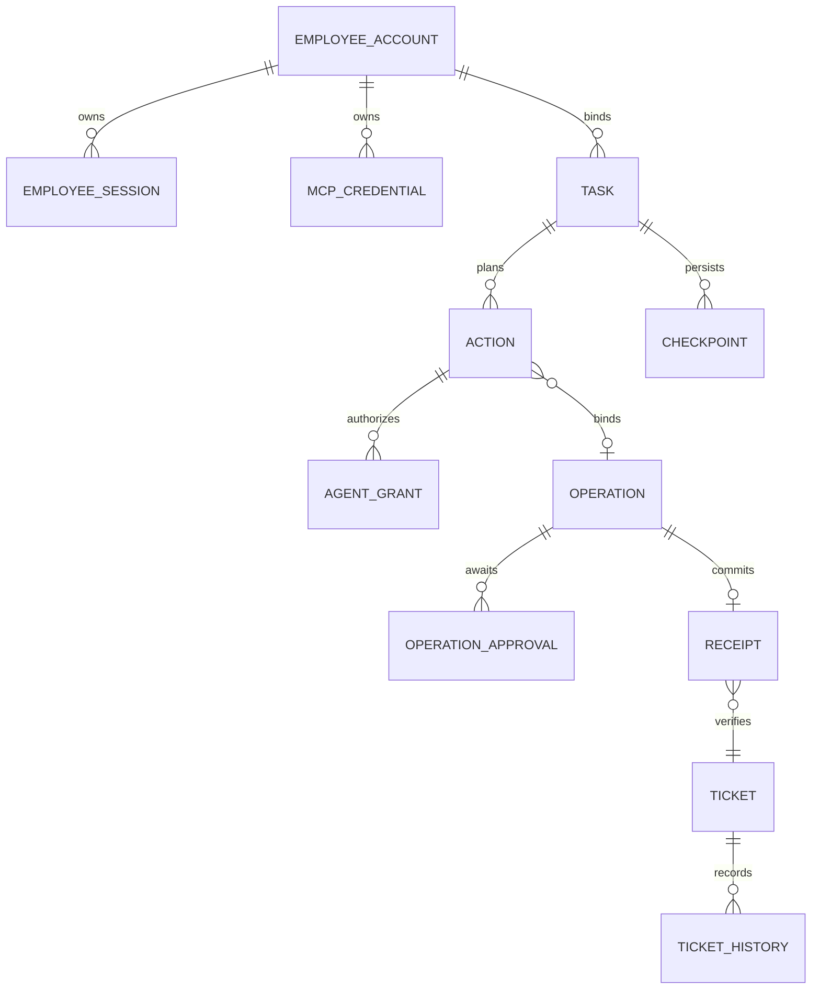
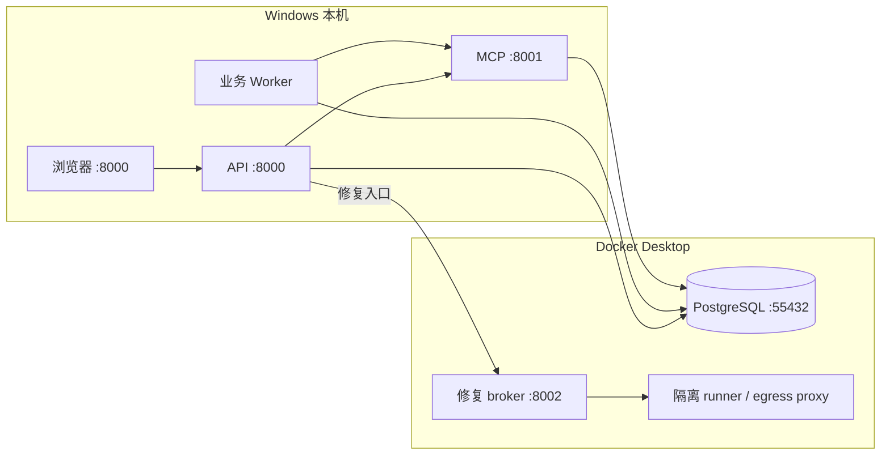

# MCP 业务 Agent 架构详解

DecAgent 用一个可恢复的执行内核，把自然语言目标转换为受员工权限约束的业务操作。
项目的差异化在于“如何决定继续、澄清、确认与恢复”，并为每次写入提供可核实证据。
当前服务工单是模拟业务载体；业务能力以 MCP + Skill 接入。
仓库修复保留为另一类任务，并不限定这个 Agent 的用途。

## 分工与组件

LLM 负责复杂规划与文本参数提议，Jev 负责有限选项的类型化判断，
程序负责候选边界、身份、权限、预算、批准和执行一致性。
Skill 描述业务做法，manifest 固定工具与参数 Schema；二者均不能赋予额外权限。
具体实现见 [规划器](../../decagent/business/planner.py)、
[题目构造](../../decagent/business/questions.py)和[操作核心](../../decagent/business/operations.py)。

Web API 的工单读取也经过 MCP。批准 API 使用同一 OperationService 的事务接口，
不另外实现一条业务写入路径。数据库访问用于身份、任务、批准和审计；
工单状态变更统一在授权的 commit 事务中执行。

## 员工登录与凭据

网页显示凭据文件路径，明文保存在受保护文件中。独立凭据持续一小时；
退出浏览器不会自动撤销它，需要显式撤销。

## 从用户目标到核实结果

LangGraph 的 task_id 同时绑定 checkpoint thread_id。
图版本为 business-2，最多 128 个阶段；人工等待、预算等待和核实等待独立 checkpoint。
Worker 认领时获得新的 lease generation，旧 Worker 的写入被拒绝。
预算耗尽可以查询已提交回执，但不能签发新的执行权限。
[执行器](../../decagent/business/execution.py)将 app.actions 关联到服务操作；
prepare、批准和 LLM 的成功文本均不算完成。

## 泳道：谁有权做什么

员工 cookie 与 MCP token 分离；owner 运维登录也独立。
浏览器批准只允许原操作员工，主管的全局审计权限不能代签。
外部 MCP 调用不带 Agent grant；Agent 路线必须携带可信程序签发的隐藏元数据。
LLM 无法通过工具参数提供 employee_id、role、approved、任意 endpoint 或 grant。

## 时序：准备、批准、提交

对同一 request_id 重复准备，相同内容返回原操作，不同内容报冲突。
操作输入不能原地编辑。外部编辑建立 supersedes 链；Agent 编辑使旧动作被拒绝，
随后重新规划新动作、新操作并再次确认。

## 未知结果的恢复

这是针对本地业务事务的幂等和恢复设计。它不宣称任意远程第三方 API 都能实现相同保证。
以后接入真实公司 API，需要该 API 提供幂等键、查询回执或补偿机制，并重新验收。

## Jev 的三类判断如何使用

| 类型 | 当前问题 | 候选或尺子由谁提供 | 如何使用 |
| --- | --- | --- | --- |
| Choice | operation、person、category | manifest 的合法命令；MCP 实际查询返回的实体 ID；附 no_match | 选有限分支，重名或不明确时不猜 |
| Noul | explicit_assignee、multi_person | manifest 固定的自然语言命题 | 返回 0～1 的命题支持概率，经阈值与政策处理 |
| Score | work_blockage | 0=工作不受影响；1=有替代办法；2=工作被阻断 | 新工单建议 normal/high/urgent；现有优先级修改仍需具体确认 |

这些题目和评分尺由程序与版本化契约构造，LLM 不动态改写权限题或评分尺度。
动态的是实际业务上下文和查询候选。LLM 可以提议 title、description 等文本，
也可以提出已注册命令；程序继续检查 ID 来源、事实依据和 Schema。

Score 允许浮点期望值；小于 0.5 为 normal，0.5～小于 1.5 为 high，其余为 urgent。
Jev 返回的概率、分数与分布须满足契约一致性检查。
问题版本、工作流版本、插件摘要、数据集版本、实际模型名共同绑定校准配置。

当前迁移保留三种判断和用量规则。旧校准绑定 CLI 契约，不能直接授权新的 MCP 快路线；
没有兼容校准时 hybrid 记录原因并转交主模型。
本次 MCP 验收使用脚本与规则，不产生 Jev 调用，因此没有新的加速或真实业务提效结论。
旧 720 次对照与历史价格账本仍保留其原始范围。

## 身份、数据和授权关系

此图表示逻辑关系；物理外键、唯一约束与触发器以 storage 的迁移文件为准。
历史匿名行保持 employee_id=NULL，主管可审计但新操作不能认领或修改。
新任务的 employee_id 不可变，原员工再认证只更新 credential_ref。

## 工具与本机部署

十二个领域命令是 directory、get、list、receipt、create、assign、start、
comment、resolve、close、reopen、set_priority。
网络目录有十四项：四个 tickets_ 读取工具、八个 tickets_prepare_ 写准备工具，
以及 business_commit_operation、business_get_operation。
账号不同，可发现工具会按角色过滤。

服务输入 64 KiB、输出 256 KiB、单请求 15 秒。
服务绑定 loopback，检查 Origin 与 Bearer；现代连接采用 discover，
兼容客户端使用旧协议初始化。连接按员工凭据隔离，进程生命周期管理，
没有逐调用新建事件循环或业务子进程。

独立 Linux 主机部署仍是后续验收项。
本机 Docker/WSL 不能替代该结论。公司业务 API 未接入。

## 阅读入口

- [使用指南](1646_MCP业务Agent使用指南.md)
- [交互架构图册](1646_MCP业务Agent架构图册.html)
- [源码与逐脚本职责](1646_MCP源码结构与脚本职责.md)
- [权限指南](../261013/1623_模拟员工账号与权限指南.md)
- [操作恢复细则](../261013/2039_业务操作恢复与核实指南.md)
