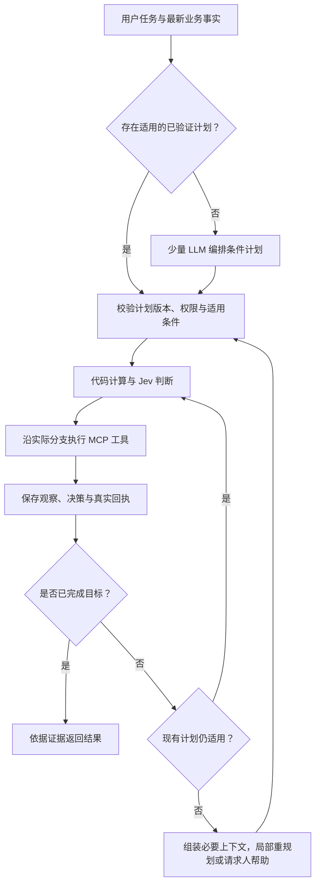

# Jev 条件计划与 Agent 运行机制需求整理

整理时间：2026-10-14 23:55，北京时间。

补充时间：2026-10-15 00:05，北京时间。新增确定性阈值、人工接管、公开数据集对比评测与后续部署要求。

本轮完成需求讨论与事实核查。最初七项方向已经由你确认，随后补充了以下三项要求；执行结构用于说明这些要求，具体计划格式、阈值与验收数值仍需下一轮 OpenSpec 定义。这份说明不表示新功能已经实现，也没有创建或实施新的 change。

## 动机与项目定位

DecAgent 面向已经注册 MCP 工具和 Skill 的公司业务。通用 LLM 负责必要的理解和规划，Jev 承担执行过程中大量有边界的语义判断，代码负责控制流程与真实业务执行。

项目特点应落在可测量的行为上：普通业务不必在每一步重新调用通用 LLM；已经验证、可以匹配的重复流程可零通用 LLM 执行；发生计划不能覆盖的新情况时，才调用规划模型修订尚未执行的部分。

成本和速度属于本轮要验证的目标。此前 MCP 验收没有调用模型，不能用于证明这一设计已经比旧方案更快、更便宜。

## 已确认的需求

| 决策 | 已确认要求 |
| --- | --- |
| 首阶段范围 | 优先优化已注册 MCP 工具和 Skill 的业务；保留扩展能力 |
| 通用 LLM 次数 | 正常任务以 1–3 次为优化目标；异常允许受控追加，记录原因并配置额外上限 |
| 分支策略 | 预规划已知分支；真实结果使计划失效时，局部重规划 |
| Pi 定位 | 规划接口可替换；Pi 是候选实现，本轮没有强制接入要求 |
| Jev 问题来源 | LLM 编排可信模板；新增模板先验证和评测；动态候选来自真实业务数据 |
| 计划复用 | 允许复用已验证流程；满足适用条件的已知业务可以零通用 LLM |
| 记忆范围 | 任务工作记忆，加有限跨任务记忆；长期内容限于经验证的偏好与流程经验 |
| 确定性与人工接管 | 用户可配置自动判断阈值；当前实际分支的关键判断低于阈值时暂停，由用户选择、更正或补充信息 |
| 公开对比评测 | 优先使用 Kaggle 有标签的公开数据；扫描多个阈值，并与可复现的基线比较 |
| 后续部署 | Agent 需要部署；部署实施放在后续阶段，本轮保留恢复、配置与可观测性要求 |

“1–3 次”统计实际通用模型请求，而不是 CLI 进程次数或一次 SDK prompt。规划重试、最终回复生成、辅助摘要或上下文压缩产生的通用模型请求，都必须进入计数和费用记录。

## 规划产物需要表达什么

一次规划应产出可验证的条件计划。它要表达 Jev 判断和业务工具之间的数据依赖，而不只是工具名称列表。

| 内容 | 要求 |
| --- | --- |
| 目标与完成证据 | 明确用户要达成的结果，以及用哪些实际回执或读取结果确认 |
| 判断节点 | 引用已注册的 Choice、Noul、Score 模板及版本 |
| 工具节点 | 引用已注册的 MCP 工具及参数 schema |
| 顺序和分支 | 描述先后依赖、条件边、分支合流及有界重复 |
| 参数绑定 | 区分常量、用户原文、真实数据、前序节点输出和候选选择 |
| 异常出口 | 表达缺证据、无匹配、低确定性、审批拒绝、工具失败或未知结果时的路径 |
| 执行约束 | 表达停止条件、预算、需人工确认的位置和可重规划范围 |

未来才能得到的值必须作为引用或获取规则留在计划中。例如，“创建工单 → 引用返回的工单 ID → 按分类读取当前处理人目录 → 用 Choice 选择真实人员 ID → 准备分派 → 确认并提交”。首次规划不需要猜测工单 ID 或未来的人员名单。

参数按来源处理：枚举和候选值由 Jev 选择；用户原文和工具事实由代码引用、复制与规范化；计算由代码完成；缺失字段向用户询问；确实需要自由文本生成时才使用通用 LLM，并计入预算。

Jev 问题是计划中的一种判断节点。业务副作用仍通过 MCP 工具执行，Jev 的答案本身不是执行授权。

## 已知分支与局部重规划

采用混合策略：先规划已有证据和业务契约能够覆盖的条件分支；运行时按真实观察选择分支、填参数；只有新情况超出计划或让其前提失效时，修订未执行部分。

分支存在并不意味着需要追加 LLM。处理已知分支是执行计划的一部分。新增目标、没有覆盖的情况、候选不足或新事实冲突，才可能需要重新规划。

不能在重规划时重复已经成功提交的业务操作。已执行事实、待确认操作和未知结果必须保留原来的身份与操作 ID。

## Jev 的批量判断与成本边界

多个问题如果共享同一份状态，而且不依赖彼此答案，可以在一个请求中批量判断。可以提前询问已知分支的问题，再由代码只消费实际分支的答案。[TypeSafe 批量分支判断](https://docs.typesafe.ai/patterns/fan-out)、[State 文档](https://docs.typesafe.ai/concepts/state)

如果后续问题需要前序工具读取到的新证据，或前序判断决定了新的候选来源，就需要下一阶段的 Jev 请求。同一请求中的问题独立求值，不能假定后一个问题能看到前一个问题刚产生的答案。

批量判断需要在延迟和 token 成本之间做选择。未使用分支仍会消耗 token；并非任何业务都适合把全部问题塞进首次请求。方案需要同时限制计划规模、推测问题数量和每个阶段的状态大小。

## 问题、选项与评分尺子的边界

LLM 可以挑选、组合和安排可信判断模板。执行权限、合法业务动作和关键尺度仍由经过验证的业务契约定义。

- Choice：从业务当前允许的动作、真实人员或真实资源候选中选择，并保留无匹配出口。
- Noul：判断一个有明确定义的条件是否成立，返回 yes 的概率。
- Score：依据已定义、可比较的分段语义进行评分；程序决定分数如何影响流程。

动态的是实际目录、资源集合和当前状态。评分段的含义、判断模板的语义与执行权限不会由当前任务的 LLM 随意改写。新增模板可以在开发与评测阶段由 LLM 辅助起草，再发布为有版本的可信模板。

候选集合必须覆盖合理答案；候选遗漏时，不能要求 Jev 选出正确值。[TypeSafe 候选提取](https://docs.typesafe.ai/cookbooks/pre_parsed_value_extraction_cookbook)

Choice 和 Score 的 confidence 表示答案分布的集中程度，不等于整个业务计划正确，也不等于具备业务权限。Noul 的概率也不能直接当成安全许可。阈值需要按任务和错误后果评测。[TypeSafe Confidence](https://docs.typesafe.ai/confidence)

## Context engineering 与 memory

你提出“把 Pi 外执行的 Jev 记录加入下一轮上下文”是合理的。需要明确三种不同的数据：

| 数据 | 作用与存储要求 |
| --- | --- |
| 执行日志与审计 | 完整保存计划版本、节点、状态版本、模板与候选、Jev 答案、工具结果和回执；可追溯 |
| 当前任务工作记忆 | 保存目标、已完成步骤、当前分支、待办、预算、审批与未知结果；支持重启恢复 |
| 有限跨任务记忆 | 保存经验证的偏好和流程经验；有来源、权限、适用范围、版本或失效规则 |

DecAgent 掌握任务事实与恢复状态。每次调用规划器时，根据当前需求把这些数据投影成必要上下文，规划器实现可以是直接模型接口，也可以是 Pi。

下一次规划优先带入：目标、有效计划片段、已执行事实、关键 Jev 决策、证据引用、未知结果、未完成项以及触发重规划的原因。完整日志保留在存储中，需要时按节点读取。不能把所有历史记录反复无差别拼接到 prompt。

推断与观察要分开。Jev 认为“可以分派”是一项判断；收到已核实的分派回执才是执行事实。人工更正和最新状态可以让旧判断失效。

Jev 可以判断哪些候选记忆值得读取或写入；权限过滤、去重、有效期和业务事实的新鲜度检查仍由代码执行。工单当前状态、人员权限等易变化事实从最新工具结果获取。

如果摘要本身需要 LLM，其调用和成本也要计算。可以优先使用结构化任务状态和确定性摘要，避免为减少规划调用而新增隐藏的摘要调用。

## Pi 的真实能力与本轮定位

Pi 默认保存会话，并支持恢复。准确的问题是：Pi 不会自动观察 DecAgent 在它外部执行的 Jev 判断，而不是“Pi CLI 没有记忆”。[Pi v1.2.0 Session 文档](https://github.com/earendil-works/pi/blob/v1.2.0/packages/coding-agent/docs/sessions.md)

Pi 区分仅持久化的数据和进入模型上下文的消息，也支持请求前的上下文变换。持久存储、下一轮上下文和跨会话记忆需要分别处理。[Pi 扩展与状态文档](https://github.com/earendil-works/pi/blob/v1.2.0/packages/coding-agent/docs/extensions.md#state)

当前官方 Pi 还支持在 codemode 中调用 Jev 的 classify 能力。因而 Jev 可以在外层 DecAgent 运行，也可以由 Pi 内部工具编排。二者都是候选结构；本轮已确认不强制使用 Pi。[Pi codemode 文档](https://github.com/earendil-works/pi/blob/v1.2.0/packages/coding-agent/docs/codemode.md#models)

一次 Pi CLI/SDK 调用可能包含工具后续响应、重试和压缩等多次模型请求。规划器适配层需要暴露真实请求数量、token、费用、取消与错误，不能用进程调用次数代替它们。[Pi 生命周期文档](https://github.com/earendil-works/pi/blob/v1.2.0/packages/coding-agent/docs/extensions.md#respect-the-runtime-lifecycle)

上述能力来自 2026-10-14 核对的官方文档与源码；没有验证本机是否安装这一 Pi 版本，也没有在本轮接入 Pi。

## Agent harness 的需求范围

| 方面 | 本轮需要体现的行为 |
| --- | --- |
| Agent loop | 执行已验证的条件计划；普通节点由代码和 Jev 推进，异常才受控调用规划器 |
| Context engineering | 按节点依赖组装状态；为重规划选择必要观察和决策；控制上下文大小 |
| Prompt engineering | 规划 prompt 使用工具契约与可信模板；Jev 判断模板有清楚选项、尺度、证据和版本 |
| 工具调用 | 计划参数在节点执行前绑定、校验；只调用受信 MCP 工具 |
| Memory | 持久任务状态，有限跨任务读写，员工与权限隔离，纠错和失效 |
| Trace | 一条任务记录能串起规划、模板、Jev、分支、工具、审批、恢复、token 和费用 |
| 性能评测 | 比较任务成功率、成本、端到端延迟、主模型调用次数、人工中断和错误副作用 |
| 安全与恢复 | 硬规则和真实权限先行；敏感写入需要确认；超时用原操作 ID 核实；计划可中断恢复 |

具体 tracing SDK、向量存储、Pi 接入方式和计划解释器实现尚未选定。它们应服务已确认目标，不作为本轮必须引入的技术清单。

## 与现有项目的差异

现有主模型一次可以提出多个工具，但产物是普通工具队列。队列耗尽、进入 primary 模式后，会继续回到主模型。没有带 Jev 节点、条件边或未来参数引用的计划。[当前循环](../../decagent/business/services.py:175)、[当前规划](../../decagent/business/services.py:432)

现有 Jev 问题由代码按受信契约构造，快速路径最终提出一个业务动作。新需求要保留可信判断定义，并扩展其编排能力。[当前问题构造](../../decagent/business/questions.py:65)

业务任务已有持久 checkpoint、观察和 Jev 决策记录，但当前规划上下文不自动包含 Jev 审计记录。项目中的记忆与 token 上下文组件主要服务历史修复路线，不能等同于业务记忆已经接通。[业务规划输入](../../decagent/business/services.py:432)、[历史路线的上下文组件](../../decagent/runtime/services.py:303)

现有 MCP、员工权限、prepare/confirm/commit、原操作回执核实、租约、预算和持久恢复基础可以继续承载新策略。需要重点调整普通工具队列、primary 模式持续规划、LLM 与 Jev 配额未分开，以及业务记忆和决策上下文缺口。

删减范围按上述目标评估。旧循环中失去作用的路径与重复逻辑可以移除；具体文件删除、旧任务兼容和历史修复模块是否退出主产品，需在新 change 中明确。

## 验收要验证的结论

对同一任务集、工具实现和安全规则，比较通用 LLM 主导路线、当前路线与条件计划路线。至少覆盖：

- 直线业务、已知分支、后续工具产生动态候选、多步创建和分派。
- 缺少参数、候选无匹配、低确定性、人工修改目标、计划失效。
- 审批拒绝、工具失败、提交结果未知、重启恢复和权限变化。
- 重复流程复用、旧版本模板失效、记忆更正、员工隔离。

统计成功率和错误副作用，通用 LLM/Jev 各自请求次数、token 和费用，端到端机器耗时 p50/p95、人工等待、重规划率、人工中断率、计划复用率和上下文规模。真实模型评测与脚本执行测试分别报告。

正常任务 1–3 次主模型、复用任务零主模型是目标，具体覆盖率需要测量。不预先承诺固定提速倍数，也不把 Jev 单次请求延迟当作任务总延迟。

## 可配置确定性与人工接管

你提出的是“确定性阈值”，不是统计学的“置信区间”。Choice 和 Score 的 confidence 是由答案分布计算的集中程度；0.95 不保证该次判断有 95% 的实际正确率。统计置信区间则用于报告一批测试结果的不确定范围。[TypeSafe 确定性定义](https://docs.typesafe.ai/confidence)

首阶段保留原始 Jev 分数，允许配置阈值。0.95 是你提出的候选设置，是否作为默认值需通过验证集确定。为避免边界遗漏，策略建议定义为“达到阈值可进入后续校验；低于阈值暂停”。达到阈值仍需满足真实权限、参数有效性和现有敏感操作审批。

不同判断类型需要明确阈值语义：

- Choice/Score：可以使用返回的 confidence。Score 的业务分数与 confidence 分开，严重程度高不意味着判断更确定。
- Noul：返回 yes 的概率 p，没有独立 confidence。可以用 yes/no 的两端阈值；若需要统一的集中程度尺度，可采用官方给出的 |2p-1|。该尺度下 0.95 对应 p 至少 0.975 或至多 0.025，不能误写成 p 大于 0.95 才算确定。[Noul 定义](https://docs.typesafe.ai/primitives/noul)、[统一尺度说明](https://docs.typesafe.ai/confidence#noul)

只检查当前实际执行分支需要的判断。推测分支中未使用的低分答案，不触发人工中断。一个操作依赖多个关键答案时，逐项检查，不把 confidence 相乘当成整个流程的正确概率。

低于阈值时，直接进入人工选择路径，不为这个原因自动追加一次主模型调用。界面需要展示待决定事项、合法候选、必要证据与 Jev 的建议；允许用户选择、拒绝或表示候选均不合适。选择写入任务状态和审计，恢复后继续校验执行。用户没有回应时保持待处理状态。

提高阈值可能降低错误自动执行，也会减少自动覆盖并增加人工等待；实际收益需要测量。明确要求确认的操作和权限不足不会因高分而跳过现有规则。

## 公开数据集与业务流程评测的对应关系

公开意图数据集先评测语义判断、无匹配识别和确定性门控。完整条件计划、MCP 写入、审批和故障恢复另用冻结的模拟业务场景评测。分类标签并不包含完整业务执行的正确轨迹，不能把分类准确率直接称为 Agent 任务成功率。

| 候选 | 数据来源与用途 | 范围 |
| --- | --- | --- |
| Bitext 客服意图数据 | [Kaggle 发布者数据集](https://www.kaggle.com/datasets/bitext/training-dataset-for-chatbotsvirtual-assistants/metadata)；有客服文本、意图和类别，适合已知业务路由 | 属于人工构造的训练语料；可用于公开基准，但不能等同于真实公司生产请求 |
| CLINC150 | [原作者仓库](https://github.com/clinc/oos-eval)；包含支持范围内及范围外请求，适合测试无匹配与人工接管 | 英文、单意图；不提供多步骤工具执行轨迹 |
| 固定模拟业务场景 | 本项目已注册工具和可信流程，加固定初始状态、用户目标与可验证最终状态 | 评测分支、参数依赖、副作用、审批、人工恢复与记忆隔离 |

Bitext 在 Kaggle 的不同版本与其 Hugging Face 新版并非自动等价。正式验收要锁定发布版本、文件哈希、来源与许可。这里只完成候选资料核查，没有下载或启用数据集。[Bitext 发布者的新版数据说明](https://huggingface.co/datasets/bitext/Bitext-customer-support-llm-chatbot-training-dataset)

使用公开数据时，intent、category、答案 response 等标签或答案字段不能进入待分类输入。保留官方测试划分；没有现成划分时，以来源或相近模板分组后划分，避免相近改写同时出现在阈值调优集和测试集。阈值在验证集选定，最终测试集用于冻结后的报告。公开数据可能已被模型训练收录，也需用新增模拟场景检查泛化。

英文结果单独报告；中文业务能力使用独立中文测试集验证。将公开数据翻译成中文需要明确来源、人工核对标签与单独命名，不能假称为原始公开基准。

## 阈值实验与对比基线

建议首先扫描 0、0.50、0.70、0.80、0.90、0.95、0.99，并提供全自动与全部转人工的参考边界。这是候选网格，正式规格可以根据验证集细化。用相同模型版本、判断模板、候选与原始输入比较；Jev latest 的实际解析版本也进入记录。

单项判断可只调用模型一次，保存原始答案后离线扫描阈值，避免为不同阈值重复付费。完整流程中，人工选择可能改变后续分支和状态；不能只重放一份全自动轨迹，就声称测到了所有阈值的真实任务表现。仅状态与问题完全相同的判断可以复用缓存。

至少包含以下对比：

| 对比 | 回答的问题 |
| --- | --- |
| Jev 同一判断流程，不使用确定性门控 | 门控是否改变自动错误与人工工作量 |
| Jev 同一判断流程，配置不同阈值 | 阈值的收益、自动覆盖和人工成本如何变化 |
| 同一主模型的 LLM 主导执行路线 | 条件计划与 Jev 路线是否减少主模型请求、费用和耗时 |
| 条件计划路线，分别启用与关闭人工门控 | 整个 Agent 的成功率、流程中断与错误副作用如何变化 |

语义判断对比使用相同输入与合法候选；流程对比使用相同工具、初始状态、权限和任务目标。现有 Agent 路线可以作为执行基线。公开论文或 Kaggle notebook 的成绩只用于背景；不直接当成相同条件下的成绩。

需要报告：

- 自动覆盖率，以及整个任务无人介入完成的比例。
- 自动处理部分的正确率与错误率；无自动样本时标为不可计算。
- 人工接管率、单任务中断次数；原本能正确自动处理却被转人工的数量。
- 未转人工的错误数量；范围外请求被错误执行为已有业务的比例。
- 经人工处理后的任务成功率、错误副作用与完成情况。
- 通用 LLM/Jev 请求次数、token、模型费用，机器耗时 p50/p95，人工等待和总完成时间。
- 不同分数区间的实际正确率，以及分数是否能可靠地筛选错误。概率校准指标应针对概率或经过校准的正确率估计，不能默认把分布集中程度当作正确概率。

例如，100 个样本中自动处理 60 个、其中正确 57 个，报告应是“自动覆盖率 60%，自动部分正确率 95%，其余 40% 转人工”。这组数字仅用于说明口径，不是实测结果。

离线扫阈值时可以用标准标签模拟理想人工选择，但必须标记为理想人工假设。它不证明真实用户的正确率、响应时间或生产效率。实际人工体验与等待成本用单独的小规模交互评测记录。

判断正确率和自动覆盖率等统计指标报告样本量及 95% 统计置信区间；自动样本子集与最终流程结果分别计算。多节点相关时以任务为单位统计或重采样，不把同一任务内的节点当作独立任务。

建议输出“自动覆盖率—自动错误率”曲线、阈值—人工接管率曲线及成本/耗时对比图，让用户选择符合业务容错与人力成本的工作点。

## 部署作为后续阶段

后续部署需要保留可配置并有版本的阈值策略、持久人工待办、进程重启后的原节点恢复、预算与指标记录。具体主机、部署方式、业务身份接入和发布步骤在部署 change 中决定。

当前需求补充不启动部署。先前保留的独立 Linux 验收仍是待办，不因公开数据集实验或本机测试而自动完成。

## 下一轮 OpenSpec 需要量化的内容

产品方向已经确认。形成正式 change 时，还需要定义任务边界、异常主模型调用上限、计划节点与有界重复限制、适用流程和版本失效规则、记忆 schema 与保留规则、确定性阈值语义与默认值、数据集版本及划分、人工模拟和真实交互口径、错误容忍度及性能基线。

下一步可以据此进行 OpenSpec explore/propose。实施应在新的 change 和明确验收要求形成后再开始。
