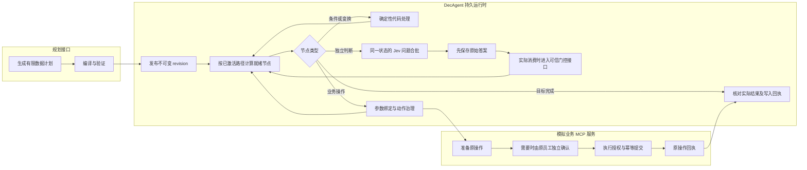
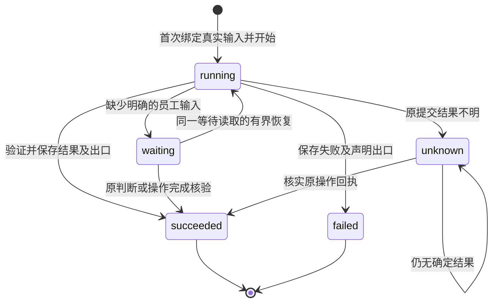
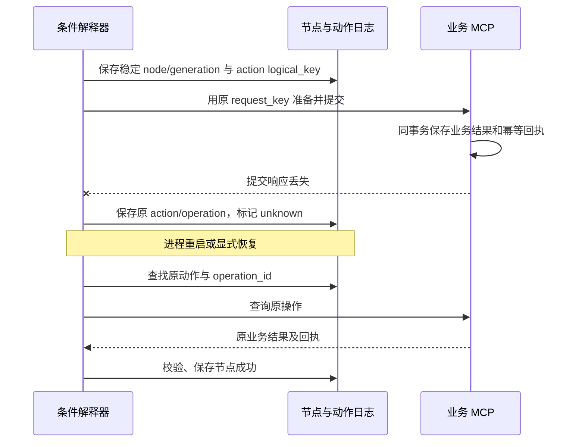

# 条件计划执行与预算：当前实施说明

本文对应 OpenSpec `jev-conditional-workflows`，记录 2026-10-15 的开发阶段。源码、测试与规格均位于 DecAgent；规格保存在 `openspec/changes/jev-conditional-workflows/`。本轮未修改用户业务数据库，也未重启当前本机服务。

## 可用范围

已实现计划契约、编译与参数绑定、不可变修订仓库、固定 `business-3` LangGraph 图、持久解释器、MCP 写入桥接、Jev 就绪合批及分类预算。阈值归一化和纯策略匹配已实现；策略发布、完整员工语义待办、局部重规划、新旧 worker 分派、记忆、流程复用、工作台和实际模型评测仍需后续任务。

当前默认员工提交和 worker 仍沿用 `business-2`。不要将旧任务或 checkpoint 改标为 `business-3`。本说明不代表新执行器已经部署。源码包含新增 SQL 012、013；测试只在独立数据库应用迁移，当前用户业务库未迁移。

## 执行路径

图中的门控是受信接口；合批本身不会把模型答案标成已接受，也不会替代写入确认。新运行图的生产入口仍待接入。

计划最多 32 个节点、分支深度 4、修订最多 4。默认节点尝试终身累计 128 次、控制推进 1,024 次；恢复与修订不会将计数清零。条件计划只是数据，不执行规划器生成的 Python、shell 或 SQL。

普通 `next` 数组激活所有后继；`branch` 只激活首个满足条件的出口。合流等待实际激活的前驱，未选分支不会阻塞。完成节点在其他活动路径处理后再核验目标。缺字段、最终 MCP schema 错误或纯变换缺值按节点声明的 `on_missing/on_error` 保存并路由。

## 节点与请求恢复

读取传输失败最多尝试两次。重新进入读取要求同一输入摘要、当前任务租约、同一读取节点且没有绑定写入动作；保留原次数。不能用此接口重置未知写入。

真实本机 HTTP 测试覆盖：动作登记后节点绑定前崩溃、业务动作完成后节点保存前崩溃、真实提交成功后响应丢失。各场景验证只有一个动作、一个服务操作、一份业务历史及回执。未知结果的原回执可在活跃时间达到上限后只读核实；重新授权提交仍须通过整体预算与权限检查。

Jev 每批默认最多 8 个互不依赖问题，只合并相同当前状态。默认使用 UTF-8 字节数加 framing 预留作为保守 token 估计，上限 8,000；SDK 当前最多 254 个真实候选加 `no_match`。超范围拆批或明确要求缩小范围，不截断候选冒充全集。同批不能读取其中另一个答案。推测分支默认不执行，未激活分支不产生模型调用或门控待办。

请求发出前，在同一事务给节点保存 `request_batch_id` 并记录 dispatched 事件。收到结果后，原子保存完整响应与各节点的 `raw_batch_id`。人工等待保留原指针；修订计划后也沿节点原请求身份恢复。响应未保存时不会自动重发，而是停在原请求核实状态。批次请求数、提交问题数、返回答案数分别记录。

## 分类预算配置

员工任务/恢复 API 的 `budget` 可配置：

| 字段 | 默认值 | 作用 |
| --- | ---: | --- |
| model_budget_version | `"1"` | 新模型预算契约版本 |
| primary_target | 3 | 正常任务优化目标 |
| max_primary_calls | 6 | 通用模型请求上限 |
| max_jev_calls | 24 | Jev 请求上限 |
| max_calls | 30 | 两类模型合计上限 |
| max_tokens | 100000 | 模型 token 上限 |
| max_active_seconds | 1800 | 活跃执行时长上限 |
| max_actions | 128 | 业务动作日志中的执行尝试上限 |
| max_node_attempts | 128 | 条件计划节点尝试上限 |
| max_graph_transitions | 1024 | 条件解释器持久控制步数上限 |
| max_plan_revisions | 4 | 计划修订上限，不超过契约的 4 |
| max_cost | 未设 | 显式费用约束；模型请求仍需有费用预留依据 |

`primary_target <= max_primary_calls`。例如零通用模型任务使用 `primary_target=0, max_primary_calls=0`；是否能完成还取决于已发布流程模板、所需输入和其他预算，配置为零本身不创建可复用流程。

第 4–6 次 primary 需要持久的异常原因，例如 `format_repair` 或实际新观察触发的 `new_observation`。格式修复、局部重规划分别写 purpose 和 plan_revision；Jev 同步批次绑定节点 ID 列表，提供方重试另记为 `provider_retry`。额度按实际提供方请求预留，不按一次 CLI 启动或一轮聊天计算。

新 `business-3` 中，primary 用完不会阻断额度内 Jev；模型调用数或 token 用完，也不阻断无需模型的合法动作。费用未知/耗尽、取消、失效租约、活跃时长或执行上限仍阻止新业务动作。旧 `business-2`/仓库修复保留原有模型次数与动作检查语义。

预留和实际发送分开记录：`reserved → dispatching → responded/unknown`。发送前在任务行锁内再次核对取消、租约、费用及当前硬额度。本地 guard 或 SDK 本地校验能证明未发送时标记 `not_sent`，保留审计但不占新业务图的实际请求名额。已在 dispatching 的记录不能仅凭再次 dispatch 失败就释放；SDK 明确本地未发送的证明须单独传入。无效模型响应照常记用量和费用；费用未知的预留在恢复后继续保留，阻止新的请求与业务动作。

费用明确为免费额度时，可使用带版本的零支付 TokenPrice，仍保留请求数和 token。这与忽略费用缺失不同，也不能推断提供方长期免费。本轮未进行实际模型评测，累计 Jev 1 美元授权仍由后续评测账本约束。

## 认证扩额与错误码

员工恢复入口为 `POST /api/v2/business/tasks/{task_id}/resume`；需原员工会话、Origin/CSRF 和 Idempotency-Key。暂停预算任务必须提交明确的新 budget；有未答待办则先回复待办。预算变更保存 `task.budget_changed`，记录员工身份、来源、前后值；重放同一幂等请求不会重复变更。当前默认入口仍是旧业务版本；新版本分派完成前，不应以手改图版本测试部署。

| code | 意义 |
| --- | --- |
| primary_exception_reason_required | 超出 primary 正常目标，缺少异常原因 |
| primary_budget_exhausted / jev_budget_exhausted | 对应模型额度耗尽 |
| model_request_budget_exhausted | 合计请求额度不足或预留不满足当前硬边界 |
| model_token_budget_exhausted | 模型 token 额度不足 |
| unknown_model_cost | 原请求费用仍未核实 |
| cost_budget_exhausted | 费用约束不足 |
| task_not_active / task_lease_expired | 任务不再活动或租约失效 |
| active_time_budget_exhausted / execution_budget_exhausted | 时长或业务执行次数达到上限 |
| unclassified_model_usage | 历史模型记录缺少可验证分类，未按 provider 名猜造 |

## 验证口径与后续

已经运行的检查包括计划与策略确定性测试、独立 PostgreSQL 事务测试、真实 loopback MCP 崩溃场景及员工 API 认证测试。数据库 fixtures 每次创建单独的 `case_...` 库，未读取或重置用户业务库。源码检查通过；完整隔离数据库回归结果以本阶段验证记录和 OpenSpec 勾选为准。

本阶段新增及关联计划/策略确定性组为 287 passed；隔离数据库的工作台、MCP、预算、修订、运行时和迁移组合为 87 passed（394.54 秒）；模型拒绝与新旧预算的关联组为 148 passed。各组有交叉，不能相加当作独立样本。ruff 对产品源码及本阶段测试通过。数据库组合的原始输出保存在项目私有测试目录 `.decagent/conditional-tests/runtime-budget-check.log`，仅含测试结果，无模型请求。

这些证据不包含模型准确率、真实员工人工正确率、生产部署或独立 Linux 验收。后续先完成局部补丁与新旧版本分派，再接策略发布/员工语义回复、上下文记忆和复用，最后执行冻结数据评测及端到端工作台验收。不能把实现了 threshold 比较当作达到 95% 自动处理正确率。
