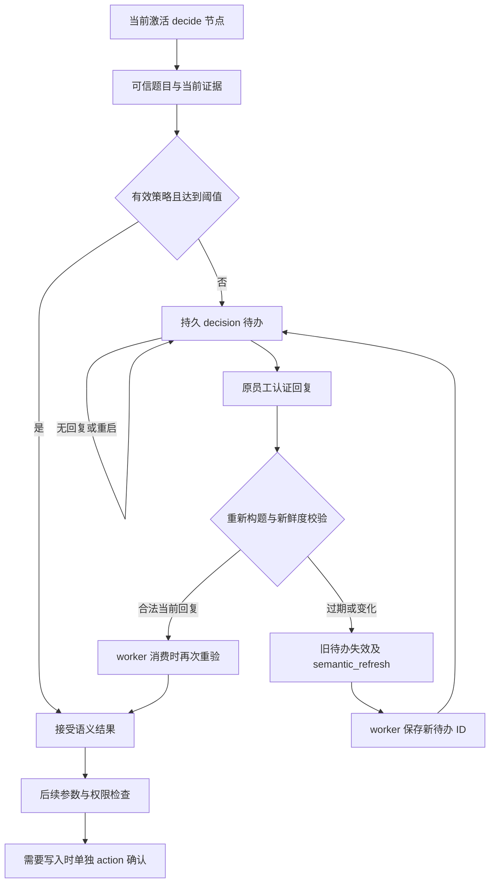
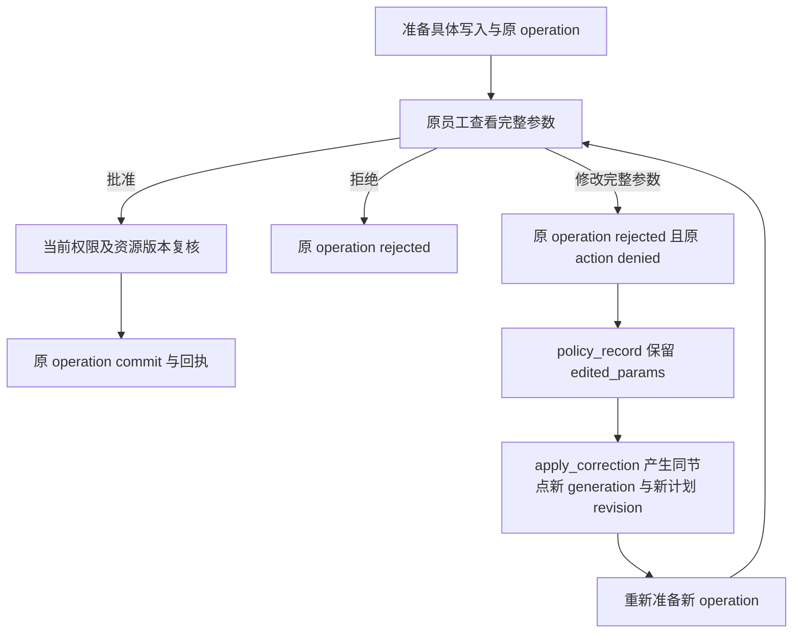

# 语义接管与独立写入确认参考

## 确定性与阈值

| 字段 | 含义 | 边界 |
| --- | --- | --- |
| Choice/Score `confidence` | 原始答案确定性，保留原分布及实际模型版本 | Score 档位与 confidence 分开保存 |
| Noul `p_yes` | 原始是概率 | 不是接口返回的 confidence |
| `derived_certainty` | `abs(2*p_yes-1)` | `p_yes=.96` 得 `.92`；`.5` 始终未决 |
| `threshold` | 当前已发布策略允许的自动消费下限 | `certainty >= threshold` 才达标；仍需参数、权限和写入检查 |
| 评测正确率 | 验证数据自动样本中正确数量 / 自动样本数 | 不是单次模型 confidence，也不是正确率保证 |
| 统计区间 | 样本统计不确定性的区间 | 不从单次 Jev 答案或人工选择推导 |

已发布策略的报告导入、验证范围、管理员下限和任务覆盖规则见同目录
[阈值策略服务参考](1453_阈值策略服务参考.md)。本说明不声明真实模型质量或性能验收通过。

## 两类确认

| 项目 | 语义接管 | 具体写入确认 |
| --- | --- | --- |
| 数据种类 | `decision` approval | `action` approval + 原 `business.operations` |
| 审计记录 | `semantic_record` | `policy_record` |
| 输入目的 | 选择、无匹配、补充、拒绝 | 批准、拒绝、修改具体完整参数 |
| 授权结果 | 始终 `grants_write_authority=false` | 仍由原员工、操作摘要、当前权限、资源版本及治理协议决定 |
| 后续副作用 | 仅恢复原节点的语义结果 | 确认通过后由原 operation 的 commit 路径执行 |

## 员工回复接口

`POST /api/v2/business/tasks/{task_id}/decisions/{approval_id}/reply`

| 要求 | 约束 |
| --- | --- |
| 身份 | 当前有效的原员工浏览器 session；MCP token 和其他员工均不可回复 |
| 请求保护 | 精确 Origin、有效 CSRF token、1–200 字符 `Idempotency-Key` |
| 摘要 | `expected_digest` 必须是原待办 digest |
| 版本 | `expected_plan_revision` 必须匹配原待办，范围 1–4 |
| 附加字段 | DTO 禁止未知字段、外来员工 ID、confidence、策略及写入批准字段 |

| decision | value | text | worker 消费状态 |
| --- | --- | --- | --- |
| `select`，Choice | 当前 criteria 中的字符串 ID | 禁止 | `selected`；`no_match` 候选转 `no_match` |
| `select`，Noul | 严格布尔 `true` / `false` | 禁止 | `selected`；人工选择不会伪装成模型概率 |
| `select`，Score | 原尺度的严格整数索引 `0..N-1` | 禁止 | `selected`；布尔及浮点不作为档位 |
| `no_match` | 禁止 | 禁止 | `no_match`，不强制接受模型建议 |
| `supplement` | 禁止 | 必须有非空具体事实 | `supplement`，供原节点的补充/纠正路径处理 |
| `reject` | 禁止 | 可选 | `rejected` |

操作审批接口仍为
`POST /api/v2/business/tasks/{task_id}/approvals/{approval_id}/reply`。
该接口不接受 `decision` 待办作为具体写入确认。

## 持久状态及恢复

| 状态/返回 | 保存与恢复规则 |
| --- | --- |
| `waiting` / `pending` | 原员工、任务、节点 generation、计划 revision/digest、可信模板、状态/候选摘要和 gate/policy 全部绑定；未回复持续等待 |
| `replied` | 严格合法的人工答案存入不可变 response record；任务置 queued，等待 worker |
| `consumed` | 稳定 `consumer_id` 只消费一次；同 consumer 重放返回 `replayed=true`，不同 consumer 冲突 |
| `stale` / `expired` | 旧待办终结，不恢复为 pending；当前仍有同节点时建立无旧建议的新待办 |
| `semantic_refresh` | 旧 approval 保存无选择、无授权的控制记录；无租约的等待任务置 queued，worker 先保存新待办 ID，再等待 |
| 新计划 revision 或旧节点不可用 | 旧回复不推进；`request=null` 指示运行时按当前计划重新定位 |
| 已完成节点的旧回复 | 不创建新语义待办，不唤醒或替换后续节点的等待；历史人工答案仍保留 |
| 权限撤销或 refresh 不可用 | 失败关闭，不消费旧答案，不发起主模型 fallback |

默认待办有效期 24 小时，服务接口允许 60–86400 秒。同一输入的刷新续期有 32 轮上限。
候选/权限/合同/账号修订变化会使旧输入失效。过期不是同意，重启不是同意。
原人工答案在刷新后仍保留于 intervention 审计及 `superseded_semantic_record`。

## 运行时服务接口

| 接口 | 约定 |
| --- | --- |
| `DecisionEvidence(question, snapshot, state)` | 类型化可信 QuestionSpec、DecisionSnapshot 与冻结 JSON 状态 |
| `decision_evidence(spec, task, node, state, *, context, scope_version, account_version)` | 从受信模板重渲染题目；不能覆盖原授权 instruction |
| `SemanticInterventions(database, refresh=callback)` | callback 签名为 `(conn, current_task, intervention_row, identity) -> DecisionEvidence` |
| `request(task_id, node_id, plan_revision, evidence, gate, *, identity, lease_owner, lease_generation, active=True, generation=1, expires_seconds=86400)` | 仅当前激活且已开始的节点；同绑定幂等；`active=false` 不创建待办 |
| `reply(identity, approval_id, body, *, response_id)` | 认证浏览器回复；先刷新并用注册表再次重构题目 |
| `consume(approval_id, *, identity, lease_owner, lease_generation, consumer_id)` | 当前 worker 租约消费；未回应也先刷新；无新模型调用 |
| `BusinessControl.refresh_semantic` | 网关通过原员工 MCP 当前读取 directory 与原 ticket，重构证据 |
| `semantic_refresh.request` | 新待办的完整公开结构；只有更新等待状态的意义，不得当作选择或写入许可 |

`QuestionSpec.id` 在实际节点使用 node ID；策略解析使用已注册模板的 question ID。
主模型规划器与未激活旁支不能自行创建或消费人工待办。

## 记忆读取与写入提议

| 项目 | 规则 |
| --- | --- |
| 读取入口 | 通用规划不检索记忆；已发布工作流用 `memory_kind + subject` 稳定槽读取当前员工的唯一有效记录 |
| 读取决策 | 运行时确定性校验身份、scope/account revision、来源、TTL 和注册表版本；不调用 Jev，也不自动选择或跳过槽 |
| Jev 写入筛选 | `BusinessMemoryWriteEvaluator` 仅用可信 `memory_write` 模板评估有证据的提议；低置信度返回待复核，不创建记忆 |
| 独立确认 | `retained` 不是写入批准；偏好需本人确认，流程经验需发布规则和真实成功回执 |
| 旧可选筛选规则 | `OptionalMemoryRules` 的历史策略表与校验仍有独立回归，但业务记忆执行路径不再调用它筛选读取内容 |

## 回归证据位置

| 文件 | 覆盖 |
| --- | --- |
| `evals/deterministic/test_business_semantic_replies.py` | DTO、严格类型、禁止授权字段 |
| `evals/integration/test_business_interventions.py` | 三种 primitive、无匹配、补充、拒绝、重放、重启、未回复、候选撤回、scope/account/revision 与到期 |
| `evals/integration/test_business_semantic_gateway.py` | 专属 API、CSRF、原员工隔离、幂等、当前 MCP 证据刷新 |
| `evals/integration/test_optional_memory_interventions.py` | 旧可选筛选规则的独立校验与历史行为回归；不代表业务记忆读取会调用 Jev |
| `evals/integration/test_business_memory_write_evaluator.py` | 写入提议证据、策略、去重、低分待复核、来源变化和预算记账 |
| `evals/integration/test_business_memory_gateway.py` | 稳定槽、当前员工隔离、缺失/歧义/过期/撤销/scope 变化暂停及每节点重新解析 |
| `evals/integration/test_business3_control.py` | business-3 action 回复、编辑留痕及原员工重新认证 |
| `evals/integration/test_business_plan_corrections.py` | 同节点新 generation、新 revision、新 operation 和再次具体确认 |

测试仅使用专用连接派生的隔离 `case_*` 数据库，未访问运行中的业务数据库，未调用付费模型。
集成 skip 不作为通过证据；实际员工交互与质量/性能验收保持独立记录。
