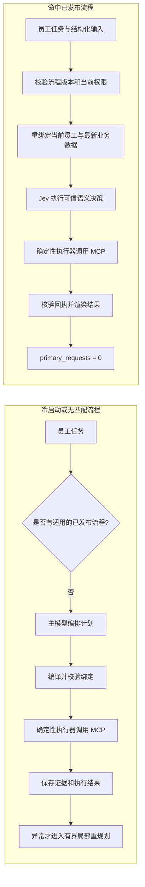

# 三个业务工作流模板

北京时间：2026-10-16 09:08。

实现入口为 `decagent.business.workflow_templates.build_workflow_template`。函数返回通过既有 owner 定义校验及计划编译器的独立 JSON 快照，不注册、不验证模型质量、不发布，也不批准写入。

| template_id / goal_id | 必填 task_input | 可信问题与路径 |
| --- | --- | --- |
| create-ticket | instruction、title、description | directory → category Choice → create → 回执完成 |
| directory-assign | instruction、ticket_id | directory → get → explicit_assignee Noul → 已明确处理人时 person Choice → assign → 回执完成 |
| review-priority | instruction、ticket_id | get → work_blockage Score → priority_for_score → 比较现值；相同走 unchanged，不同走 set_priority → 回执完成 |

## 冷启动与已发布流程复用



`primary_requests = 0` 只表示复用流程没有调用通用主模型；流程仍可能调用已校准的 Jev 判断。每次复用都重新检查员工身份、scope、流程/策略版本和实时资源，异常重规划单独记账，不将冻结或未知操作改写成新计划。

创建允许 description 为空字符串，title 必须非空。分派模板只适用于 handler、supervisor；其他模板允许 employee、handler、supervisor，实际 MCP 权限仍逐步检查。角色匹配不构成写入授权。

## 构造草稿

在应用已验证的 owner、database、scope、spec 上下文中调用。policy_dependencies 必须由真实已发布且独立校准的策略行构成，键必须精确覆盖该模板的问题 ID；每个值只含 policy_id、policy_version、definition_digest。

```python
from decagent.business.workflow_templates import build_workflow_template
from decagent.business.workflow_registry import WorkflowRegistry

# scope 为当前明确选择的业务 scope；pins 为本 scope 的已发布校准策略。
draft = build_workflow_template(
    "directory-assign",
    spec=spec,
    scope_id=str(scope["id"]),
    scope_revision=scope["revision"],
    policy_dependencies={
        "explicit_assignee": pins["explicit_assignee"],
        "person": pins["person"],
    },
    version="1",
)
workflows = WorkflowRegistry(database)
registered = workflows.register(owner, draft)
```

其余依赖集合分别为 create-ticket 的 category 与 review-priority 的 work_blockage。策略引用固定版本及 definition_digest，编译成功不代表策略可发布。注册表在 validate、publish 和复用时另行检查策略可用性、当前 scope、工具与问题指纹；不要用本地脚本标签冒充生产校准。

owner 必须执行覆盖报告的正常及异常样本，收集实际执行日志，随后调用既有 `validate(owner, workflow_id, version, report, expected_sha256)` 和 `publish(owner, workflow_id, version)`。一次成功不会自动发布。

## 参数与分支边界

- create 的 title、description 来自本次 task_input，category_id 来自本次目录候选的已接受 selected_value。
- assign 的 ticket_id、expected_revision 来自本次 get；person_id 来自本次目录候选的已接受 selected_value。Noul 否定走 missing_input；Choice 无匹配走 no_match，均不补造人员。
- priority 的 Score selected_value 只进入注册纯变换 priority_for_score。unchanged 的 reviewed 工具结果证据带明确条件：本次 ticket.priority 等于变换结果。更新必须继续通过原 governed_write 具体确认和服务端操作规则。
- 模板不含历史资源 UUID、员工身份、operation、approval、receipt 或写入授权；实例仍由原认证员工、当前 scope 和账号 revision 绑定。

unchanged 的条件证明可供已注册流程的可信完成契约消费。普通计划不能仅凭模型自行声称“无需修改”绕过目标核实；完整自然语言“按需调整优先级”的热复用由生产流程接线测试负责。

## 无付费回归与证据口径

从 DecAgent 根运行：

```powershell
.venv/Scripts/python.exe -m pytest evals/deterministic/test_business_workflow_templates.py evals/deterministic/test_business_workflow_contracts.py -q
$env:DECAGENT_TEST_DATABASE_URL = (Get-Content -LiteralPath '.decagent/conditional-tests/database-url' -Raw).Trim()
$env:PGOPTIONS = '-c max_parallel_workers_per_gather=0 -c max_parallel_maintenance_workers=0 -c jit=off -c lock_timeout=15000'
.venv/Scripts/python.exe -m pytest evals/integration/test_business_workflow_templates.py -q
.venv/Scripts/python.exe -m ruff check decagent/business/workflow_templates.py evals/deterministic/test_business_workflow_templates.py evals/integration/test_business_workflow_templates.py
```

专用测试管理员位于本机 55433，集成 fixture 每个测试派生 case_<UUID> 数据库并迁移；不得将连接替换成用户 55432 业务库，也不要打印连接串。

集成测试通过真实 loopback MCP 客户端/服务端执行读取、prepare、commit 和回执核实。SyntheticAdapter 是本地标签 oracle，scripted_gate 只存在于测试，明确绕过生产质量判定；没有付费模型调用。需要具体确认时使用隔离 fixture 的认证员工回复，不计为真人交互实验。

每套矩阵执行正常分支、缺输入、凭据失效和工具失败。创建及分派还执行 Choice 无匹配；分派执行 Noul 否定；优先级执行 0/1/2 三档、相同不写以及需要具体确认的更新。报告 covered_nodes、covered_edges 只从已保存的节点执行及 control.targets 取并集，再由 validate_workflow_report 验证全覆盖；没有从声明图复制覆盖。报告标记 synthetic=true、quality_claim=false，不能为不存在的 synthetic 策略发布流程。

完成结果使用既有确定性 summary 和 model_requests=0；每次运行同时查询 usage_records，断言 primary 行为零。这里证明的是模板解释执行与渲染路径；生产显式流程匹配、发布后热命中及异常局部重规划分类由对应生产集成测试验证。真实 Jev 质量、费用、性能及真实员工互动均未由此测试证明。

本次验证：模板及注册表确定性契约 26 passed（20.63s）；三个真实 loopback MCP 模板矩阵及优先级冷/热目标 5 passed（123.02s）；模板、规划、集成测试的 Ruff 检查通过。分支集使用合成标签 oracle，只验证执行与覆盖契约，不构成 Jev 质量声明。
