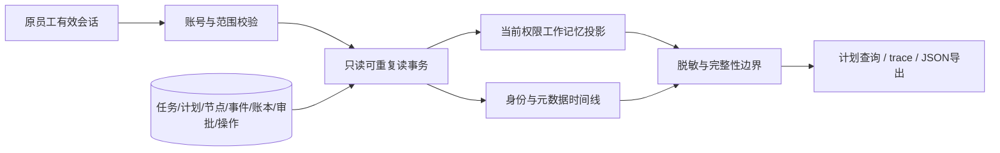

# 条件计划查询与脱敏追踪接口参考

| 范围 | 当前状态 |
| --- | --- |
| 业务环境 | 本机模拟员工工单业务 |
| 数据依据 | PostgreSQL 持久任务、计划、节点、审批、操作与请求账本 |
| 模型调用 | 查询与导出不调用模型；验证使用夹具，不代表真实 Jev/通用模型效果 |
| 在线数据库 | 本次仅使用专用测试数据库；未迁移或访问 live 数据库 |
| Linux | 尚未独立验收 |
| 命名时区 | 北京时间；2026-10-16 09:25 读取时钟后创建 |

## 接口

| 方法与路径 | 返回内容 | 缓存 |
| --- | --- | --- |
| `GET /api/v2/business/tasks/{task_id}/plan` | 当前权限投影、计划与节点、决策、操作、用量、计划修订元数据、等待元数据、策略引用 | `no-store` |
| `GET /api/v2/business/tasks/{task_id}/trace` | `task_id`、`through_event_seq`、`legacy`、`timeline`、`usage` | `no-store` |
| `GET /api/v2/business/tasks/{task_id}/export` | `decagent.business-trace.v1` 格式的 `snapshot` 与 `timeline`；JSON 附件 | `no-store` |

| 访问条件 | 结果 |
| --- | --- |
| 有效原员工浏览器会话 | 再次核验会话、账号、业务范围及登记契约 |
| 其他员工，包含主管 | `404`，不能按主管身份读取其他员工的业务任务 |
| 匿名、owner bearer、MCP bearer | `401`；MCP 身份不能替代员工浏览器身份 |
| 范围停用或登记契约发生变化 | `409`；不返回失效业务详情 |
| 旧 `business-2` 任务 | `legacy=true`、`plan=null`，不生成条件计划 |
| 超过保护边界 | `409 trace_too_large`；不会静默截断为完整导出 |

## 计划与节点

| 字段 | 含义 |
| --- | --- |
| `plan.revision` / `content_digest` | 当前持久化计划版本及内容摘要 |
| `plan.nodes[].inputs` | 参数绑定及来源声明；文本只作为数据 |
| `nodes[].active` | 当前稳定节点的最新执行代次 |
| `nodes[].activated` | 已被持久控制边实际激活 |
| `active_nodes` | 已激活路径上的节点 |
| `ready_nodes` | 当前可推进节点 |
| `inactive_nodes` | 已确定不会执行的分支节点 |
| `blocked_nodes` | 依赖尚未满足的节点；不等同于模型拒绝 |
| `completed_nodes` | 当前计划中已持久成功的节点 |
| `observations[].current` | 证据是否属于当前员工、范围及账号权限版本 |
| `observations[].source_ref` | 原节点和证据摘要；旧权限版本不复制旧业务值 |
| `decisions[].raw_answer` | 仅当前权限版本可见的 Jev 原始 Noul/Choice/Score 答案 |
| `decisions[].effective` | 实际采用值、接受状态及 `inferred` / `user_confirmed` 来源 |
| `actions[].verified` | 持久动作及服务端回执验证结果；日志文字不能设为完成 |
| `actions[].operation_id` | 原服务操作；未知结果仍保持此身份，不能从查询重新提交 |
| `plan_revisions` | 修订关系与摘要；不重复输出旧计划的业务正文 |
| `waiting` | 仅持久状态为 `awaiting_input`、`awaiting_approval`、`paused_budget` 时返回最新等待元数据；运行或终态不复活旧待办 |

## 模型请求与预算

| 字段 | 含义 |
| --- | --- |
| `usage.actual_requests` | 已进入 `dispatching`、`responded` 或 `unknown` 的请求条目数；不按进程/规划函数调用计数 |
| `usage.families.primary` / `jev` | 分模型族统计；同批多个问题仍按实际请求条目计数 |
| `usage.requests[].purpose` | `plan`、`replan`、格式修复、判断等账本用途 |
| `dispatch_state=reserved` | 仅预留，尚无发送证据；不计实际请求 |
| `dispatch_state=not_sent` | 已证明未发送；不计实际请求 |
| `dispatch_state=unknown` | 请求结果尚不确定；已占用的请求额度不释放 |
| `actual_tokens` / `actual_cost` | 已知实测用量；未知为 `null` |
| `known_tokens` / `known_cost` | 仅已知部分合计，不能充当完整实际账单 |
| `unknown_tokens` / `unknown_cost` | 是否仍有待核实用量；不能把未知当作零 |
| `held_tokens` / `held_cost` | 尚未解除的预算占用，保留未知请求预留 |
| `limits.primary_target` | 通用模型请求目标，当前默认 `3` |
| `limits.max_primary_calls` | 独立硬上限，当前默认 `6`；任务持久预算优先 |
| `exception_reason` | 超目标请求的异常原因 |
| `remaining_primary_requests` | 硬上限减去尚占用额度的 primary 请求；与实际发出数分别呈现 |

## 阈值与策略

| 项目 | 含义 |
| --- | --- |
| 原始分数 | 模型针对当前答案返回的确定性信息 |
| 有效阈值 | 已绑定策略和任务配置采用的门限；位于 `policies` |
| `policy_id` / `policy_version` | 策略身份和版本；修订不会覆写原决策事实 |
| `validation_record` | 对应实测验证报告引用；接口不伪造验证成绩 |
| 实测正确率 | 指定验证数据上的正确比例；不等于某个答案的模型分数 |
| 统计置信区间 | 估计正确率的统计不确定范围；不等于答案确定性 |
| `0.95` 设置 | 确定性门限；不承诺 95% 业务正确率 |
| 人工语义回复 | 仅形成语义选择事实；具体写入仍需要独立员工确认 |

## 时间线关联

| 事件来源 | 关联身份与事实 |
| --- | --- |
| `app.events` | 任务序号、规划 dispatched/proposed/failed、重规划、判断批次、人工响应及恢复元数据 |
| 规划日志 | `request_key`、父摘要、目标修订、确切账本请求 ID、已保存结果状态 |
| `plan.revision` | 计划 ID、修订、父修订、内容摘要 |
| `node.state` | 节点、执行代次、计划修订、持久状态、当前策略引用 |
| `business.decision_batch` | 批次身份、节点集合、对应计划修订下的 Jev 请求 ID |
| `model.request` | 实际请求 ID、模型族、用途、请求状态、费用与未知预留 |
| `approval.state` | 原审批 ID；语义审批附原节点、代次、修订及绑定摘要 |
| `action.state` | 动作 ID、原操作 ID、原请求身份、回执引用与验证标记 |
| `operation.state` | 原操作状态、输入摘要、替代关系；未知状态明确要求核实 |
| 策略事件 | 任务绑定的策略身份、版本及有效配置元数据 |

## 恢复与保护边界

| 场景 | 行为 |
| --- | --- |
| 工作进程停止、lease 过期 | 仍可只读查询；不伪造 lease、不调用发布或执行方法 |
| 缓存丢失或浏览器重连 | 从持久事实重建当前投影，不依赖外部 trace 服务 |
| 旧权限版本 | 旧观察/选择正文按工作记忆规则省略，保留定位引用 |
| 切换员工 | 请求重新按当前有效会话鉴权；返回 `no-store`，前端还需清理自身缓存 |
| 不可信业务文本 | 只作为数据返回；前端须用文本渲染，不能执行脚本或权限指令 |
| 凭据与运输对象 | 不返回 credential ref、token hash、headers、SDK 对象、原始 API payload |
| 未核实操作 | 保持原操作和回执引用，不根据成功字样宣布完成 |
| 大小保护 | 单集合最多 1000 项、最大深度 32；超限明确失败 |

## 验证记录

| 验证 | 结果 |
| --- | --- |
| 首个测试先行 | 缺少 `/plan` 端点导致预期 `404`；随后实现 |
| 新接口回归 | 13 项通过，115.52 秒，专用临时 PostgreSQL 数据库；另补运行态不复活旧待办回归 |
| 相邻接口回归 | trace、员工记忆与语义回复共 30 项通过，266.42 秒 |
| 安全用例 | headers/SDK/原始 payload 排除、旧权限观察隐藏、语义绑定关联、长时间线不被默认 100 项边界截断 |
| 外部模型与费用 | 未调用真实付费模型；未知用量使用账本夹具验证 |
| 操作完成证据 | 读取持久动作与服务端回执；不以日志文字为完成依据 |
