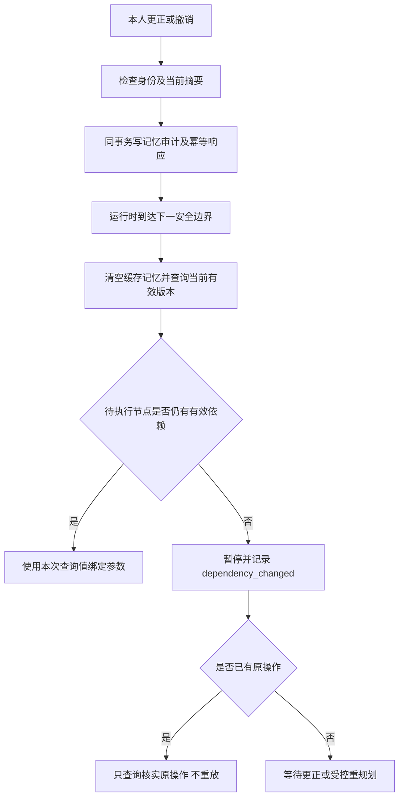

# 员工记忆管理与依赖失效

本说明对应条件计划 business-3 的当前源码。业务服务使用本机模拟工单；界面接入与完整验收仍在进行。本文接口测试使用独立 PostgreSQL 55433，不迁移用户业务库。记忆不授予业务权限，也不代替实时工单和人员目录查询。通用规划不搜索或自动注入跨任务记忆；读取只由已发布工作流显式声明的稳定槽触发，并由代码按当前员工解析，不调用 Jev 判断是否读取。

## 查看与管理

所有接口前缀为 `/api/v2/business`，要求原员工浏览器登录。owner 和 MCP token 不能代替本人管理。修改接口必须带当前 Origin、X-CSRF-Token 和稳定的 Idempotency-Key；重试相同请求复用原 key。

| 操作 | 方法与路径 | 参数 |
|---|---|---|
| 本人历史 | GET /memories | 可选 task_id、limit（默认 50） |
| 单条历史 | GET /memories/{id} | 可选 task_id |
| 待执行依赖 | GET /memories/dependencies | task_id |
| 更正偏好 | POST /memories/{id}/correct | task_id、expected_digest、value |
| 确认偏好 | POST /memories/{id}/confirm | task_id、expected_digest |
| 撤销 | POST /memories/{id}/revoke | task_id、expected_digest、reason |
| 撤销证据来源 | POST /memories/sources/revoke | task_id、reference、reason |

`expected_digest` 取当前条目的 `content_digest`。不可通过请求提供员工、scope 版本、权限或计划指纹。服务端根据原员工任务、当前契约、问题注册表和计划重新确定有效范围。显式流程实例使用已校验流程定义摘要；普通计划使用当前计划摘要。

不提供 task_id 时是历史检查，`active=false`、`verified=false` 不等于数据库记录被撤销；它表示本次查看没有可验证的执行上下文。提供 task_id 后仍需通过当前权限、TTL、来源和版本检查。

## 已发布工作流的稳定记忆槽

工作流只保存 `memory_kind + subject`，不保存员工记忆 ID，也不接受任务输入指定其他槽。示例绑定：

~~~json
{"source":"verified_memory","memory_kind":"confirmed_preference","subject":"response_language","path":["value"]}
~~~

运行时将其解析为 `confirmed_preference:response_language`，再按当前认证员工、公司、业务范围与账号版本查询唯一有效记录，并检查 TTL、证据来源和契约/问题/计划指纹。缺失、过期、撤销、scope 变化或多条有效记录都会暂停依赖节点；不会改用其他员工记录、让模型补值或沿用上次缓存。每个依赖节点分派前都重新解析，计划和 trace 只记录槽名及受控来源摘要，不向通用规划上下文注入记忆正文。

~~~mermaid
sequenceDiagram
    participant W as 已发布工作流
    participant R as DecAgent 运行时
    participant DB as 员工记忆存储
    participant M as Jev / 通用规划器
    W->>R: verified_memory(kind, subject)
    R->>DB: 按当前员工解析并复核来源、版本、TTL
    DB-->>R: 唯一有效记录 / 缺失 / 歧义
    alt 唯一有效记录
        R->>R: 绑定值并继续节点校验
    else 缺失或歧义
        R->>R: 暂停依赖节点，不执行副作用
    end
    Note over M: 不参与记忆读取判断
~~~

更正只支持注册的有限偏好值。更正创建新待确认版本，保留旧值和原始证据；本人另行确认后才替代旧版。流程经验只接受已发布规则和真实已核实操作回执，不能在这个接口中编辑成业务事实。偏好默认 30 天、流程经验默认 7 天，均受当前来源有效性约束。

## 撤销后的执行边界

依赖查询按实际激活路径计算：尚未选择的可能路径保守保留，已经确认不会走的旁支不阻塞当前节点。待执行节点的直接和传递依赖均需有效。已完成、已提交和未知操作的历史证据保留，撤销不能抹除审计，也不能让系统重新发起旧写入。

运行时在节点开始、业务工具读取真正发送前、每批 Jev 判断之前以及真实模型发送前重新检查。稳定槽解析结果只服务于当前节点，下一依赖节点会清空并重新解析。具体写入确认和记忆确认彼此独立。

## 已验证范围与限制

原有本人记忆 API 和生产入口回归覆盖跨员工拒绝、CSRF/Origin、幂等、同事务回滚、来源撤销、TTL、scope 变化、非激活旁支和历史证据保留。稳定槽另有工作流发布/解析、缺失/歧义/过期/撤销暂停、每节点清缓存与重新解析的隔离数据库集成回归；具体通过数以本轮最终命令输出为准。历史 repair memory 有单独回归，采用自己的规则。

完整前端、真实模型策略质量和独立 Linux 部署尚不能据此宣称通过。Jev 对写入提议的筛选只产生候选，不跳过证据、本人确认或来源校验；记忆读取由已发布工作流稳定槽和确定性运行时代码控制。

相关说明：[可信筛选](0342_业务记忆可信筛选.md)、[任务上下文](../261015/1500_任务工作记忆与上下文.md)、[执行恢复](0917_条件计划执行与恢复.md)。

