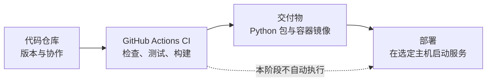

# DecAgent 项目构建与交付入门

这组文档把项目交付拆成三件事：保存代码、自动检查代码、把程序运行到目标环境。它们有关联，但处理的是不同阶段。

| 部分 | 文档 | 当前状态 |
| --- | --- | --- |
| 代码仓库 | [代码仓库与首次推送教程](代码仓库/1938_代码仓库与首次推送教程.md) | 已创建公开仓库 [shuaibilx/DecAgent](https://github.com/shuaibilx/DecAgent)，当前 `main` 指向 `21b7570`；本次只推送 DecAgent，未推送 Waku 源码。 |
| CI | [GitHub Actions 持续集成教程](CI-CD/1938_GitHub_Actions持续集成教程.md) | [运行 38904507234](https://github.com/shuaibilx/DecAgent/actions/runs/38904507234) 全部通过：Python 3.11/3.13 检查、打包、镜像构建和离线 Compose smoke。 |
| 部署 / CD | [Docker Compose 部署与环境说明](部署/1938_Docker_Compose部署与环境说明.md) | 手动 Compose 指南已写；本机 Windows Docker Desktop 服务健康且隔离 smoke 通过。尚未推送镜像到 Registry，也未配置自动部署；Linux 主机验收待办。 |

CI 通过表示代码通过了自动检查、测试和构建，不表示服务已经部署。部署指南也不会替代首次推送或 GitHub Actions 的运行结果。

## 建议阅读顺序

先看代码仓库教程，了解哪些文件会进入版本控制以及首次推送如何操作；再看 CI 教程，认识每项检查在哪个阶段运行；最后看部署说明，区分 Windows 本机模拟业务环境与当前 Compose 中的仓库修复服务。

## 本轮验收范围

- `.github/workflows/ci.yml` 覆盖 Python 3.11/3.13、临时 PostgreSQL 集成测试、Python 安装包、已安装 wheel 的 MCP 调用及离线 Compose 启动烟测。
- GitHub Actions 运行 38904507234 已全部通过：两个 Python 矩阵、包验证、runner/control/executor 镜像构建和隔离离线 Compose smoke。
- 本机 Windows Docker Desktop 现有 Compose 栈运行健康，API `/health` 返回 `ok`；隔离离线 smoke 验证 owner 初始化、认证 CLI 与控制服务边界，模型付费请求为 0。此项不等于新服务器部署或完整网页验收。
- CD 自动发布/部署尚未配置：没有向镜像 Registry 推送产物，也没有部署到 Linux 服务器。按当前范围先交付 CI 和手动部署指南，Linux 主机部署与自动发布留待确定目标环境后实施。
