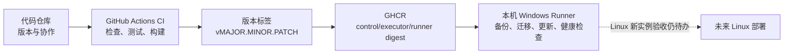

# DecAgent 项目构建与交付入门

这组文档把项目交付拆成三件事：保存代码、自动检查代码、把程序运行到目标环境。它们有关联，但处理的是不同阶段。

| 部分 | 文档 | 当前状态 |
| --- | --- | --- |
| 代码仓库 | [代码仓库与首次推送教程](代码仓库/1938_代码仓库与首次推送教程.md) | 已创建公开仓库 [shuaibilx/DecAgent](https://github.com/shuaibilx/DecAgent)；只推送 DecAgent，未推送 Waku 源码。 |
| CI | [GitHub Actions 持续集成教程](CI-CD/1938_GitHub_Actions持续集成教程.md) | [main CI 38924980607](https://github.com/shuaibilx/DecAgent/actions/runs/38924980607) 的完整测试通过；release 运行 [38931396165](https://github.com/shuaibilx/DecAgent/actions/runs/38931396165) 的完整检查和三个镜像发布也通过。 |
| 部署 / CD | [Docker Compose 部署与环境说明](部署/1938_Docker_Compose部署与环境说明.md) | `v0.1.3` 已通过完整 CI、镜像发布和 GHCR 登录，真实备份（116,335 字节）及数据库迁移成功；API/Worker 随后因完整 runner 镜像引用未解析为裸 digest 而未通过健康检查。当前 API 已通过临时 digest 配置恢复；配置解析修复与回归测试通过，标准自动部署待 `v0.1.4` 再验，Linux 新实例验收仍待办。 |

CI 通过表示代码通过自动检查、测试和构建；CD 还要通过 GHCR 发布与本机健康检查。两者都不等于独立 Linux 部署已经验收。

## 建议阅读顺序

先看代码仓库教程，了解哪些文件会进入版本控制以及首次推送如何操作；再看 CI 教程，认识每项检查在哪个阶段运行；最后看部署说明，区分 Windows 本机模拟业务环境与当前 Compose 中的仓库修复服务。

## 本轮验收范围

- `.github/workflows/ci.yml` 覆盖 Python 3.11/3.13、临时 PostgreSQL 集成测试、Python 安装包、已安装 wheel 的 MCP 调用及离线 Compose 启动烟测。
- GitHub Actions 运行 [38924980607](https://github.com/shuaibilx/DecAgent/actions/runs/38924980607) 的两个 Python 矩阵、包验证、runner/control/executor 镜像构建和隔离离线 Compose smoke 全部通过。
- 本机 Windows Docker Desktop 现有 Compose 栈运行健康，API `/health` 返回 `ok`；隔离离线 smoke 验证 owner 初始化、认证 CLI 与控制服务边界，模型付费请求为 0。此项不等于新服务器部署或完整网页验收。
- 版本发布工作流要求 CI 全绿、semver 标签和 main 祖先提交；本机 Runner 只执行发布部署 job，不接收 Pull Request。
- Release 运行 [38995053020](https://github.com/shuaibilx/DecAgent/actions/runs/38995053020) 的 Python 3.11/3.13 数据库集成测试、wheel/MCP 验证、隔离 Compose smoke、GHCR 登录及三类镜像发布全部成功；部署成功保存备份 `predeploy-v0.1.3-20261017T025707Z.dump`（116,335 字节，SHA-256 `E241FBF44731D41D4C8EA6D69A9E27D0224ECEAEDA6A366F6747F37A8A50DAA6`），并完成数据库迁移。API/Worker 随后因 `RuntimeConfig` 把完整不可变 runner 镜像引用当作裸 digest 校验而启动失败。备份经 `pg_restore --list` 验证，含 202 个 TOC 项。当前仅重建 API/Worker 并临时传入裸 digest 使 API 恢复 `ok`；PostgreSQL、broker、核心卷保持不变。代码已加入安全解析与回归测试，下一次 `v0.1.4` 需验证标准自动部署；独立 Linux 主机部署及新实例完整网页验收仍未完成。
