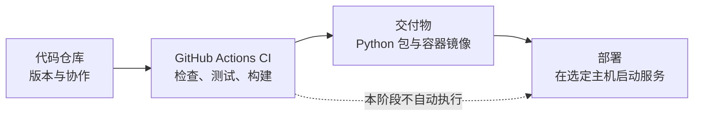

# DecAgent 项目构建与交付入门

这组文档把项目交付拆成三件事：保存代码、自动检查代码、把程序运行到目标环境。它们有关联，但处理的是不同阶段。

| 部分 | 文档 | 当前状态 |
| --- | --- | --- |
| 代码仓库 | [代码仓库与首次推送教程](代码仓库/1938_代码仓库与首次推送教程.md) | DecAgent 当前目录还没有 Git 仓库或远程地址；教程说明首次推送步骤，本轮没有创建外部 GitHub 仓库。 |
| CI | [GitHub Actions 持续集成教程](CI-CD/1938_GitHub_Actions持续集成教程.md) | 工作流已写入项目；本地 lint、确定性测试已验证。没有远程仓库，尚未运行 GitHub Actions。 |
| 部署 | [Docker Compose 部署与环境说明](部署/1938_Docker_Compose部署与环境说明.md) | 已说明当前 Compose 组成和部署前提；没有独立 Linux 主机，Linux 部署验收待办。 |

CI 通过表示代码通过了自动检查、测试和构建，不表示服务已经部署。部署指南也不会替代首次推送或 GitHub Actions 的运行结果。

## 建议阅读顺序

先看代码仓库教程，了解哪些文件会进入版本控制以及首次推送如何操作；再看 CI 教程，认识每项检查在哪个阶段运行；最后看部署说明，区分 Windows 本机模拟业务环境与当前 Compose 中的仓库修复服务。

## 本轮验收范围

- 已添加 `.github/workflows/ci.yml`，覆盖 Python 3.11/3.13、临时 PostgreSQL 集成测试、Python 安装包、MCP 安装包调用及离线 Compose 启动烟测。
- 本机已运行 Ruff、确定性测试、sdist/wheel 构建、独立 wheel 导入与 CLI 帮助验证；Compose 静态配置检查通过。Docker daemon 没有响应，因此容器启动烟测和本机 MCP/PostgreSQL 验证尚未执行。
- GitHub Actions 尚未执行：当前 DecAgent 目录无 `.git`，也没有 GitHub remote。首次推送教程将创建远程仓库留作你操作，未在本轮替你推送。
- Linux 独立主机部署没有执行；也没有加入自动部署、镜像推送或生产凭据。
