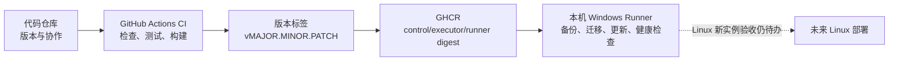

# DecAgent 项目构建与交付入门

这组文档把项目交付拆成三件事：保存代码、自动检查代码、把程序运行到目标环境。它们有关联，但处理的是不同阶段。

| 部分 | 文档 | 当前状态 |
| --- | --- | --- |
| 代码仓库 | [代码仓库与首次推送教程](代码仓库/1938_代码仓库与首次推送教程.md) | 已创建公开仓库 [shuaibilx/DecAgent](https://github.com/shuaibilx/DecAgent)；只推送 DecAgent，未推送 Waku 源码。 |
| CI | [GitHub Actions 持续集成教程](CI-CD/1938_GitHub_Actions持续集成教程.md) | main CI [38998096425](https://github.com/shuaibilx/DecAgent/actions/runs/38998096425) 和 release [39001018038](https://github.com/shuaibilx/DecAgent/actions/runs/39001018038) 均通过 Python 3.11/3.13、数据库集成测试、安装包/MCP 检查及离线 Compose smoke。 |
| 部署 / CD | [Docker Compose 部署与环境说明](部署/1938_Docker_Compose部署与环境说明.md) | `v0.1.4` 完成 GHCR 三类镜像发布和本机 Windows 自动部署；发布前备份 201,433 字节、`pg_restore` 验证通过、迁移成功、API `/health` 返回 `ok`，三个核心数据卷保留。Linux 新实例验收仍待办。 |

CI 通过表示代码通过自动检查、测试和构建；CD 还要通过 GHCR 发布与本机健康检查。两者都不等于独立 Linux 部署已经验收。

## 建议阅读顺序

先看代码仓库教程，了解哪些文件会进入版本控制以及首次推送如何操作；再看 CI 教程，认识每项检查在哪个阶段运行；最后看部署说明，区分 Windows 本机模拟业务环境与当前 Compose 中的仓库修复服务。

## 本轮验收范围

- `.github/workflows/ci.yml` 覆盖 Python 3.11/3.13、临时 PostgreSQL 集成测试、Python 安装包、已安装 wheel 的 MCP 调用及离线 Compose 启动烟测。
- GitHub Actions 运行 [38924980607](https://github.com/shuaibilx/DecAgent/actions/runs/38924980607) 的两个 Python 矩阵、包验证、runner/control/executor 镜像构建和隔离离线 Compose smoke 全部通过。
- 本机 Windows Docker Desktop 现有 Compose 栈运行健康，API `/health` 返回 `ok`；隔离离线 smoke 验证 owner 初始化、认证 CLI 与控制服务边界，模型付费请求为 0。此项不等于新服务器部署或完整网页验收。
- 版本发布工作流要求 CI 全绿、semver 标签和 main 祖先提交；本机 Runner 只执行发布部署 job，不接收 Pull Request。
- Release 运行 [39001018038](https://github.com/shuaibilx/DecAgent/actions/runs/39001018038) 的 Python 3.11/3.13 数据库集成测试、wheel/MCP 验证、隔离 Compose smoke、GHCR 登录及三类镜像发布全部成功，本机 Windows Runner 也完成 `v0.1.4` 自动部署。预部署备份 `predeploy-v0.1.4-20261017T044821Z.dump` 为 201,433 字节，SHA-256 `A0F82B6365ACA38D445CDDE75A33B51E8F0682C827560036989C7629CE8D3772`；`pg_restore --list` 成功读取 336 个 TOC 项。数据库迁移完成，API `/health` 返回 `ok`；API、Worker、executor 与 egress proxy 运行于 v0.1.4 固定 digest，PostgreSQL 和三个核心数据卷未更换。Release 日志记录部署状态 `deployed`。独立 Linux 主机部署和新实例完整网页验收仍未完成。
