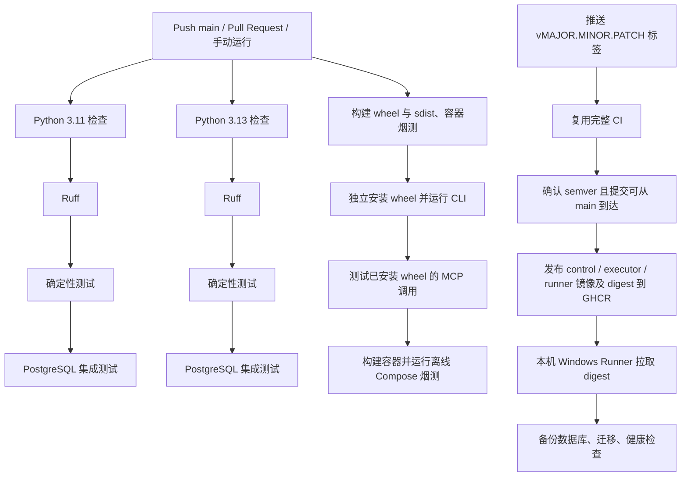

# DecAgent GitHub Actions 持续集成与镜像发布

持续集成（CI）在代码推送或 Pull Request 时检查项目。版本标签触发的发布工作流（CD）会先复用完整 CI；检查通过后构建三类镜像并推送到 GHCR，最后交给本机 Windows Docker Desktop Runner 更新服务。

## 工作流做什么

CI 配置位于 [`.github/workflows/ci.yml`](../../../.github/workflows/ci.yml)，推送到 `main`、创建或更新 Pull Request，以及手动点击 **Run workflow** 都会触发它。发布配置位于 [`.github/workflows/release.yml`](../../../.github/workflows/release.yml)，只响应 `v*` 版本标签。



GitHub Actions 为集成测试启动一个一次性 PostgreSQL 服务，使用测试专用数据库名和密码。每个集成测试结束后会删除它创建的数据库。依赖通过 `requirements.lock` 安装，并以该文件作为 pip 缓存键；PostgreSQL 镜像使用固定 digest。Python 3.11/3.13 检查与包构建、容器烟测并行运行；发布仍等待完整 CI 通过。

打包阶段会把 wheel 安装到临时目录并从源码目录之外导入，避免误把当前工作区当作安装包；然后运行已安装 wheel 的 CLI 和 MCP 协议验证。最后构建 runner、control 和 executor 镜像，并调用 `ops/control/offline_smoke.py` 验证新建的隔离 Compose 项目能启动。离线烟测使用空模型凭据，不发送模型请求。发布工作流只在完整 CI 通过后把这三类镜像分别推送到 `ghcr.io/shuaibilx/decagent-control`、`decagent-executor` 和 `decagent-runner`；每个镜像带 `vX.Y.Z`、完整 commit SHA 标签，并把 Registry digest 传给部署 job。

## 本地检查

从 DecAgent 根目录运行：

```powershell
.\.venv\Scripts\python.exe -m ruff check decagent evals ops
.\.venv\Scripts\python.exe -m pytest evals/deterministic -q
```

本机运行了 Ruff、Compose 安全配置回归和离线 Docker smoke，均通过。完整数据库集成套件由 GitHub Actions 的一次性 PostgreSQL 服务运行并通过；本机没有对当前业务数据库运行整套集成测试。

main CI 运行 [38998096425](https://github.com/shuaibilx/DecAgent/actions/runs/38998096425) 在 commit `089cd02` 上通过 Python 3.11/3.13、数据库集成测试、安装包验证和隔离 Compose smoke。Release 运行 [39001018038](https://github.com/shuaibilx/DecAgent/actions/runs/39001018038) 再次通过完整 CI 与离线 Compose smoke，短期 `GITHUB_TOKEN` 登录 GHCR 成功并发布 control、executor、runner 三类不可变镜像。本机 Windows Runner 备份数据库、完成迁移并升级服务；API/Worker 现能从完整固定镜像引用提取 runner digest，三个应用镜像均按 digest 运行，API `/health` 返回 `ok`。Release 部署 job 全部成功。独立 Linux 新实例和完整网页闭环仍待验收。

## 测试分层与覆盖边界

在 commit `cf91c47` 的 [CI 运行 39004408738](https://github.com/shuaibilx/DecAgent/actions/runs/39004408738) 中，pytest 收集了 1,396 个确定性测试和 615 个数据库集成测试。Python 3.11 分别为 1,394 通过/2 跳过（1分55秒）和 591 通过/24 跳过（25分50秒）；Python 3.13 的数据库集成测试为 591 通过/24 跳过，用时 40分08秒。两个 Python 版本的 job 并行启动，但每个 job 内的检查、确定性测试和集成测试按步骤串行。pip 缓存已命中，依赖安装约十几秒，因此集成测试的数据库准备与执行是主要耗时来源。

当前确定性测试覆盖规则、策略边界、参数验证、拒绝路径和失败处理；数据库集成测试覆盖存储、worker、MCP、审批、恢复和若干完整组件交互。wheel 验证会从源码目录外运行已安装包，经本地 MCP 客户端和服务端完成一次操作提交、查询并检查数据库回执；Compose 烟测验证新实例启动、owner 初始化、CLI 与容器安全设置。这些是有效的包/服务边界验收，但项目目前没有单独的 `evals/e2e` 测试层，也没有从员工自然语言请求开始，贯穿规划、Jev、动态分支、多步 MCP、人工中断/恢复到最终业务回执的完整端到端场景。

CI 默认排除 `live` 标记测试，不调用真实 Qwen、OpenRouter/Jev 或 GitHub 服务；真实 Docker 执行器验收也由显式环境变量控制，未启用时会跳过。pytest-cov 尚未安装，CI 没有行覆盖率或分支覆盖率报告，所以测试数量不能替代覆盖数据，也不能据此宣称覆盖充分。本轮将每个测试创建的数据库改为 fixture 管理并在结束后删除，也清理了迁移/备份用的辅助数据库；CI 现在打印跳过原因和最慢 25 个集成用例。下一步应基于新的耗时结果决定是否并行化，再补齐一条隔离、无付费调用的完整业务工作流 E2E，并测量覆盖率基线。暂不设置覆盖率硬门槛，避免先定一个缺乏依据的数字。

安装 wheel 时，本机 pip 仍提示配置的 `pypi.ngc.nvidia.com` 索引发生 SSL EOF；命令跳过该索引并成功完成安装。这个警告来自当前本机 pip 索引配置，工作流没有设置该索引，不能据此预判 GitHub Runner 的网络结果。

若要手动运行集成测试，必须先准备专用、可丢弃的 PostgreSQL 实例，并将 `DECAGENT_TEST_DATABASE_URL` 指向该实例。不要把现有业务数据库地址填入该变量：部分测试会创建并删除测试数据库或数据。

## 如何查看 GitHub 结果

打开 [DecAgent Actions](https://github.com/shuaibilx/DecAgent/actions)，选择 `CI` 并查看对应 commit 或 Pull Request。绿色勾表示该次工作流全部成功；红色叉表示某个 job 或步骤失败。点开失败步骤，查看首个异常并回到本地复现。

公开仓库 `shuaibilx/DecAgent` 当前 main CI 为 [运行 38998096425](https://github.com/shuaibilx/DecAgent/actions/runs/38998096425)，所有 job 通过。配置文件本身不代表后续每次提交都通过；每次变更仍需查看对应运行记录。

## 版本发布与 GHCR

下方的旧发布记录是 `v0.1.2` 部署失败时的历史状态；最新部署进度见本节末尾。

首次发布 `v0.1.0` 已完成；`v0.1.4` 已通过完整 release gate、发布 GHCR 镜像并完成本机自动部署。后续发布前先确认 `main` 对应的 CI 全绿，再选择一个尚未使用的语义版本标签。以下 `v0.1.5` 仅作下一次 patch 发布示例：

```powershell
git tag -a v0.1.5 -m "DecAgent v0.1.5"
git push origin v0.1.5
```

`release.yml` 会再次执行完整 CI，因此 PR 代码不会直接进入发布。标签必须严格符合 `vMAJOR.MINOR.PATCH`，并指向 `main` 历史中的提交。发布 job 使用 GitHub 托管 runner 和只具备 `packages: write` 的短期 `GITHUB_TOKEN`；部署 job 仅获 `packages: read`。镜像 package 首次创建默认保持私有，源代码仓库仍公开；工作流通过短期令牌拉取镜像，不把模型或 GitHub 凭据保存为 Actions secret。

`v0.1.0` 发布时 GHCR 登录曾失败。三个私有 package 的 **Package settings → Manage Actions access** 均已确认包含仓库 `shuaibilx/DecAgent` 且角色为 **Admin**，截图与 package 配置一致，无需再次调整权限。`v0.1.1` 和 `v0.1.2` 的 `docker/login-action` 均成功登录；`v0.1.2` release run [38991318147](https://github.com/shuaibilx/DecAgent/actions/runs/38991318147) 也成功发布 control、executor、runner 三类镜像。随后部署脚本在数据库备份的 `docker compose exec ... sh -ec ...` 命令处失败，错误来自 Windows PowerShell 5.1 的原生命令参数转发导致容器内 shell 脚本截断；备份、迁移及 Compose 更新都没有运行。脚本现直接调用 PostgreSQL 容器内的 `pg_dump` 并通过本地 Unix socket 连接，避免嵌套 shell 和密码参数传递；本机 Windows PowerShell 5.1 预检及临时 dump 实测通过。此段是 `v0.1.2` 的历史状态，后续结果见下方部署状态。

Package 设置入口：[control](https://github.com/users/shuaibilx/packages/container/package/decagent-control)、[executor](https://github.com/users/shuaibilx/packages/container/package/decagent-executor)、[runner](https://github.com/users/shuaibilx/packages/container/package/decagent-runner)。当前授权已达到 Admin；不需要重复添加。若以后再遇到认证问题，先检查 GHCR 登录步骤的 token 来源、job 的 `packages: read` 权限、Action access 列表和 runner 的原始登录日志，再决定是否调整 package 设置。

### v0.1.4 部署状态

Release 运行 [39001018038](https://github.com/shuaibilx/DecAgent/actions/runs/39001018038) 的完整 CI、离线 Compose smoke、GHCR 登录及三类镜像发布均成功；本机 Windows 自托管 Runner 的部署 job 也成功。部署生成 `predeploy-v0.1.4-20261017T044821Z.dump`，文件大小 201,433 字节，SHA-256 为 `A0F82B6365ACA38D445CDDE75A33B51E8F0682C827560036989C7629CE8D3772`；本机 `pg_restore --list` 成功读取 336 个 TOC 项。数据库迁移完成，Compose 输出 `status=deployed`、`api=healthy`；随后从本机请求 `/health` 得到 `{"status":"ok"}`。API、Worker、executor 与 egress proxy 使用 v0.1.4 固定 digest，PostgreSQL 与三个核心数据卷保持不变。三个私有 GHCR package 的 Manage Actions access 均含仓库 `shuaibilx/DecAgent` 且角色为 Admin，本次 Actions `packages: read` 登录和拉取成功；无需再次更改权限。独立 Linux 部署与新实例完整网页闭环仍待验收。

### v0.1.3 历史记录

Release 运行 [38995053020](https://github.com/shuaibilx/DecAgent/actions/runs/38995053020) 已完成全套 CI、离线 smoke 与三类 GHCR 镜像发布。部署备份 `predeploy-v0.1.3-20261017T025707Z.dump` 为 116,335 字节，SHA-256 为 `E241FBF44731D41D4C8EA6D69A9E27D0224ECEAEDA6A366F6747F37A8A50DAA6`，`pg_restore --list` 列出 202 项；数据库迁移完成。API/Worker 因完整 runner image ref 未解析为裸 digest 而未通过健康检查。当时仅重建 API/Worker 并临时传入裸 digest 后，API `/health` 恢复 `ok`；PostgreSQL、broker 和三个核心数据卷未更换。其后的 v0.1.4 修复与标准部署结果见上方当前状态。

## 产物与边界

普通 CI 会构建 Python wheel、source distribution 和容器镜像，并在 GitHub Runner 临时磁盘上验证；只有推送版本标签才会发布 GHCR 镜像并触发本机自动部署。CI 全绿说明代码通过设定检查；CD 结果还要看发布 workflow 的镜像发布和本机健康检查，且不代表独立 Linux 部署已验收。

pip 下载缓存按 `requirements.lock` 复用。GHCR 发布镜像使用独立 Buildx layer cache；普通 CI 的 runner 镜像构建耗时约 10 秒，Compose 离线烟测约 90 秒，因此当前优先修复 PostgreSQL 集成测试累积未清理数据库的问题，并输出最慢 25 个集成用例的耗时用于持续评估。

触发 GitHub Actions 可能消耗 GitHub Actions 的账户额度。普通测试不需要配置 Qwen、OpenRouter 或 GitHub API 密钥；不要把它们添加为 CI secrets，除非未来某个经批准的测试确实需要真实外部服务。

GitHub 官方文档：[Docker 镜像发布](https://docs.github.com/en/actions/tutorials/publish-packages/publish-docker-images)、[Package Actions access 与可见性](https://docs.github.com/en/packages/learn-github-packages/configuring-a-packages-access-control-and-visibility)、[自托管 Runner 安全使用](https://docs.github.com/en/actions/reference/security/secure-use)。本机 Runner 只匹配受信任的版本发布工作流，不接 Pull Request；但它能访问本机 Docker daemon 和 Compose secret 文件，仓库管理员必须谨慎审查发布流程改动。
