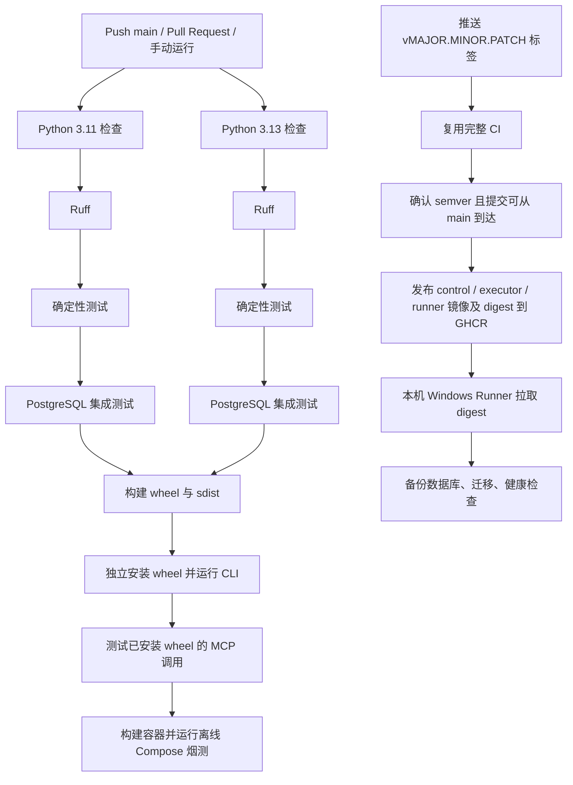

# DecAgent GitHub Actions 持续集成与镜像发布

持续集成（CI）在代码推送或 Pull Request 时检查项目。版本标签触发的发布工作流（CD）会先复用完整 CI；检查通过后构建三类镜像并推送到 GHCR，最后交给本机 Windows Docker Desktop Runner 更新服务。

## 工作流做什么

CI 配置位于 [`.github/workflows/ci.yml`](../../../.github/workflows/ci.yml)，推送到 `main`、创建或更新 Pull Request，以及手动点击 **Run workflow** 都会触发它。发布配置位于 [`.github/workflows/release.yml`](../../../.github/workflows/release.yml)，只响应 `v*` 版本标签。



GitHub Actions 为集成测试启动一个一次性 PostgreSQL 服务，使用测试专用数据库名和密码。依赖通过 `requirements.lock` 安装，并以该文件作为 pip 缓存键；PostgreSQL 镜像使用固定 digest。两个 Python 版本先完成检查与测试，之后再构建包和容器。

打包阶段会把 wheel 安装到临时目录并从源码目录之外导入，避免误把当前工作区当作安装包；然后运行已安装 wheel 的 CLI 和 MCP 协议验证。最后构建 runner、control 和 executor 镜像，并调用 `ops/control/offline_smoke.py` 验证新建的隔离 Compose 项目能启动。离线烟测使用空模型凭据，不发送模型请求。发布工作流只在完整 CI 通过后把这三类镜像分别推送到 `ghcr.io/shuaibilx/decagent-control`、`decagent-executor` 和 `decagent-runner`；每个镜像带 `vX.Y.Z`、完整 commit SHA 标签，并把 Registry digest 传给部署 job。

## 本地检查

从 DecAgent 根目录运行：

```powershell
.\.venv\Scripts\python.exe -m ruff check decagent evals ops
.\.venv\Scripts\python.exe -m pytest evals/deterministic -q
```

本机运行了 Ruff、Compose 安全配置回归和离线 Docker smoke，均通过。完整数据库集成套件由 GitHub Actions 的一次性 PostgreSQL 服务运行并通过；本机没有对当前业务数据库运行整套集成测试。

main CI 运行 [38924980607](https://github.com/shuaibilx/DecAgent/actions/runs/38924980607) 在 commit `5d3c23b` 上通过 Python 3.11/3.13、数据库集成测试、安装包验证和隔离 Compose smoke。Release 运行 [38991318147](https://github.com/shuaibilx/DecAgent/actions/runs/38991318147) 的 Python 3.11/3.13 数据库集成测试、wheel/MCP 验证和离线 Compose smoke 全部通过，短期 `GITHUB_TOKEN` 登录 GHCR 成功并发布了三类镜像。本机部署随后在备份前因 Windows PowerShell 5.1 拆分 `docker compose exec` 的 shell 脚本参数失败；没有创建备份或启动迁移。现已移除嵌套 shell，直接通过 PostgreSQL 本地 Unix socket 调用 `pg_dump`；Windows PowerShell 5.1 的预检和一份临时只读 dump 测试通过。完整 CD 待 `v0.1.3` 再验，Linux 新实例验收仍待办。

安装 wheel 时，本机 pip 仍提示配置的 `pypi.ngc.nvidia.com` 索引发生 SSL EOF；命令跳过该索引并成功完成安装。这个警告来自当前本机 pip 索引配置，工作流没有设置该索引，不能据此预判 GitHub Runner 的网络结果。

若要手动运行集成测试，必须先准备专用、可丢弃的 PostgreSQL 实例，并将 `DECAGENT_TEST_DATABASE_URL` 指向该实例。不要把现有业务数据库地址填入该变量：部分测试会创建并删除测试数据库或数据。

## 如何查看 GitHub 结果

打开 [DecAgent Actions](https://github.com/shuaibilx/DecAgent/actions)，选择 `CI` 并查看对应 commit 或 Pull Request。绿色勾表示该次工作流全部成功；红色叉表示某个 job 或步骤失败。点开失败步骤，查看首个异常并回到本地复现。

公开仓库 `shuaibilx/DecAgent` 的最新 main CI 为 [运行 38924980607](https://github.com/shuaibilx/DecAgent/actions/runs/38924980607)，全部 job 通过。配置文件本身不代表后续每次提交都通过；每次变更仍需查看对应运行记录。

## 版本发布与 GHCR

首次发布 `v0.1.0` 已完成。后续发布前先确认 `main` 对应的 CI 全绿，再在项目根目录推送新的语义版本标签；当前部署脚本修复计划通过 `v0.1.3` 完成真实部署闭环：

```powershell
git tag v0.1.3
git push origin v0.1.3
```

`release.yml` 会再次执行完整 CI，因此 PR 代码不会直接进入发布。标签必须严格符合 `vMAJOR.MINOR.PATCH`，并指向 `main` 历史中的提交。发布 job 使用 GitHub 托管 runner 和只具备 `packages: write` 的短期 `GITHUB_TOKEN`；部署 job 仅获 `packages: read`。镜像 package 首次创建默认保持私有，源代码仓库仍公开；工作流通过短期令牌拉取镜像，不把模型或 GitHub 凭据保存为 Actions secret。

`v0.1.0` 发布时 GHCR 登录曾失败。三个私有 package 的 **Package settings → Manage Actions access** 均已确认包含仓库 `shuaibilx/DecAgent` 且角色为 **Admin**，截图与 package 配置一致，无需再次调整权限。`v0.1.1` 和 `v0.1.2` 的 `docker/login-action` 均成功登录；`v0.1.2` release run [38991318147](https://github.com/shuaibilx/DecAgent/actions/runs/38991318147) 也成功发布 control、executor、runner 三类镜像。随后部署脚本在数据库备份的 `docker compose exec ... sh -ec ...` 命令处失败，错误来自 Windows PowerShell 5.1 的原生命令参数转发导致容器内 shell 脚本截断；备份、迁移及 Compose 更新都没有运行。脚本现直接调用 PostgreSQL 容器内的 `pg_dump` 并通过本地 Unix socket 连接，避免嵌套 shell 和密码参数传递；本机 Windows PowerShell 5.1 预检及临时 dump 实测通过。完整部署待 `v0.1.3` 验收。

Package 设置入口：[control](https://github.com/users/shuaibilx/packages/container/package/decagent-control)、[executor](https://github.com/users/shuaibilx/packages/container/package/decagent-executor)、[runner](https://github.com/users/shuaibilx/packages/container/package/decagent-runner)。当前授权已达到 Admin；不需要重复添加。若以后再遇到认证问题，先检查 GHCR 登录步骤的 token 来源、job 的 `packages: read` 权限、Action access 列表和 runner 的原始登录日志，再决定是否调整 package 设置。

## 产物与边界

普通 CI 会构建 Python wheel、source distribution 和容器镜像，并在 GitHub Runner 临时磁盘上验证；只有推送版本标签才会发布 GHCR 镜像并触发本机自动部署。CI 全绿说明代码通过设定检查；CD 结果还要看发布 workflow 的镜像发布和本机健康检查，且不代表独立 Linux 部署已验收。

pip 下载缓存按 `requirements.lock` 复用。技能提供的缓存分析器提示当前 Docker 构建没有跨次运行的 Buildx layer cache；首版先保留 Compose 离线烟测的原生构建路径，后续可依据 GitHub Actions 的实际耗时再评估 Buildx 缓存。

触发 GitHub Actions 可能消耗 GitHub Actions 的账户额度。普通测试不需要配置 Qwen、OpenRouter 或 GitHub API 密钥；不要把它们添加为 CI secrets，除非未来某个经批准的测试确实需要真实外部服务。

GitHub 官方文档：[Docker 镜像发布](https://docs.github.com/en/actions/tutorials/publish-packages/publish-docker-images)、[Package Actions access 与可见性](https://docs.github.com/en/packages/learn-github-packages/configuring-a-packages-access-control-and-visibility)、[自托管 Runner 安全使用](https://docs.github.com/en/actions/reference/security/secure-use)。本机 Runner 只匹配受信任的版本发布工作流，不接 Pull Request；但它能访问本机 Docker daemon 和 Compose secret 文件，仓库管理员必须谨慎审查发布流程改动。
