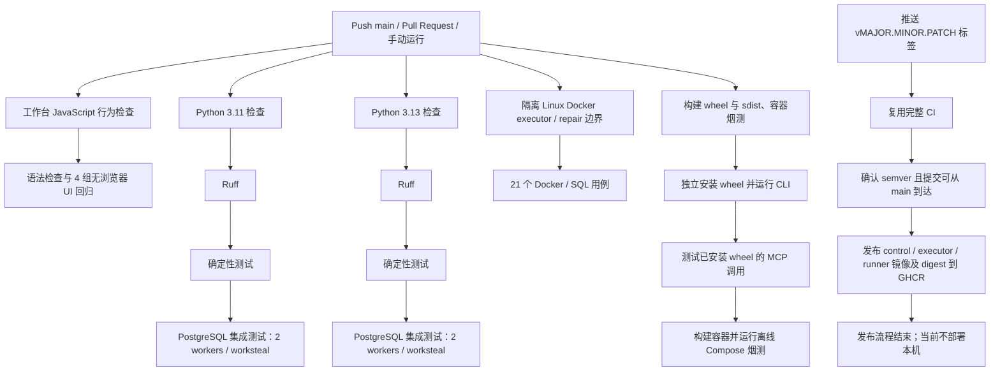

# DecAgent GitHub Actions 持续集成与镜像发布

**状态更新（2026-10-20）：** PR [#1](https://github.com/shuaibilx/DecAgent/pull/1) 已合并至 `main`（merge commit `0c747a396a360cc168d62c261f5d3dcd329cfb82`），删除了公共 release workflow 中的 `deploy-local` self-hosted job。现在版本标签只会在 GitHub-hosted Ubuntu 上完成 CI 和 GHCR 镜像发布，不会调度本机部署。GitHub 仓库 Runner 数量为 0，本机也没有 Runner 服务或进程；既有 v0.1.4 容器保持运行且未被本次改动触碰。下文关于 v0.1.4 本机自动部署的内容是历史记录，不能作为当前自动 CD 能力说明。

持续集成（CI）在代码推送或 Pull Request 时检查项目。版本标签触发的发布工作流（CD）会先复用完整 CI；检查通过后构建三类镜像并推送到 GHCR。当前本机部署与可信发布执行器尚未重新设计和验收。

## 工作流做什么

CI 配置位于 [`.github/workflows/ci.yml`](../../../.github/workflows/ci.yml)，推送到 `main`、创建或更新 Pull Request，以及手动点击 **Run workflow** 都会触发它。发布配置位于 [`.github/workflows/release.yml`](../../../.github/workflows/release.yml)，只响应 `v*` 版本标签。



`workbench-ui` 是独立的快速 job，与两个 Python 矩阵及包/镜像烟测并行。它运行工作台静态脚本语法检查，以及选择状态、trace 渲染、语义介入和游客工作台四组 Node 回归；不启动数据库或调用模型。它不替代 Playwright 端到端验收。

`executor-boundary` 也是独立的 GitHub-hosted Ubuntu job。它为每个运行生成隔离的 Compose 项目与容器名，只使用临时测试凭据，并以只读方式挂载源码；随后在临时 PostgreSQL、broker 与 MCP 环境中运行 Docker executor 和 repair 共 21 个边界用例。job 的工作目录和容器使用专属随机前缀，不复用本机项目；清理时不删除卷，托管 runner 回收其临时环境。Python 集成矩阵仍将这 21 个需要显式隔离 Docker 环境的用例标为 skip，但这个独立 job 会实际执行它们并单独报告结果。

GitHub Actions 为集成测试启动一个一次性 PostgreSQL 服务，使用测试专用数据库名和密码。每个 Python job 用迁移后的模板数据库为每个测试创建独立克隆，并在测试结束后删除克隆库；模板库只在每个 pytest worker 内迁移一次。集成测试固定使用 2 个 `pytest-xdist` worker 和 `worksteal` 分发，以免在 PostgreSQL 上同时启动过多测试。依赖通过 `requirements.lock` 安装，并以该文件作为 pip 缓存键；PostgreSQL 镜像使用固定 digest。Python 3.11/3.13 检查与包构建、容器烟测并行运行；发布仍等待完整 CI 通过。

2026-10-21 的候选 SHA `3a7938fd1b3e7a564de6310fc171d1be8f8adfdc` 在 [CI run 39592249617](https://github.com/shuaibilx/DecAgent/actions/runs/39592249617) 上全部通过，总墙钟为 25 分 33 秒。两个 Python 版本各自 Ruff 通过、确定性测试 `1963 passed, 18 skipped`、PostgreSQL 集成 `624 passed, 30 skipped`；独立 Docker/SQL job 的 21 个测试全部通过。剩余 9 个集成 skip 是 pinned benchmark image、Windows ACL、opt-in EnterpriseOps Docker readiness、可选上游 source cache 和缺少 mcp-cli，不是 PostgreSQL 服务缺失。该 run 只能证明代码与隔离工程测试通过，不代表公开基准任务或 Jev 收益已经通过。

打包阶段会把 wheel 安装到临时目录并从源码目录之外导入，避免误把当前工作区当作安装包；然后运行已安装 wheel 的 CLI 和 MCP 协议验证。最后构建 runner、control 和 executor 镜像，并调用 `ops/control/offline_smoke.py` 验证新建的隔离 Compose 项目能启动。离线烟测使用空模型凭据，不发送模型请求。发布工作流只在完整 CI 通过后把这三类镜像分别推送到 `ghcr.io/shuaibilx/decagent-control`、`decagent-executor` 和 `decagent-runner`；每个镜像带 `vX.Y.Z`、完整 commit SHA 标签，并把 Registry digest 传给部署 job。

## 本地检查

从 DecAgent 根目录运行：

```powershell
.\.venv\Scripts\python.exe -m ruff check decagent evals ops
.\.venv\Scripts\python.exe -m pytest evals/deterministic -q
# DECAGENT_TEST_DATABASE_URL 必须指向专用、可丢弃的 PostgreSQL 实例
.\.venv\Scripts\python.exe -m pytest evals/integration -n 2 --dist=worksteal -q -rs --durations=25
```

在 Windows 的中文路径中，pytest-xdist 的 worker 可能遇到路径编码错误；可从 ASCII 驱动器映射运行，或本地省略 `-n 2 --dist=worksteal`。GitHub Ubuntu runner 的工作区路径没有这个限制。

本机运行了 Ruff、Compose 安全配置回归和离线 Docker smoke，均通过。完整集成测试使用独立的一次性 PostgreSQL 容器，不连接 DecAgent 当前业务数据库。

main CI 运行 [38998096425](https://github.com/shuaibilx/DecAgent/actions/runs/38998096425) 在 commit `089cd02` 上通过 Python 3.11/3.13、数据库集成测试、安装包验证和隔离 Compose smoke。Release 运行 [39001018038](https://github.com/shuaibilx/DecAgent/actions/runs/39001018038) 再次通过完整 CI 与离线 Compose smoke，短期 `GITHUB_TOKEN` 登录 GHCR 成功并发布 control、executor、runner 三类不可变镜像。本机 Windows Runner 备份数据库、完成迁移并升级服务；API/Worker 现能从完整固定镜像引用提取 runner digest，三个应用镜像均按 digest 运行，API `/health` 返回 `ok`。Release 部署 job 全部成功。独立 Linux 新实例和完整网页闭环仍待验收。

## 测试分层与覆盖边界

在基线 [CI 运行 39004408738](https://github.com/shuaibilx/DecAgent/actions/runs/39004408738) 中，pytest 收集 1,396 个确定性测试和 615 个数据库集成测试。Python 3.11 集成测试用时 25分50秒；Python 3.13 用时 40分08秒。新方案在 [CI 运行 39015142876](https://github.com/shuaibilx/DecAgent/actions/runs/39015142876) 全绿：3.11 集成测试 592 通过/24 跳过，用时 18分50秒；3.13 为 592 通过/24 跳过，用时 20分03秒。两个 Python job 中的集成测试各使用 2 个 `pytest-xdist` worker；确定性测试分别用时 2分53秒和 3分08秒，wheel/MCP/Compose job 与它们并行，在 2分22秒完成。完整 CI 从 46分20秒降到 23分55秒，减少 22分25秒（约 48%）。

当前确定性测试覆盖规则、策略边界、参数验证、拒绝路径和失败处理；数据库集成测试覆盖存储、worker、MCP、审批、恢复和若干完整组件交互。wheel 验证会从源码目录外运行已安装包，经本地 MCP 客户端和服务端完成一次操作提交、查询并检查数据库回执；Compose 烟测验证新实例启动、owner 初始化、CLI 与容器安全设置。这些是有效的包/服务边界验收，但项目目前没有单独的 `evals/e2e` 测试层，也没有从员工自然语言请求开始，贯穿规划、Jev、动态分支、多步 MCP、人工中断/恢复到最终业务回执的完整端到端场景。

CI 默认排除 `live` 标记测试，不调用真实 Qwen、OpenRouter/Jev 或 GitHub 服务；真实 Docker 执行器、基准镜像和本机 ACL 验收由显式环境条件控制，未启用时会跳过。当前 pytest-cov 尚未安装，CI 没有行覆盖率或分支覆盖率报告，因此测试数量不能替代覆盖数据，也不能据此宣称覆盖充分。数据库测试使用 fixture 克隆独立库并在结束后删除；最慢用例会在 CI 报告中列出。Windows Python 3.13 的本地完整集使用 2 个 worker 完成 594 通过、22 跳过，用时 20分22秒，与 GitHub Linux 的两个版本都在 20 分钟左右相符。测试面包含近 1,400 个确定性用例和 616 个集成用例（其中 24 个依赖环境而跳过），但没有单独的 `evals/e2e` 层，也没有从员工自然语言请求贯穿规划、Jev、动态分支、多步 MCP、人工中断/恢复到最终业务回执的完整端到端场景。下一步应补齐一条隔离、无付费调用的核心业务 E2E，并测量行/分支覆盖率基线；暂不设置覆盖率硬门槛，避免用任意阈值制造安全感。

安装 wheel 时，本机 pip 仍提示配置的 `pypi.ngc.nvidia.com` 索引发生 SSL EOF；命令跳过该索引并成功完成安装。这个警告来自当前本机 pip 索引配置，工作流没有设置该索引，不能据此预判 GitHub Runner 的网络结果。

若要手动运行集成测试，必须先准备专用、可丢弃的 PostgreSQL 实例，并将 `DECAGENT_TEST_DATABASE_URL` 指向该实例。不要把现有业务数据库地址填入该变量：部分测试会创建并删除测试数据库或数据。

## 如何查看 GitHub 结果

打开 [DecAgent Actions](https://github.com/shuaibilx/DecAgent/actions)，选择 `CI` 并查看对应 commit 或 Pull Request。绿色勾表示该次工作流全部成功；红色叉表示某个 job 或步骤失败。点开失败步骤，查看首个异常并回到本地复现。

公开仓库 `shuaibilx/DecAgent` 当前 main CI 为 [运行 39015142876](https://github.com/shuaibilx/DecAgent/actions/runs/39015142876)，所有 job 通过。配置文件本身不代表后续每次提交都通过；每次变更仍需查看对应运行记录。

## 版本发布与 GHCR

下方的旧发布记录是 `v0.1.2` 部署失败时的历史状态；最新部署进度见本节末尾。

首次发布 `v0.1.0` 已完成；`v0.1.4` 曾通过完整 release gate、发布 GHCR 镜像并完成本机自动部署，这是历史记录。当前不要把 `v0.1.5` 示例当成部署命令：版本标签会发布 GHCR 镜像，但不会更新本机服务。待私有部署仓库/可信 CD 执行器设计并验收后，再启用自动部署。

以下仅展示语义版本标签格式，不建议在部署路径重新验收前执行：

```powershell
git tag -a v0.1.5 -m "DecAgent v0.1.5"
git push origin v0.1.5
```

`release.yml` 会再次执行完整 CI，因此 PR 代码不会直接进入发布。标签必须严格符合 `vMAJOR.MINOR.PATCH`，并指向 `main` 历史中的提交。当前发布 job 使用 GitHub 托管 runner 和只具备 `packages: write` 的短期 `GITHUB_TOKEN`；工作流没有部署 job，也不需要给公共仓库注册本机 Runner。镜像 package 保持私有；工作流用短期令牌发布镜像，不把模型或 GitHub 凭据保存为 Actions secret。

`v0.1.0` 发布时 GHCR 登录曾失败。三个私有 package 的 **Package settings → Manage Actions access** 均已确认包含仓库 `shuaibilx/DecAgent` 且角色为 **Admin**，截图与 package 配置一致，无需再次调整权限。`v0.1.1` 和 `v0.1.2` 的 `docker/login-action` 均成功登录；`v0.1.2` release run [38991318147](https://github.com/shuaibilx/DecAgent/actions/runs/38991318147) 也成功发布 control、executor、runner 三类镜像。随后部署脚本在数据库备份的 `docker compose exec ... sh -ec ...` 命令处失败，错误来自 Windows PowerShell 5.1 的原生命令参数转发导致容器内 shell 脚本截断；备份、迁移及 Compose 更新都没有运行。脚本现直接调用 PostgreSQL 容器内的 `pg_dump` 并通过本地 Unix socket 连接，避免嵌套 shell 和密码参数传递；本机 Windows PowerShell 5.1 预检及临时 dump 实测通过。此段是 `v0.1.2` 的历史状态，后续结果见下方部署状态。

Package 设置入口：[control](https://github.com/users/shuaibilx/packages/container/package/decagent-control)、[executor](https://github.com/users/shuaibilx/packages/container/package/decagent-executor)、[runner](https://github.com/users/shuaibilx/packages/container/package/decagent-runner)。当前授权已达到 Admin；不需要重复添加。若以后再遇到认证问题，先检查 GHCR 登录步骤的 token 来源、job 的 `packages: read` 权限、Action access 列表和 runner 的原始登录日志，再决定是否调整 package 设置。

### v0.1.4 部署状态

Release 运行 [39001018038](https://github.com/shuaibilx/DecAgent/actions/runs/39001018038) 的完整 CI、离线 Compose smoke、GHCR 登录及三类镜像发布均成功；本机 Windows 自托管 Runner 的部署 job 也成功。部署生成 `predeploy-v0.1.4-20261017T044821Z.dump`，文件大小 201,433 字节，SHA-256 为 `A0F82B6365ACA38D445CDDE75A33B51E8F0682C827560036989C7629CE8D3772`；本机 `pg_restore --list` 成功读取 336 个 TOC 项。数据库迁移完成，Compose 输出 `status=deployed`、`api=healthy`；随后从本机请求 `/health` 得到 `{"status":"ok"}`。API、Worker、executor 与 egress proxy 使用 v0.1.4 固定 digest，PostgreSQL 与三个核心数据卷保持不变。三个私有 GHCR package 的 Manage Actions access 均含仓库 `shuaibilx/DecAgent` 且角色为 Admin，本次 Actions `packages: read` 登录和拉取成功；无需再次更改权限。独立 Linux 部署与新实例完整网页闭环仍待验收。

### v0.1.3 历史记录

Release 运行 [38995053020](https://github.com/shuaibilx/DecAgent/actions/runs/38995053020) 已完成全套 CI、离线 smoke 与三类 GHCR 镜像发布。部署备份 `predeploy-v0.1.3-20261017T025707Z.dump` 为 116,335 字节，SHA-256 为 `E241FBF44731D41D4C8EA6D69A9E27D0224ECEAEDA6A366F6747F37A8A50DAA6`，`pg_restore --list` 列出 202 项；数据库迁移完成。API/Worker 因完整 runner image ref 未解析为裸 digest 而未通过健康检查。当时仅重建 API/Worker 并临时传入裸 digest 后，API `/health` 恢复 `ok`；PostgreSQL、broker 和三个核心数据卷未更换。其后的 v0.1.4 修复与标准部署结果见上方当前状态。

## 产物与边界

普通 CI 会构建 Python wheel、source distribution 和容器镜像，并在 GitHub Runner 临时磁盘上验证；只有推送版本标签才会发布 GHCR 镜像。当前发布流程不会部署本机服务。CI 全绿说明代码通过设定检查；GHCR 发布也不代表业务服务已经升级，更不代表独立 Linux 部署已验收。

pip 下载缓存按 `requirements.lock` 复用。GHCR 发布镜像使用独立 Buildx layer cache；本次 CI 的打包/镜像 job 用时约 2 分 43 秒，Docker 边界 job 用时约 2 分 22 秒，两个 PostgreSQL 集成 job 分别用时约 20 分 38 秒和 17 分 22 秒。集成仍是总耗时主体；同分支此前成功 run 用时约 18 分 41 秒，因此本次 25 分 33 秒不能证明 CI 已提速。现有流水线保留 2-worker `worksteal` 调度并输出最慢 25 个用例；下一轮应先比较多个 run 的慢用例与 worker 等待，再决定是否调整并行度，不能为缩短时间删减 Python 版本或测试覆盖。

触发 GitHub Actions 可能消耗 GitHub Actions 的账户额度。普通测试不需要配置 Qwen、OpenRouter 或 GitHub API 密钥；不要把它们添加为 CI secrets，除非未来某个经批准的测试确实需要真实外部服务。

GitHub 官方文档：[Docker 镜像发布](https://docs.github.com/en/actions/tutorials/publish-packages/publishing-and-installing-a-package)、[Package Actions access 与可见性](https://docs.github.com/en/packages/learn-github-packages/configuring-a-packages-access-control-and-visibility)、[自托管 Runner 安全使用](https://docs.github.com/en/actions/reference/security/secure-use)。公共源码仓库当前没有 self-hosted job；如未来恢复 CD，部署执行器应迁入私有部署仓库并验证 release 来源与镜像 digest。
