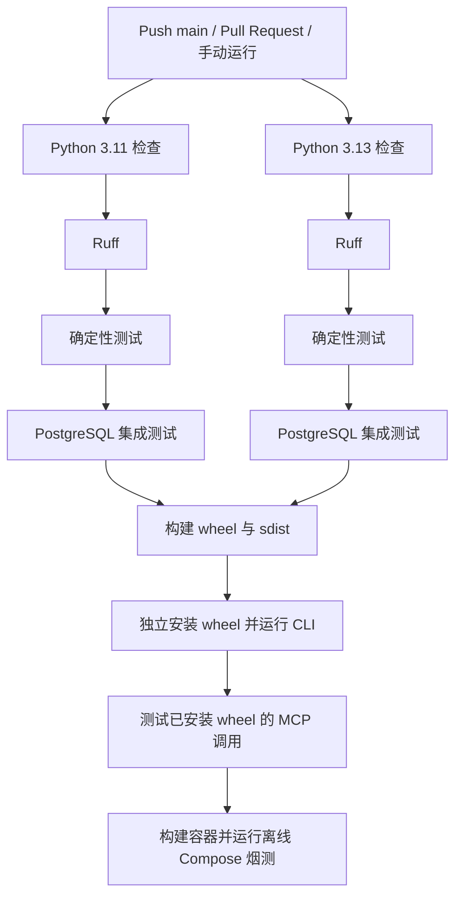

# DecAgent GitHub Actions 持续集成教程

持续集成（CI）会在代码推送或 Pull Request 时自动检查项目。当前工作流运行 lint、测试、Python 安装包验证和容器启动烟测；它不会发布镜像，也不会部署到服务器。

## 工作流做什么

配置位于 [`.github/workflows/ci.yml`](../../../.github/workflows/ci.yml)。推送到 `main`、创建或更新 Pull Request，以及手动点击 **Run workflow** 都会触发它。



GitHub Actions 为集成测试启动一个一次性 PostgreSQL 服务，使用测试专用数据库名和密码。依赖通过 `requirements.lock` 安装，并以该文件作为 pip 缓存键；PostgreSQL 镜像使用固定 digest。两个 Python 版本先完成检查与测试，之后再构建包和容器。

打包阶段会把 wheel 安装到临时目录并从源码目录之外导入，避免误把当前工作区当作安装包；然后运行已安装 wheel 的 CLI 和 MCP 协议验证。最后构建 runner、control 和 executor 镜像，并调用 `ops/control/offline_smoke.py` 验证新建的隔离 Compose 项目能启动。离线烟测使用空模型凭据，不发送模型请求。

## 本地检查

从 DecAgent 根目录运行：

```powershell
.\.venv\Scripts\python.exe -m ruff check decagent evals ops
.\.venv\Scripts\python.exe -m pytest evals/deterministic -q
```

本机已经运行以上检查：Ruff 通过；确定性测试为 **1388 passed, 3 skipped**。本机尚未针对一次性 PostgreSQL 实例运行整个 `evals/integration`；CI 会在它自己的干净 PostgreSQL 服务上执行，避免碰到本机业务数据库。

本机还成功构建了 `decagent-0.1.0` 的 sdist 和 wheel，将 wheel 安装到源码目录外的临时目录，验证导入路径确实来自该 wheel，并通过 `python -m decagent --help`。Compose 静态配置检查通过；本机 Docker daemon 在等待后仍无响应，因此没有启动容器，也没有运行需要 PostgreSQL 的 MCP wheel 烟测。GitHub Actions 上的真实结果要等首次推送后查看。

安装 wheel 时，本机 pip 仍提示配置的 `pypi.ngc.nvidia.com` 索引发生 SSL EOF；命令跳过该索引并成功完成安装。这个警告来自当前本机 pip 索引配置，工作流没有设置该索引，不能据此预判 GitHub Runner 的网络结果。

若要手动运行集成测试，必须先准备专用、可丢弃的 PostgreSQL 实例，并将 `DECAGENT_TEST_DATABASE_URL` 指向该实例。不要把现有业务数据库地址填入该变量：部分测试会创建并删除测试数据库或数据。

## 如何查看 GitHub 结果

先按照[代码仓库教程](../代码仓库/1938_代码仓库与首次推送教程.md)将项目推送到 GitHub。打开仓库的 **Actions** 页面，选择 `CI`，再点开对应的 commit 或 Pull Request。绿色勾表示该次工作流全部成功；红色叉表示某个 job 或步骤失败。点开失败步骤，查看首个异常并回到本地复现。

工作流受限于当前状态：DecAgent 目录没有 Git 仓库或 remote，因此 GitHub 上目前没有运行记录。配置文件存在不等于 CI 已在线通过。

## 产物与边界

工作流会构建 Python wheel、source distribution 和容器镜像，并在 GitHub Runner 临时磁盘上验证；当前没有上传长期 artifact、推送容器 Registry、创建 Release 或执行部署步骤。CI 全绿说明这次代码通过了设定的检查，不代表生产服务器已经运行，也不代表 Linux 部署已验收。

pip 下载缓存按 `requirements.lock` 复用。技能提供的缓存分析器提示当前 Docker 构建没有跨次运行的 Buildx layer cache；首版先保留 Compose 离线烟测的原生构建路径，后续可依据 GitHub Actions 的实际耗时再评估 Buildx 缓存。

触发 GitHub Actions 可能消耗 GitHub Actions 的账户额度。普通测试不需要配置 Qwen、OpenRouter 或 GitHub API 密钥；不要把它们添加为 CI secrets，除非未来某个经批准的测试确实需要真实外部服务。

GitHub 官方 Action 文档：[actions/checkout](https://github.com/actions/checkout)、[actions/setup-python](https://github.com/actions/setup-python)。
