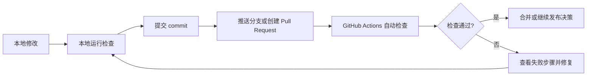

# DecAgent 代码仓库与 GitHub 首次推送教程

代码仓库记录源代码的修改历史，并为 GitHub Actions 提供代码来源。DecAgent 已推送到公开 GitHub 仓库，CI 工作流也已有成功运行记录。

## 项目目录怎么分

| 路径 | 内容 | 是否属于源代码仓库 |
| --- | --- | --- |
| `decagent/` | Agent、业务服务、MCP、存储及网关源码 | 是 |
| `ops/` | 本地运维、容器入口、迁移与辅助脚本 | 是 |
| `evals/` | 确定性测试、集成测试和评测工具 | 是；公开数据缓存与研究材料按各自 `.gitignore` 排除 |
| `.github/workflows/` | GitHub Actions 工作流定义 | 是 |
| `generated/` | 项目指南、架构说明和生成报告 | 是；文档按日期及主题分组 |
| `.venv/`、`.decagent/`、`.env` | 本地 Python 环境、运行数据、环境变量和密钥 | 否，已加入 `.gitignore` |
| `output/`、`.idea/`、`.playwright-cli/` | 本机浏览器产物、IDE 与浏览器自动化状态 | 否，已加入 `.gitignore` |
| `dist/`、`*.egg-info`、缓存目录 | 本机构建产物与工具缓存 | 否，已加入 `.gitignore` |

`.gitignore` 可以防止常见本机配置进入 Git，但首次推送前仍要检查 Git 的暂存文件列表。不要将 API key、密码、访问令牌、`.env` 或 `.decagent/secrets/` 提交到仓库。

## 当前仓库状态

截至 2026-10-16，DecAgent 位于公开仓库 [shuaibilx/DecAgent](https://github.com/shuaibilx/DecAgent)，`main` 当前指向 `21b7570`。本次推送包含 DecAgent 与已迁入的 `openspec/`，没有推送 Waku 源码。工作区 `main` 与 `origin/main` 一致。

## 首次推送到 GitHub

本项目的首次推送已完成，当前仓库位于 `https://github.com/shuaibilx/DecAgent`。以下 `git init` 步骤只适用于另一个尚未初始化的新副本；不要在当前仓库再次运行 `git init` 或添加第二个 `origin`。新建仓库时，不要勾选初始化 README、`.gitignore` 或 License，因为项目目录已有这些文件。

以下是首次推送时使用的命令模板；当前工作区已完成初始化和推送，不要在当前副本重复执行。首次推送前应先审查 `.gitignore` 和暂存文件，确认没有本地密钥或运行数据。

```powershell
# 进入 DecAgent 根目录后执行
git init -b main
git add .
git status --short
git diff --cached --name-only
```

检查列表只包含预期的源码、测试、配置和文档。确认没有 `.env`、`.decagent/`、令牌、密码、私有数据或大体积本机产物后，再创建第一次提交并设置远程地址：

```powershell
git commit -m "Add DecAgent source and CI workflow"
git remote add origin https://github.com/<OWNER>/<REPOSITORY>.git
git push -u origin main
```

把 `<OWNER>` 和 `<REPOSITORY>` 替换成你创建的仓库信息。之后在 GitHub 仓库的 **Actions** 页面查看 `CI` 工作流。若远程仓库不是以 `main` 作为默认分支，需要将 `.github/workflows/ci.yml` 中的 push 分支名称与仓库默认分支同步。

本次使用 GitHub CLI 创建公开仓库并推送 `main`；commit `21b7570` 的 CI 已全部通过。后续每个推送都会触发新的 CI，检查对应 commit 的最新运行结果。

## 后续日常流程



提交代码和部署服务是两个操作。当前 Actions 只做 CI，不会把代码部署到服务器。
