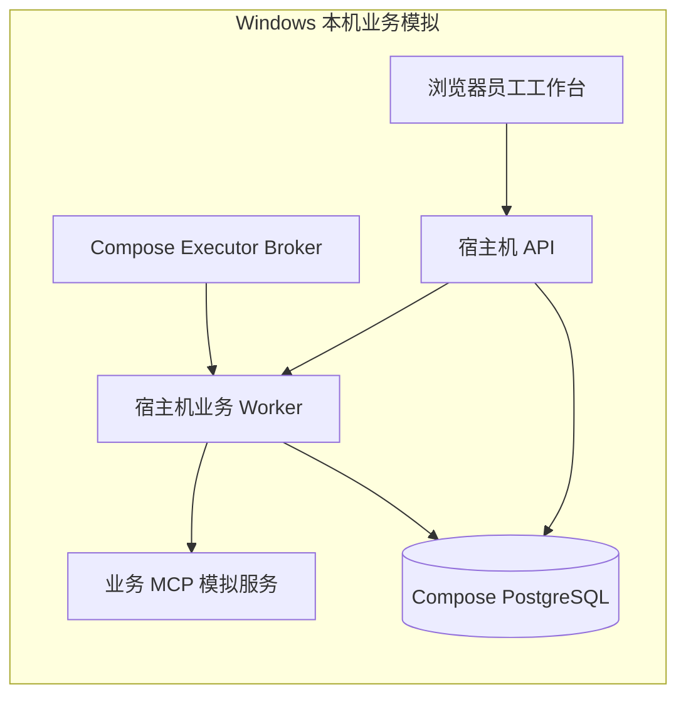
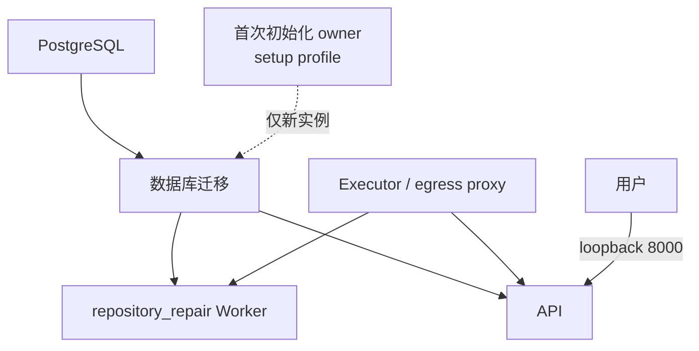

# DecAgent Docker Compose 部署与环境说明

CI 负责检查和构建；CD 在版本标签通过检查后，把镜像发布到 GHCR 并更新已配置的本机 Windows Docker Desktop。当前没有独立 Linux 主机，因此本文也把 Linux 部署前提单独保留，不能用本机部署替代 Linux 验收。

## 先区分两种运行环境

DecAgent 当前有两条运行路径，不能把它们当成同一个部署包：

| 运行路径 | 组成 | 用途与状态 |
| --- | --- | --- |
| Windows 本机业务模拟 | `compose.yaml` + `compose.windows.yaml` 提供 PostgreSQL 和 broker；`ops.local.start` 在宿主机启动 MCP、员工 API、业务 Worker | 用于本机模拟员工工单流程。源码 README 标记当前 schema 为 17；2026-10-14 的旧使用指南记录 schema 11，只是旧版本快照。不要把旧指南当成当前数据库升级说明。 |
| Compose 容器栈 | PostgreSQL、迁移、可选 owner 初始化、API、`repository_repair` Worker、egress proxy、executor broker | 当前 `compose.yaml` 的 Worker 命令是 `worker --kind repository_repair`。该文件不能证明业务 MCP 与 business Worker 已经完成 Linux 部署验收。 |



## Compose 容器栈包含什么



配置文件通过 `${...}` 读取 `.env`，敏感文件从 `.decagent/secrets/` 装载。Compose 在启动前要求设置 `DECAGENT_RUNNER_IMAGE` 为本机 runner 镜像的不可变 `sha256` image ID。API 默认仅绑定 `127.0.0.1`；PostgreSQL 与 broker 不应直接暴露到公网。`executor-broker` 挂载 Docker socket，因此运行它的主机权限和隔离需要谨慎管理。

## 部署前需要准备

未来部署需要一台独立 Linux 主机、Docker Engine 与 Compose 插件、DecAgent 代码、可持久化备份的数据库卷、模型/API 凭据、安全的 HTTPS 入口，以及和当前源码版本一致的迁移计划。部署负责人还要确认 runner 镜像、宿主机 Docker socket 与执行隔离策略。

当前没有独立 Linux 主机。Windows Docker Desktop 已用于恢复并检查本机现有服务，也运行了隔离离线 Compose smoke；这些检查不等同于新机器安装、完整网页闭环或生产部署。

## 未来 Linux Compose 部署准备

以下命令是未来在专用 Linux 主机上的操作示例，本轮没有执行。先从 GitHub clone 已审查的仓库 commit，在项目根目录配置环境。仅在全新目录且 `.env` 不存在时复制模板；不要覆盖已有 `.env`：

```bash
if [ ! -f .env ]; then cp .env.example .env; fi
```

在 `.env` 中填入部署所需的地址、模型名和 API 凭据。不要提交 `.env` 或把密钥写进命令历史。程序提供的秘密初始化脚本只创建缺失文件并保留现有 secret；运行前先审阅设置来源：

```bash
python -m ops.control.prepare_secrets
```

构建 runner 镜像并查看不可变镜像 ID：

```bash
docker build -f ops/runner/Dockerfile -t decagent-executor-runner:supervised .
docker image inspect decagent-executor-runner:supervised --format '{{.Id}}'
```

将输出的 `sha256:...` ID 配置给 `DECAGENT_RUNNER_IMAGE`，再检查 Compose 最终配置，并按部署审查结果启动：

```bash
docker compose -f compose.yaml config --quiet
docker compose -f compose.yaml build
docker compose -f compose.yaml up -d --wait
docker compose -f compose.yaml --profile setup run --rm owner-init
docker compose -f compose.yaml ps
```

首次初始化只适用于全新数据库。已有实例不要重复执行 owner 初始化，也不要为排障直接删除数据库卷。上线前需在目标机实测 API 健康状态、登录、迁移、备份恢复、runner 网络隔离和日志脱敏；具体业务模拟栈的 Linux 部署方案还需要单独完成设计与验收。

停止容器可使用 `docker compose -f compose.yaml down`，它会保留命名数据卷。不要使用 `down -v`，除非你明确要删除数据库及其他持久化数据并已有可验证备份。

## GHCR 发布与本机自动部署

`.github/workflows/release.yml` 只响应 `v*` 标签。它先在 GitHub 托管 Runner 上复用完整 CI，再检查标签格式为 `vMAJOR.MINOR.PATCH`、提交位于 `main` 历史中；随后发布 control、executor 和 runner 镜像到 GHCR，使用 Registry 返回的 digest 部署。普通 push 和 Pull Request 不会使用本机 Runner。

首次安装本机 Runner 前，确认 GitHub CLI 已以仓库管理员账号登录，当前用户已经配置 `.env` 与 `.decagent/secrets/`，Docker Desktop Linux engine 正在运行。然后在 DecAgent 根目录的 PowerShell 执行：

```powershell
.\ops\deploy\install-local-runner.ps1
```

脚本会下载官方 Windows x64 Actions Runner、注册仓库级 `decagent-local-deploy` Runner，并创建当前用户登录时启动的计划任务。此终端没有管理员权限，所以 Runner 不注册为 Windows 服务。任务启动后会等待 Docker Desktop Linux engine 就绪；用户登出、Docker Desktop 未启动或电脑休眠期间，本机 Runner 不在线，发布部署会等待或失败。若希望开机后自动部署，请在 Docker Desktop 设置中启用登录时启动，并保持当前 Windows 用户处于登录状态。

Runner 默认安装在 `%USERPROFILE%\DecAgentRunner\actions-runner`，由当前用户的计划任务写入和更新；启动诊断记录位于该目录的 `_diag\local-bootstrap.log`。如果曾经按旧版本安装在 `%LOCALAPPDATA%\DecAgent\actions-runner`，安装脚本会把现有 Runner 配置迁移到用户目录。

仓库环境 `local-deploy` 限制为 `v*` 标签。GHCR package 默认私有，发布工作流只使用短期 `GITHUB_TOKEN`：发布 job 仅有 `packages: write`，本机部署 job 仅有 `packages: read`。没有把 Qwen、Jev 或 GitHub 业务凭据上传到 Actions secrets；部署时仍从本机项目目录读取 `.env` 和 `.decagent/secrets/`。

私有 GHCR 镜像必须允许 `DecAgent` 工作流读取。三个 package 的 **Package settings → Manage Actions access** 均已确认包含仓库 `shuaibilx/DecAgent`，角色为 **Admin**，高于读取镜像所需的权限；部署 job 声明 `packages: read`。截图与配置一致，**无需再次添加仓库或调整角色**。`v0.1.1` 与 `v0.1.2` release 均证明短期 `GITHUB_TOKEN` 可以成功登录和发布镜像。`v0.1.2` 随后的部署在数据库备份命令处因 PowerShell 5.1 参数转发破坏嵌套 `sh -ec` 脚本而失败，未创建备份或启动迁移。部署脚本已改为在 PostgreSQL 容器中直接运行 `pg_dump`，使用 Unix socket；本机 Windows PowerShell 5.1 预检和临时只读备份测试通过。此处的部署失败记录仅对应 `v0.1.2`；真实备份、迁移和后续服务状态见下方版本记录。

三个 package 页面：[control](https://github.com/users/shuaibilx/packages/container/package/decagent-control)、[executor](https://github.com/users/shuaibilx/packages/container/package/decagent-executor)、[runner](https://github.com/users/shuaibilx/packages/container/package/decagent-runner)。

首次 `v0.1.0` 已发布，`v0.1.4` 已完成标准自动部署闭环。下列 `v0.1.5` 命令仅作为下一次 patch 发布示例；使用前先确认标签尚未存在且对应 main CI 全绿：

```powershell
git tag -a v0.1.5 -m "DecAgent v0.1.5"
git push origin v0.1.5
```

部署脚本 `ops/deploy/deploy-local.ps1` 会先检查当前 API、PostgreSQL、Compose 项目名、密钥文件和配置，再将数据库备份写入 `.decagent/backups/predeploy-<版本>-<UTC时间>.dump`；然后按 digest 拉取三类镜像、执行 Compose 迁移与更新，并等待 `/health` 返回 `ok`。脚本使用 `compose.yaml` 和 `compose.windows.yaml`，不运行 owner 初始化，不重写 `.env`，也不删除 Compose 卷。备份文件在 `.decagent/` 下，已被 Git 忽略。

若更新或健康检查失败，GitHub Actions 会标记失败并保留更新前备份；脚本不会自动恢复数据库，因为迁移不一定能由旧版程序读取。先查看 Actions 的错误步骤与本机容器状态，再根据迁移兼容性选择恢复方案；不要使用 `docker compose down -v` 排障。Runner 具有本机 Docker daemon 权限，因此即使仓库公开，仍应把 `.github/workflows/release.yml` 和 `ops/deploy/` 的变更按高权限代码审查。

## Windows 本机说明

当前 Windows 模拟环境使用 `compose.windows.yaml`，将 PostgreSQL 暴露到本机 `127.0.0.1:55432`，broker 暴露到本机 `127.0.0.1:8002`；MCP、业务 API 和 Worker 由 `python -m ops.local.start` 在宿主机运行。2026-10-16 验证时，Docker Compose 服务处于运行状态，API `/health` 返回 `ok`。隔离离线 smoke 通过；它使用临时项目，不重置当前用户数据。历史[本机使用指南](../../261014/1646_MCP业务Agent使用指南.md)按 schema 11 编写，而当前源码 README 是 schema 17，使用前需先按当前迁移与数据状态核对；不要对已有业务数据库盲目重建或重置。

## 部署状态

### v0.1.4 当前状态

Release run [39001018038](https://github.com/shuaibilx/DecAgent/actions/runs/39001018038) 的 CI、Python 3.11/3.13 数据库集成测试、安装包/MCP 检查、离线 Compose smoke、GHCR 登录与三类镜像发布全部成功；本机 Runner 的部署 job 也成功。实际预部署备份 `.decagent/backups/predeploy-v0.1.4-20261017T044821Z.dump` 大小 201,433 字节，SHA-256 为 `A0F82B6365ACA38D445CDDE75A33B51E8F0682C827560036989C7629CE8D3772`，Docker 中的 PostgreSQL 工具 `pg_restore --list` 读取 336 个 TOC 项。数据库迁移容器正常退出，API 与 Worker 健康，API `/health` 返回 `ok`。control 使用 `ghcr.io/shuaibilx/decagent-control@sha256:877c83c5eac8124de1083c6e5745617621a42a565de7b10a98d7e20ef93f6a20`；executor 使用 `ghcr.io/shuaibilx/decagent-executor@sha256:a7246b4e5b1d4340c8416a5d26ccd35f9a60757a978b934bab952d174ca5c2e6`；runner 使用 `ghcr.io/shuaibilx/decagent-runner@sha256:26b4732e5dbe1639c9520378275fe8bfbb3d4c425b4707c9eeca1b04ce89e970`。PostgreSQL 与 `decagent_postgres_data`、`decagent_control_data`、`decagent_broker_receipts` 三个持久卷均保留原有名称。Actions 日志最终状态为 `deployed`。独立 Linux 主机部署和新实例网页闭环仍待办。

### v0.1.3 历史记录

Release run [38995053020](https://github.com/shuaibilx/DecAgent/actions/runs/38995053020) 的完整 CI、离线 smoke、GHCR 登录和三类镜像发布均通过。真实预部署备份 `.decagent/backups/predeploy-v0.1.3-20261017T025707Z.dump` 为 116,335 字节，SHA-256 为 `E241FBF44731D41D4C8EA6D69A9E27D0224ECEAEDA6A366F6747F37A8A50DAA6`；`pg_restore --list` 成功列出 202 个 TOC 项，数据库迁移也已完成。随后 API/Worker 因完整 runner 镜像引用未被提取为裸 digest而未通过健康检查。没有回滚数据库或删除卷；当时仅用裸 digest 环境重建 API/Worker 后，API `/health` 恢复 `ok`。PostgreSQL、broker 和三个核心数据卷保持不变。其后的 v0.1.4 修复与标准部署验收结果见上方当前状态。独立 Linux 主机和新实例网页闭环仍未完成。

### v0.1.2 历史记录

本机 Windows Docker Desktop 的现有 Compose 服务健康，本机 Runner 在线。`v0.1.2` release run [38991318147](https://github.com/shuaibilx/DecAgent/actions/runs/38991318147) 的完整 CI、镜像构建、离线 smoke、GHCR 登录和三类镜像发布均通过；本机部署在数据库备份前因 Windows PowerShell 5.1 转发 `sh -ec` 参数失败而退出，未创建备份、未运行迁移、未更新 Compose。失败后 API 仍返回 `ok`，核心数据卷保持原名和原状，备份目录为空。已将脚本改为直接调用 `pg_dump` 的 Unix socket 模式；本机 Windows PowerShell 5.1 `-ValidateOnly` 通过，临时只读备份测试生成 116,335 字节有效 dump 并清理了临时文件。`v0.1.3` 与 `v0.1.4` 的后续结果分别见对应历史和当前状态；Linux 新实例与独立主机验收仍未完成。
