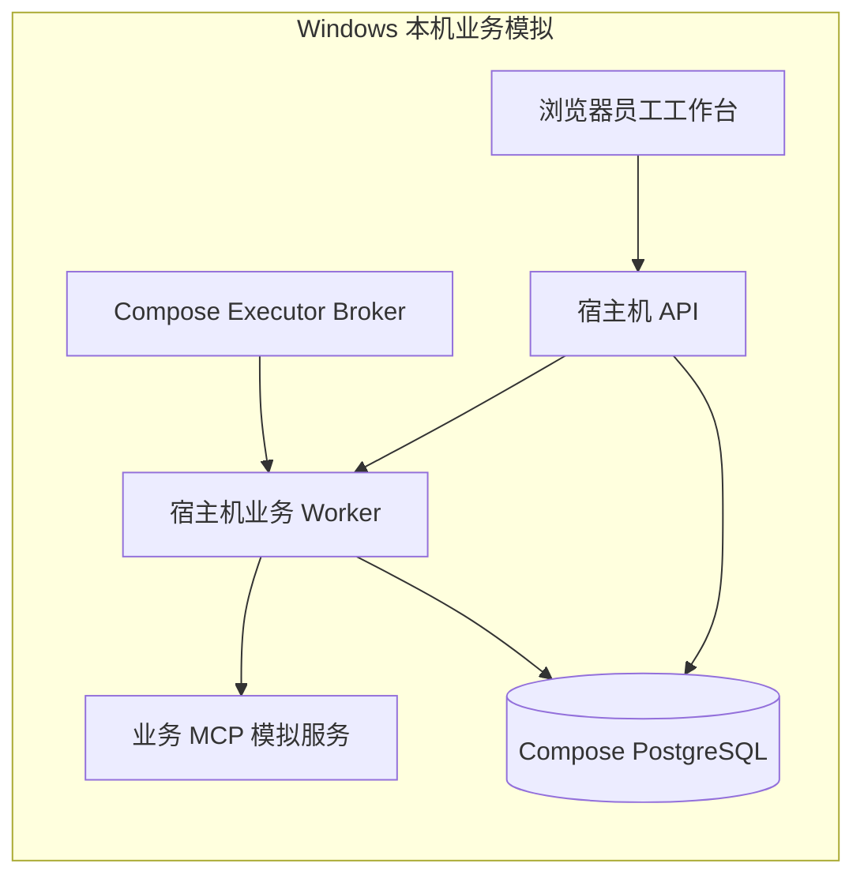
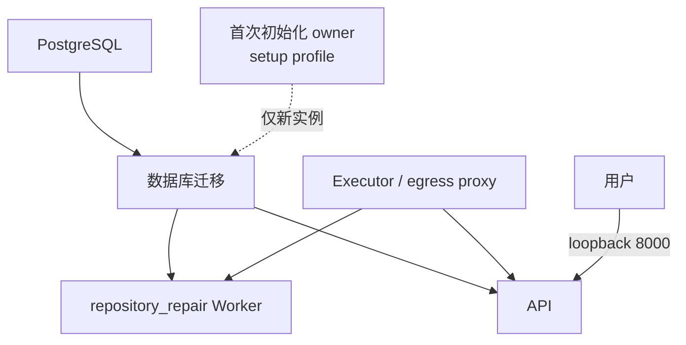

# DecAgent Docker Compose 部署与环境说明

CI 负责检查和构建；部署负责在某台机器上配置密钥、启动服务并验证健康状态。当前没有独立 Linux 主机，因此本文把现有运行方式和部署前提讲清楚，Linux 操作仍需在真实主机上验收。

## 先区分两种运行环境

DecAgent 当前有两条运行路径，不能把它们当成同一个部署包：

| 运行路径 | 组成 | 用途与状态 |
| --- | --- | --- |
| Windows 本机业务模拟 | `compose.yaml` + `compose.windows.yaml` 提供 PostgreSQL 和 broker；`ops.local.start` 在宿主机启动 MCP、员工 API、业务 Worker | 用于本机模拟员工工单流程。源码 README 标记当前 schema 为 17；2026-10-14 的旧使用指南记录 schema 11，只是旧版本快照。不要把旧指南当成当前数据库升级说明。 |
| Compose 容器栈 | PostgreSQL、迁移、可选 owner 初始化、API、`repository_repair` Worker、egress proxy、executor broker | 当前 `compose.yaml` 的 Worker 命令是 `worker --kind repository_repair`。该文件不能证明业务 MCP 与 business Worker 已经完成 Linux 部署验收。 |



## Compose 容器栈包含什么



配置文件通过 `${...}` 读取 `.env`，敏感文件从 `.decagent/secrets/` 装载。Compose 在启动前要求设置 `DECAGENT_RUNNER_IMAGE` 为本机 runner 镜像的不可变 `sha256` image ID。API 默认仅绑定 `127.0.0.1`；PostgreSQL 与 broker 不应直接暴露到公网。`executor-broker` 挂载 Docker socket，因此运行它的主机权限和隔离需要谨慎管理。

## 部署前需要准备

未来部署需要一台独立 Linux 主机、Docker Engine 与 Compose 插件、DecAgent 代码、可持久化备份的数据库卷、模型/API 凭据、安全的 HTTPS 入口，以及和当前源码版本一致的迁移计划。部署负责人还要确认 runner 镜像、宿主机 Docker socket 与执行隔离策略。

当前没有 Linux 主机；本机 Docker Desktop 状态也未用于本轮部署验收。因此不要将下面的准备步骤视为已经执行的生产部署记录。

## 未来 Linux Compose 部署准备

以下命令是未来在专用 Linux 主机上的操作示例，本轮没有执行。先从 GitHub clone 已审查的仓库 commit，在项目根目录配置环境。仅在全新目录且 `.env` 不存在时复制模板；不要覆盖已有 `.env`：

```bash
if [ ! -f .env ]; then cp .env.example .env; fi
```

在 `.env` 中填入部署所需的地址、模型名和 API 凭据。不要提交 `.env` 或把密钥写进命令历史。程序提供的秘密初始化脚本只创建缺失文件并保留现有 secret；运行前先审阅设置来源：

```bash
python -m ops.control.prepare_secrets
```

构建 runner 镜像并查看不可变镜像 ID：

```bash
docker build -f ops/runner/Dockerfile -t decagent-executor-runner:supervised .
docker image inspect decagent-executor-runner:supervised --format '{{.Id}}'
```

将输出的 `sha256:...` ID 配置给 `DECAGENT_RUNNER_IMAGE`，再检查 Compose 最终配置，并按部署审查结果启动：

```bash
docker compose -f compose.yaml config --quiet
docker compose -f compose.yaml build
docker compose -f compose.yaml up -d --wait
docker compose -f compose.yaml --profile setup run --rm owner-init
docker compose -f compose.yaml ps
```

首次初始化只适用于全新数据库。已有实例不要重复执行 owner 初始化，也不要为排障直接删除数据库卷。上线前需在目标机实测 API 健康状态、登录、迁移、备份恢复、runner 网络隔离和日志脱敏；具体业务模拟栈的 Linux 部署方案还需要单独完成设计与验收。

停止容器可使用 `docker compose -f compose.yaml down`，它会保留命名数据卷。不要使用 `down -v`，除非你明确要删除数据库及其他持久化数据并已有可验证备份。

## Windows 本机说明

当前 Windows 模拟环境使用 `compose.windows.yaml`，将 PostgreSQL 暴露到本机 `127.0.0.1:55432`，broker 暴露到 `127.0.0.1:8002`；MCP、业务 API 和 Worker 由 `python -m ops.local.start` 在宿主机运行。历史[本机使用指南](../../261014/1646_MCP业务Agent使用指南.md)按 schema 11 编写，而当前源码 README 是 schema 17，使用前需先按当前迁移与数据状态核对；不要对已有业务数据库盲目重建或重置。

## 部署状态

本轮没有创建服务器、上传镜像、运行迁移或配置自动部署。Linux 主机验收仍是后续工作；当前 CI 与部署保持分离。
