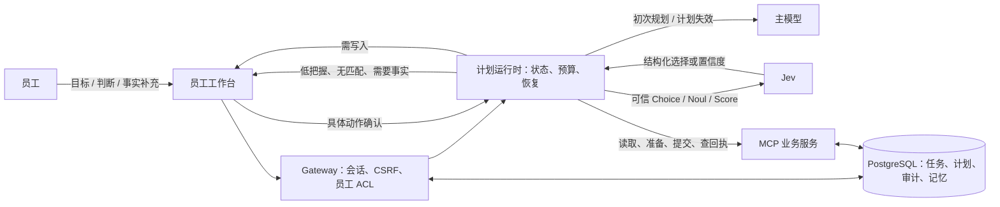
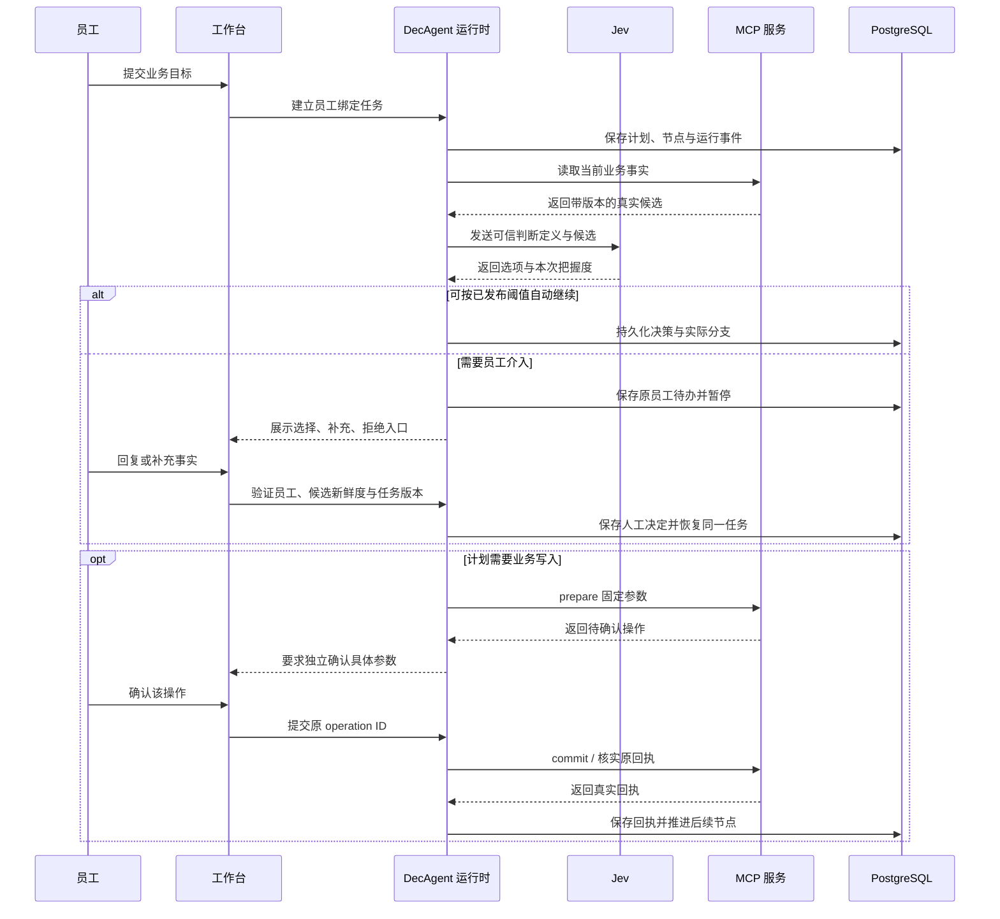
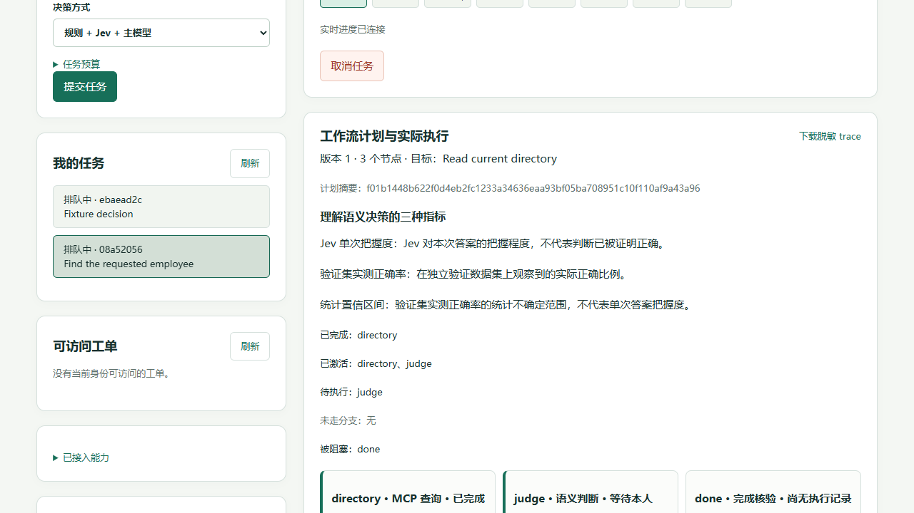
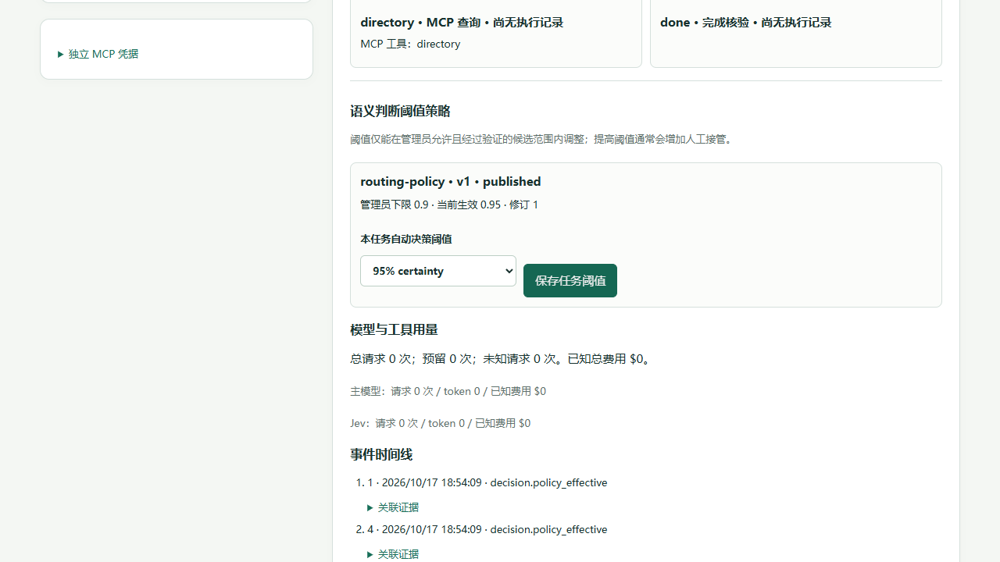

# DecAgent 工作台使用与隔离浏览器验收

这份说明补充[本机启动与员工操作指南](../261014/1646_MCP业务Agent使用指南.md)，聚焦条件工作流的 trace、语义待办、阈值和员工记忆。浏览器验收使用临时 PostgreSQL 子库、合成员工和回环地址；不连接公司的真实业务系统，也不发送主模型或 Jev 请求。

## 系统边界

员工通过浏览器提交目标并处理本人待办。Gateway 校验员工身份和任务权限，条件计划运行时读取当前 MCP 业务事实；主模型只负责初始规划或受控的异常重规划，Jev 只回答已注册的问题。PostgreSQL 保存计划、运行事件、决策、员工记忆和操作回执。Jev 的选择不会授予业务权限，写操作仍走独立的准备、具体确认、提交和回执核实。

下面的泳道强调：Jev 只选流程已经声明的分支，工具执行、员工确认和回执核实由不同的参与者完成。

## 工作台可见行为

- **工作流计划与实际执行**显示计划版本、目标、完成与待执行节点、未走分支、参数来源、阈值策略、模型/工具用量和事件时间线。
- **待本人处理**允许选择候选、选择“都不符合”、补充事实后重判或拒绝当前判断。候选过期时，旧回复不被采用，页面提示刷新后重新判断。
- **语义阈值**只允许管理员发布策略给出的范围内选择。已保存阈值和生效修订会回显；单次 Jev 把握度、验证集正确率和统计置信区间是三种不同指标。
- **我的业务记忆**按当前员工和业务范围隔离。即使当前计划没有声明稳定记忆槽，员工仍可查看、确认、修正和撤销自己的记忆；记忆不授予操作权限。
- **具体写入确认**绑定即将执行的参数和原操作 ID。语义选择或阈值通过不能代替这次确认。

## 本机隔离验收结果

| 场景 | 结果 | 验证方式 |
| --- | --- | --- |
| 计划与分支在完整重载后保持与服务端一致 | 通过 | 固定持久任务 + Playwright CLI |
| 语义待办显示真实候选、选择、补充、拒绝入口 | 通过 | 合成员工工作台 fixture |
| 候选失效后旧选择不被采用 | 通过 | 使候选失效，再提交旧候选 |
| 员工切换后任务、审批与记忆缓存清除 | 通过 | 登录 IT 员工后切换 Facilities 员工 |
| 无稳定记忆槽时仍能管理本人记忆 | 通过 | 确认、修正并撤销合成偏好 |
| 阈值保存后 trace 立即显示生效值和修订 | 通过 | 从 0.90 调整至 0.95，断言修订 1 |
| 双击一个延迟中的语义回复只发送一次请求 | 通过 | 浏览器网络路由延迟并同步双击，观察到 1 次请求 |
| 重载后恢复到仍待处理的语义节点 | 通过 | 刷新并重新选择原任务 |
| 从工作台新建任务，经人工确认到 MCP 回执的完整链路 | 通过 | `business_workbench_lifecycle_fixture.py` 启动临时子库、生产 Gateway/Worker 与 loopback MCP；supervisor 在 UI 提交合成工单优先级任务，确认具体操作后由 Worker 提交并核实服务端回执。刷新并重新选择任务后仍显示成功，目标为 high、revision 2、`server_verified=true`。本次 0 次主模型/Jev 请求 |
| JavaScript 逻辑回归 | 通过 | 3 组 Node 回归脚本，全部通过 |
| Python 回归 | 通过 | 定向策略/trace 集成 `29 passed`；完整确定性 `1398 passed, 3 skipped`；完整集成 `594 passed, 22 skipped` |

以上都是本机合成数据验收，不代表真实员工审批体验、主模型质量、Jev 准确率或生产部署可用性。完整生命周期验收任务为 `d403abf2-91e1-4c31-a6fe-8500931d052a`，工单为 `2427ff3f-4f0f-4ade-bfe2-3b8c9b8e7772`；fixture 只绑定本机回环地址和一次性 PostgreSQL 子库。启动时从 fixture 输出读取临时登录信息和任务 JSON；界面策略选“规则”以避免模型请求。提交后在工作台确认 `set_priority` 的具体参数，随后检查最终状态、目标核实和成功回执。关闭 fixture 后应确认临时子库已删除。既有语义待办截图保存在 `output/playwright/workbench-intervention/`；可归档截图如下。

## 自托管边界

当前 Windows Docker Desktop、自托管 Runner、GHCR 发布和 API 健康检查已通过本机验收。面向外部员工的 Linux 新实例尚未部署。入口 TLS、员工账号生命周期、异地备份恢复、Linux 升级回滚与真实浏览器 E2E 必须按[外部用户自托管方案](部署/1706_外部用户自托管方案.md)另行验收后，才适合邀请外部用户。
