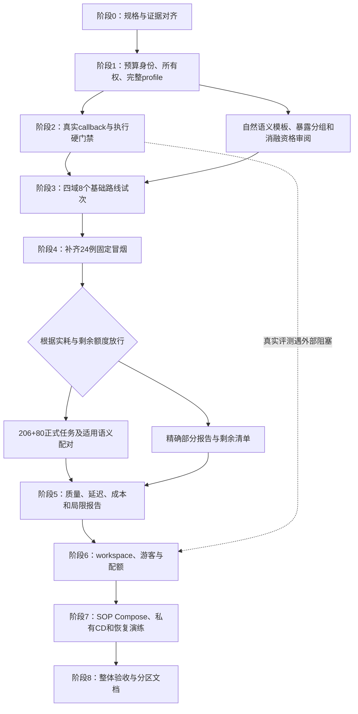
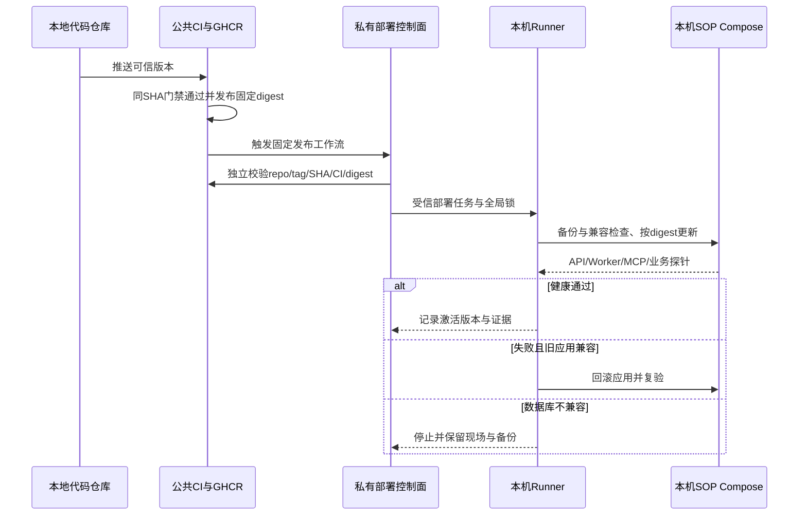

# DecAgent 公开评测与本机交付后续规划

规划时间：2026-10-19 19:22（北京时间）。本轮进行只读核查和规划，不修改产品代码、不派发模型请求、不启动正式 benchmark。本文件是当前推进导航；OpenSpec 的需求、任务勾选和逐项证据仍是验收依据。此前计划保留为历史快照，不覆盖旧诊断或未知用量记录。

## 1. 当前基线

| 部分 | 当前事实 | 不能据此声称 |
| --- | --- | --- |
| 条件计划主 change | `jev-conditional-workflows` 为 58/65；剩余 9.6、10.3–10.6、10.8、10.10 | 剩余工程量只占 7/65；这些任务包含完整评测接线和实测 |
| 生产业务能力 | 类型化计划、持久解释器、人工接管、稳定槽记忆、流程复用、工作台已有实现及工程验证 | 已通过公开基准、实际员工研究或公网生产验收 |
| 模型 readiness | 10.9 已通过；5 次 Qwen、29,858 token、报告费用 $0；受限只读 directory 计划通过生产编译器 | 任意 benchmark 工具目录、多轮对话、用户模拟器和裁判已经就绪 |
| 历史基线 | 9.6A 已有 business-2/business-3 隔离执行配对，属于 execution-only | 历史基线的模型质量或 Jev 收益已经证明 |
| 公开基准 | EnterpriseOps 206、τ official test 80；正式任务仍 0/286 | 成功率为 0%；当前是未运行 |
| 固定冒烟 | EnterpriseOps CSM/ITSM 各 10，τ retail/telecom 各 2 个 train 案例，共 24 | 24 例都是 official test；τ train 冒烟不能进入 80 个 test 的分子 |
| runner | 两路线 smoke/full dry-run、profile/来源/本地镜像预检通过，live execute 仍拒绝 | 已执行 48/572 个路线试次；它们目前只是基础路线槽位 |
| 游客交付 | `guest-sop-local-trial` 为 0/28 | 已有员工工作台等于具备游客空间隔离 |
| CI/GHCR/CD | 已有公共 CI、历史镜像发布和旧本机部署证据 | 当前大量未提交实现已经通过远端 CI，或新 SOP 已部署 |
| 本机拓扑与 Runner | 现有 Compose 仍含旧 repair worker；公共 release workflow 仍可直接调度本机 Runner | 私有 CD 隔离、SOP Worker/MCP、业务探针、兼容回滚已验收 |

本轮依据包括当前两个 change 的 tasks、`public_trials.py`、`model_profiles.py`、`routes.py`、`public_session.py`、benchmark v4 清单与 dry-run 证据、现有 workflow/Compose/部署脚本。最新局部验证记录为 46 项定向测试、Ruff 和主 change strict 校验通过；它不替代新增实现后的完整回归。

CI/CD 状态依据本地源码和已有历史证据，本轮没有实时查询远端 workflow 或 Runner 在线状态。下面的实施清单不用于重新计算 OpenSpec 完成百分比。

## 2. 已确定的边界

1. 公开评测优先。真实评测受外部资源阻塞时，转做独立的游客和部署离线实现，不把阻塞写成通过。
2. Jev 只评估自然存在且已审核的语义节点；结构化条件走代码，不新增补充工作流集来凑 Jev 样本。
3. 首批从固定 24 例中按冻结顺序选四域各首个案例，先跑 ReAct/Plan 两条基础路线，共 8 个路线试次；闭环通过后补齐固定冒烟。这个分波次安排不新增或替换样本。
4. Qwen 用量未知时，停止当前路线的后续工具、模型和裁判调用，保留原预留，不自动重跑。其他尚未开始的任务可在剩余批次额度内继续。发生全局预算身份错误、账本损坏、身份泄漏或执行者所有权冲突时，仍停止整批。
5. Jev 费用未知时，暂停新的 Jev 请求；历史累计 $1 不重置、不按路线复制。非 Jev 任务是否可继续由其独立资源门禁决定。
6. 正式对照固定 Qwen 模型、参数及提供方配置，关闭跨模型 fallback。产品的 Qwen/DeepSeek 恢复能力另测；模型变化建立新实验组。
7. 一次规划、工具执行、总结、模拟器、裁判都按实际请求计量。未知工具写入不能借模型重试而重新提交。
8. 95% 自动处理正确率与每决策族至少 100 个自动样本的资格不降低；当前没有合格生产阈值，游客保持 Jev 建议加人工选择，具体业务写入另行确认。
9. 跨任务记忆只通过员工/空间和已发布流程的稳定槽显式绑定；官方测试间不学习。
10. 游客无需注册、独立模拟公司、同浏览器恢复、7 天无活动过期、可切换空间内角色及清空，不提供跨设备恢复。
11. 游客既定额度不重问：北京时间日界，全站每日 $5/500 万 Qwen token；每游客每日 30 任务/50 万 token，游客并行 1、全站并行 2、队列 20。
12. 公共 CI/GHCR 与私有 `DecAgent-deploy` CD 分开；域名购买、公网 Tunnel、独立 Linux 验收后置。本机短时中断可接受。

## 3. 推进依赖



这是一条主推进顺序，不要求等公开基准全部成功才编写离线游客或部署代码。实际员工研究和缺少合格阈值时的性能验收继续保留待办，不阻止如实交付工程实现。

## 4. 阶段0：同步当前规划与可复现身份

关联：两个 change 的 proposal/design/spec/tasks 和现有执行导航。

- [ ] 将“主模型当前未就绪”“55/60、57/62”等旧口径明确标为历史，当前状态引用 10.9 和 58/65；保留全部旧失败与 unknown 证据。
- [ ] 把本轮四域首批和 Qwen 路线隔离策略同步至主 change；游客 change 不因这些决定虚增完成项。
- [ ] 将 9.6 的 A–F、10.8 和 10.10 展开为可独立验收的实施切片，保留原要求和任务证据映射；拆分后重新计算进度，不能为了百分比增加已完成项。
- [ ] 审查当前未提交实现和锁文件，按可审阅切片形成源码快照；记录 Agent 代码版本、上游版本、配置和数据摘要。正式结果不能只依赖后来可能变化的工作目录。

完成条件：一份可定位最新状态的索引；规格、计划和任务没有相互矛盾的门禁。归档、主规格同步、公开发布继续按对应请求执行。

## 5. 阶段1：先完成安全与实验身份

关联：10.8、10.10、9.6E。主要现有文件：

- `decagent/evaluation/business/public_trials.py`
- `decagent/evaluation/business/model_profiles.py`
- `decagent/evaluation/business/ledger.py`
- `decagent/runtime/model_calls.py`、`model_factory.py`
- `evals/benchmarks/build_trial_manifest.py` 与 manifests
- 对应 deterministic tests

### 5.1 累计预算与批次边界

- [ ] 将公开试次连接到同一个既有累计 Jev 账本，覆盖历史探针、校准、所有 route、smoke/full；单路线 `$1` 检查不能替代全局限制。
- [ ] 为执行批次建立固定身份与唯一账本绑定；新建路径、切换 mode 或恢复进程不能重新获得额度。原始历史支出和 unknown 预留不得重新初始化。
- [ ] 独立定义公开批次的总请求、总 token、费用和时间上限，区分 Agent、模拟器、裁判；每试次的 200/200/100 万/30 分钟不是全实验预算。
- [ ] 首批派发前根据真实公开 policy、tool schema 和上下文离线量化预留上界，并核对既有授权覆盖范围；若预算不能覆盖，给出范围/预算选择后再运行，不借用 readiness 的剩余额度。

### 5.2 执行者所有权与恢复

- [ ] 加入独占执行者身份、租约和 fencing 校验；活跃执行者存在时，第二个进程不能执行全局 resume 或派发同一试次。
- [ ] 只有证明原执行者失效后才能接管；旧执行者即使恢复也不能继续派发、结算或覆盖新执行者结果。
- [ ] 完成与 unknown 试次不可自动重跑。已保存官方状态可重新评分时，只重评分，不重跑 Agent。
- [ ] 用两个真实独立进程验证竞争、崩溃和接管；不能只用同进程 close/reopen 证明恢复安全。

### 5.3 完整模型 profile

- [ ] 明确固定模型支持的 temperature、top_p、seed、工具选择/输出方式、超时和 provider routing；不支持的参数记录为不支持，不能向服务端强加。
- [ ] 区分 requested 与实际 resolved model/provider；无法获取的值显式为空并限制可复现结论。可变 Jev alias 发生版本漂移时停止该组或另开组，不拼接成绩。
- [ ] 把 profile 和派发参数一致性作为运行前校验；裁判/模拟器也遵循同组身份与计量规则，不能隐式使用上游默认模型。
- [ ] 更新版本化 manifest，旧 v4 和 dry-run 保留追溯；校验每个试次来源、配置摘要与实验身份，而不只核对顶层计数。

完成条件：全局预算不可绕过；跨进程没有双派发；实际模型身份和冻结配置可追溯。现有 dry-run 安全默认保持有效。

## 6. 阶段2：接通真实执行闭环，先用离线故障验证

关联：10.8、10.10、9.6B/C/E。主要文件为 `routes.py`、`public_session.py`、`enterprise_environment.py`、`enterprise_scoring.py`、`tau_process.py`、`tau_worker.py`、`final_response.py` 与公开 runner。新适配代码按 provider 调用、试次调度、资源守卫分别组织，避免继续将所有逻辑塞进一个 ledger 文件。

- [ ] 对 Planner、ReAct、语义判断、结果总结、τ 用户模拟器、官方裁判建立真实 callback，复用现有主模型归一化与预算实现；一次外层 callback 不得掩盖多次实际请求。
- [ ] 每次派发前完成 profile/预算/所有权检查；把 known-not-sent、已知失败、unknown、实际 token/费用和 server IDs 落到同一试次证据。
- [ ] 产品的有限重试/DeepSeek fallback 单独验收；正式实验关闭跨模型 fallback。Qwen unknown 终结当前路线，停止其后续工具与裁判；调度器可领取其他 pending 任务。
- [ ] 将真实工具调用数、计划控制步、τ 官方步数及可取消 deadline 接到执行器；HTTP/stdio 超时不得超过剩余期限。时间预留和事后结算本身不能中止卡住的请求。
- [ ] 机器时间、环境准备、用户模拟/人工等待、裁判、清理、总墙钟分别测量，采用所有路线一致的口径。
- [ ] EnterpriseOps 从新鲜数据库采集私有指纹并调用原 verifier；τ 同一权威环境服务工具、用户模拟和原 evaluator，保存 SimulationRun。
- [ ] 默认从真实工具证据渲染结果；确需总结时最多一次受控主模型请求，记录来源和全部成本，不基于 gold/verifier 失败触发总结。
- [ ] 验证计划无法表达的任务、工具错误、环境故障、评分故障、资源停止和未知副作用各有独立状态。未测错误副作用继续为 `not_measured`。
- [ ] 失败路径保存必要日志和状态证据后再清理；不能用 reset 隐去未知提交。未知写入只能查询原回执核实，不能在新环境重放后声称恢复。

必须通过的故障测试：跨进程竞争、超额预留、错误 profile、已完成/unknown 不重跑、Qwen unknown 不追加裁判且其他试次可继续、Jev unknown 阻止所有新增 Jev、原工具写入不重放、每域评分故障、进程树/容器清理。

完成条件：正式 `--execute` 只在全部 guard 和所需 adapter 就绪时放行；无需放行的组合仍明确拒绝。不要先删除保护性拒绝再补控制逻辑。

## 7. 与阶段2同期：自然语义适用性及公平矩阵

关联：9.6D/E、10.4。此工作在实际 Jev 请求及官方 test 之前完成。

- [ ] 只从公开业务政策、合法上下文、工具契约和允许开发数据识别语义节点；不读取 gold/私有 verifier 来设计问题或候选。
- [ ] 为每个自然模板固定来源/版本、primitive、问题定义、真实候选映射、无匹配和异常行为，独立复核后再启用。没有适用节点就报告 N/A。
- [ ] 审核 EnterpriseOps 已暴露任务族映射；当前全 `unassigned` 不能作为最终分组。τ train 用于开发，test 冻结，不看 test 结果改模板。
- [ ] 冻结实验矩阵和每组准确分母：全任务 ReAct/确定性计划基础对照；自然适用任务上的 Jev 路线与同状态通用模型语义配对；结构化条件的代码对照；合格样本上的冷/热和稳定槽记忆消融。
- [ ] 补齐原三路线目标和当前“两条基础路线 + 语义子实验”之间的任务/计量映射。不能将当前 48/572 个基础槽位称为完整三路线试次数，也不能给相同 Plan 结果换 Jev 名称当第三条路线。
- [ ] 热复用只能使用此前独立验证并发布的流程，显式报告发布成本与命中率。记忆 fixture 须事先冻结并绑定员工，不允许从前一个官方测试任务学习；不适用的消融保留 N/A。

如果自然语义适用分母为 0：提交审阅范围和不适用理由，可以交付两条基础路线的结果；Jev 收益标为证据不足，10.4 的完整 Jev 对照要求继续未通过。是否未来修改验收范围另行决定，本计划不自动删掉该要求或新增数据集。

## 8. 阶段3：四域最小真实闭环

关联：9.6F、10.3。

首批 ID 按当前 v4 `smoke_trials` 中每域首次出现顺序解析，固定为：

```json
[
  {"domain": "csm", "split": "oracle", "case_id": "task_20260106_161859_265_00364ece_0e836ce8"},
  {"domain": "itsm", "split": "oracle", "case_id": "task_20260115_201951_323_391f1eff_659b9dae"},
  {"domain": "retail", "split": "train", "case_id": "0"},
  {"domain": "telecom", "split": "train", "case_id": "[mms_issue]airplane_mode_on|bad_network_preference|bad_wifi_calling|break_apn_mms_setting|break_app_both_permissions|data_mode_off|data_usage_exceeded|unseat_sim_card|user_abroad_roaming_disabled_off[PERSONA:Hard]"}
]
```

后续更新 manifest 版本时必须校验仍为这些 ID，不能因首条较难而换案例。

- [ ] 从已冻结 smoke 顺序各选 CSM、ITSM、retail、telecom 第一条，不增加、替换任务；每条先执行 ReAct/Plan，共 8 个基础路线试次，逐试次新鲜隔离。
- [ ] 首批记录真实角色用量、工具参数依赖、最终回复、官方评分、失败分类与清理证据；τ 需要时执行真实用户模拟/澄清及原官方 evaluator。
- [ ] 每域至少完成一个完整可评分路线；另用独立受控故障检查 scorer 失败处理，不能让故障注入污染正式任务成绩。
- [ ] 同期只对已经审核的自然适用节点运行语义配对，单列新增试次和 Jev 额度；无节点就不调用 Jev。
- [ ] 保存逐案例的通过/失败/unknown/未开始情况。Agent 正常执行但业务目标失败属于真实失败；初始化失败和评分故障单列，不能当成功或从覆盖分母消失。

放行条件：四域工具/对话/评分/清理都已打通，资源与失败处理符合规格。个别任务成功不证明全量质量，业务失败也不能通过删难题解决。

## 9. 阶段4：补齐24例，再决定全量执行

关联：10.3、10.4。

- [ ] 在同一冻结实验组内补齐剩余 smoke；已完成试次不自动重复，unknown 保留。修复导致模型/prompt/适配器/政策变化时建立新组，不拼接前后结果。
- [ ] 报告 24 个 smoke 任务和各实验实际路线试次；τ train 冒烟与后续官方 test 的分母保持分开。
- [ ] 使用真实实耗估算 206+80 任务、语义配对与预注册消融的费用和时间，列出模型、工具和环境各部分以及 Jev 剩余额度。
- [ ] 预算与资源满足现有授权时按冻结方案运行；不满足时给出完整费用/范围选择。不能默认追加费用、扩大额度或无限重试。
- [ ] 全量按固定域/ID 分批运行，保留全部 286 条状态；测试间独立重置，不在查看 test 结果后调参。中断只恢复未开始任务，不重放已完成或 unknown。

完成条件：实际覆盖数、试次数与未完成清单可重算。全量未完成时仍提供可复现部分报告，不写“全量得分”。

## 10. 阶段5：结论与研究边界

关联：10.4–10.6，并更新原11.3的审计证据。

- [ ] 分开报告完整任务成功率、节点正确率、覆盖率、错误副作用、自动/人工处理、误/漏接管、主模型/Jev/模拟器/裁判请求与 token、延迟和费用。
- [ ] 附精确分母、失败与未完成清单、数据/模型/profile/代码版本及配对区间；失败、unsupported、unknown 不隐藏。
- [ ] Qwen 当前免费额度的实际账单与 Jev 实付费用如实报告。只有有可靠来源和明确假设时才附标准化价格或盈亏平衡分析；不得用零费用标签证明 Jev 更省钱。
- [ ] 分开回答“一次规划是否比 ReAct 少调用”“Jev 是否比同状态通用模型更快/便宜且质量可接受”。前者通过不能替代后者证据。
- [ ] 资格不足时不发布置信度生产阈值，不打开 holdout 补样。真实员工研究未执行则继续待办；单人合成工作台和模拟用户只作各自范围的证据。
- [ ] 保存架构/流程、调用时序、覆盖—错误率、请求/费用/延迟图和恢复说明；只在统计证据支持时声称收益。

未达到模型收益目标不会自动否定工程交付，但性能任务继续未通过。没有真实员工参与不能把10.5整体标为全部完成。

## 11. 阶段6：游客交付，按可验收切片推进

关联：`guest-sop-local-trial` 1.1–3.5、6.1。

| 切片 | 实施范围 | 放行证据 |
| --- | --- | --- |
| G1：空间基础 | workspace迁移、可信员工身份、目录/工单、任务/审批/operation/receipt、MCP、trace、稳定记忆槽 | 两空间负向集成；旧任务和原身份恢复不变；游客入口关闭 |
| G2：会话与生命周期 | 创建/恢复、角色切换、7天过期、清空、撤销凭证、租约与unknown核实后的清理 | Cookie/CSRF/Origin、刷新/重启恢复、跨角色确认拒绝、后台轮询不续命 |
| G3：资源准入 | 既定全站/游客/任务原子额度、并行、队列、限流、受信代理 | 并发不超额、跨日/重启不重置unknown、清Cookie仍受全站上限 |
| G4：首个完整本机体验 | 同一工作台两游客业务链、Jev建议、人工选择、独立写入确认、记忆 | 真实浏览器E2E；不得把Node DOM行为测试当完整浏览器验收 |

只有 G1–G4 全链路通过后才在本机启用游客入口。不能先开放匿名会话，再补数据库归属和配额。游客业务与公开 benchmark 分库/分账本/分证据。

## 12. 阶段7：本机SOP、代码仓库、CI与CD分别交付

关联：游客 change 4.1–5.5。

### 12.1 本机SOP拓扑

- [ ] 专用 Compose 启动 API、业务 Worker、业务 MCP、PostgreSQL，验证条件计划配置和内部可信身份；只暴露 loopback 入口。
- [ ] 业务健康探针覆盖 Worker/MCP 和可清理测试空间，采用脚本模型零付费；API存活不能掩盖业务Worker退出。
- [ ] 保存旧镜像 digest/config/schema 和数据库备份，演练正常升级、业务健康失败、兼容应用回滚及不兼容迁移停止；不自动恢复旧备份覆盖新数据库。
- [ ] 验证 Windows 登录、Docker Desktop、Runner和服务重启后的任务/预算恢复，不承诺未登录或关机时可用。

### 12.2 公共CI与代码仓库

- [ ] 沿用分层并行与锁定缓存，保留 Python3.11/3.13、Ruff、确定性、PostgreSQL、真实核心浏览器E2E、wheel/MCP与Compose门禁。
- [ ] 用新源码快照运行远端 CI，报告每job及整体关键路径耗时、缓存命中与skip；普通CI不调用付费模型或下载完整公开数据。
- [ ] 源码、生成文档、运行数据和凭证按既有边界管理；未经审阅的工作目录不直接作为可发布版本。

### 12.3 私有CD控制面

- [ ] 先实现并离线验证私有发布验证器，拒绝错误repo/tag/SHA/main祖先关系、CI/run attempt、digest及任意脚本/路径。
- [ ] 建立并配置已批准的私有部署仓库，将本机Runner迁出公共仓库；验证公共PR/Actions不能调度本机。
- [ ] 私有仓库固定受信脚本独立验证发布来源及镜像digest，不checkout dispatch任意指定的公共代码执行部署。
- [ ] 所有版本共用单一部署concurrency lock；当前按release-ref分别加锁不能防止不同版本同时更新同一实例。
- [ ] 正常发布与故障发布各做一轮演练，保存源码/CI/release/digest/备份/业务探针/回滚证据，再恢复自动发布。



Cloudflare入口不在该时序的本轮实施范围；域名与公网开放在隔离、资源和私有CD验收后另行安排。

## 13. 阶段8：总验收与文档分区

关联：游客 change 6.1–6.2，以及主 change 各未完成任务的实测证据。

- [ ] 两个change严格校验；需求—实现—测试—公开实测—使用指南逐项映射，准确区分通过、失败、证据不足、未执行和后续。
- [ ] 运行适合本次变更的确定性、隔离PostgreSQL、真实浏览器核心链路、Python矩阵、安装产物/MCP、Compose、升级回滚与重启恢复。
- [ ] 单独维护模型与Agent、评测、游客使用、代码仓库、CI、CD、本机部署文档；每组有索引，图中标识已实现与待验收。
- [ ] 独立保留：真实员工研究、合格阈值、Jev收益未证明事项、未完成官方试次、域名/公网、独立Linux。文件存在或工程测试通过不能代替它们。

现有离线命令入口（未来新增测试完成后再扩展，不虚构尚不存在的子命令）：

```powershell
python -m ruff check decagent evals
python -m pytest evals/deterministic/test_business_public_trials.py evals/deterministic/test_business_model_profiles.py evals/deterministic/test_business_route_comparison.py -q
python evals/benchmarks/run_public_trials.py --mode smoke --check-images
python evals/benchmarks/run_public_trials.py --mode full --check-images
openspec validate jev-conditional-workflows --type change --strict
openspec validate guest-sop-local-trial --type change --strict
```

需要数据库的集成检查使用专用派生测试库；τ子进程检查使用已固定的独立Python3.12运行时。环境不满足的skip写入验收表，不算通过。当前public runner的两条命令仍是dry-run；实现并验证live门禁之前不把它们当执行命令。

## 14. 下一次实施的首个交付

首先执行阶段0与阶段1：同步最新规格/任务口径，修正全局Jev预算绑定，补跨进程所有权与完整profile，并以定向失败/恢复测试验收。完成后再接真实callback和官方执行闭环；不重新做已通过的通用readiness，不先跑全量，不提前启动公网。
