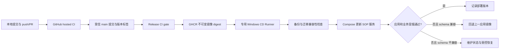
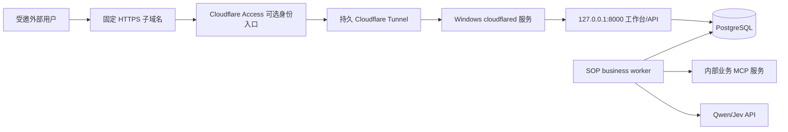

# 本机对外服务与发布链路评审

核查时间：2026-10-19 10:27（北京时间）。这是现状核查与方案草案，本轮没有修改部署、开放公网、触发发布或新增模型请求。用户受众、可用性和域名三项选择尚待确认。

## 状态续记（2026-10-20）

PR [#1](https://github.com/shuaibilx/DecAgent/pull/1) 已合并到 `main`，merge commit `0c747a396a360cc168d62c261f5d3dcd329cfb82`。公共 `.github/workflows/release.yml` 的 `deploy-local` self-hosted job 已删除；公共 CI 与 GHCR 发布仍由 GitHub-hosted runner 执行。远端 Actions API 显示 repository Runner 数量为 0，本机没有 GitHub Runner 服务或 Runner.Listener/Worker 进程。旧版本 v0.1.4 的本机自动部署记录保留为历史，但当前没有自动 CD；本次未更改 Docker Compose 或运行中的容器。

## 结论与当前状态

本地 Git push → GitHub CI → 受信版本发布 → GHCR → Windows 自托管 Runner → Docker Compose → Cloudflare Tunnel，是可用于少量外部用户试用的方案。当前只交付过旧版本的 CI/CD；新的条件 SOP 业务链路尚未部署完整，Tunnel 和自动回滚也未交付。

| 部分 | 已确认事实 | 不能据此声称的结果 |
| --- | --- | --- |
| CI | 有成功记录，含 Python 3.11/3.13、Ruff、确定性与 PostgreSQL 集成、包/镜像、安装后 MCP 与 Compose smoke | 当前未提交的新源码没有通过远端 CI |
| 镜像发布/CD | v0.1.4 的 GHCR 发布及 Windows 本机部署曾成功 | 不是当前新 SOP 的完整发布 |
| 本机容器 | API /health 返回 ok，运行 v0.1.4 镜像 | /health 不能证明业务 worker、业务 MCP、审批恢复都可用 |
| Runner（当前） | 公共仓库登记数为 0；本机服务与 Runner.Listener/Worker 进程均不存在 | 当前 push/tag 不会调度本机部署；后续部署执行器待私有化设计 |
| Compose | worker 固定为 repository_repair；尚无业务 MCP 服务，条件工作流开关未透传 | 新 business-3 SOP 尚未由这套 Compose 完整承载 |
| 回滚 | 已有部署前数据库备份、pull、up --wait、API 健康检查 | 失败 catch 只退出并保留备份，没有自动恢复旧镜像 |
| Tunnel | 未发现项目配置、本机 cloudflared 服务或进程 | 尚无已验证的固定域名公网入口 |

远端证据：[PR #1](https://github.com/shuaibilx/DecAgent/pull/1) 的三个检查均通过，且已合并；[v0.1.4 发布 39001018038](https://github.com/shuaibilx/DecAgent/actions/runs/39001018038) 是历史发布证据。当前本地工作分支仍为 `feat/conditional-evaluation`，存在大量未提交实现，不应与已合并的 workflow 安全修复混为同一候选版本。

## 推荐发布流程

普通 push 触发 CI；现有发布由 vMAJOR.MINOR.PATCH 标签触发，不是每次 push 都部署。release.yml 的 quality job 通过后才发布镜像，部署使用输出 digest。标签提交只需“可达 main”是现有检查，不等于它已经受到分支或标签保护。

当前 main 未配置 branch protection，rulesets 列表为空；local-deploy 环境有 v* tag 限制，但无 reviewer。需要确定可信发布边界。推荐公共源码仓库用 GitHub hosted CI，CD 只领取经过审查的发布任务；对个人电脑，更稳妥的隔离方式是独立部署 VM 或私有部署仓库。Runner 标签本身不构成安全隔离。GitHub 官方明确提示公共仓库长期自托管 Runner 的不受信代码风险：[自托管 Runner 安全说明](https://docs.github.com/en/actions/security-for-github-actions/security-guides/security-hardening-for-github-actions#hardening-for-self-hosted-runners)。

## 推荐访问拓扑

建议 cloudflared 以 Windows 服务运行，独立于应用 Compose 更新，把固定子域名映射至宿主 127.0.0.1:8000。Tunnel 地址绑定服务地址，容器更新不需要改变域名；更新期间单实例重建仍可能短暂不可访问。如果将 cloudflared 放进 Compose，目标应是 api:8000，容器中的 localhost 不指向宿主 API。

对外只发布工作台/API。PostgreSQL、业务 MCP、broker 和 Docker 控制接口保留在内部。Cloudflare Access 管外部门禁，应用内员工账号、ACL 和独立写入确认继续生效；Access 登录不能自动变成员工业务身份，更不能把每位访客都登录成 owner。

持久 Tunnel 需要 Cloudflare 账号及可发布应用的域名；本机无需公网 IP 或路由器入站端口映射，连接由 cloudflared 主动向外建立。参考 [官方入门](https://developers.cloudflare.com/tunnel/get-started/)、[路由说明](https://developers.cloudflare.com/tunnel/concepts/routing/)。不要使用 Quick Tunnel 作为固定入口：主机名每次启动改变，没有可用性承诺且不支持 SSE；[官方限制](https://developers.cloudflare.com/tunnel/get-started/quick-tunnels/)。

## 必须补齐的交付项

1. 定义 SOP Compose 拓扑：API、business worker、内部业务 MCP、PostgreSQL；明确业务模拟数据初始化、凭据和跨容器 URL。当前 worker 的 repository_repair 模式不能替代业务 worker。
2. 显式启用并部署 business-3 条件工作流配置；新源码中的默认开关是 false，本地 .env 也未设置它。源码能力不等于容器已启用。
3. 恢复 CD Runner 在线并验证用户登录/Docker Desktop 启动依赖；不能只因计划任务显示 Ready 就认定 Runner 在线。
4. 在 /health 之外增加部署业务冒烟：实际队列被消费、MCP 目录可读、员工隔离和审批待办可恢复；这些可以用合成数据和确定性路径，不必每次 CD 产生模型费用。
5. 实现明确的应用回退与数据库恢复边界，演练失败部署。记录前一成功镜像 digest。只有旧应用兼容新 schema 才能自动回退镜像；数据库还原会丢失备份后的新写入，不能无条件自动执行。
6. 配置持久 Tunnel、固定子域名、允许访问者及端到端 HTTPS/登录验证。确认电脑休眠、断网、重启后的恢复行为。

Docker Desktop 与用户会话、Windows 更新、家庭网络和电源共同决定可用性；Tunnel 不会让关机的主机继续提供服务。这种配置可以作为个人项目受邀试运行，不应在未做可用性设计前承诺 7×24。

## 源码依据

- [CI](../../../.github/workflows/ci.yml)
- [发布与 CD](../../../.github/workflows/release.yml)
- [本机部署脚本](../../../ops/deploy/deploy-local.ps1)
- [Runner 安装](../../../ops/deploy/install-local-runner.ps1)
- [Compose](../../../compose.yaml)、[Windows 覆盖](../../../compose.windows.yaml)
- [条件运行时配置](../../../decagent/runtime/config.py)

本评审没有将任何待办描述为已实现，后续确认方案后再同步 OpenSpec 并实施。
