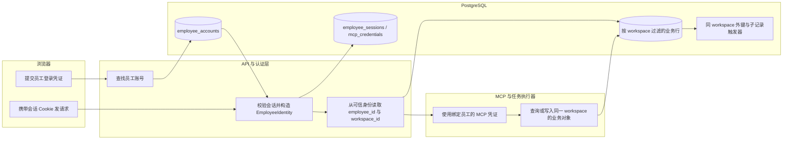
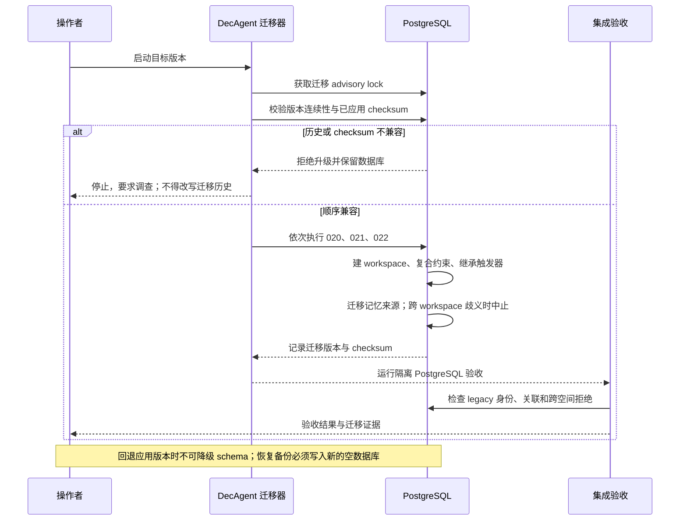

# Workspace 身份链与数据库迁移回退边界

本文解释 DecAgent 如何把员工身份绑定到 workspace，并在任务、MCP 凭证、业务操作和记忆中保持同一隔离边界。它描述当前实现，不是游客公开注册指南。

## Workspace 与员工身份

Workspace 是业务数据的租户边界。员工账号、业务任务、工单、审批、操作回执、MCP 凭证和记忆都属于一个 workspace。员工 ID 标识操作者；workspace ID 限制该操作者能访问的数据空间。

请求中的 `workspace_id` 不是身份来源。`EmployeeIdentity` 由服务端认证流程构造，浏览器会话和 MCP 凭证都从数据库中的员工账号行取得 workspace。浏览器只提交会话 Cookie；客户端不能靠改请求体切换 workspace。相关实现见 `decagent/business/employee_auth.py:23`、`:67`、`:98`、`:165`、`:230` 和 `decagent/business/workspaces.py:5`、`:8`。

现有 workspace schema 包含 `legacy` 与 `guest` 两种类型，但 migration 只创建 legacy workspace。游客自助创建 workspace、访客生命周期和公开注册仍是独立 change 的后续工作；不能据此认为陌生用户现在可以注册。

## 身份如何贯穿一次请求

认证成功后，API 将可信的 `employee_id` 和 `workspace_id` 一起用于任务、事件、审批、trace、MCP 凭证和业务查询。任务子记录的 workspace 由数据库根据父任务或父 action 推导；复合外键要求关联对象属于同一 workspace。仅有对象 ID 不足以读取另一个 workspace 的资源。

## 迁移如何建立隔离边界

迁移按 `decagent/storage/database.py:17` 中的固定顺序运行。`Database.migrate()` 在 advisory lock 下检查已应用版本和 checksum，再依次应用尚未执行的 SQL，见 `decagent/storage/database.py:54`。已应用 migration 的文件不可原地修改；checksum 不匹配会停止升级。

1. `007_business_employee_identity.sql` 建立员工账号、会话和 MCP 凭证所需的身份结构。
2. `020_business_workspaces.sql` 创建 `business.workspaces`，插入固定 legacy workspace `00000000-0000-0000-0000-000000000001`，并为现有业务与任务表补上 `workspace_id`。旧行使用 legacy 默认值保留原身份；复合唯一键与外键约束同空间的人员、工单、任务、审批、凭证、操作和回执关系。关键入口见 `decagent/storage/020_business_workspaces.sql:3`、`:12`、`:15` 及之后的约束定义。
3. `021_task_child_workspace.sql` 为事件、action、approval、计划节点和其他 task-owned 行安装触发器，从父 task/action 继承 workspace；缺失父 workspace 时拒绝插入。见 `decagent/storage/021_task_child_workspace.sql:3`、`:28`。
4. `022_business_memory_workspace.sql` 将旧记忆和撤销记录归到所属员工的 workspace；已发布规则则依据其 operation receipt 来源确定 workspace。如果同一规则的来源跨越多个 workspace，migration 会中止，而不是猜测。随后记忆规则主键和记忆查询索引都改为 workspace-aware，并删除旧 `company_scope` 字段。见 `decagent/storage/022_business_memory_workspace.sql:11`、`:37`、`:78`、`:81`。

## 泳道：迁移与恢复

## 出错时如何回退

这些迁移是前向 schema migration，没有对应的 down migration。旧应用版本面对更高 schema 版本会拒绝启动；因此不能先把数据库升到 22，再只回滚应用二进制并继续使用原数据库。

发生失败时，保留原数据库和迁移证据，不要手工删除 `schema_migrations` 行、改写已发布 SQL 或把 workspace 约束降级。若必须恢复旧应用，使用升级前的有效备份恢复到**新的空数据库实例**，再启动与该备份 schema 版本匹配的应用。当前备份实现也要求恢复目标与证据目录是新的；原数据库应保留供调查。若迁移因跨 workspace 记忆来源而中止，先人工核验数据归属，再设计新的前向修复 migration。

## 验收证据与当前范围

隔离 PostgreSQL 集成测试检查旧员工、工单、回执、审批、记忆及 LangGraph checkpoint 的身份保持；还测试重复迁移、workspace 触发器和跨空间关系拒绝。主要入口为 `evals/integration/test_business_workspace_migration.py:156`、`:324` 以及 `evals/integration/test_business_identity_migration.py`。游客 change 的 tasks 文件记录了 task 1.1–1.5 的具体集成证据。

本说明完成游客 change 的 task 1.6 文档交付。游客会话创建、到期/清空、资源准入和公开入口仍按 `openspec/changes/guest-sop-local-trial/tasks.md` 的未完成任务推进。
