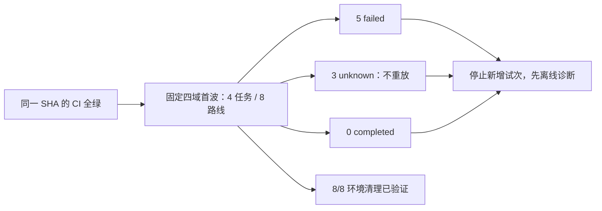

# DecAgent 首波公开评测报告

评测时间：2026-10-21（北京时间）

候选版本：`38447609df10e602b8a29ef8d58941ce9ebb337e`

机器报告：[public-first-wave-live-20261021-candidate-3844760.json](../../evals/benchmarks/evidence/public-first-wave-live-20261021-candidate-3844760.json)

GitHub CI：[run 39497828524](https://github.com/shuaibilx/DecAgent/actions/runs/39497828524)

## 结论

首波执行器完成了固定范围的派发和清理记录，但**没有完成真实业务执行闭环**。4 个任务的 8 条 ReAct/Plan 路线全部尝试，结果为 5 条失败、3 条状态未知、0 条完成。只有 ITSM 的 ReAct 路线到达官方评分器，评分为 `0.0`；其余 7 条未评分。8 条路线的隔离环境清理均有验证记录。

因此，本次结果不能用于证明 Agent 已能稳定完成企业流程，也不能比较 ReAct 与 Plan 的质量或性能，更不能作为 Jev 收益证据。Jev 和官方裁判均没有被调用。首波结束后已停止新增评测试次，所有 `unknown` 路线都保持终态，没有重放。

## 放行条件

固定候选 SHA 的 GitHub Actions 已全绿。CI 从 2026-10-20 21:07:47 UTC 运行至 21:35:49 UTC，用时约 28 分钟。

| 检查 | Python 3.11 | Python 3.13 | 结果 |
| --- | ---: | ---: | --- |
| Ruff | 通过 | 通过 | 通过 |
| 确定性测试 | 1,931 passed，18 skipped | 1,931 passed，18 skipped | 通过 |
| PostgreSQL 集成 | 605 passed，30 skipped | 605 passed，30 skipped | 通过 |
| Workbench 浏览器逻辑 | — | — | 通过 |
| Wheel、MCP 协议、镜像构建、Compose 冒烟 | — | — | 通过 |

跳过项来自明确未启用的环境条件，包括 Windows ACL/junction 语义、固定 τ 子进程测试、可选 benchmark/Docker 夹具和未安装的 `mcp-cli`。它们不计为已验证。两个 Python 版本的 PostgreSQL 集成都连接 CI 专用数据库，没有因缺少数据库而跳过集成套件。

## 冻结任务与路线

本阶段选择 smoke cohort 中 24 个任务的 4 个首波任务，共 8/48 条路线槽位。它不是完整的 286 任务评测，也不把 τ `train` 样例并入官方 `test` 成绩。

| 基准 / 域 | Split | 固定任务 ID | ReAct + Skill + MCP | 一次规划 + MCP |
| --- | --- | --- | --- | --- |
| EnterpriseOps-Gym / CSM | oracle | `task_20260106_161859_265_00364ece_0e836ce8` | unknown：`find_user` 工具派发结果未知 | failed：`AttributeError`，未发模型请求 |
| EnterpriseOps-Gym / ITSM | oracle | `task_20260115_201951_323_391f1eff_659b9dae` | failed：`ModelCallError`；官方评分 `0.0` | failed：`AttributeError`，未发模型请求 |
| τ-Bench / retail | train | `0` | unknown：用户模拟器回调失败，用量未知 | unknown：用户模拟器回调失败，用量未知 |
| τ-Bench / telecom | train | `[mms_issue]airplane_mode_on\|bad_network_preference\|bad_wifi_calling\|break_apn_mms_setting\|break_app_both_permissions\|data_mode_off\|data_usage_exceeded\|unseat_sim_card\|user_abroad_roaming_disabled_off[PERSONA:Hard]` | failed：τ 环境准备 `TauBridgeError` | failed：τ 环境准备 `TauBridgeError` |

单次 `find_user` 工具 attempt 在固定目录中标为写操作，MCP 网关返回 `NodeFailure`，结果保持 unknown。路线报告虽验证 session/environment 清理，但没有证据证明该业务操作没有副作用；不能把清理成功解释成业务状态已回滚。

## 模型、工具和费用账本

所有真实通用模型请求均使用配置的 Qwen `qwen3.8-flash`，没有跨模型降级。该批次记录 4 次 Qwen 请求：

| 角色 | 请求数 | 可确认的实际 Token | 预留但实际用量未知 | 费用 |
| --- | ---: | ---: | ---: | --- |
| Agent 主模型 | 2 | 18,738 | 0 | unknown |
| τ 官方用户模拟器 | 2 | unknown | 53,508 | unknown |
| 官方裁判 | 0 | 0 | 0 | 未调用 |
| Jev | 0 | 0 | 0 | 未调用 |

首波批次上限为 500 次 Qwen 请求、5,000,000 Token、1,600 次工具调用和 14,400 秒。账本计数为 4 次请求、72,246 个“实际用量加 unknown 预留”的预算 Token、1 次工具 attempt、约 58.36 秒墙钟；这些数值均低于停止线。`72,246` 不是实际 Token 总量：其中 18,738 个 Token 有响应 usage，53,508 个是两个 unknown 请求的保留额。

供应商没有提供这四次请求对应的抵扣前费用、代金券抵扣及实付金额。故 Qwen 费用完整性为 **unknown**，不能计成 `$0`，也不能用于成本比较。代金券只影响实付，不改变抵扣前 API 费用的计量要求。原累计 Jev `$1` 账本没有新增请求。

## 对失败结果的处理

- `failed` 与 `unknown` 都按原始任务和路线保留；不换题、不重试已派发路线。
- 只有一个官方评分结果：EnterpriseOps ITSM/ReAct 为 `0.0`。这不是全基准分数。
- `find_user` 的写操作 attempt 结果未知；需在任何未来新批次前确认供应商/环境回执或保持未解决状态。
- 两个 τ retail 用户模拟器请求的 usage unknown。其各自路线已终止；其他独立路线继续执行。
- 两个 Plan EnterpriseOps 路线因 planner callback 收到 `None` 输入 schema，在 JSON Schema 验证阶段触发 `AttributeError`；该路径在模型预留前失败，没有 Qwen 请求或工具调用。
- τ telecom 的两条路线在环境准备阶段被 `TauBridgeError` 终止，未进入 Agent 工具/评分路径。后续离线复现发现固定任务的官方用户模拟器提供 30 个 user-tool schema，而 DecAgent callback 上限为 8，导致模型预检拒绝请求；该路径在账本预留/模型派发前失败。
- ITSM/ReAct 的 Qwen 响应有已知 Token 用量，但未通过 ReAct action contract，返回 `ModelCallError`；原响应内容按隐私边界未保存，无法进一步区分具体格式问题，也不重放请求。

## 首波故障的离线诊断

以下探针仅使用固定任务的隔离环境和脚本回调，没有访问模型 API、调用业务工具或运行原始路线；首波账本不变。

| 故障 | 离线证据 | 修复 / 当前处理 |
| --- | --- | --- |
| EnterpriseOps Plan `AttributeError` | 精确适配器复现显示 `session.input_schema` 为 `None`；路由核心虽使用默认 schema，planner callback 却直接验证 `None`，异常发生在 planner 模型请求之前 | planner factory 现在与路由核心一致，缺少 session schema 时回退到默认 input schema。新增回归测试先失败、修复后定向 planner 测试 `10 passed`。 |
| τ telecom `TauBridgeError` | 锁定 τ worker 通过脚本 callback 发出的 simulator 请求包含 30 个工具 schema；callback 的旧 8 项上限在 Token 预留前拒绝，worker 将该异常包装为 `TauBridgeError` | schema 上限提高到 32，同时仍受请求 Token 上限约束；同一锁定 worker 上的真实 30-schema 预检现通过，0 模型请求、0 工具调用。单测同时拒绝 33 项；planner/τ callback 定向文件 `10 passed`。 |
| τ retail `RuntimeError` / usage unknown | 两次模型 attempt 已派发但没有 usage；账本只保存通用异常类型，one-shot worker 原始诊断阶段未进入该首波证据 | 原路线保持 unknown 且不重放。不能据此断言是模型服务、子进程还是响应传输故障。 |
| ITSM/ReAct `ModelCallError` | Provider 返回了可计 Token 的响应，但 ReAct callback 没有接受为受支持动作；最终官方 verifier 分数为 `0.0` | 保留原分数与响应边界；由于响应正文未留存，具体输出形状原因不可恢复，不补发请求。 |
| CSM/ReAct `find_user` `NodeFailure` | 唯一 tool attempt 在网关派发后转为 unknown，目录 effect 为 `write` | 业务副作用仍未解决；cleanup verified 只证明环境关闭，不证明写入回滚。不得查询后重放，也不得宣称零副作用。 |

上述两个代码修复和新回归当前位于待审工作树，不属于首波候选 `3844760` 的 CI。本机完整 deterministic `1933 passed, 18 skipped (216.43s)`，Ruff 与 OpenSpec strict 已通过；接下来须形成新候选并在该候选 SHA 上通过远端 CI。这些修复本身不能把首波的 0/8 完成路线改成成功结果。

## 下一步门槛

暂不补跑剩余 20 个 smoke 任务，也不启动 206+80 全量比较。已修复 Plan 默认 schema 与 τ telecom 用户模拟器工具目录边界；τ retail unknown、ITSM 响应细节和 `find_user` 副作用仍不可恢复，必须保持原状态。Qwen 的抵扣前金额、代金券抵扣和实付继续向供应商账单对账，unknown 保持 unknown。

修复应形成新候选 SHA，并通过该 SHA 的完整本机检查与远端 CI。之后再依据本次可确认的消耗和明确的 Qwen 账单，重新估算剩余 smoke 与全量所需资源并冻结新批次上限；不得复制首波额度。95% 自动正确率和每类至少 100 个自动样本的资格条件不变，holdout 不用于补样，Linux 部署验收仍待后续。
