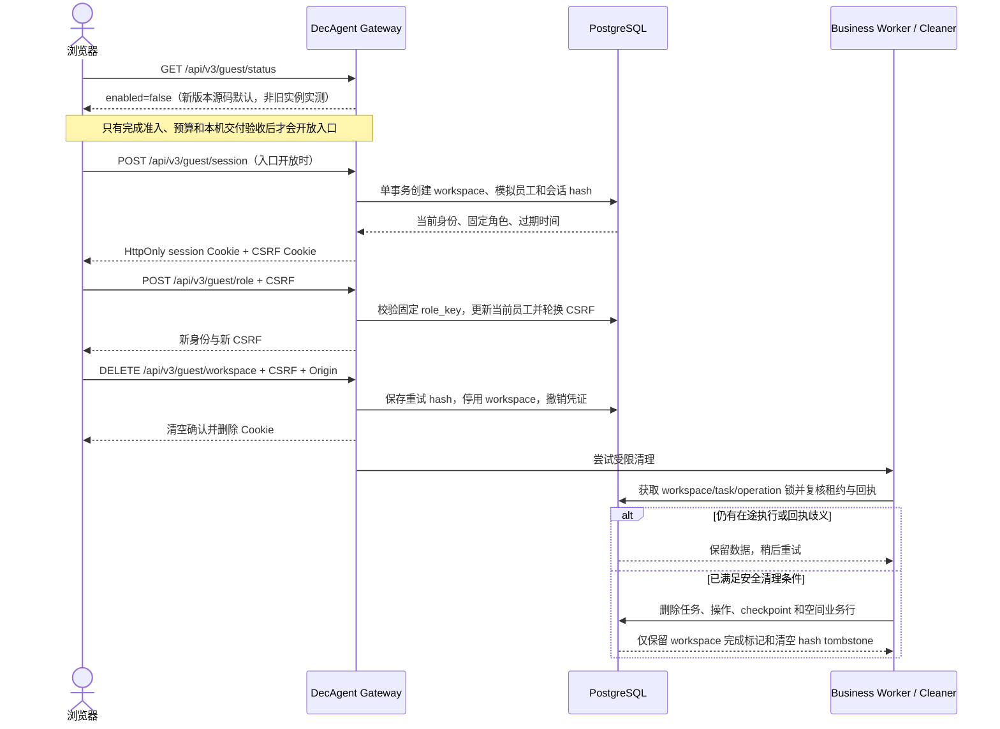
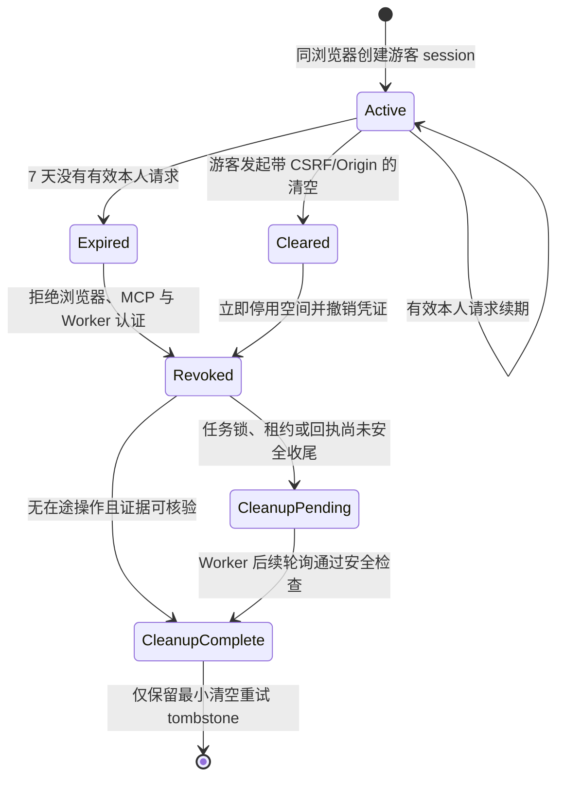

# DecAgent 游客会话、过期与权限边界

游客体验复用业务工作台，但每个浏览器会话绑定独立的合成 workspace。
服务端凭证决定身份和空间；客户端不能选择任意 workspace。
当前功能仅供本机受控试用，入口默认关闭。

以下时序描述当前源码契约。2026-10-21 核对时，8000 端口仍是 v0.1.4 旧镜像，游客状态接口返回 404；它没有验证新版本的开关或完整游客链路。新功能需要候选匹配的独立实例验收，当前业务库未在本轮升级。

## 会话与清理时序

## 会话状态

`last_activity_at` 只由成功的非被动用户请求更新。
session 恢复、status、HEAD/OPTIONS 和事件订阅不续期。
清空先撤销访问，再执行清理；清理尚未完成不代表空间仍可访问。

## 权限边界

| 身份 | 可访问范围 | 明确禁止 |
| --- | --- | --- |
| 未认证浏览器 | 登录页和游客入口开关状态 | 读取游客或员工业务数据 |
| 游客当前模拟员工 | 当前 guest workspace 中该员工有权访问的合成业务与任务 | 指定 workspace、访问其他游客空间或使用 owner 身份 |
| 游客主管角色 | 当前空间内注册的主管操作和只读范围 | 越过工作流权限或替代具体写入确认 |
| Business Worker | active workspace 中有效凭证绑定的任务 | 领取已停用空间任务或在过期身份下续租 |
| MCP 凭证 | 当前空间、当前员工且凭证未撤销的已注册工具 | 访问真实公司 API 或其他 workspace |
| 仓库维护 owner | 独立仓库维护入口 | 由游客会话继承 owner/任意 Shell 权限 |

Jev 建议、用户语义选择和业务写入是三个不同阶段。
决策回复只写入语义待办；分派或其他业务写入仍要求独立操作确认与可核验回执。
没有自然语义判断或合格阈值时，工作流使用人工接管；本说明不宣称 Jev 已提高准确率。

## 恢复和删除的证据边界

- Gateway 的清空请求要求当前游客身份、CSRF 和精确 Origin。
- 会话 token 与 CSRF 只以哈希保存；清空 tombstone 仅保留同一 DELETE 安全重试所需的哈希。
- Worker 只领取 active workspace 的任务，并在 graph/checkpoint 执行期间持有 task 锁。
- Cleaner 等待任务 lease 和 Worker 锁；含 `partial_history`、`receipt_mismatch` 或未验证成功回执时返回 `pending`。
- 任务终止后清理器删除 workspace checkpoint 和业务行，不重放 unknown 操作。
- 游客退出、过期和清空都不提供跨设备找回；清理期间也不能恢复凭证。

关键实现位置：`decagent/config.py:21` 定义默认关闭；`decagent/gateway/app.py:557` 返回开关，`:589` 创建会话，`:624` 恢复会话，`:668` 清空空间，`:694` 切换角色。`decagent/business/guest_auth.py:182` 创建或恢复身份，`:302` 切换角色，`:443` 停用空间；`decagent/business/guest_cleanup.py:31` 过期扫描，`:79` 清理与证据检查；`decagent/business/worker.py:92` 只领取 active workspace，`:203` 执行清理轮询。语义建议 UI 位于 `decagent/gateway/static/business.js:403`。

## 当前边界

游客资源日预算、队列、公开注册防滥用、本机 SOP Compose 和私有 CD 尚未完成。
因此游客入口仍默认关闭，不应把本机页面暴露到互联网。
真实 Jev 提示的来源与在线建议质量还未完成 live 验收。
