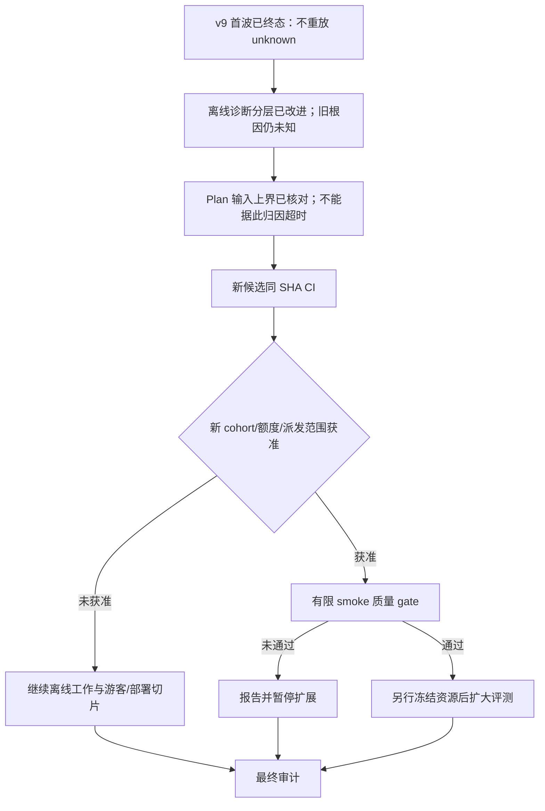

# DecAgent 后续规划索引
# DecAgent 后续规划索引

本索引将已完成、未通过和未实施的工作分开记录。v9 后已完成 worker 安全诊断分层及其同 SHA CI；本轮追加 `httpx2` HTTP 生命周期元数据诊断，提交候选 `39a96bc` 并触发同 SHA CI，运行结果待核。历史 unknown 的根因仍无法追溯。下一步评估首波质量门槛失败的定位与可离线验证的修复方向，再单独冻结新 cohort。游客与本机交付仍是独立 OpenSpec 工作包。

## 当前事实（2026-10-22）

| 范围 | 当前状态 | 下一验收点 |
| --- | --- | --- |
| jev-conditional-workflows | 72/79；未完成 9.6.D/F/G、10.3–10.6 | 评估首波质量失败和离线修复路径；四域质量门槛未通过 |
| guest-sop-local-trial | 10/28 | workspace 隔离、游客生命周期/资源准入、SOP Compose 与私有 CD 分阶段完成 |
| 固定 v9 首波 | 4 任务、8 路线全部终态；2 failed、6 unknown、0 success；2 条官方评分均 0.0；清理 8/8 verified | 不重放 attempts；报告记录 5/14 Qwen usage unknown、252,296 reserved tokens |
| 完整公开比较 | 0/286 个任务形成完整有效对照 | 不运行剩余 smoke、206+80 全量或 Jev 对照，直至离线修复、候选 CI、质量 gate 与新派发授权齐备 |
| v9 候选/CI | `126fe5a3dc9edcb3d595d0aa40fa1a5d8713af41`；[CI 39639666250](https://github.com/shuaibilx/DecAgent/actions/runs/39639666250) success | CI 只验证代码质量，不代表 live task 质量通过 |
| HTTP 边界诊断候选/CI | `39a96bc23e1cd4ee00dec6fb8c12df5bb7b8531d`；[CI 39656986729](https://github.com/shuaibilx/DecAgent/actions/runs/39656986729) in progress | 完成后核对所有 job；该 CI 不包含评测派发或发布 |
| 公共 Runner 边界 | 2026-10-22 复核：公共 Runner `0`；public CI/release 不含 self-hosted job；本机 Runner 计划任务 Disabled，进程 `0`；PR #1 merged | 边界已冻结；私有 deploy repo/Runner 尚未建成，5.3 保持开放 |
| 模型计量 | 9 个 settled Qwen 请求 72,390 Token；5 个 unknown 预留 252,296 Token | 冻结费率估算 settled ¥0.0610926、unknown 上界 ¥0.2796608；均非供应商逐笔账单或实付 |
| 暴露范围 | v9 digest `f984ec74c9776efef0b6ba808ff035198500f1997537e01776dc2a895173a604` | 用户再次确认未在项目外查看 τ official test 80；与 v9 已冻结的 `not_exposed` 一致，不等于独立 holdout |
| 当前本机服务 | 本轮未核验运行状态 | 不把历史页面或旧镜像状态写成当前验收；按独立部署计划复核 |

2026-10-22 离线改进：客户端构造失败现在明确为 verified not-dispatched；`respond()` 期未分类异常以 `model_worker_model_call` 记 unknown，已返回结果的封帧异常记 `model_worker_response`，异常内容不跨进程暴露。新回归先红后绿；完整 deterministic 1,982 passed/18 skipped、Ruff 与 OpenSpec strict 通过。v9 三次 Plan 的输入预留上界为 51,653/60,124/62,435（profile 上限 65,536），各预留 8,192 输出；这只能说明输入已处于上限较高区间，不能解释超时。代码 SHA `812bf62359c2b8dc11658fbb66cc9874e6a6ea80` 已推至远端；同 SHA [CI run 39649117340](https://github.com/shuaibilx/DecAgent/actions/runs/39649117340) 五个 job 全通过、总耗时 22:34。未追溯旧 `target/ValueError`，也未重新派发模型。

2026-10-22 HTTP 生命周期补充：锁定的 OpenAI SDK 使用 `httpx2`，不能把 `httpx.Client` 实例跨包传入。当前代码以 `httpx2.Client` 的 request/response hooks 记录 `model_worker_request_pre_send` 与收到响应后的 HTTP 状态码；响应状态不代表 token 或账单用量已知，unknown 仍不可重放。新增本机临时 HTTP 服务 + 隔离 worker 的真实 SDK 端到端测试，以畸形 200 响应验证阶段标记和敏感内容不泄露，不访问外网或模型。全量 deterministic `1,989 passed, 18 skipped (229.99s)`，定向 74 passed；锁文件检查、OpenSpec strict `6/6` 与 CI Ruff 范围 `ruff check decagent evals ops` 通过。v9 first-wave dry-run 仍选 4 个固定案例/8 路线，ledger/model/MCP 为 0。候选 `39a96bc23e1cd4ee00dec6fb8c12df5bb7b8531d` 已推送并触发 [CI 39656986729](https://github.com/shuaibilx/DecAgent/actions/runs/39656986729)，其 Python 3.11/3.13 PostgreSQL 集成测试仍在运行。全仓 `ruff check .` 会额外扫描 `.agents/skills` 附带示例并报 66 条既有规则问题；项目 CI 实际 lint 命令通过。无模型请求，旧账本未改。

详见[公开评测报告](../../261022/0133_公开评测首波报告_v9.md)、[机器证据](../../../evals/benchmarks/evidence/public-first-wave-live-20261022-v9-126fe5a.json)、[暴露审阅](../../../evals/benchmarks/evidence/exposure-review-20261022.md)及 [OpenSpec tasks](../../../openspec/changes/jev-conditional-workflows/tasks.md)。报告中的 35.7% unknown 是 5/14 的描述性比例，不是 Qwen 可靠性概率估计；请求样本固定且不独立。

## 接下来按此顺序推进

| 顺序 | 工作包 | 结束条件 |
| --- | --- | --- |
| P0 | 证据与账本保全 | v9 manifest/报告/账本只读；5 个 Qwen 和 1 个 MCP unknown 不重放，不释放预留，不补造回执 |
| E1 | worker 与 provider 安全诊断 | 已区分客户端构造 preflight、HTTP request pre-send 与收到响应头；历史 v9 ValueError 根因不可追溯，不能改写旧记录 |
| E2 | Plan 超时与输入上界复核 | 已核对 v9 输入上界与冻结限制；不得据此归因。后续仅可评审新 profile/上下文的离线改进，不改写 v9 |
| E3 | 新候选工程验证 | 代码 SHA `812bf62359c2b8dc11658fbb66cc9874e6a6ea80` 的 deterministic/Ruff/OpenSpec strict、Python 3.11/3.13、PostgreSQL、wheel/MCP、Compose、Docker boundary 同 SHA CI 全部通过；总耗时 22:34 |
| E4 | 重新冻结公开评测 | 决定新 cohort/manifest/任务范围/预算和恢复语义；不自动继承首波 live 授权，获得对确切批次的单独派发授权后才运行 |
| G | 游客隔离与资源准入 | 完成 workspace/员工/记忆边界、会话清理、预算、限流和队列的独立验收 |
| D | 本机交付与私有 CD | SOP 专用 Compose、业务探针、备份、兼容回滚、私有 Runner 发布来源验证和重启演练 |
| A | 最终审计 | Spec/tasks、测试、真实 benchmark、CI/CD 和分区文档逐项对应；Linux、真实员工研究、合格阈值仍需独立完成 |

## 当前实验边界

- Qwen 有代金券仍有抵扣前费用；实际 API invoice/voucher/cash 必须有供应商证据。冻结 profile 推导值不能称为账单。Jev 仍走原累计 `$1` 账本，本批没有 Jev request。
- 本轮 500 次请求、500 万 Token、1,600 工具、4 小时是已冻结的首波停止线，不是对后续重复 unknown 或新 cohort 的无限授权。
- ReAct/Plan 是本轮 8 条基础路线；没有执行 Jev 自然语义配对，也没有执行剩余 20 smoke 或 206+80 full。
- 自动决策正确率至少 95%、每类至少 100 个自动样本、不打开 holdout 补样的条件不变；真实员工研究和独立 Linux 验收继续待办。
- v9 `not_exposed` 只描述本项目查阅范围，不能声称是模型的独立未见数据集。

## 首波资源外推（只用于规划，不是新增预算或派发许可）

按 v9 首波 4 个任务的 benchmark/domain 实际请求与冻结费率预留，按 v9 固定 smoke 的剩余分布（CSM 9、ITSM 9、τ retail 1、τ telecom 1）和 full 分布（CSM 103、ITSM 103、τ retail 40、τ telecom 40）分别作线性外推。首波 8 条路线中 2 条 failed、6 条 unknown，主要提早终止；因此这些数值不是成功任务的可靠需求预测，工具调用数尤其不能外推。

| 范围 | Qwen 请求外推 | Token 外推（含 unknown 预留） | 冻结 profile 成本外推 | 粗略运行时间 | 解释 |
| --- | ---: | ---: | ---: | ---: | --- |
| 剩余 20 smoke 案例/40 条路线 | 46（Agent 41、用户模拟器 5） | 1,501,118（其中预留 1,277,584） | ¥1.5358454 | 约 24 分钟 wall-clock 的简单路线比例外推 | 低样本、早停；若下一批沿用 500 请求/5M Token/4 小时限额，外推名义上可容纳，但该额度不自动授权新 cohort，且质量门未通过，不能启动 |
| 完整 286 案例/572 条路线 | 812（Agent 612、用户模拟器 200） | 22,251,842（其中预留 18,165,983） | ¥23.0414855 | 约 5.7 小时 wall-clock 的简单路线比例外推 | 按 5M Token/500 请求/4 小时批次至少需 5 批；Agent 角色估算 19,619,042 Token 超过每批 3M 上限，故角色上限将下界提高到至少 7 批；成功路径长尾与新总成本授权仍待评审 |

成本采用 v9 冻结费率的抵扣前估算，不是账单或现金支出；用户给出的最高 ¥2.7/M 粗略上界对应 smoke 约 ¥4.05、full 约 ¥60.08，仍须以具体 token 结构和新 profile 核验。两种估算都不含 Jev 配对：本首波 Jev 为 0 次，且任何 Jev unknown/新请求都受原累计 `$1` 账本约束。用户对 τ test `not_exposed` 的确认已在 v9 记录，无需重复生成同内容 manifest；该确认也不改变本轮首波质量失败或后续 live 授权边界。

## tasks.md 的维护规则

整理前主清单约 110 KB，其中非复选框文本约占 64% 字符；34 个二/三级标题中包含多轮历史 CI 和执行快照。问题是将执行清单当成了追加日志，并非任务解析损坏。本轮已将它精简至约 27 KB；字节摘要、全部编号/勾选和逐项文本保留校验见整理目录。

同一 change 又持续承载模型接入、评测治理与兼容验收，范围较大；后续独立新功能应另建 change。当前仍未完成的验收不能为了缩短文件而删除、改名或提前归档。

建议保留原任务分组与稳定编号。任务描述保留范围与验收要求；逐次命令输出、故障经过、旧进度和长证据进入独立记录。每次 apply 只更新相关复选框、一个短状态和证据链接，不再追加整套测试历史。规划索引不另建一套任务完成计数。

旧清单中的游客 9/28、历史 schema、旧候选 CI 和不同批次结果已按原文快照保留，并在整理索引明确其历史属性，不靠“最新补充”段落覆盖更早的矛盾。新计划文件保持按职责拆分，不把所有运行记录搬到一个新的巨大索引。

## 保持的边界

- unknown 不归零、不释放旧预留、不重放旧路线。Qwen usage unknown 终结当前路线；仅价格未知与用量未知分开处理。Jev usage/费用未知阻止新增 Jev。
- Jev 使用原累计 $1 账本；新候选 SHA 的账本隔离不构成新增资源授权。
- 正式对照固定模型/参数/提供方配置，关闭跨模型降级；新实验组不拼接旧结果。
- 仅自然语义节点进入 Jev；结构化分支用规则，无适用节点为 N/A。
- 自动正确率至少 95%、每判断族至少 100 个自动样本的资格条件不变；不打开 holdout 补样。
- 区分 Agent 步数、工具调用、模型请求、τ 官方步骤、机器时间和人工等待；模拟员工不能替代真实员工研究。
- 当前不购买域名、不开放公网、不把 Docker Desktop 当独立 Linux 验收、不归档未完成 change。

## 分区文件

- [公开评测推进计划](1157_公开评测推进计划.md)
- [游客与本机交付计划](1157_游客与本机交付计划.md)
- [已安装技能与适用边界](../../../.agents/skills/README.md)
- [固定来源与文件摘要](../../../.agents/skill-sources.json)
- [任务清单整理与历史记录](../任务整理/1434_任务整理索引.md)
- [千问平台费率核验](../模型计费/1441_千问平台费率核验.md)
- [上一版规划索引（历史）](../../261020/计划/0007_后续实施规划索引.md)

E3 已完成：代码 SHA `812bf62359c2b8dc11658fbb66cc9874e6a6ea80` 的同 SHA CI [39649117340](https://github.com/shuaibilx/DecAgent/actions/runs/39649117340) 全部通过，耗时 22:34。下一阶段应先复核 v9 质量门槛失败后的故障定位与候选修复方向；不重放旧 unknown。若改动高上界计划上下文，需建立独立候选重验，不变更 v9。只有新的 cohort、任务、费用估算、停止线和恢复边界都复核后，才另行请求确切新批次的 live 派发授权。与此同时可独立继续 Guest/本机交付变更，但不把它们计入公开 benchmark 质量。
