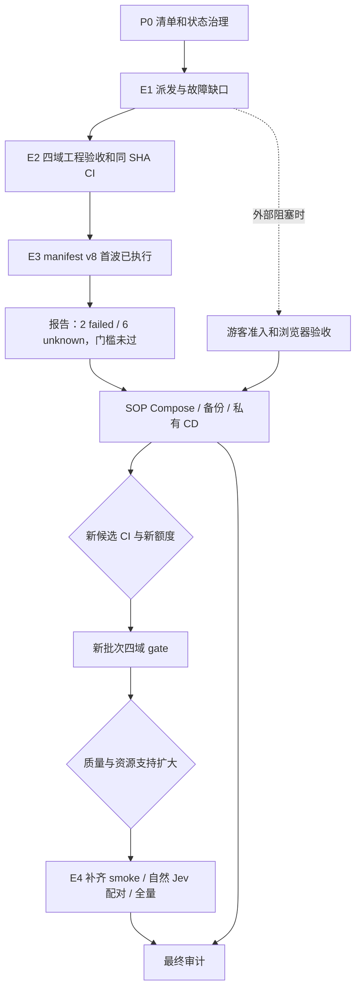

# DecAgent 后续规划索引

本轮已执行 manifest v8 的四域 8 路线真实首波并交付报告；结果未通过进入 smoke/full 的门槛。当前先定位模型 callback unknown 和工具派发异常，修复并回归后再讨论新实验批次；不会重放 v8 unknown。

## 当前事实

| 范围 | 已完成 | 仍缺什么 |
| --- | --- | --- |
| jev-conditional-workflows | 71/79 | 9.6.D–G、10.3–10.6；10.10.E 与 11.1 已完成。176 项四域受控工程验证与 5a21ded 同 SHA CI 均通过；真实 v8 首波结果为 2 failed、6 unknown、0 成功，10.3 门槛未过 |
| guest-sop-local-trial | 10/28 | 2.5–2.6、3.1–3.5、4.1–4.4、5.1–5.5、6.1–6.2；私有部署仓库/CD 尚未建立 |
| build-decagent-workbench | 78/81 | 跨平台隔离/新实例验收和真实模型实验；Linux 无主机条件继续待办 |
| 固定首波 v8 | 4 个任务、8 条路线全部终态 | 2 failed、6 unknown、0 成功；两条官方分数均为 0.0，6 条未评分；清理 8/8 verified；见[首波报告](../2110_公开评测首波报告_v8.md) |
| 完整公开比较 | 0/286 个任务形成完整有效对照 | 不等于从未派发；不能把已有失败和 unknown 从报告中删除 |
| 当前实验候选 | `5a21ded64061ce5576b33c58dcec3266615e2a1a`；CI [39600167554](https://github.com/shuaibilx/DecAgent/actions/runs/39600167554) 全部通过，live 首波对应该 SHA | 结果可审计但未达到质量门槛；后续改动形成新候选后，要为新 SHA 重新取得 CI |
| 当前本机服务 | API 镜像 v0.1.4，revision 089cd02715a5b0ae4934db953f412086988b09f4 | 容器代码 SCHEMA_VERSION=17，游客状态接口 HTTP 404；源码迁移序列已至 025。不能把旧服务页面当新功能验收 |

源代码的 schema 序列不等于运行中数据库已迁移。本轮只查询了镜像标签、容器代码版本和只读状态接口，没有升级或修改运行库。

## 本轮确认与后续前置

1. 用户已确认整理主 tasks.md 时完整保留历史；整理保留全部 79 个编号、原顺序和验收要求。当前以 OpenSpec CLI 读取的 `71/79` 为准；整理当时的 66 个勾选属于历史快照。原文、分组记录和逐项校验见 [任务整理索引](../任务整理/1434_任务整理索引.md)。
2. 用户已提供适用的 [千问平台 API 定价页](https://platform.qianwenai.com/pricing/api)，[Qwen profile v4 / manifest v8](../模型计费/1441_千问平台费率核验.md)已冻结 CNY 普通输入/输出/缓存命中 ¥0.8/¥2.7/¥0.1 每百万 Token，10.8.D 已完成。用户代金券不改变抵扣前 API 成本；逐请求 invoice、券/现金原始分摊仍缺供应商记录，跨币种比较仍需可核验汇率。用户确认 v8 批次停止线 500 次请求、500 万 Token、1,600 次工具调用、4 小时；按冻结 profile 最高费率推导，抵扣前上界约 ¥13.50。实际账本预留暴露约 ¥0.4381（含 unknown reserve），不是供应商账单。
3. 用户已确认故障备用应跨 API 提供方：主模型走千问兼容端点，DeepSeek 备用走 OpenRouter `deepseek/deepseek-v4.1-flash`。Jev 仍按 OpenRouter USD 独立计费；不能将千问平台 DeepSeek 价格套用到 OpenRouter 线路，费用与请求/用量来源分开记录。
4. 当前项目技能库包含 15 项官方开发参考、2 项社区实践、6 项 OpenSpec 工作流和 1 项 TypeSafe 补充。为后续 Cloudflare Tunnel/Zero Trust 设计，新增 Cloudflare 官方 `cloudflare-one` 技能并固定上游提交；它只提供开发参考，本轮未登录或修改 Cloudflare 账户，也未改变公开注册与外部访问方案。

当前没有要求购买域名、提供 Linux 主机或提供密钥。v8 额度已在 2026-10-21 经用户确认并用于首波，Qwen 冻结费率上界约 ¥0.4381（含 unknown reserve），不是供应商发票；下一批不得沿用该授权。

## 后续执行顺序

| 顺序 | 工作包 | 结束条件 |
| --- | --- | --- |
| P0 | 任务清单与状态治理 | 本轮主清单重组已完成；后续持续保持历史可追溯、短状态与独立证据，不改变任务定义或完成状态 |
| E1 | 复核旧首波故障与实际派发缺口 | 旧故障回归已补；v8 实测新发现 callback unknown，需新增离线根因调查与回归 |
| E2 | 四域隔离工程闭环与当前候选验收 | 已完成：四域工具、原始评分、清理及 runner/ledger/unknown/取消故障矩阵共 176 passed；精确候选 `5a21ded` 的 CI run 39600167554 全部通过。真实首波结果另列，不把工程通过等同模型质量通过 |
| E3 | v8 首波结果审计与恢复计划 | 已尝试 4 任务/8 路线：2 failed、6 unknown、0 成功；两条官方评分均 0.0，清理 8/8 verified。5 个模型 callback 请求 usage unknown；先离线定位，v8 不重放 |
| E4 | 新批次 smoke gate、自然 Jev 对照与全量 | 暂停：需要修复并通过四域 gate、重新冻结候选与额度后，才可补齐 24 个 smoke、206+80 全量或 Jev 自然场景配对 |
| G | 游客资源准入与真实浏览器体验 | 费用上界可靠、空间/身份/记忆隔离、队列/限流和真实建议人工选择通过 |
| D | SOP 本机交付与私有 CD | 业务探针、备份、兼容回滚、私有 Runner 可信发布和重启演练通过 |
| A | 最终审计 | 规格、测试、实测、文档逐项对应；保留 Linux、员工研究与阈值样本不足项 |

## tasks.md 的维护规则

整理前主清单约 110 KB，其中非复选框文本约占 64% 字符；34 个二/三级标题中包含多轮历史 CI 和执行快照。问题是将执行清单当成了追加日志，并非任务解析损坏。本轮已将它精简至约 27 KB；字节摘要、全部编号/勾选和逐项文本保留校验见整理目录。

同一 change 又持续承载模型接入、评测治理与兼容验收，范围较大；后续独立新功能应另建 change。当前仍未完成的验收不能为了缩短文件而删除、改名或提前归档。

建议保留原任务分组与稳定编号。任务描述保留范围与验收要求；逐次命令输出、故障经过、旧进度和长证据进入独立记录。每次 apply 只更新相关复选框、一个短状态和证据链接，不再追加整套测试历史。规划索引不另建一套任务完成计数。

旧清单中的游客 9/28、历史 schema、旧候选 CI 和不同批次结果已按原文快照保留，并在整理索引明确其历史属性，不靠“最新补充”段落覆盖更早的矛盾。新计划文件保持按职责拆分，不把所有运行记录搬到一个新的巨大索引。

## 保持的边界

- unknown 不归零、不释放旧预留、不重放旧路线。Qwen usage unknown 终结当前路线；仅价格未知与用量未知分开处理。Jev usage/费用未知阻止新增 Jev。
- Jev 使用原累计 $1 账本；新候选 SHA 的账本隔离不构成新增资源授权。
- 正式对照固定模型/参数/提供方配置，关闭跨模型降级；新实验组不拼接旧结果。
- 仅自然语义节点进入 Jev；结构化分支用规则，无适用节点为 N/A。
- 自动正确率至少 95%、每判断族至少 100 个自动样本的资格条件不变；不打开 holdout 补样。
- 区分 Agent 步数、工具调用、模型请求、τ 官方步骤、机器时间和人工等待；模拟员工不能替代真实员工研究。
- 当前不购买域名、不开放公网、不把 Docker Desktop 当独立 Linux 验收、不归档未完成 change。

## 分区文件

- [公开评测推进计划](1157_公开评测推进计划.md)
- [游客与本机交付计划](1157_游客与本机交付计划.md)
- [已安装技能与适用边界](../../../.agents/skills/README.md)
- [固定来源与文件摘要](../../../.agents/skill-sources.json)
- [任务清单整理与历史记录](../任务整理/1434_任务整理索引.md)
- [千问平台费率核验](../模型计费/1441_千问平台费率核验.md)
- [上一版规划索引（历史）](../../261020/计划/0007_后续实施规划索引.md)

下一次 apply 的起点是 E2：用已就绪 τ runtime 补齐当前候选的四域隔离工程验收和剩余故障矩阵；随后候选需 clean SHA 与同 SHA CI，才评估新 cohort 的资源并放行首波。
