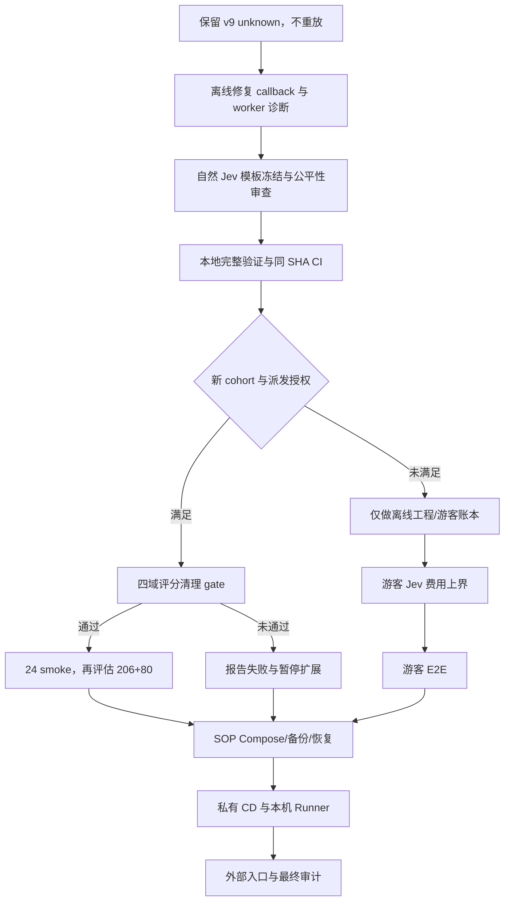

# DecAgent 后续实施计划与验收顺序

本计划依据 2026-10-22 的 OpenSpec 和实测证据更新。当前不重放旧模型请求，不开启公网，不把工程测试通过表述成 Agent 任务成功。

## 当前状态

| 工作包 | 现在完成情况 | 直接含义 |
| --- | --- | --- |
| `jev-conditional-workflows` | 72/79；剩余 9.6.D、9.6.F、9.6.G、10.3–10.6 | manifest v9 在候选 f1a4 上执行固定 4 个任务/8 条路线；4 failed、4 unknown、0 succeeded。只有两条到达官方评分，均为 0.0；整批清理 8/8。首波门槛未过，剩余 smoke/全量暂停；正式成功任务仍为 0/286。 |
| `guest-sop-local-trial` | 17/28；剩余 2.5、3.2、4.3–4.4、5.1–5.5、6.1–6.2 | workspace、会话、生命周期、预算账本、队列、匿名限流、3.5 费用说明及 4.1–4.2 已完成。4.2 增加 API 业务 readiness、Worker 健康探针和隔离 Compose 故障恢复 smoke；实际测试发现并修复 Worker 对固定 Compose MCP 地址的拒绝。最终 smoke 通过，Worker 中断可检测并恢复，0 次模型请求，临时容器、卷、网络和镜像均清理。定向确定性测试 115 项通过，PostgreSQL readiness/Worker 集成 2 项通过，Ruff 与严格 OpenSpec 通过；游客入口仍关闭，3.2 的 Jev 费用预留上界未证实。详见[业务 readiness 证据](../../evals/integration/evidence/sop-business-readiness-20261022.md)。 |
| `build-decagent-workbench` | 78/81；剩余 4.7、11.7、12.3 | 11.7 的三策略实测可复用主 change 10.3–10.6 的同一冻结 cohort 与报告，不另开重复模型批次；12.3 的 Linux 新实例验收仍需 Linux 主机；4.7 需按可信代码执行是否保留的产品范围决定完成或通过独立 OpenSpec 变更取代，不能静默勾选。 |
| 首波候选与修复验证 | 历史首波身份固定为 f1a4；离线修复 `cb050a9` 与安全诊断 `ec09ccb` 已分别通过 CI | 原候选 `f1a4a704fe2c36b22127006fe0bc9860733923d5` 的 run 39731158534 通过；空工具列表修复 `cb050a92b181cc75c7939a99d8c466a1f912c266` 的 run 39736719671 通过；安全异常链诊断 `ec09ccb1076f26854f99f12a9980c3b37e2ee248` 的同 SHA run [39741402103](https://github.com/shuaibilx/DecAgent/actions/runs/39741402103) 也全绿。上述只是工程验证，不更改或重跑历史 cohort。 |
| 公共 CI / GHCR | 当前提交 `1c74226` 的 GitHub Actions run 39749887819 已于 2026-10-22 全部 9 个 job 通过，墙钟 11:48；流水线优化任务 5.1 仍未完成 | 安全 PR #1 已合并至默认分支 SHA `0c747a3`，移除了公共 release 的 `deploy-local` job。GitHub workflow registry 仍显示旧名称 `Release and local deployment`，但默认分支 YAML 只有 reusable CI gate 和 `ubuntu-latest` GHCR publish。Runner API 为 0，本机计划任务 Disabled，无 Runner 服务/进程；私有部署仓库与 CD 演练仍未完成。详见[公共 Runner 边界证据](../../evals/integration/evidence/public-runner-boundary-20261022.md)。 |
| 开发技能 | 项目已有 25 个 skill 目录、157 个文件；17 个上游 GitHub 来源固定到 commit 并逐文件校验，另有 DecAgent 自有 OpenRouter Decisions skill | LangGraph、Jev/评测、MCP、PostgreSQL、安全、浏览器、Docker、Cloudflare、Actions 均已有项目内参考；上游 OpenRouter Decisions skill 仓库未声明许可证，因此未复制，改用只记录项目约束并链接官方文档的本地 skill。SQLite 原子预算、Python 进程树取消和 benchmark 专用适配没有合适的已核验官方 skill，按官方文档与项目故障测试执行。 |

### 当前工作区回归复验（2026-10-22）

Agent311 环境实际为 Python 3.13.13；按仓库 `requirements.txt`/`requirements.lock` 安装依赖时，系统 pip 的全局 NVIDIA 附加索引会产生 SSL EOF，因此使用 `uv pip install --python <Agent311 python> --no-config --index-url https://pypi.org/simple -r requirements.txt`，未更改系统 pip 配置。首波前完整确定性套件为 `2,024 passed, 18 skipped`（277.80 秒）；离线修复后完整 deterministic 复验 `2,025 passed, 18 skipped`（288.37 秒），Ruff 通过；严格 OpenSpec 6/6。PostgreSQL 集成此前 `318 passed/12 skipped` 与 `364 passed/15 skipped`，合并 `682 passed, 27 skipped`，该组在空工具校验器修复前执行。之后候选 `f1a4a704fe2c36b22127006fe0bc9860733923d5` 的同 SHA GitHub Actions run 39731158534 全绿，才执行固定 v9 首波；结果与失败边界见本计划新增的首波执行报告。该真实首波并非 dry-run，当前修复后工作区与历史候选 SHA 不同，不能再以当前工作区启动 live runner。
Agent311 环境实际为 Python 3.13.13；按仓库 `requirements.txt`/`requirements.lock` 安装依赖时，系统 pip 的全局 NVIDIA 附加索引会产生 SSL EOF，因此使用 `uv pip install --python <Agent311 python> --no-config --index-url https://pypi.org/simple -r requirements.txt`，未更改系统 pip 配置。首波前完整确定性套件为 `2,024 passed, 18 skipped`（277.80 秒）；空工具校验器修复后为 `2,025 passed, 18 skipped`（288.37 秒）；最新安全诊断切片 `ec09ccb` 为 `2,028 passed, 18 skipped`（286.37 秒），定向 public diagnostics/tool ledger 套件为 `67 passed`，Ruff 与严格 OpenSpec 6/6 通过。最新代码 SHA `ec09ccb1076f26854f99f12a9980c3b37e2ee248` 的 GitHub Actions run 39741402103 全绿，覆盖 Python 3.11/3.13、PostgreSQL、wheel/MCP、Compose、Docker 和 Workbench。历史 fixed v9 cohort 仍锁定其原 candidate `f1a4a704fe2c36b22127006fe0bc9860733923d5`；当前通过 CI 的工程修复不构成新 live candidate 或派发授权。

### 首波 candidate f1a4 执行结果（2026-10-22）

candidate `f1a4a704fe2c36b22127006fe0bc9860733923d5` 已通过同 SHA CI run 39731158534 后执行固定 v9 manifest。4 个任务、8 条 ReAct/Plan 路线全部终态：4 failed、4 unknown、0 success；只有 ITSM/ReAct 和 τ telecom/ReAct 获得官方分数，均为 0.0；清理 8/8 verified。Qwen 派发 15 次，已返回 usage 101,110 tokens；3 个 Plan primary request 超时且 usage unknown，保留 198,176 Token 与 ¥0.2052352 费用预留。已知 usage 的冻结费率 API 毛费用估算为 ¥0.0853511，不是账单或实付；Jev 与 judge 均为 0 请求。完整路线与限制见[首波执行报告](1426_公开评测首波执行报告_f1a4a70.md)。

首波门槛未通过。保持全部 unknown 和预留，不重放；暂停剩余 smoke、206+80 全量和任何 Jev 配对。离线复现已确认 τ retail train case 0 的用户模拟器会产生合法空工具目录；旧校验器把 `[]` 误作“无 validator”，触发 one-shot 客户端本地拒发。现在空目录由拒绝任意 tool call 的 validator 表示；定向 callback 文件 `25 passed`，完整 deterministic `2,025 passed, 18 skipped`，Ruff 与 OpenSpec strict 通过。3 个 Plan timeout 与 CSM MCP unknown 尚无可核验根因。修复提交 `cb050a9` 的同 SHA CI run 39736719671 已全部通过（约 12.1 分钟）；不重放历史路线，也不触发新模型请求。下一批仍须重新冻结 cohort 与额度。

### 首波 Qwen unknown 应如何理解

较早的 candidate 126fe5a v9 批次记录 14 次 Qwen 派发、5 次 usage unknown（35.7%）；最新 candidate f1a4 批次为 15 次派发、3 次 usage unknown，另有 2 次在本地明确拒发。两批样本都很小且不独立，不能据此估计 Qwen 总体故障概率。前一批的 τ `ValueError` 记录和两批 Plan timeout 仍是历史 unknown；f1a4 的 τ 空工具列表缺陷另经离线复现并修复，不能据此改写旧路线。所有未知用量及其预留保持原样，不能重发或释放。

账单上，usage unknown 表示实际 token 用量未核实；只有费用字段 unknown 时仍要保留已知 token。Qwen 使用代金券仍按抵扣前 API 费率计入预算，券后现金另列；v9 的冻结费率结果只是估算，不是供应商账单。最新首波中已知用量冻结费率估算为 ¥0.0853511，unknown 请求另保留 ¥0.2052352；这两项不应混成“实际花费”。已确认的千问价格表是[千问 API 定价页](https://platform.qianwenai.com/pricing/api)。汇率采用每个北京时间预算日冻结的官方中间价并留 10% 余量，现有示例 `6.7200 -> 6.04 CNY/USD` 不是供应商实际收费记录。

### 2026-10-22 模型费率来源复核

用户确认千问 API 价格目录适用于项目端点；Qwen3.8-Flash 当前目录价为 ¥0.8/M 普通输入、¥0.1/M 缓存输入、¥2.7/M 输出，与 profile v4 一致。千问平台直连 DeepSeek-V4.1-Flash 另按时段计价；项目备用模型走 OpenRouter，必须按 OpenRouter 的实际上游/响应计费，不能套用千问平台价格。`~typesafe/jev-latest` 当前解析至 Jev 1.14，精确版本费率为 $0.042/M 输入、$0/M 输出；新 Jev 对照须在新 cohort/profile 中固定实际版本并保存 generation 费用证据，v4 profile、v8/v9 manifest 和历史账本不重写。详细操作者说明与价格页面复核见[费用口径文档](0951_游客预算与模型费用口径.md)和[验收记录](../../evals/integration/evidence/guest-cost-disclosure-20261022.md)。

## 按依赖排序的工作

### 1. 公开评测：先结束离线修复，保持 live gate 关闭

1. 固定 v9 的 manifest、账本、5 个 Qwen unknown 和 1 个 MCP unknown；不重放、不清空预留、不改写旧结果。
2. 完成 9.6.D：只审核公开政策与工具契约中自然存在的语义节点；当前只审出 CSM 知识文章选择一个候选，其余没有确认的 Jev 适用节点标 `N/A`。冻结节点、问题模板、候选项及同状态输入，结构化条件继续用代码规则。
3. 继续 9.6.F 的离线子项：原四个定向套件覆盖 callback 故障分类、τ 用户模拟器 `ValueError`、工具调用/usage HTTP 回环及 `x-request-id` 记录（`128 passed`）；新切片 `ec09ccb` 又覆盖显式/隐式异常链与 `from None` 抑制（定向 `67 passed`）。全量 deterministic `2,028 passed, 18 skipped`、Ruff、OpenSpec strict 与同 SHA CI run 39741402103 全部通过。新诊断不能还原 v9 历史 `model_worker_target` ValueError 或 CSM MCP unknown，也未完成真实 callback/官方评分；因此 9.6.F 保持未完成。不得将 provider unknown 改成 not-sent。
4. 本轮离线候选 `ec09ccb1076f26854f99f12a9980c3b37e2ee248` 已通过 Ruff、全量 deterministic、PostgreSQL、浏览器核心链路、wheel/MCP、Compose 以及 Python 3.11/3.13 同 SHA CI。后续代码变更仍需复跑相关检查；影响 callback 的修复继续用 fake HTTP provider 验证接收、结算和错误边界。
5. 9.6.G 与 10.3 的真实首波、剩余 24 例 smoke、206+80 全量评测都需单独达到门槛。旧的 500 请求/500 万 Token/4 小时停止线和旧授权不自动变成新批次派发授权；正式对照需新 cohort、冻结价格/模型/profile/manifest、成本估算、停止线和明确派发授权。Jev 仍受原累计 `$1` 账本约束；unknown/费用不明时暂停新增 Jev。
6. 通过四域官方评分和清理闭环后，才做三条路线公平对照及 10.4/10.5/10.6 报告。结构化规则不拿来与 Jev 比赛；只在自然适用的同状态语义节点对比 Jev 与固定通用模型。报告精确分母、成功、unknown、工具副作用、延迟、请求、Token、抵扣前成本及配对区间；无证据则写“无优势/证据不足”。95% 自动正确率及每判断族至少 100 个自动样本的条件保持不变，不打开 holdout 补样。
7. 同一冻结 cohort 的完整三策略报告同时作为 `build-decagent-workbench` 11.7 的验收证据；仅当 10.3–10.6 与该任务各自的实验、校准及统计要求都满足时再勾选，不能因一份报告存在就默认双重通过。

### 2. 游客试用：补足 Jev 成本上界后再允许真实体验

1. 继续 task 3.2：对实际 provider、固定模型身份与版本绑定可核验费率，给完整序列化请求设最大长度/token 上界；费用预留必须覆盖该最大请求的抵扣前成本，并有超过预留时的保护测试。不能证明上界时，guest 的 Jev 请求必须在派发前拒绝，不能把 `$0.01` 常量当供应商最大账单。当前已核实 OpenRouter Decisions 专属契约没有明确保证 `provider.max_price` 是此端点的硬费用上限，因此 Jev 派发仍 fail closed。
2. 3.5 已完成：操作者[费用说明](0951_游客预算与模型费用口径.md)覆盖预算日、CFETS 快照、10% 余量、Qwen / 千问直连 DeepSeek / OpenRouter 备用 DeepSeek / Jev 1.14 的费率边界、代金券/现金证据、unknown 预留和派发拒绝，并通过工作台回归、39 项账本集成测试、严格 OpenSpec 与本地链接校验。当前资料更新未改动 profile v4、历史 manifest 或运行配置；Qwen 模板费率仍为空，模板不可直接用于游客模型派发。OpenRouter 费用上界审查见[证据](../../evals/integration/evidence/openrouter-decisions-cost-bound-20261022.md)。
3. 完成 2.5：先做不发真实 provider 请求的工作台离线 E2E；覆盖 Choice/Noul/Score、无匹配、补充、拒绝、过期选择以及“语义选择不等于写入授权”。只有 3.2 通过并另行批准真实请求后，才验证 Jev 原始建议来源。
4. 完成 6.1：两游客、员工角色、稳定记忆槽、任务审批、预算与重启恢复端到端检查。限流 3.4 已完成：5 次新 session/h、10 次任务提交/min、30 次人工回复/min，清 Cookie 不能重置 IP 摘要；浏览器已验证等待原因、额度、429/Retry-After。代码审查发现旧迁移把 HMAC key 存入数据库，现由部署环境变量提供，迁移 030 删除旧 key 表，缺 key 时游客试用 fail closed；提前换 key 会被运行时拒绝，等待旧窗口过期后才允许轮换。62 项相关 PostgreSQL 回归已复验，详见 [HMAC 密钥审查证据](../../evals/integration/evidence/guest-rate-limit-hmac-secret-20261022.md)。限流依据是防滥用信号，不等同身份认证。

### 3. 本机交付与 CI/CD：先本地可恢复，再接私有 CD，最后讨论公网

1. 4.1–4.2 已完成：SOP 专用 Compose（API、业务 Worker、业务 MCP、PostgreSQL）、loopback 暴露、API/Worker 业务 readiness、零付费隔离 smoke、Worker 故障探测与恢复已验证。继续完成 4.3–4.4 的数据库备份/恢复、兼容应用回滚及 Windows/Docker Desktop 重启演练。修复方向的旧 Compose 保持隔离，不能把旧 Runner 继续当作 SOP 部署。
2. 完成 5.1：先读取每个 CI job 的耗时、缓存命中和失败，再按独立验证层并行/缓存；保留 Python 3.11/3.13、Ruff、确定性、PostgreSQL、Workbench、wheel/MCP、Docker/Compose 检查。对比总墙钟和 runner-minutes，不为提速删必需测试。
3. 完成 5.2–5.4：私有 `DecAgent-deploy` 只接收校验过的仓库、main 祖先 SHA、成功 CI/run、GHCR digest；自托管 Runner 只注册私有仓库。部署脚本固定且串行，先备份，再升级和业务探针；schema 不兼容就停，兼容时才可回滚镜像。演练成功、健康失败、恢复失败三个结果并保存证据。
4. 完成 5.5 与 6.2：代码仓库、CI、CD、本机部署分区指南分别更新；严格核对 OpenSpec、测试、CI、恢复证据。独立 Linux 验收、真实员工研究和生产阈值研究继续标为待办。
5. 用户选择了公开注册、接受本机短时中断，目前没有域名。当前先只提供本机与受邀外部验证，不开放陌生用户公网注册。Quick Tunnel 只适合临时、随机 URL 的演示，不是稳定的公开服务地址；正式稳定外部入口要等预算与滥用防护、备份/恢复和私有 CD 通过，再确定域名和 Cloudflare Tunnel 配置。此计划不购买域名或开通 Tunnel。

### 4. Workbench 遗留任务的收束

`build-decagent-workbench` 仍有三项开放任务，不与主 change 合并或伪装成已完成：

- **4.7 可信代码执行验收：** 该项覆盖仓库执行环境的可信代码、网络和资源边界。若该能力仍作为产品范围，需补齐文档并按 Linux 与 Windows Docker Desktop/WSL2 验收；若决定从产品中退役，则通过单独 OpenSpec 变更明确取代或取消该任务，并保留历史实现与证据，不能将未执行的平台测试标记通过。
- **11.7 三策略实测：** 与主 change 10.3–10.6 共用一次冻结 cohort、角色 profile、实际调用记录和最终报告；不重复派发模型，也不把不同模型或批次拼接成同组结果。
- **12.3 跨平台新实例：** 在 SOP Compose 与备份/恢复基础完成后验证 Windows Docker Desktop/WSL2 的新实例、网络隔离、资源限制和网页闭环。Linux 主机当前不可用，因此 Linux 验收继续明确待办，不能由 Windows/Docker Desktop 结果代替。

## CI/CD 当前结论

当前 CI 和 GHCR 发布已存在。安全 PR #1 已从默认分支移除公共 `deploy-local` job；workflow 注册名称仍是历史文字，但 YAML 仅保留 GitHub-hosted CI gate 与 GHCR 发布。本机 Runner 已禁用。CI/CD **未整体完成**：CI 速度优化 5.1 未验收，CD 尚无私有部署仓库、Runner 迁移和端到端回滚证据。本机 SOP Compose 4.1–4.2 已验收；4.3–4.4 的备份、兼容恢复及重启演练仍待完成。

## tasks.md 为什么仍很长

主 change 把原计划执行、评测治理、模型接入与多轮验收放在同一个 OpenSpec change 中，共 79 个编号任务。逐次测试输出、历史候选 SHA、账单说明和阶段状态被持续追加到 tasks.md，造成任务计划、状态板和运行日志混在一起；同类证据又重复保存在报告中。这是维护流程失控，不是 OpenSpec 解析损坏。2026-10-22 已将主 tasks.md 从 45,884 字节整理为 11,382 字节，保留全部 79 个编号、72 个完成状态、7 个未完成状态及简明验收摘要；逐字历史在[整理前快照](任务整理/1202_jev任务完整快照_整理前.md)，清单规则和未完成项见[整理说明](任务整理/1202_jev任务整理说明.md)。游客 change 单独维护 28 项任务；本轮完成 4.2 后，其状态从 16/28 更新为 17/28，并把 smoke 诊断细节放入独立 evidence，而非堆入 tasks.md。后续只在 tasks.md 保存范围、状态、短验收摘要与证据链接；精确命令、SHA、用时、分母、失败和 skip 放进独立 evidence/report 文件。若新增功能独立于现有 change，应新建 change，而不是继续扩张同一清单。

## 项目级技能

无需再安装重复的通用技能。当前项目索引在[`.agents/skills/README.md`](../../.agents/skills/README.md)，上游来源、固定提交、许可证和逐文件 SHA-256 在[`.agents/skill-sources.json`](../../.agents/skill-sources.json)，任务映射在[官方技能与任务对照](../261021/开发技能/1502_官方技能与任务对照.md)。官方源包括 OpenAI、Anthropic、LangChain、Docker、Supabase 与 Cloudflare；GitHub Awesome Copilot 的 Actions 两项明确标为社区实践，不冒充 GitHub 官方标准。OpenRouter Decisions 的上游 skill 仓库未声明许可证，故没有 vendoring；新增的项目自有 skill 通过格式校验。SQLite 预算并发、Python 进程树取消、EnterpriseOps/τ 原生适配没有合适的已核验官方 skill，继续依据官方文档、上游代码与隔离故障测试。安装 skill 不等于完成安全审计、评测或部署。

## 下一次执行的具体起点

下一步继续 `jev-conditional-workflows` 的 9.6.D 自然语义节点审查及 9.6.F 真实 callback/评分闭环前仍可做的离线工作；旧首波 Qwen/MCP unknown 不重放，新模型批次须重新冻结 cohort、额度并取得单独派发授权。游客侧继续推进 3.2 的 Jev 单请求费用上界与计量模型审查，并做 2.5 的离线工作台 E2E；3.5 已有交付。SOP Compose 和私有 CD 排在游客闭环之后，陌生用户公网注册暂不开放。所有阶段完成后更新此计划索引与各自 OpenSpec tasks，不以一个工作包的通过代替另一个工作包。
