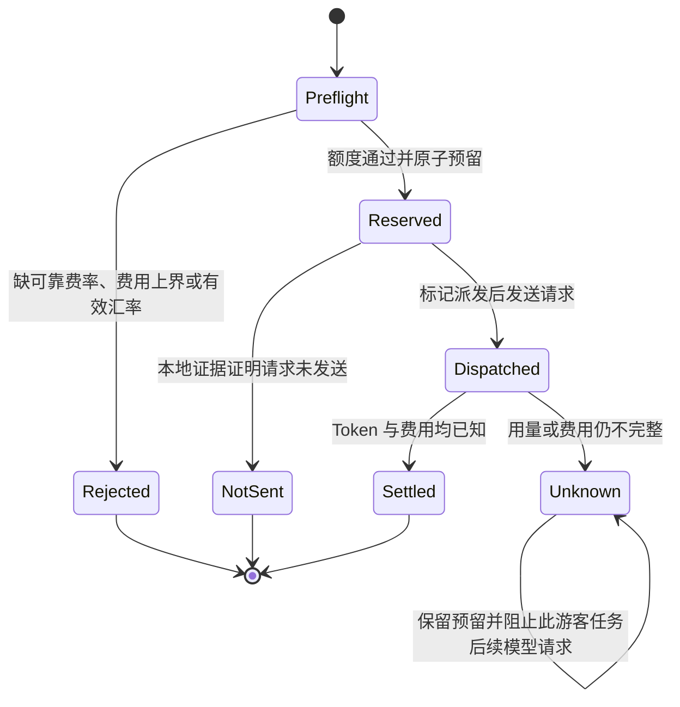

# 游客预算与模型费用口径

## 预算看的是 API 资源消耗

游客的额度卡用于控制 DecAgent 的每日模型资源，不等同于千问或 OpenRouter 的账单。预算按 API 抵扣前费用计入；代金券只改变最后的付款方式，不减少系统记录的 API 费用。只有供应商响应或账单能证明券额、现金支出时，系统才分别记录这两项。

游客预算按北京时间自然日计算：全站最多占用 **5 美元等值 API 费用**和 **500 万个 Qwen Token**；每个游客空间最多创建 **30 个任务**，最多占用 **50 万个 Qwen Token**。Token 和费用是两种独立限制，免费额度或代金券都不会取消 Token 限制。

## Qwen、DeepSeek 与 Jev 的计价

你确认[千问 API 定价页](https://platform.qianwenai.com/pricing/api)适用于项目使用的兼容 API。该总价页从模型目录动态加载明细；对应的[Qwen3.8-Flash 模型页](https://www.qianwenai.com/models/qwen3.8-flash)列出本说明所需的具体费率。以下标准实时文本 Token 单价为人民币元/百万 Token，核验日期为 2026-10-22：

| Qwen3.8-Flash 计费项 | 目录价 | DecAgent 当前使用范围 |
| --- | ---: | --- |
| 普通输入 | ¥0.8 | 用于实时输入 Token |
| 缓存命中输入 | ¥0.1 | 仅当返回缓存用量可核验时使用 |
| 输出 | ¥2.7 | 用于输出 Token |
| Batch File 输入 / 输出 | ¥0.4 / ¥1.35 | 当前实时 Chat Completions 不使用 |
| 显式缓存创建 / 命中 | ¥1.25 / ¥0.1 | 当前没有启用该计费模式 |
| Batch Chat 输入 / 输出 | 页面标注限时五折 | 不用于当前实时请求或 profile |

公开评测 profile v4 已将 `qwen3.8-flash` 的 primary、user simulator、judge 费率冻结为 CNY ¥0.8/M 普通输入、¥0.1/M 缓存输入、¥2.7/M 输出；来源、币种和版本进入 profile 指纹。这是基于用户指定目录价计算的抵扣前 API 成本估算，不是逐请求发票。费率配置没有覆盖的计费模式不得启用；缓存明细缺失时使用普通输入费率，不猜测缓存折扣。供应商账单上的券额与现金实付只在有逐请求证据时拆分。

### DeepSeek 两条独立线路

千问平台也提供同端点调用的 `deepseek-v4.1-flash`，目录价以人民币计：忙时（页面标为东八区 08:00–22:00）普通输入 ¥2/M、输出 ¥8/M、缓存输入 ¥0.2/M；错峰时段（22:00–次日 08:00）普通输入 ¥1/M、输出 ¥4/M、缓存输入 ¥0.1/M。见[千问平台 DeepSeek 模型页](https://www.qianwenai.com/models/deepseek-v4.1-flash)。这些费率只适用于千问平台线路。

项目配置的备用模型则走 OpenRouter，模型为 `deepseek/deepseek-v4.1-flash`。OpenRouter 当前模型页显示目录基准价为 **$0.07/M 输入、$0.50/M 输出、$0.008/M 缓存读取**，但页面同时列出多家上游提供方，各上游费率并不相同，实际路由可能变化。费用核算应优先记录 OpenRouter 对该次 generation 返回的费用和实际上游信息；不能把千问平台的人民币费率套到 OpenRouter，也不能仅凭 OpenRouter 通用目录价声称游客单次费用存在硬上界。正式对照关闭跨模型降级。若要在预算限制下启用备用路由，须限制可用上游、冻结费率版本并设置输入/输出上限，确保最大请求费用不超过预留；否则派发前拒绝。

### Jev 版本与计费

Jev 通过 OpenRouter Decisions API 调用。当前 `~typesafe/jev-latest` 解析到 Jev 1.14；[精确版本模型页](https://openrouter.ai/typesafe/jev-1.14)列出 **$0.042/M 输入、$0/M 输出**。历史账单中该费率曾由你提供的 generation 记录核验；当前页面再次确认同价。`jev-latest` 仍是浮动别名：可复现实验要记录实际返回的模型 ID 和 generation ID，并在 cohort 内冻结实际版本；版本变化时另开 profile/cohort，不与旧结果拼接。员工 Jev 路径优先保存 OpenRouter 响应的 `usage.cost`、Token 与 generation ID，固定费率用于预算核对，不能覆盖服务商响应费用。费用或用量不完整时保留 `unknown`，不记零。

**游客 Jev 当前在派发前拒绝**：即使 Jev 1.14 有公开单价，固定 `$0.01` 预留仍不是经强制 Token 上限和路由费率上限证明的单请求费用上界。OpenRouter 通用 Provider Routing 文档提到的 `provider.max_price` 尚未被 Decisions API 专属契约明确保证为此端点的硬上限，因此不能据此开放游客 Jev。具体核对见[接口审查记录](../../evals/integration/evidence/openrouter-decisions-cost-bound-20261022.md)。

## 人民币如何换成每日美元额度

账本以美元等值比较全站的 `$5` 上限。配置使用 CFETS 官方 USD/CNY 中间价快照：每个北京时间预算日第一次建立额度桶时保存报价来源日期、基础汇率、来源 URL、安全余量和有效汇率；当日不随配置变化。报价需要来自该日开始前最近的已公布工作日报价，并且不得早于预算日七天以上。运行时不会抓取网页；操作者要从可信官方来源更新配置。代码会校验来源域、日期和七天有效期，但不会自动验证报价是不是最新发布的一期。

首版在基础汇率上留 **10% 安全余量**，并把有效汇率向下截断到每美元 0.01 元。记录中的示例采用 2026-10-20 官方中间价 **6.7200 CNY/USD**：

```text
floor(6.7200 × 0.90, 2) = 6.04 CNY/USD
¥2 ÷ 6.04 = $0.331125827… → 预留/记账向上取整为 $0.331126
$5 × 6.04 = ¥30.20
```

这里的 `$0.331126` 是保守折算后的美元等值，不是额外收取的美元，也不表示券后现金支出。示例汇率见[中国外汇交易中心的 2026-10-20 中间价公告](https://www.chinamoney.org.cn/chinese/ccprnoticecontent/index.html?searchDate=2026-10-20)。

## 一次模型请求如何占用和释放额度

每个模型尝试先在同一个数据库事务内预留任务账本和游客日账本额度，再标记为已派发，随后才访问供应商。拿到完整 Token 和费用后，系统用实际值结算，并调整预留差额。结算同时保存供应商原币费用、费用依据、模型/费率标识、请求 ID、券额与现金额（后两项只有存在凭证才记录）。



超时或连接中断不能证明供应商没有处理请求。遇到这种 unknown，原预留继续占用额度，且同一游客任务不能自动重试或切换模型。只有可信的本地发送前检查证明请求没有离开 DecAgent，才可把它标记为 `not_sent` 并释放预留。

## 工作台显示什么

额度卡展示全站美元等值费用占用和 Qwen Token 占用；它不是供应商账单。任务用量区域把“已知 API 费用”和未解决的 unknown 分开显示：有已知金额但仍存在未知请求时，会明确标出“仍有未知项”；已确认零费用且没有未知项时才显示零。供应商价格或汇率无法满足策略时，说明请求在派发前被拒绝，不产生模型请求费用。

| 状态 | 预算与工作台含义 |
| --- | --- |
| 已知正费用 | 按 API 抵扣前费用计入；另显示有证据的券额和现金支出。 |
| 已知零费用 | 供应商用量与费用均已确认，金额为零；仍会计入 Token 和任务限制。 |
| `unknown` | 费用或 Token 尚未确认；原额度预留保留，不能当作零。 |
| 派发前拒绝 | 缺少预算所需的费率、上界或汇率；没有调用模型。 |
| `not_sent` | 有本地证据表明请求未发送；预留释放。 |

目前游客入口默认关闭。3.2 的实际模型预留/结算只部分完成，游客 Jev 费用上界没有通过验证；此说明和工作台文案不代表游客 Jev 已开放、公开部署已完成或供应商账单已对账。

## 相关实现

- `decagent/business/trial_budget.py`：每日额度、FX 快照、预留、unknown 与结算。
- `decagent/runtime/model_calls.py`：输入/输出费率计算与 Jev 供应商 usage 记录。
- `decagent/storage/usage.py`：与任务用量账本原子关联及游客 Jev 拒发。
- `decagent/gateway/static/business.html`、`business.js`：游客额度与未知费用说明。
- `evals/deterministic/guest_workbench.cjs`：零费用、unknown、预算披露的工作台回归。
