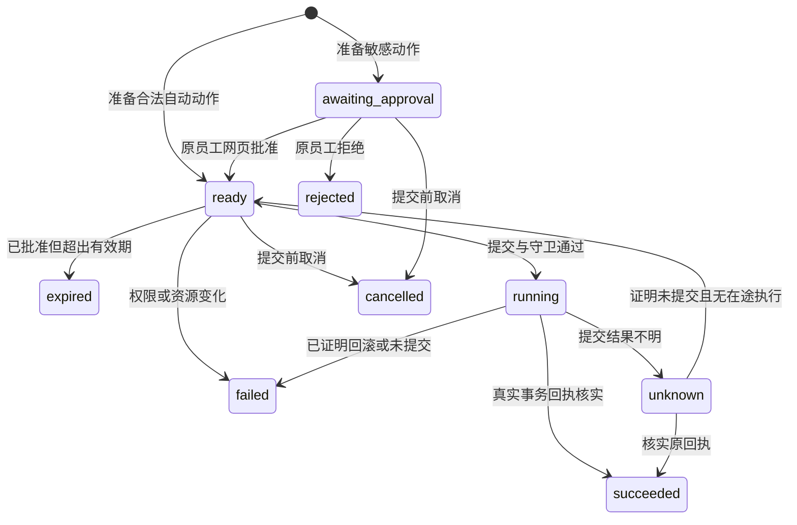
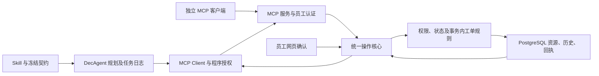
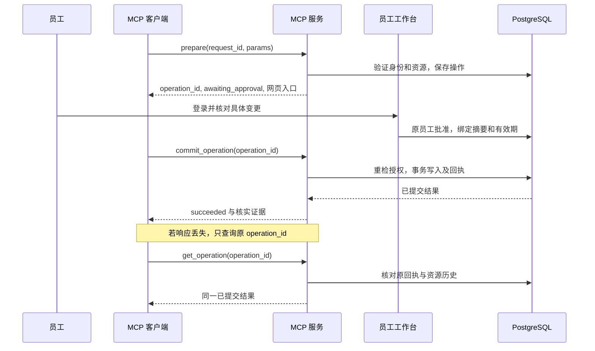

# Design

## Context

动机见 [proposal.md](proposal.md)。本文件同时保存 openspec-explore 的需求分析和可交给 apply 阶段的技术决定；所有“新增”均是待实施能力。

规划根和实现根均为 DecAgent 项目根目录；源码路径以下均相对该根目录；不在 waku 中另建重复 Agent。

### 探索证据

| 当前可核实事实 | 对本 change 的影响 |
| --- | --- |
| `business/contracts.py:406,420` 要求 module/argv entrypoint；`business/execution.py:35` 默认构造 CliRunner | 接口及注册契约须迁移，不能只把配置 URL 填入旧入口 |
| `gateway/business.py:44` 的读取和批准前重评直接调用 CliRunner | Worker、工作台和评测必须一起切换 |
| `business/planner.py:48,90` 已从契约生成模型函数并读取安装包 Skill | 复用结构化规划，CLI 不等于没有 Schema |
| `business/tickets/store.py:41,53` 真实访问 PostgreSQL，写入、历史和回执同事务 | 复用业务规则和持久化，MCP 不套壳启动 CLI |
| `storage/006_service_tickets.sql` 只有目录、工单、历史、回执，没有业务账号；`gateway/auth.py:73` 是单 owner | 员工登录、角色、资源权限与操作者审计是新增能力 |
| `business/worker.py:103` 逐任务构造服务，图同步 invoke | 连接管理器必须独立于逐任务服务生命周期 |
| `evaluation/business/harness.py` 直接构造 CliRunner | 旧 CLI 成功数不能作为 MCP 网络链路验收 |
| 本机 mcp-cli 0.3.0 使用 TS SDK 1.32.1；默认工具重试三次 | 验收旧协议、关闭重试与 daemon，独立核实结构化结果 |

已完整读取旧 `business-workflow-agent` 的七份规格。主 `openspec/specs/` 当前为空，旧 change 完成但未归档；本 change 使用六个新能力名，不对不存在的主规格写 MODIFIED。旧 CLI 必需入口和 owner 业务权限在 MCP v2 业务中被替代，目标完成、事务回执、模型用量和决策约束继续保留。旧 change 本轮不改写或归档，后续归档若建立旧主规格，须将 CLI 要求限制到历史 v1，不能把它重新施加给 MCP v2。

用户给出的 `../../../generated/261012/2036_CLI与MCP路线对比.md` 是参考。其通用 shell CLI 示例不等于当前结构化 CLI；“MCP 工具永远静态”“必然亚毫秒”“CLI 不能有硬 Schema”不作为需求或验收依据。

### 已确认的产品决定

自研 DecAgent 优先；MCP 为业务主入口；保留管理 CLI；沿用工单并补员工权限；Streamable HTTP 本机服务；外部客户端也可发起写操作并共用网页确认；预置员工账号；员工与处理人按本人/指派范围访问，主管管理全局。主协议使用最新 `2026-07-28`，旧协议仅作兼容。

## Goals / Non-Goals

**Goals：** 单个合成公司的可持续业务闭环；同一契约与身份规则服务 DecAgent 和独立 MCP 客户端；可信人工确认；可重启的两阶段写入与可核实结果；图文指南与本机实测证据。

**Non-Goals：** 不启动御龙后端，不调用公司真实 API；不做企业 SSO、多租户、stdio 双主路线或万能 call_api；不改变 Jev 判断问题、候选、尺度和校准；不重写 LangGraph 或历史仓库修复执行器；不将本机容器通过算作独立 Linux 部署通过。

## Decisions

### 1. 直接 Python MCP 服务及明确版本

采用 `mcp==2.3.0`，客户端使用官方 Client；服务端使用官方 Server 的工具注册与协议处理，从既有契约导出 Schema。SDK 序列化承担协议差异，不手写两套 JSON-RPC。沿用 Python 是为了直接复用当前业务和存储；不新增 TypeScript 业务实现，也不采用 MCP 调 CLI 的薄包装。

MCP 服务独立运行于 `http://127.0.0.1:8001/mcp`，工作台保留默认 8000。新增管理命令 `decagent business-server`；本机启动脚本将业务服务、API 与 Worker 纳入明确启动及停止顺序，复用已有可用 PostgreSQL。服务停机时暂停业务调用，不回退 CLI。

DecAgent 要求实际协议为 `2026-07-28`，连接元数据不满足即拒绝。服务同时提供 SDK 的 `2025-11-25` 兼容能力，用于本机 mcp-cli；相同操作核心不因协议版本改变权限。新协议不要求旧 initialize/session；客户端生命周期是本地 SDK/HTTP 资源管理，不等于协议会话。

服务使用独立 Bearer 认证；Origin 若存在必须匹配配置的本机来源，headless 请求仍须认证。只监听 loopback。现有 owner middleware 仅保护 `/api/v1`，不能自动保护独立 `/mcp`。本版是本机模拟认证，不宣称完成标准企业 OAuth。

### 2. 单一契约与可检查 Skill

内建插件升级到 `service-tickets 2.0.0`，业务 workflow 的问题和尺度保持原版本含义。连接描述包含固定 service ID、transport、主协议和配置中的 endpoint 引用，模型不能提供 URL。

契约保留业务命令 input/result Schema、effect、confirmation、workflow、Skill 引用，并生成两类定义：模型业务参数定义，以及含机器请求键的 MCP wire Schema。两者从相同业务 Schema 片段派生，不复制两份手写字段。

MCP 公共工具固定为：

| 工具 | 输入与行为 |
| --- | --- |
| `tickets_directory`、`tickets_get`、`tickets_list`、`tickets_receipt` | 现有业务读取参数；返回权限过滤、Schema 合法的结构化结果 |
| `tickets_prepare_create`、`tickets_prepare_assign`、`tickets_prepare_start`、`tickets_prepare_close`、`tickets_prepare_reopen`、`tickets_prepare_comment`、`tickets_prepare_resolve`、`tickets_prepare_set_priority` | `request_id` 与 `params`；params 使用对应业务 Schema，准备而不提交资源 |
| `business_commit_operation` | 仅 `operation_id`；执行服务端保存的确切操作，Agent 提交额外携带程序执行授权元数据 |
| `business_get_operation` | `operation_id`；返回状态、安全摘要、确认入口和已核实结果 |

共十四项工具，目录可按当前身份过滤。确认策略和读写影响取自可信本地契约，不信任远端 annotations。客户端检查该身份授权子集的 Schema 与契约摘要；正常权限过滤不是漂移，意外变化则停止派发。

MCP 返回 `structuredContent`，并兼容提供相同 JSON 的 text 内容。结果分为业务读取数据、操作视图、已核实提交结果；严格校验重复键、未知字段、输入 64 KiB、输出 256 KiB，默认请求时限 15 秒。超时后的写入依据操作状态核实，不能从格式错误推出未提交。

Skill 仍是安装包中的业务指导：目录 ID、同名澄清、状态顺序、字段来源、准备/提交区分和故障恢复。它不授权。当前十二项能力不需要通用网关或额外子 Agent。外部客户端按相同 Skill 参考使用准备、网页确认、提交、查询流程。

### 3. 独立员工身份和具体角色

新增业务身份存储，员工绑定现有目录人员 ID，角色为 `employee`、`handler`、`supervisor`。保留六个人员及同名数据，预置映射如下：

| 登录名 | 目录人员 | 角色 |
| --- | --- | --- |
| employee-it | 张伟 / IT Support | employee |
| employee-facilities | 张伟 / Facilities | employee |
| handler-it | Zhang Wei / IT Support | handler |
| handler-facilities | Zhang Wei / Facilities | handler |
| handler-access | 王芳 / Access Management | handler |
| supervisor | Chen Li / Network | supervisor |

账号通过明确 `decagent business accounts seed` 管理操作设置，初始密码随机生成，仅保存到受保护的 `.decagent/demo-auth/`；重复 seed 不重置凭据。密码使用带独立盐的标准密码哈希，不存明文数据库密码。管理 seed、账号设置和凭据发行不作为 MCP 模型工具。

新增 `/api/v2/business` 员工业务 API，默认业务页面使用员工会话；旧 owner 入口保留运维、历史查看与仓库修复。v2 middleware 实施独立认证、Origin/CSRF 和角色检查；旧 owner 业务创建及确认接口不再可发起新 v2 写入。

浏览器业务会话默认 12 小时；员工通过登录后的管理界面申请独立 MCP 访问凭据，默认 1 小时有效，持久化只保存 token 哈希、员工、用途、有效期、撤销状态。MCP token 不可代替网页登录确认。凭据引用而非 token 进入任务快照，可信 broker 从本机受保护存储解析。令牌过期时要求原员工重新认证，不能换员工续跑。模拟身份与真实公司登录明确区分。

资源与动作矩阵按 `authenticated-service-tickets` 规格实施：所有角色创建仅限本人；处理人开始/解决限被指派资源；主管控制分配与已有优先级；关闭/重开允许本人请求者及主管。可分配目标仅有效 handler 或 supervisor。目录提供最小 ID/name/team；get、list、history 按范围过滤，不能用 person_id 筛选绕过权限。对无权资源的读取统一给不可访问结果，不泄露其内容。

创建的 requester_id 由当前员工确定，从模型可填写参数中移除。操作回执查询允许原操作员工及主管审计；主管查询权不授予代签或提交其他员工操作的权力。角色与 active 状态在每次访问和提交时重新查验，不把权限快照当永久授权。

### 4. 服务端统一操作与批准

增加 `business.operations`、`business.operation_approvals`，操作保存员工、请求键、业务命令、输入摘要、参数、契约、expected_revision、来源、可选 Agent 关联及状态。唯一请求键作用域为员工；相同键同内容返回原操作，异内容冲突。输入摘要包含员工、命令、规范化有效参数和契约摘要。

prepare 先验证身份、Schema、权限和当前业务规则，再保存不可变操作。无确认要求进入 ready，敏感动作进入 awaiting_approval。工具调用成功只代表准备成功，不写工单。Agent 的 request_id 由任务/动作/摘要稳定生成并注入；外部客户端使用并保留自己的请求键。

确认仅由绑定原员工的 v2 浏览器会话发起。展示参数、目标资源、旧状态/新状态、revision 和有效期。批准后 15 分钟内有效；重复确认返回原结果。编辑创建新 request_id 与新操作，旧操作 rejected/失效并保留关联；不能修改原操作后沿用原批准。网页确认修改批准元数据，实际业务写入仍通过 MCP commit。

DecAgent 的 app.actions 继续保存任务动作和费用/租约审计，并关联 server_operation_id；业务批准与提交以 business.operations 为事实源，旧 app.approvals 对 business v2 只记录中断关联，不独立授予业务写权限。历史修复批准不迁移到此核心。

公共操作状态固定为 ready、awaiting_approval、running、unknown、succeeded、failed、rejected、expired、cancelled。准备、批准和提交事件可检查；配置/资源变更导致旧操作 failed 并给出明确的新准备原因。外部操作不启动 LLM、不伪装 Agent 任务；原客户端批准后按同一操作 ID 提交。

### 5. 提交边界、事务与恢复

commit 接受 operation_id，不接收新的业务参数。服务验证原员工、当前权限、契约、状态、资源版本和适用批准，再在数据库锁下执行精确保存内容。批准消费、业务写入、历史、回执和成功状态在同一 PostgreSQL 提交事务保持一致；running 的派发准备可单独持久化，以便进程退出后核实。

Agent 关联操作必须在 prepare 时由有效程序授权元数据建立关联。可信控制层发行不可猜测的执行 grant，绑定员工、任务、动作、请求键、摘要、租约代次和期限，通过 SDK 请求元数据注入，不进入模型函数参数或公开操作视图。服务在 commit 时验证 grant 并锁定关联任务，重新核对 generation、取消、预算和插件状态。仅有员工 Bearer 或自报 task_id 不能接管 Agent 操作；外部客户端只能提交自己准备且无 Agent 关联的操作。

将 TicketStore 的事务内业务执行拆成可在同一连接调用的内部领域方法，避免嵌套独立事务。业务身份、操作、批准和资源授权在真正写入层检查，RPC 处理函数不能直接跳到旧 `execute(command, params, operation_id)` 绕过检查。旧 runner 中的 strict_json/error 移到公共 codec，再移除业务 CLI。

回执加入真实员工和新输入摘要，保留旧回执原结构及版本范围。按原 operation_id 串行化提交；成功回放只返回已核实证据，不重复执行。get_operation 对 running/unknown 先在同一操作锁下查业务回执及资源历史；暂时无回执不是失败。只有排除在途事务并证明未提交、原操作与授权仍有效，才允许原 ID 再提交，否则保留 unknown 与人工核实入口。

任务目标规则保留非空 W 子集 C 子集 O：完成声明来自本任务已核实动作，必须包括全部写入，允许略去辅助读取；完整历史和最终目标核实仍保存。创建并分配不要求关闭。准备句柄不是 O 中的已完成业务动作。现有 primary 用量结算、拒绝结果和费用未知边界不改变。

### 6. 客户端、Graph 与网页边界

增加进程级 MCP 连接管理器及同步适配接口，行为包含 read、prepare、commit、query_operation 和 close。Worker 生命周期内持有一个受控异步运行器；每任务 BusinessServices 借用资源，任务结束不关闭共享运行器。ASGI lifespan 管理其自己的异步客户端。连接按 service、employee_id、credential_revision 隔离，凭据撤销或服务漂移时关闭失效连接。禁止逐调用 asyncio.run。

BusinessExecutor 在现有任务动作验证之后准备服务端操作，保存 operation_id，必要时触发 durable interrupt；员工批准后恢复同一任务并调用 commit，随后核实结果。BusinessControl 查询、网页详情和批准前资源重评使用相同 MCP 管理器，不能直接读取 TicketStore。网页批准元数据由统一操作核心处理，没有第二套业务许可。

业务页展示当前员工、可用操作、Agent 任务、外部 MCP 操作、真实工单及状态；事件订阅按员工授权过滤，切换身份清空旧视图。主管可查询全局，但不能以普通查询权限恢复别人任务或代签。解决记录必须来自员工明确提供并确认的文本，不展示为实际维修能力。

### 7. 验收、文档和引用

先做确定性权限/操作核心，再进行真实 loopback HTTP + PostgreSQL 集成验收。模型可采用已有可复现脚本替身，标签明确；不产生 Jev 调用，不重跑或修改旧 720 次模型报告来证明协议优势。新增固定业务集覆盖完整多角色路径、读与写、消歧、拒绝、失效、并发和恢复。

mcp-cli 按已安装 v0.3.0 验收，配置别名 decagent-tickets，url 指向本机端点，headers.Authorization 使用 `Bearer ${DECAGENT_EMPLOYEE_MCP_TOKEN}` 引用。使用专用 `-c` 配置、`MCP_NO_DAEMON=1`、`MCP_MAX_RETRIES=0`；先 info 工具与参数，再 call。其文本输出不能独自证明 outputSchema 或成功，完整结构化结果由 Python 客户端核实，业务回执另查数据库/服务。

以现代与兼容协议分别记录实测元数据、机器耗时 p50/p95、禁止副作用、故障恢复和失败分母。程序级签发 grant、员工凭据、原始密码和模型密钥不进入报告。旧性能证据保留版本，不推导 MCP 提速倍数。

更新 README、安装依赖、使用指南、模拟账号权限说明、MCP 调用及恢复指南、源码结构说明和图册。生成文件按实际北京时间放入 DecAgent 的 generated/YYMMDD/HHmm_主题；标准 OpenSpec 名称保留。本设计的三张图供规划审查，实施交付另补泳道图并渲染核实。安装包在 checkout 外启动验证 Skill、契约和服务入口。

主要资料： [MCP 2026-07-28](https://modelcontextprotocol.io/specification/2026-07-28)、[Streamable HTTP](https://modelcontextprotocol.io/specification/2026-07-28/basic/transports/streamable-http)、[SDK v2](https://py.sdk.modelcontextprotocol.io/whats-new/)、[SDK 2.3.0](https://pypi.org/project/mcp/)。服务设计参考本机 mcp-builder；调用顺序参考 mcp-cli，版本用法以官方及已安装源码为准。

## Risks / Trade-offs

- 跨客户端绕过原审批 → 服务端唯一批准与提交事实源，MCP 不暴露 approve，最底层写入再次授权。
- 同一进程混用员工连接 → 凭据维度隔离客户端，逐请求核实身份和账号状态。
- 协议兼容被当作降级 → DecAgent 主连接显式检查 2026-07-28，旧客户端单独验收且权限语义一致。
- 租约失效后远端继续写 → 程序 grant 与共享 PostgreSQL 任务守卫在提交事务中再次检查；取消后已提交仍按回执报告。
- 异步桥接阻塞及连接泄漏 → 生命周期所有者明确，限时请求、关闭及中断测试，网关不在事件循环中运行阻塞桥接。
- 同路径 Skill 或制品漂移 → 注册冻结 Skill 和能力内容摘要；实施版本变更显式更新安装制品，不仅比较远端服务名称。
- 新角色使旧案例失效 → 为案例声明真实发起角色，越权属于正确拒绝，不用万能主管制造全部成功。
- 自建认证与真实企业认证差异 → 明确本机合成账号范围，不声称企业 SSO 或真实 API 接入。
- 版本解析不等于运行通过 → 前轮 pip dry-run 仅证明依赖可解析；实际安装、HTTP 和双协议兼容均是待实施验收。

## Migration Plan

1. 保留现有数据备份与 CLI 历史报告；确认正在运行的 API/Worker，停止新业务派发后实施迁移。
2. 新增员工账号/会话/访问凭据、操作/批准及 Agent grant 存储；历史主体字段允许为空，禁止自动回填虚假身份。
3. 明确 seed 合成账号并安装 SDK，启动业务服务，登记 service-tickets 2.0.0 和冻结契约。
4. 接入客户端、Worker 和 v2 业务页面，原 v1 owner 业务创建/批准停止发起新写入；所有新操作使用服务端核心。
5. 未结束的旧 CLI 任务进入显式版本不兼容暂停；原批准不迁移，不自动重放。旧匿名或 requester 缺失资源只读历史查看，v2 不可变更；新员工重新提交新任务。
6. 真实协议、角色、恢复、安装与浏览器验收通过后移除业务 CLI 入口、runner 专用测试，保留公共 codec、管理 CLI 与历史修复行为。
7. 失败时停止新服务写入并保留数据及操作核实能力；不自动启动旧 CLI 写入。需要恢复旧版本只能由运维基于备份执行明确回滚，并保留事故期间已有提交证据。

没有需要用户补答才能确定方案的开放问题。公司真实认证、API 与独立 Linux 主机均不在本 change 的实现门槛中。
